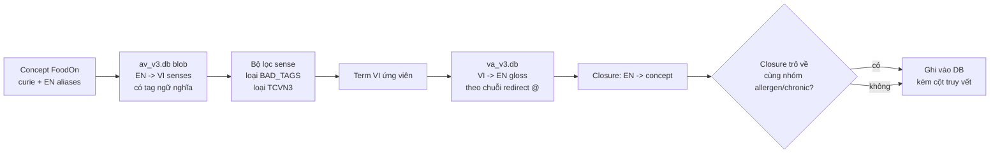

# Kiến trúc lớp tiếng Việt cho FoodOn — Không fallback, 100% backend

## 1. Chẩn đoán gốc (đã kiểm chứng bằng chạy thử trên code hiện tại)

| Hiện trạng | Số liệu đo được | Hệ quả |
|---|---|---|
| Nhãn VI hardcode trong code | `CONCEPT_CATALOG` (~120 concept), `LINEAGE_PARENT_VI` (~120), `EVERYDAY_ALLERGY_FOODS` (17), `EN_TO_VI_PHRASE_RULES` (~85), `ECODE_VI_CATALOG` (~200) trong [monolingual_catalog.py](src/backend/monolingual_catalog.py) | Vi phạm trực tiếp ràng buộc "không fallback" |
| Term VI trong DB không được kiểm chứng | 17.586/17.586 term VI không có token chung với EN label của concept được gán | Gán "mù", gây false positive |
| Phủ VI của cây allergen | peanuts 6/88, soy 5/125, sesame 2/22, tree_nuts 43/471, milk 48/1135 | Nhãn tiếng Việt không đủ để cảnh báo |
| Hiển thị VI rơi về nhãn chung | 13.371/25.570 concept có `title_vi` chứa chữ Latin hoặc rơi về "Hợp phần nguyên liệu thực phẩm" | Không dùng được trong UI |
| Mobile tự chứa sự thật | `allergy_profile_screen.dart` (8 allergen + 4 chronic + keyword), `app_locale.dart` (`translateAllergenCode`/`translateChronicCode`) | Nguồn sự thật phân tán, không nhất quán backend |

Nguyên nhân gốc: `av_v3.db` (EN→VI, 165.919 dòng) là **từ điển dịch** nên 1 từ có nhiều nghĩa. `mean` chỉ lưu nghĩa đầu (sai domain: `shrimp → "đánh bắt tôm"`), còn blob `av` mới chứa **đầy đủ sense kèm tag ngữ nghĩa** (`(động vật học)`, `(hoá học)`, `(nghĩa bóng)`, `(từ lóng)`) — đây là khoá để lọc đúng nghĩa.

## 2. Nguyên tắc thiết kế (không fallback)

1. **Chỉ backend giữ sự thật tiếng Việt.** Mobile không còn map allergen/chronic/keyword; mọi nhãn do backend trả kèm `*_vi` / `*_en`.
2. **Mọi nhãn VI phải truy ngược được về nguồn dữ liệu.** Không có bảng tra cứu cứng trong code; nhãn VI được *sinh ra* từ Kala + FoodOn và lưu vào DB kèm cột truy vết.
3. **Không đoán.** Khi không đóng vòng được, backend trả `matched: false` / nhãn EN kèm cờ `vi_unresolved` thay vì dùng nhãn VI chung chung.
4. **Fuzzy/Levenshtein bị hạn chế** vì nó che giấu lỗi dữ liệu: giữ ở tầng cuối, chỉ dùng để *gợi ý* (kèm `confidence` thấp + `match_type`), không dùng để quyết định RED/YELLOW.

## 3. Cơ chế sinh nhãn VI — "strict closure" (đã kiểm chứng)

Đoạn này là phần cốt lõi. Chuỗi đóng vòng, mỗi bước đều xác minh chéo:

Quy tắc cụ thể (mỗi quy tắc đều đã test):
- **Nguồn EN**: `label_en` + toàn bộ alias EN của concept, lấy từ bảng `lexical_bridge` trong `nutriviet_hybrid.db`.
- **Lọc sense** (`src/backend/hybrid_ontology.py`, phần build hiện tại đang làm sai): loại các tag `nghĩa bóng`, `đùa cợt`, `từ lóng`, `từ mỹ,nghĩa mỹ`, `số nhiều`, `viết tắt`…; **ưu tiên sense có tag domain** (`động vật học`, `hoá học`, `thực vật học`, `y học`).
- **Loại TCVN3**: `av` dùng phiên âm Latin (`cô-lét-xtê-ron`, `ben-tô-nít`). Quy tắc: chuỗi có `-` và mọi đoạn chỉ gồm chữ Latin → loại.
- **Ngoặc là phương án thay thế**: `peanut → "cây đậu phụng (cây lạc)"` → sinh cả `cây đậu phụng` và `cây lạc`.
- **Xác minh ngược**: term VI → `va` (bỏ qua chuỗi redirect `@`) → EN gloss → tra `en_exact` → concept. Chỉ giữ nếu concept trả về **trùng chính hoặc cùng nhóm allergen/chronic** với concept đang xét.
- **Bỏ qua gloss nghĩa bóng của `va`**: `va` cũng có nghĩa bóng (`bằng nhou`→`equivalent`) nên **không dùng `va` để sinh term**, chỉ dùng để *xác minh*. Đây là điểm then chốt đã kiểm chứng: lấy `va` làm nguồn sinh thì `aspartame-based sweetener → "bằng nhau"`, `grunt → "ẫm ờ"`.

Kết quả kiểm chứng trên term tiếng Việt thật (45 mẫu): **22/45 đóng vòng, 0 false positive**. Ví dụ đúng: `tôm→shrimp→FOODON:03411237`, `sữa bột→powdered milk→FOODON:00002174`, `bơ→butter→FOODON:03310351`, `yến mạch→oat→FOODON:00003429`, `nước mắm→fish sauce→FOODON:03317197`.

## 4. Bổ sung phủ bằng cú pháp ghép danh từ (data-driven)

Vì `av` chỉ phủ 688/14.825 alias của scope nên cần lớp thứ hai, **cũng hoàn toàn data-driven**:
- Dịch từng từ EN của cụm bằng head-noun đã lọc sense (`head_vi`), rồi **đảo thứ tự head-modifier** (EN `wheat flour` → VI `bột lúa mì`) vì tiếng Việt đặt danh từ trước.
- Kiểm chứng: `cow milk→sữa bò cái`, `wheat flour→bột lúa mì`, `peanut butter→bơ đậu phụng`, `sesame oil→dầu vừng`, `fish sauce→nước chấm cá`, `oat flour→bột yến mạch`.
- **Bắt buộc**: kết quả ghép phải đóng vòng ngược qua `va` trước khi ghi DB. Nếu không đóng vòng → loại.

## 5. Thay đổi cụ thể theo file

### 5.1 [src/backend/hybrid_ontology.py](src/backend/hybrid_ontology.py) — build phase
- Thêm bảng mới `vi_lexical_bridge` (cùng schema `lexical_bridge` + cột `source` ghi truy vết: `av_sense`, `av_composed`, `va_verified`) để mọi nhãn VI đều truy được nguồn.
- Viết lại `resolve_va_senses` / `process_av_vi_gloss` / phần prune `vi_candidates` theo cơ chế strict closure ở mục 3-4:
  - `resolve_va_senses` hiện tại lấy sense thứ 1 và cắt từ `xem`/`như` → thay bằng duyệt **toàn bộ sense trong blob**, gắn tag, lọc BAD_TAGS.
  - Bỏ đường dẫn sinh term từ `va`; `va` chỉ còn vai trò xác minh ngược.
  - Thêm bước xác minh closure bắt buộc trước khi ghi `vi_final_rows`; concept nào không đóng vòng được thì **không có term VI** → engine phải trả `vi_unresolved` thay vì nhãn chung chung.
- Bổ sung `vi_closure_verified` cột trong `foodon_concepts` để phân biệt "đã xác minh" với "chưa".

### 5.2 [src/backend/monolingual_catalog.py](src/backend/monolingual_catalog.py) — bỏ hardcode
- **Xoá** `CONCEPT_CATALOG`, `LINEAGE_PARENT_VI`, `EVERYDAY_ALLERGY_FOODS`, `EN_TO_VI_PHRASE_RULES`, `EN_WORD_TO_VI`, `ECODE_VI_CATALOG`.
- Thay bằng lớp đọc từ DB: `title_vi` lấy từ `vi_lexical_bridge` (chỉ nhận term đã closure-verified); `description_vi` **dựng từ lineage FoodOn** + nhãn allergen/chronic, không dịch từ EN.
- `translate_en_phrase_to_vi` hiện dùng `EN_WORD_TO_VI` để dịch từng từ → **xoá hẳn**, vì đó chính là fallback.
- Với concept chưa có VI đã xác minh: trả `title_vi = None` + `vi_status: "unresolved"`, API trả kèm `label_en` để UI hiển thị song ngữ **có kiểm soát** thay vì bịa nhãn VI.

### 5.3 [src/backend/hybrid_ontology.py](src/backend/hybrid_ontology.py) — runtime
- `recognize_ingredient`: bỏ `functional_stopwords` hardcode; giữ `is_gluten_free`/`is_lactose_free`/`is_plant_milk`/`is_plant_butter` vì chúng là **claim ngôn ngữ trên nhãn** (không phải fallback dữ liệu).
- `classify_concept_risk`: bỏ `any("vitamin" in t for t in vi_terms)` (suy đoán qua chuỗi VI) → dùng `food_type` + lineage FoodOn thuần.
- `search_concepts`: bỏ `cat_bonus` dựa trên `CONCEPT_CATALOG` → thay bằng cờ `vi_verified` trong DB.
- `get_category_concepts`: `CURATED_CATEGORY_CURIES` là hardcode → thay bằng truy vấn theo `curie_chronics`/`curie_allergens` + `ecode_bridge` từ DB.
- `evaluate_packaging_label`: `profile_source_food_vi` lấy từ `EVERYDAY_ALLERGY_FOODS` → lấy từ DB (term VI đã verify của concept đại diện nhóm allergen).

### 5.4 [src/backend/wsgi_app.py](src/backend/wsgi_app.py) — API
- Thêm `GET /api/v1/foodon/resolve?q=<token>&lang=vi|en` trả về kết quả closure kèm `vi_status`, `source`, `confidence` để mobile hiển thị và debug được.
- `POST /api/v1/scans`: khi token không đóng vòng được, `details[].matches[].vi_status = "unresolved"` và **không** tạo trigger → verdict chỉ dựa trên khái niệm đã xác minh (an toàn theo nguyên tắc "không đoán").
- Thêm `GET /api/v1/foodon/lexicon?lang=vi` xuất toàn bộ term VI đã verify + nguồn truy vết (phục vụ việc mobile không còn hardcode).

### 5.5 [src/mobile/lib/services/profile_service.dart](src/mobile/lib/services/profile_service.dart)
- Thêm method gọi endpoint mới; bỏ phần map allergen/chronic tại client.

### 5.6 [src/mobile/lib/l10n/app_locale.dart](src/mobile/lib/l10n/app_locale.dart)
- `translateAllergenCode` / `translateChronicCode` hiện hardcode 8+5 nhãn → **xoá**, thay bằng đọc `allergen_name_vi` / `allergen_name_en` do backend trả kèm trong payload (`red_triggers`, `yellow_triggers` đã có sẵn 2 field này).

### 5.7 [src/mobile/lib/screens/allergy_profile_screen.dart](src/mobile/lib/screens/allergy_profile_screen.dart)
- 8 chip allergen + 4 bệnh + `descriptionVi/descriptionEn` + `_quickEverydayFoods` → lấy từ `GET /api/v1/foodon/lexicon` (backend), cache trong bộ nhớ.

### 5.8 [src/backend/evaluate_hybrid.py](src/backend/evaluate_hybrid.py) — benchmark
- Mở rộng bộ test: thêm nhóm **VI-only** (từ VI mà FoodOn không có), nhóm **ambiguous** (1 từ nhiều nghĩa: `đường`→road/street/sugar, `muối`→salt/pickle, `mè`→lath/plank/sesame), nhóm **claim** (`không chứa gluten`, `sữa đậu nành`).
- Thêm chỉ số: `vi_coverage_rate` (concept scope có VI đã verify), `vi_false_positive_rate` (term VI đóng vòng nhưng trỏ sai concept), `unresolved_rate`.
- Ngưỡng nghiệm thu: `vi_false_positive_rate = 0`, `vi_coverage_rate` ≥ 85% trong scope allergen/chronic, `unresolved_rate` được báo cáo minh bạch chứ không giấu.

## 6. Trình tự thực hiện

1. **Tái lập số liệu baseline**: chạy `evaluate_hybrid.py`, lưu metrics hiện tại (accuracy 100%, 125/125) làm mốc so sánh — mục tiêu là **không giảm** sau khi bỏ hardcode.
2. Viết `build_vi_lexicon(...)` trong `hybrid_ontology.py` (mục 3-4), sinh `vi_lexical_bridge` + cột truy vết; chạy lại build DB.
3. Đo `vi_coverage_rate` / `vi_false_positive_rate`; nếu phủ dưới ngưỡng thì bật thêm lớp ghép danh từ (mục 4).
4. Viết lớp đọc DB thay cho `monolingual_catalog.py`; xoá toàn bộ bảng hardcode.
5. Cập nhật runtime (`recognize_ingredient`, `classify_concept_risk`, `search_concepts`, `get_category_concepts`, `evaluate_packaging_label`).
6. Thêm endpoint mới + `vi_status` trong payload scan.
7. Sửa mobile: `app_locale.dart`, `allergy_profile_screen.dart`, `profile_service.dart`.
8. Chạy lại benchmark, bổ sung nhóm test mới, đối chiếu baseline.
9. Cập nhật `src/backend/README.md` mô tả pipeline VI mới và nguồn truy vết.

## 7. Rủi ro & xử lý

| Rủi ro | Xử lý |
|---|---|
| `av` phủ thưa alias của scope (~4,6% alias) | Lớp ghép danh từ (mục 4) + báo cáo `unresolved_rate` minh bạch |
| Không đóng vòng → mất nhãn VI cho concept | `vi_status: "unresolved"` + hiển thị EN có kiểm soát; **không** bịa nhãn VI |
| Bỏ hardcode làm giảm accuracy benchmark | Giữ ngưỡng "không giảm so với baseline"; nếu giảm → phải cải thiện closure, không được thêm bảng tra cứu cứng |
| Từ điển dịch có nghĩa bóng cho cùng 1 từ | Bắt buộc closure + lọc tag + loại TCVN3; `va` chỉ để xác minh |
| Đổi schema DB → app đang deploy dùng DB cũ | `build_hybrid_database` phải idempotent; thêm bước migrate `ALTER TABLE` cho `vi_lexical_bridge` |