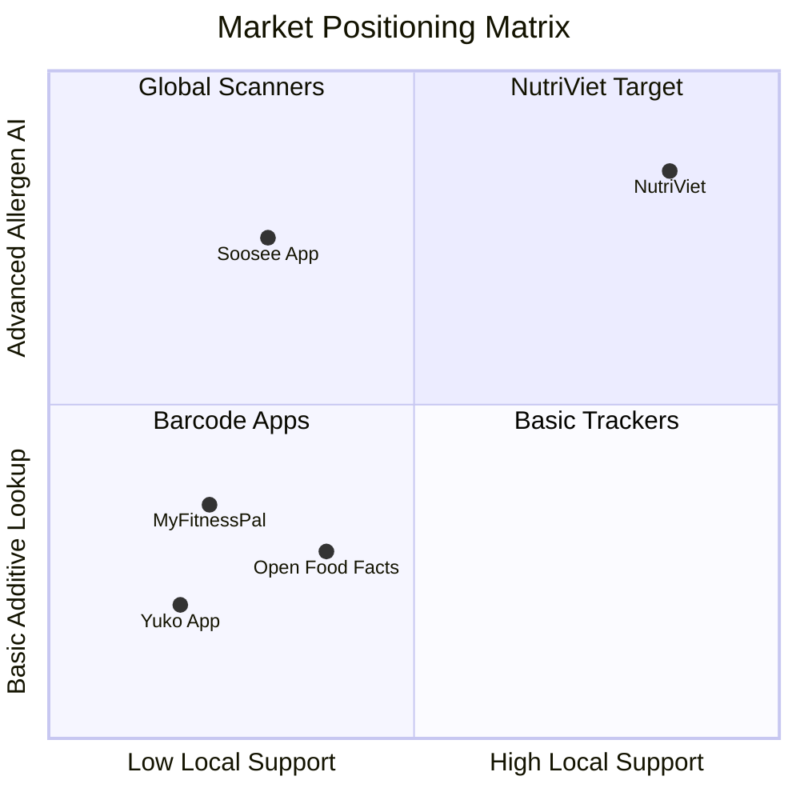

# NutriViet: Vision Document
**Product Vision and High-Level Requirements Specification**  
**Course:** CS300 - CSC13002 - Introduction to Software Engineering  
**Project Assignment:** PA3-2026 (2nd Submission)  
**Group:** Group 07 - NutriViet Team  

---

## 1. Introduction
*Performed by: Ngo Tien Binh | Reviewed by: Truong Gia Linh | Edited by: Le Tat Nam*

### 1.1. Purpose of the Document
The purpose of this Vision Document is to collect, analyze, and define the high-level needs and features of **NutriViet**, an intelligent mobile food allergy detection and personalized nutrition management application for Android. It focuses on the capabilities required by primary stakeholders, target end-users, and system administrators, establishing the target problems, system boundaries, unique market positioning, key architectural capabilities, and non-functional quality standards. This document serves as the authoritative baseline for all downstream architectural design, use case elaboration, sprint task breakdown, and acceptance validation throughout the CS300 Software Engineering curriculum.

### 1.2. References
1. **NutriViet Project Proposal (PA1-2026):** Baseline requirements, existing app survey, and team contract ([proposal.md](../../proposal.md)).
2. **FoodOn Consortium:** FoodOn: A global farm-to-fork food ontology (`https://foodon.org/`).
3. **National Food Safety Technical Regulations:** QCVN 01-189:2019/BNNPTNT on labeling standards for packaged foodstuffs in Vietnam.
4. **IEEE Std 830-1998:** IEEE Recommended Practice for Software Requirements Specifications.
5. **Open Food Facts API Documentation:** Open database of food products worldwide (`https://world.openfoodfacts.org/`).
6. **WCAG 2.1 Guidelines:** Web Content Accessibility Guidelines for color contrast and assistive readability.

---

## 2. Positioning
*Performed by: Le Tat Nam | Reviewed by: Ngo Tien Binh | Edited by: Luong Hoang Nam*

### 2.1. Problem Statement
The table below specifies the core societal and health challenge addressed by the NutriViet platform.

| Element | Specification |
|:---|:---|
| **The problem of** | Obscure, complex, and unstandardized ingredient labeling on packaged food products in Vietnam, characterized by microscopic typography, foreign technical nomenclature, cryptic chemical additive codes (E-numbers), and undeclared cross-contamination allergens. |
| **affects** | Vietnamese consumers suffering from severe food allergies (e.g., peanuts, seafood, gluten, cow's milk), chronic metabolic disorders (e.g., diabetes, hypertension, gout), parents purchasing baby food, and health-conscious shoppers following strict dietary regimens. |
| **the impact of which is** | High risks of life-threatening anaphylactic reactions, chronic dietary complications, severe anxiety during grocery shopping, and excessive time wasted manually deciphering chemical labels at retail supermarket shelves. |
| **a successful solution would be** | A mobile application offering instant smartphone camera Optical Character Recognition (OCR) combined with typo-tolerant fuzzy matching and FoodOn ontology classification, delivering unambiguous color-coded safety hazard alerts (RED dangerous / YELLOW caution / GREEN safe), personalized dietary logging, and curated safe food alternatives. |

### 2.2. Product Position Statement
The table below outlines the strategic positioning of NutriViet in contrast to existing commercial market alternatives.

| Element | Specification |
|:---|:---|
| **For** | Vietnamese shoppers and households managing dietary restrictions, food allergies, and chronic medical nutrition plans. |
| **Who** | Require immediate, foolproof, and scientifically grounded verification of food ingredients while shopping in retail stores. |
| **The product name** | **NutriViet** |
| **That** | Scans product packaging labels via camera OCR in real time, cross-references ingredients against personalized user health profiles using hierarchical FoodOn allergen ontologies, and delivers immediate visual hazard alerts without requiring pre-registered barcode databases. |
| **Unlike** | Existing international applications like **Yuko** (which lacks personalized health-profile hazard filtering and Vietnamese label support) and **Soosee** (which lacks recursive additive ontology mapping, dietary logging, and community verification). |
| **Our product** | Delivers specialized Vietnamese OCR text normalization, semantic ontology inference for hidden food derivatives, local offline caching for low-connectivity supermarket environments, and verified community-driven product crowdsourcing. |

---

## 3. Stakeholder and User Descriptions
*Performed by: Truong Gia Linh | Reviewed by: Luong Hoang Nam | Edited by: Nguyen Hoang Phuc Thinh*

### 3.1. Stakeholder Summary
The key stakeholders invested in the development, operation, and outcome of the NutriViet ecosystem include:

| Stakeholder Group | Role in Project | Key Concerns & Interests |
|:---|:---|:---|
| **Course Instructors & TAs** | Academic supervisors & quality evaluators | Adherence to Scrum process, Spec-Driven Development, quantifiable NFRs, traceability, and code quality. |
| **Development Team (Group 07)** | System designers, full-stack engineers, QA | Scalable Clean Architecture, robust OCR accuracy, test coverage $\ge 80\%$, on-time sprint deliverables. |
| **Health-Restricted Consumers** | Primary end-users | Zero false negatives on severe allergens, instant scanning response (< 3s), clear visual indicators. |
| **Medical Dietitians / Nutritionists** | External domain advisors (non-system users) | Accuracy of dietary calculations, safe macro/micronutrient thresholds, proper medical disclaimer visibility. |
| **System Administrators** | Operational managers | Intuitive moderation portal, data integrity in ontology tables, fast resolution of OCR correction flags. |

### 3.2. User Summary

| User Persona | System Role | Motivation & Usage Pattern | Technical Proficiency |
|:---|:---|:---|:---|
| **Allergy-Prone Consumer (e.g., An, 22)** | Standard User | Scans labels in supermarkets to avoid fatal peanut and shellfish exposure; checks hazard alerts in under 3 seconds. | Basic mobile smartphone literacy. |
| **Chronic Care Shopper (e.g., Uncle Hai, 58)** | Standard User | Monitors daily sodium, sugar, and purine intake; logs meals to prevent gout flare-ups and diabetic spikes. | Moderate mobile literacy; needs high-contrast UI and large font options. |
| **Platform Moderator (e.g., Linh, 24)** | System Administrator | Verifies user-contributed food products, approves additive dictionary extensions, monitors error rates. | Advanced web and database proficiency. |

### 3.3. User Environment
The physical, technical, and operational conditions under which NutriViet operates are analyzed across four distinct dimensions:

1. **Physical Retail & Supermarket Environments:**
   - **Illumination Variability:** Users scan products under diverse lighting conditions ranging from harsh fluorescent overhead supermarket tubes (300–600 lux) causing specular reflection, to dim traditional corner markets and warehouse basements (< 150 lux).
   - **Packaging Substrates & Topography:** Labels appear on glossy cellophane snack bags, translucent beverage bottles, curved aluminum cans, crinkled plastic foils, and textured cardboard cartons. These introduce severe optical distortion, font shearing, and partial occlusions.
   - **User Ergonomics & Distraction:** Shoppers typically operate the phone with one hand while holding a grocery basket or pushing a cart with the other. The UI must therefore support one-handed gesture ergonomics and large, unambiguous tap targets.

2. **Mobile Device Hardware Diversity:**
   - **Operating System Range:** Android 8.0 (Oreo, API Level 26) through Android 15 (API Level 35).
   - **Camera Sensor Variability:** Camera hardware on target devices ranges from low-end 8MP fixed-focus sensors without optical image stabilization (OIS) to multi-sensor 50MP modules with autofocus and auto-exposure.
   - **Processor & Memory Spectrum:** Devices span entry-level hardware (Quad-Core 2.0 GHz, 2GB–3GB RAM) to premium flagships (Octa-Core, 8GB–12GB RAM). On-device OCR processing must remain lightweight to prevent thermal throttling or out-of-memory (OOM) termination on budget units.

3. **Network Infrastructure & Supermarket Connectivity Profile:**
   - Supermarket basements and rural grocery outlets frequently suffer from poor cellular reception (high latency > 800ms, packet dropouts, or total signal loss).
   - NutriViet provides a dual-mode operational architecture: an online mode connected to the FastAPI backend for real-time crowdsourced updates and deep ontology queries, and an autonomous offline fallback mode executing on-device OCR against local SQLite/Hive encrypted allergy definitions.

4. **Administrative Desktop Environment:**
   - System administrators access the moderation portal via modern desktop web browsers (Google Chrome 120+, Mozilla Firefox 120+, Apple Safari 17+, Microsoft Edge) on displays with a minimum resolution of 1920x1080 over high-speed broadband connections.

### 3.4. Summary of Key Stakeholder and User Needs

| Need ID | Priority | Stakeholder / User Need | Current Pain Point | Addressed Feature |
|:---:|:---:|:---|:---|:---|
| **N-01** | High | Instant allergen hazard detection without manual typing. | Decoding microscopic label text is exhausting and error-prone. | Camera OCR + Instant Visual Alert (FG1, FG2) |
| **N-02** | High | Identification of obscure chemical additives & hidden allergens. | Additives like "E621" or "Sodium Caseinate" hide dairy/MSG origins. | FoodOn Ontology & Additive Dictionary (FG3) |
| **N-03** | High | Full functionality in offline supermarket basements. | Cloud-only apps fail completely when cellular signal is lost. | On-Device OCR & Offline Health Cache (FG1, FG3) |
| **N-04** | Medium | Tracking daily nutritional consumption against medical targets. | Generic calorie counters do not track allergy hazard histories. | Daily Nutritional Diary & Health Metrics (FG4) |
| **N-05** | Medium | Finding safe alternative foods when a scanned item is dangerous. | Shoppers leave empty-handed after discovering an allergen. | Safe Dietary Alternative Recommender (FG4) |
| **N-06** | Medium | Community contributions for unindexed local Vietnamese snacks. | Barcode databases omit artisanal and local market products. | Crowdsourced Food Product Submission (FG6) |
| **N-07** | High | Rigorous moderation to ensure crowdsourced data accuracy. | Unverified community data could lead to severe health accidents. | Admin Portal & Ingredient Audit System (FG8) |

### 3.5. Alternatives and Competition
NutriViet addresses critical deficiencies in existing international and generic commercial platforms. The comparative matrix below evaluates NutriViet against primary commercial and open-source alternatives across 8 rigorous technical and domain dimensions:

| Comparison Dimension | NutriViet (Proposed) | Yuko App (EU) | Soosee App (NL) | Open Food Facts | MyFitnessPal |
|:---|:---:|:---:|:---:|:---:|:---:|
| **Vietnamese Packaging Label OCR** | **Native High Accuracy** | No Support | No Vietnamese Support | Barcode-only / Basic OCR | Barcode-only |
| **On-Device Offline Hazard Alerting** | **Yes (< 300ms cache)** | No (Cloud Barcode) | Yes (Predefined words) | Partial (Cached Barcodes) | No (Cloud Dependent) |
| **Hierarchical Semantic Allergen Ontology (FoodOn)** | **Yes (e.g. Casein $\rightarrow$ Milk)** | No (Static Rules) | No (Keyword match only) | Basic taxonomy | None |
| **Personalized Multi-Condition Filtering** | **Yes (Allergens + Chronic)** | No (Generic score) | Partial (Allergies only) | Generic nutritional score | Macro goals only |
| **Daily Nutritional & Allergic Reaction Logging** | **Yes (Macros + Symptoms)** | No | No | No | Nutrition only (No symptoms) |
| **Safe Contextual Alternative Suggestions** | **Yes (Allergen-free items)** | Yes (General eco-score) | No | Limited | No |
| **Moderated Community Crowdsourcing Workflow** | **Yes (Admin Audit Portal)** | No (Proprietary data) | No | Yes (Open Wiki style) | No |
| **Color-Blind Accessible Tri-Tier Alerts** | **Yes (RED/YELLOW/GREEN + Icons)** | Red/Green only | Yellow highlighting | Green/Orange/Red bars | Generic text |

---

## 4. Product Overview
*Performed by: Nguyen Hoang Phuc Thinh | Reviewed by: Le Tat Nam | Edited by: Ngo Tien Binh*

### 4.1. Product Perspective
NutriViet is a modern, cloud-connected mobile health platform operating on a client-server architecture:
- **Client Tier:** A cross-platform Flutter application running natively on Android, utilizing on-device machine learning for real-time text recognition (Google ML Kit).
- **Edge / Local Data Tier:** An encrypted SQLite/Hive local storage cache holding the user's active health profile, severe allergen keys, and emergency offline dictionary.
- **Server Tier:** A containerized FastAPI (Python 3.12) backend exposing RESTful APIs, orchestrating fuzzy matching services, FoodOn semantic ontology graph queries, community submission pipelines, and administrative moderation portals.
- **Data Persistence Tier:** A PostgreSQL relational database managing normalized ingredient lexicons, user accounts, audit trails, and product catalogs.

### 4.2. Assumptions and Dependencies
1. **Camera Quality Assumption:** The host mobile device possesses an autofocus camera with a minimum resolution of 8 megapixels capable of legibly capturing packaging labels at 10–25 cm distance.
2. **Lighting Assumption:** While the app supports flashlight toggling, packaging text must have sufficient optical contrast against label backgrounds.
3. **Ontology Dependency:** Accurate allergen lineage derivation depends on the FoodOn open-source ontology dataset and curated Vietnamese ingredient mappings maintained by administrators.
4. **Legal & Medical Boundary:** NutriViet provides assistive decision-support warnings and does not claim to replace certified clinical allergy diagnosis or emergency medical care.

---

## 5. Product Features
*Performed by: Luong Hoang Nam | Reviewed by: Ngo Tien Binh | Edited by: Truong Gia Linh*

This section refines the 8 Functional Groups (FG1–FG8) established in PA1 into detailed feature specifications. In compliance with PA3 standards, each feature is decomposed into concrete functional capabilities to ensure complete traceability with the Use-Case Model (Section C) and Use-Case Specifications (Section D).

### 5.1. Feature Descriptions

#### FG1: Authentication and Authorization
* **Description:** NutriViet allows users to register and log in securely using an email and password or Google OAuth 2.0 authentication. This feature is needed to protect personal medical profiles, maintain synchronized meal logs, and ensure that each user can access the appropriate functions based on their assigned system role. Standard users can access food scanning, allergy profile customization, meal logging, and community submission, while administrators access the administrative moderation dashboard. Both users and administrators benefit from role-based access control (RBAC), which enforces the principle of least privilege, protects sensitive personal health records, and prevents unauthorized catalog modifications.
* **Sub-Capabilities & Traceability:**
  - *UC01: Register New Account* (Email/password validation, credential hashing).
  - *UC02: Log In & Authenticate* (JWT issue, token refresh, Google sign-in).
  - *UC03: Manage Account Profile & Preferences* (Password update, session termination, role verification).

#### FG2: Personal Allergy Profile Management
* **Description:** NutriViet enables users to create, view, and modify personal profiles containing known food allergens (e.g., peanuts, seafood, cow's milk, eggs, gluten, soybeans, tree nuts, sesame) and chronic metabolic restrictions (e.g., diabetes mellitus, arterial hypertension, hyperuricemia/gout, chronic kidney disease). Users can configure sensitivity levels (Severe/Anaphylaxis vs. Mild/Sensitivity) for each allergy. This feature is necessary because food safety assessments must be strictly individualized to prevent false safety assurances. The configured profile serves as the active evaluation rule baseline for all real-time scans. Individuals with food allergies, patients with chronic conditions, and caregivers managing dependents benefit directly from tailored hazard calculations.
* **Sub-Capabilities & Traceability:**
  - *UC04: Configure Allergy & Health Profile* (Multi-select allergens, chronic dietary flags).
  - *UC05: Set Allergen Sensitivity Thresholds* (Severe/Anaphylaxis, Mild Intolerance, Family Dependent sub-profiles).

#### FG3: Packaging OCR Scanner
* **Description:** NutriViet allows users to capture food packaging with a smartphone camera and extract ingredient lists and nutritional declaration tables using on-device Optical Character Recognition (Google ML Kit). This feature is essential because packaging labels frequently feature tiny 4pt typography, curved cellophane wraps, and low contrast that are burdensome and slow to decipher manually in grocery store aisles. Coupling text recognition with on-device image preprocessing (contrast enhancement, perspective rectification) and Levenshtein fuzzy matching corrects optical transcription noise. Scanned ingredient tokens are recorded into the user's localized scan history for rapid offline retrieval.
* **Sub-Capabilities & Traceability:**
  - *UC06: Scan Food Packaging Label via Camera* (Real-time camera preview, flash toggle, shutter capture).
  - *UC07: Preprocess & Crop Label Image* (Bounding box adjustment, contrast enhancement, text tokenization).
  - *UC08: View & Search Scan History* (Chronological scan records, cached hazard status).

#### FG4: Instant Evaluation, Allergy Alert, and Safe Alternative Suggestion
* **Description:** NutriViet analyzes extracted ingredients against the active user health profile and FoodOn semantic ontology hierarchy, rendering an instantaneous, color-coded safety evaluation: RED (Fatal / Severe Hazard), YELLOW (Cautionary / Ambiguous additive or mild allergen match), or GREEN (No known hazards detected based on available data). Whenever a RED or YELLOW hazard is triggered, the system proactively generates a list of safe, verified dietary substitutes in the same product category that are free from the user's allergens. This feature prevents accidental allergen ingestion while ensuring shoppers do not leave supermarkets empty-handed.
* **Sub-Capabilities & Traceability:**
  - *UC09: Evaluate Ingredient Hazards* (Fuzzy matching, ontology derivation, RED/YELLOW/GREEN hazard alert rendering).
  - *UC10: View Safe Product Alternatives* (Category-based safe product retrieval, nutritional comparison).

#### FG5: Dietary and Reaction Journal
* **Description:** NutriViet allows users to log consumed food items into an interactive daily dietary journal, automatically aggregating total caloric, sugar, sodium, and purine intake against recommended medical thresholds. Furthermore, users can log unexpected allergic or gastrointestinal symptoms (itching, urticaria, facial swelling, nausea) linked to specific consumed items. This capability is critical because allergic reactions can occur with delayed onset, making retrospective correlation vital for clinical consultations with allergists and dietitians.
* **Sub-Capabilities & Traceability:**
  - *UC11: Log Daily Meal Intake* (Direct entry from scan result, portion sizing, macro/micronutrient accumulation).
  - *UC12: Record Allergic Symptom Incident* (Symptom classification, severity level, photographic evidence, clinical export).

#### FG6: Shopping List and Favorites
* **Description:** NutriViet provides a safe product bookmarking and smart grocery checklist system. Users can save verified safe items encountered during scanning directly into their Favorites repository and organize them into categorized shopping checklists prior to retail store visits. In-store checklist items are automatically checked off upon scanning, eliminating redundant rescanning of known safe household staples and streamlining grocery shopping for allergy-prone families.
* **Sub-Capabilities & Traceability:**
  - *UC13: Manage Safe Product Favorites* (Add/remove bookmarks, custom categories, quick re-evaluation).
  - *UC14: Create & Check Grocery Shopping List* (Checklist generation, in-store checkoff sync).

#### FG7: Community Product Contribution
* **Description:** NutriViet provides a structured crowdsourcing workflow empowering consumers to submit previously unindexed packaged food products. Users capture front-of-pack images, ingredient lists, brand names, and barcode numbers directly from the mobile app. Additionally, users can flag OCR inaccuracies or suspected mislabeled ingredients on existing catalog items. This capability solves the cold-start data challenge across local Vietnamese retail markets while maintaining user engagement.
* **Sub-Capabilities & Traceability:**
  - *UC15: Submit Unindexed Food Product* (Packaging photo upload, barcode capture, ingredient transcription).
  - *UC16: Report OCR / Ingredient Inaccuracy* (Flag incorrect parsing, suggest corrected ingredient spelling).

#### FG8: Admin Allergy Dictionary and Product Verification
* **Description:** NutriViet equips system administrators with a secure web moderation portal to inspect, verify, approve, or reject user-submitted product entries before they enter the public database. Administrators maintain the master ingredient and additive dictionary, map newly discovered Vietnamese colloquial food terms to standardized FoodOn ontology concepts, and audit crowdsourced correction flags. This centralized governance ensures the clinical trustworthiness and legal compliance of the NutriViet safety catalog.
* **Sub-Capabilities & Traceability:**
  - *UC17: Moderate Crowdsourced Product Submissions* (Side-by-side photo inspection, edit ingredients, approve/reject).
  - *UC18: Manage Master Additive & Allergen Dictionary* (CRUD operations on E-numbers, synonyms, and FoodOn hierarchy mappings).

---

### 5.2. System Workflow Diagrams

#### Workflow Diagram 1: Mobile Camera OCR Scanning & Hazard Alert Workflow
The workflow diagram below illustrates the end-to-end user journey during food label capture, text extraction, risk calculation, and visual hazard alerting.

  

#### Workflow Diagram 2: Community Food Crowdsourcing & Admin Verification Pipeline
The workflow diagram below illustrates the data lifecycle and administrative moderation pipeline for user-submitted food products.

  

---

## 6. Non-Functional Requirements (NFR)
*Performed by: Nguyen Hoang Phuc Thinh | Reviewed by: Le Tat Nam | Edited by: Ngo Tien Binh*

All non-functional requirements are explicitly quantifiable and accompanied by designated verification procedures to ensure unambiguous compliance during course testing.

### 6.1. Performance & Responsiveness
* **NFR-PERF-01 (OCR Extraction Latency):** The complete on-device OCR extraction and preprocessing pipeline must execute in **less than 1.5 seconds** on mid-range Android devices (Snapdragon 680 or equivalent with 4GB RAM) for label images containing up to 150 words. *Verification: Automated timer benchmark over 50 standardized test packaging images.*
* **NFR-PERF-02 (End-to-End Hazard Evaluation):** From camera shutter capture to rendering the visual hazard alert (RED/YELLOW/GREEN), total elapsed time must be **under 3.0 seconds** over a standard 4G cellular connection (ping $\le 50\text{ ms}$). *Verification: Pipelined network trace measuring client-server-client roundtrip.*
* **NFR-PERF-03 (Offline Evaluation Latency):** In offline fallback mode, evaluating extracted tokens against the local encrypted allergy cache must complete in **less than 300 milliseconds**. *Verification: Unit test running benchmark evaluation loop on device.*
* **NFR-PERF-04 (Camera Frame Rate):** The active camera preview interface must maintain a smooth refresh rate of **at least 30 frames per second (fps)** without UI stuttering or dropped frames. *Verification: Android Studio GPU Profiler frame render trace.*

### 6.2. Scalability & Availability
* **NFR-SCAL-01 (Concurrent Workload):** The backend API service must sustain **at least 150 concurrent active scanning requests** with an average response latency $\le 500\text{ ms}$ and a 99th percentile latency $\le 1200\text{ ms}$. *Verification: Locust/JMeter stress test simulating 150 virtual users.*
* **NFR-SCAL-02 (Service Availability):** The cloud backend and database infrastructure must target **99.5% operational uptime** per calendar month, excluding scheduled maintenance windows announced 24 hours in advance. *Verification: Continuous health check monitoring endpoint logging during sprint evaluation.*
* **NFR-SCAL-03 (Catalog Query Scalability):** The PostgreSQL database schema and indexing must support querying over a catalog of **at least 100,000 product records and 5,000 additive definitions** with indexed query execution times $\le 50\text{ ms}$. *Verification: EXPLAIN ANALYZE execution timing on mocked 100K catalog.*

### 6.3. Security & Data Protection
* **NFR-SEC-01 (In-Transit Encryption):** All communications between the mobile client and backend APIs must be encrypted using **TLS 1.3** (with fallback to TLS 1.2), enforcing HTTPS and strict certificate validation. *Verification: Wireshark packet inspection and SSL Labs testing.*
* **NFR-SEC-02 (At-Rest Encryption):** User health profiles, medical allergy tags, and personal scan history stored on the device must be encrypted using **AES-256-GCM** via the Android Keystore-backed SQLCipher/Hive encryption. *Verification: Physical inspection of extracted SQLite database file verifying zero plaintext strings.*
* **NFR-SEC-03 (Credential & Token Management):** User authentication sessions must utilize cryptographically signed **JSON Web Tokens (JWT)** with an access token lifespan of **60 minutes** and refresh token rotation. Zero API keys, database credentials, or secret salts may be stored in Git source control. *Verification: Automated git-secrets scan in CI/CD pipeline.*
* **NFR-SEC-04 (Role-Based Access Control - RBAC):** Administrative API endpoints (moderation, catalog mutation, user audits) must strictly verify administrative scopes; unauthorized access attempts must return HTTP 403 and trigger security log events. *Verification: Automated integration test suite targeting unauthorized admin endpoint requests.*

### 6.4. Platform & Compatibility
* **NFR-PLAT-01 (Operating System Support):** The client application must install and run flawlessly on **Android 8.0 (Oreo, API Level 26)** through **Android 15 (API Level 35)**. *Verification: Automated Firebase Test Lab matrix across 5 distinct Android OS levels.*
* **NFR-PLAT-02 (Display Adaptability):** The mobile UI layout must adapt seamlessly across screen resolutions from **720x1280 (HD)** up to **1440x3200 (QHD+)** and support dynamic system font scaling up to **150%** without text clipping or layout overflow errors. *Verification: Flutter widget testing with varying Viewport sizes and textScaleFactors.*
* **NFR-PLAT-03 (Installation Package Size):** The compiled Android Application Package (APK) release size must **not exceed 45 megabytes (MB)** to enable rapid downloading on mobile cellular networks. *Verification: `flutter build apk --release` size validation.*

### 6.5. Reliability & Accuracy
* **NFR-REL-01 (Allergen Detection Recall):** On clear, standardized packaging text, the fuzzy matching algorithm must achieve **at least 98% recall** for primary declared allergens (peanuts, tree nuts, shellfish, milk, eggs, wheat, soybeans). False negatives on these seven major allergen categories are treated as critical severity defects requiring immediate remediation. *Verification: Automated test suite against 200 labeled real-world ingredient texts.*
* **NFR-REL-02 (Offline Storage Footprint):** The local offline database and emergency cache must consume **less than 40 megabytes (MB)** of device storage space. *Verification: Device storage audit after full offline sync.*
* **NFR-REL-03 (Graceful Degradation):** In the event of OCR failure due to severe packaging distortion or poor lighting, the application must never crash; it must notify the user within 1.0 second with guidance to activate the flashlight or input manual text. *Verification: Chaos testing with corrupted and pitch-black camera inputs.*

### 6.6. Usability & Accessibility
* **NFR-USAB-01 (Color-Blind Accessible Tri-Tier Alerts):** In accordance with WCAG 2.1 AA standards, all safety alerts must not rely solely on color. The RED alert must be accompanied by an Octagonal Exclamation Icon (`[!X]`), YELLOW caution by a Triangular Warning Icon (`[!?]`), and GREEN safe by a Shield Check Icon (`[OK]`). High contrast mode must achieve a minimum color contrast ratio of **4.5:1** against backgrounds for standard text and **3:1** for UI components. *Verification: Contrast analyzer and simulated Deuteranopia/Protanopia screen filters.*
