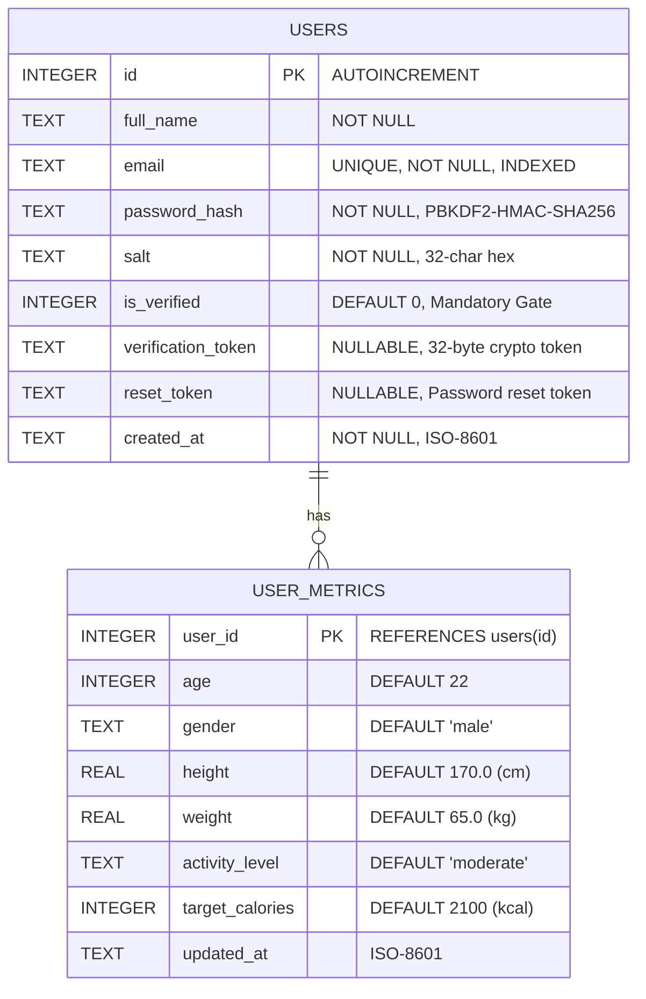
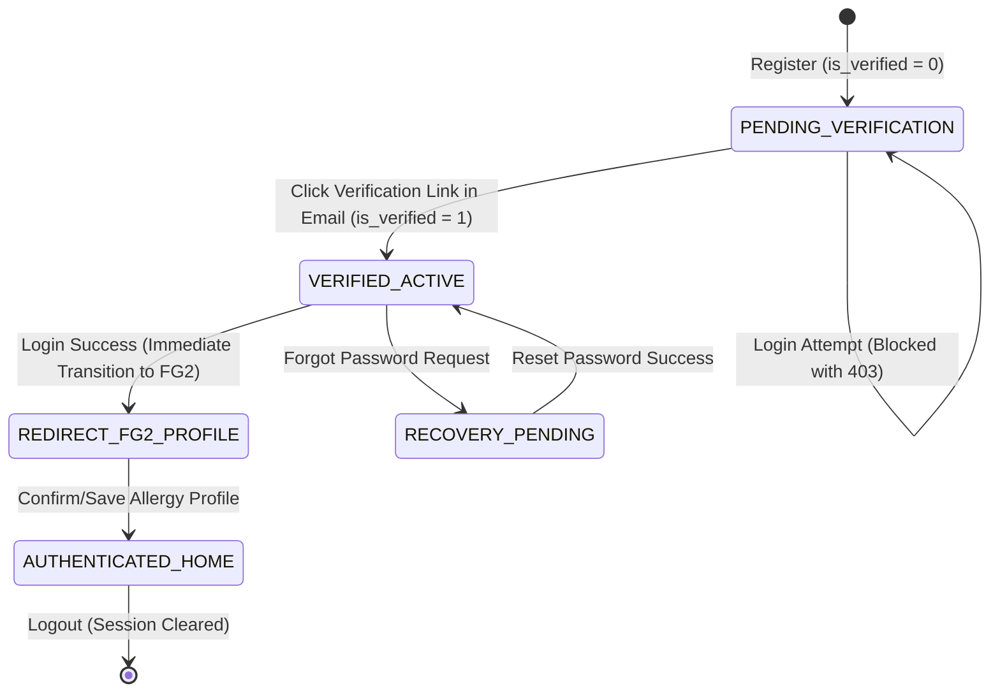

# Data Model: FG1 - Authentication & Authorization

**Feature**: `001-fg1-authentication`  
**Specification**: [spec.md](spec.md) | **Plan**: [plan.md](plan.md)  
**Database Engine**: SQLite 3 (ACID compliant)  
**Target Table**: `users`  

---

## 1. Entity-Relationship & Relational Schema



---

## 2. DDL Schema Definition (SQL)

```sql
CREATE TABLE IF NOT EXISTS users (
    id INTEGER PRIMARY KEY AUTOINCREMENT,
    full_name TEXT NOT NULL,
    email TEXT UNIQUE NOT NULL COLLATE NOCASE,
    password_hash TEXT NOT NULL,
    salt TEXT NOT NULL,
    is_verified INTEGER DEFAULT 0,
    verification_token TEXT,
    reset_token TEXT,
    created_at TEXT NOT NULL
);

-- User body physical metrics (Standard Nutrition App metrics)
CREATE TABLE IF NOT EXISTS user_metrics (
    user_id INTEGER PRIMARY KEY REFERENCES users(id) ON DELETE CASCADE,
    age INTEGER DEFAULT 22,
    gender TEXT DEFAULT 'male',
    height REAL DEFAULT 170.0,
    weight REAL DEFAULT 65.0,
    activity_level TEXT DEFAULT 'moderate',
    target_calories INTEGER DEFAULT 2100,
    updated_at TEXT NOT NULL
);

-- Optimization indexes for high-frequency queries
CREATE UNIQUE INDEX IF NOT EXISTS idx_users_email ON users(email);
CREATE INDEX IF NOT EXISTS idx_users_verification ON users(verification_token);
```

---

## 3. Data Dictionary

### Table: `users`
| Column Name | Data Type | Nullable | Constraints | Description & Validation Rules |
|:---|:---:|:---:|:---|:---|
| `id` | `INTEGER` | No | `PRIMARY KEY AUTOINCREMENT` | Unique identifier generated by SQLite sequence. |
| `full_name` | `TEXT` | No | Length: 1–100 chars | Display name of the consumer. Stripped of whitespace. |
| `email` | `TEXT` | No | `UNIQUE`, Case-insensitive | Consumer email address. Lowercased prior to storage. |
| `password_hash` | `TEXT` | No | 64-char hex string | Derived cryptographic key using PBKDF2-HMAC-SHA256 with 100,000 rounds. |
| `salt` | `TEXT` | No | 32-char hex string | 16-byte cryptographically secure pseudorandom salt. |
| `is_verified` | `INTEGER` | No | `DEFAULT 0` | 0 = Unverified (blocked from login), 1 = Verified (granted access). |
| `verification_token` | `TEXT` | Yes | 32-byte URL-safe string | Token sent in email verification link. |
| `reset_token` | `TEXT` | Yes | 32-byte URL-safe string | Temporary token for password recovery. |
| `created_at` | `TEXT` | No | ISO-8601 UTC string | Registration timestamp (e.g., `2026-11-10T12:00:00Z`). |

### Table: `user_metrics`
| Column Name | Data Type | Nullable | Constraints | Description |
|:---|:---:|:---:|:---|:---|
| `user_id` | `INTEGER` | No | `PRIMARY KEY REFERENCES users(id)` | User ID owning these physical metrics. |
| `age` | `INTEGER` | No | `DEFAULT 22` | Age in years (1–120). |
| `gender` | `TEXT` | No | `male` / `female` | Biological gender for caloric computation. |
| `height` | `REAL` | No | `DEFAULT 170.0` | Height in centimeters (cm). |
| `weight` | `REAL` | No | `DEFAULT 65.0` | Weight in kilograms (kg). |
| `activity_level` | `TEXT` | No | `sedentary`, `moderate`, `active` | Physical activity factor for TDEE calculation. |
| `target_calories` | `INTEGER` | No | `DEFAULT 2100` | Estimated daily energy requirement (kcal). |
| `updated_at` | `TEXT` | No | ISO-8601 UTC string | Last update timestamp. |

---

## 4. State Transitions & Lifecycle


