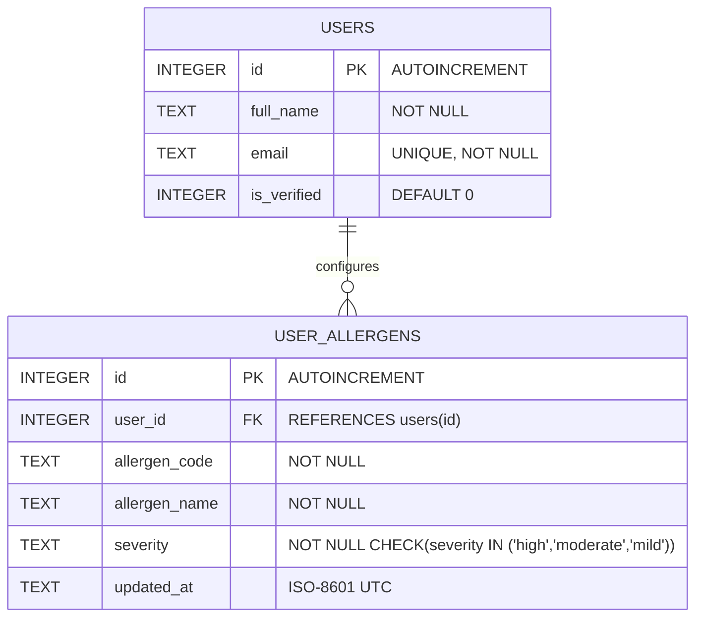
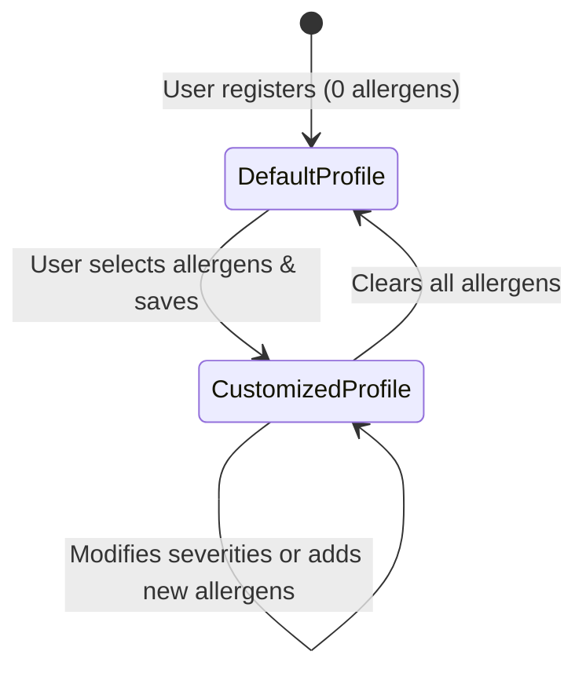

# Data Model: FG2 - Personal Allergy Profile Management

**Feature**: `002-fg2-allergy-profile`  
**Specification**: [spec.md](spec.md) | **Plan**: [plan.md](plan.md)  
**Database**: SQLite 3 (`nutriviet.db`)  
**Target Table**: `user_allergens`  

---

## 1. Entity-Relationship Diagram



---

## 2. DDL Schema Definition (SQL)

```sql
CREATE TABLE IF NOT EXISTS user_allergens (
    id INTEGER PRIMARY KEY AUTOINCREMENT,
    user_id INTEGER NOT NULL REFERENCES users(id) ON DELETE CASCADE,
    allergen_code TEXT NOT NULL,
    allergen_name TEXT NOT NULL,
    severity TEXT NOT NULL CHECK(severity IN ('high', 'moderate', 'mild')),
    updated_at TEXT NOT NULL
);

-- Compound index to enforce unique allergen per user and accelerate queries
CREATE UNIQUE INDEX IF NOT EXISTS idx_user_allergen ON user_allergens(user_id, allergen_code);
CREATE INDEX IF NOT EXISTS idx_user_allergens_user_id ON user_allergens(user_id);
```

---

## 3. Data Dictionary

| Column Name | Data Type | Nullable | Constraints | Description |
|:---|:---:|:---:|:---|:---|
| `id` | `INTEGER` | No | `PRIMARY KEY AUTOINCREMENT` | Unique record ID. |
| `user_id` | `INTEGER` | No | `FOREIGN KEY REFERENCES users(id)` | Identifies which user owns this allergy constraint. |
| `allergen_code` | `TEXT` | No | `peanuts`, `seafood`, `milk`, `gluten`, `eggs`, `soy`, `fish`, `tree_nuts` | Standard machine-readable code. |
| `allergen_name` | `TEXT` | No | String | Human-readable name in Vietnamese. |
| `severity` | `TEXT` | No | `'high'`, `'moderate'`, `'mild'` | Sensitivity threshold. |
| `updated_at` | `TEXT` | No | ISO-8601 UTC String | Last modification timestamp. |

---

## 4. State Machine (Profile Updates)


