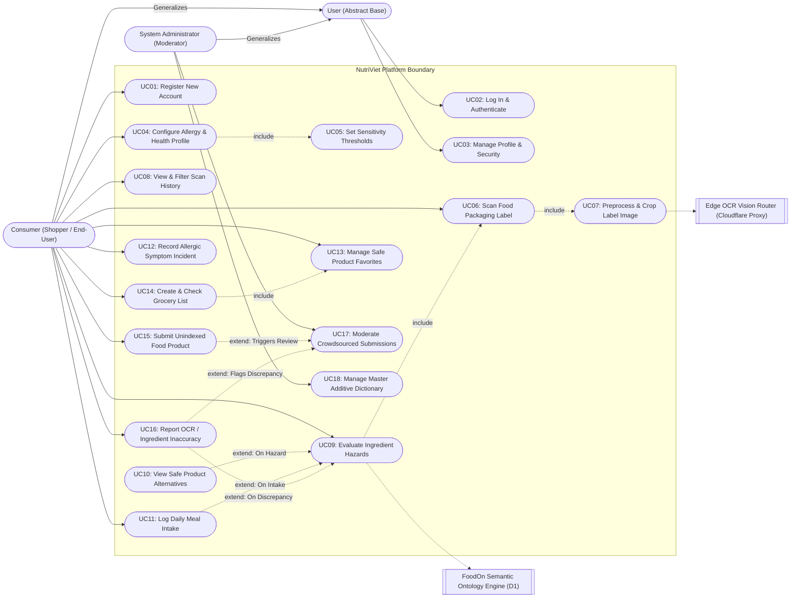
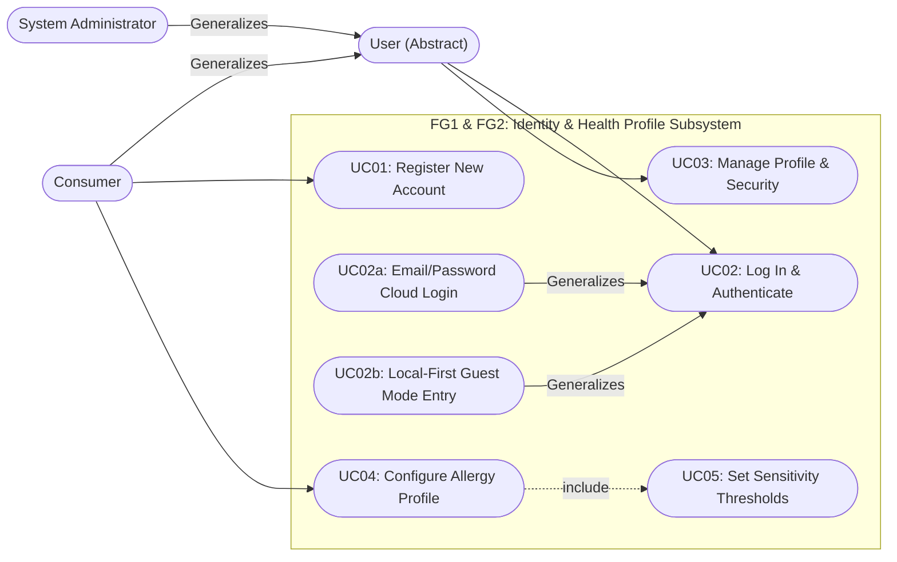
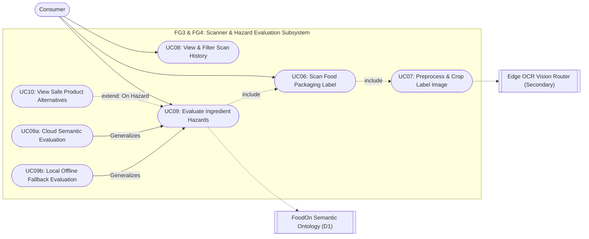
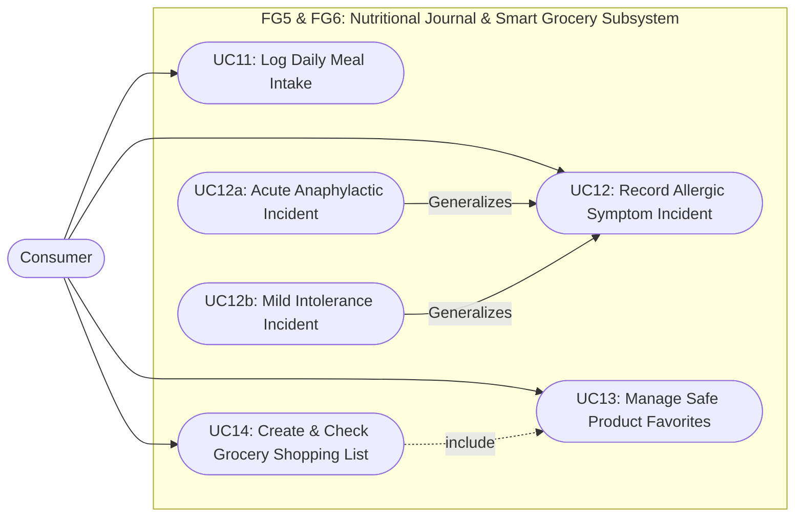
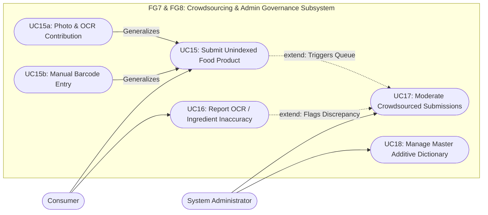

# NutriViet: Use-Case Model & Functional Specifications
**Detailed Requirements Modeling & User Interface Prototyping**  
**Course:** CS300 - CSC13002 - Introduction to Software Engineering  
**Project Assignment:** PA4-2026 (Section A Revised Submission)  
**Group:** Group 07 - NutriViet Team  
**Submission Date:** 25/11/2026  

---

## 1. Traceability Matrix: Functional Groups to Use Cases
*Performed by: Ngo Tien Binh | Reviewed by: Le Tat Nam | Edited by: Truong Gia Linh*

The table below establishes bidirectional traceability between the 8 Functional Groups (FG1–FG8) defined in the [Vision Document](vision.md) and the 18 elaborated system Use Cases (UC01–UC18).

| Functional Group (Vision Document) | Use Case ID | Use Case Name | Primary Actor | Priority | Prototype Reference |
|:---|:---:|:---|:---|:---:|:---|
| **FG1: Authentication & Authorization** | **UC01** | Register New Account | Consumer | High | [Figure D.1](#figure-d1) |
| | **UC02** | Log In & Authenticate | Consumer, Admin | Critical | [Figure D.2](#figure-d2) |
| | **UC03** | Manage Account Profile & Preferences | Consumer | Medium | [Figure D.3](#figure-d3) |
| **FG2: Personal Allergy Profile Management** | **UC04** | Configure Allergy & Health Profile | Consumer | Critical | [Figure D.4](#figure-d4) |
| | **UC05** | Set Allergen Sensitivity Thresholds | Consumer | High | [Figure D.4](#figure-d4) |
| **FG3: Packaging OCR Scanner** | **UC06** | Scan Food Packaging Label via Camera | Consumer | Critical | [Figure D.5](#figure-d5) |
| | **UC07** | Preprocess & Crop Label Image | Consumer | High | [Figure D.6](#figure-d6) |
| | **UC08** | View & Filter Scan History | Consumer | Medium | [Figure D.7](#figure-d7) |
| **FG4: Hazard Evaluation & Safe Alternatives** | **UC09** | Evaluate Ingredient Hazards | Consumer | Critical | [Figures D.8a, D.8b, D.8c](#figure-d8a) |
| | **UC10** | View Safe Product Alternatives | Consumer | High | [Figure D.9](#figure-d9) |
| **FG5: Dietary & Reaction Journal** | **UC11** | Log Daily Meal Intake | Consumer | High | [Figure D.10](#figure-d10) |
| | **UC12** | Record Allergic Symptom Incident | Consumer | High | [Figure D.11](#figure-d11) |
| **FG6: Shopping List & Favorites** | **UC13** | Manage Safe Product Favorites | Consumer | Medium | [Figure D.12](#figure-d12) |
| | **UC14** | Create & Check Grocery Shopping List | Consumer | Medium | [Figure D.12](#figure-d12) |
| **FG7: Community Product Contribution** | **UC15** | Submit Unindexed Food Product | Consumer | High | [Figure D.13](#figure-d13) |
| | **UC16** | Report OCR / Ingredient Inaccuracy | Consumer | Medium | [Figure D.14](#figure-d14) |
| **FG8: Admin Allergy Dictionary & Verification**| **UC17** | Moderate Crowdsourced Submissions | Administrator | Critical | [Figure D.15](#figure-d15) |
| | **UC18** | Manage Master Additive Dictionary | Administrator | High | [Figure D.16](#figure-d16) |

---

## 2. Section C: Use-Case Model
*Performed by: Luong Hoang Nam | Reviewed by: Ngo Tien Binh | Edited by: Nguyen Hoang Phuc Thinh*

### 2.1. System Actors

In accordance with UML 2.5 standards, the NutriViet system identifies both human actors (primary end-users and administrators) and external technical systems (secondary actors):

1. **User (Abstract Base Actor):** An abstract generalized human actor representing any authenticated entity within the NutriViet ecosystem. Possesses core authentication credentials (email/password) and a Bearer session security context. Both `Consumer` and `System Administrator` inherit from `User`.
2. **Consumer (Primary End-User - Specializes `User`):** Everyday shoppers and consumers managing individual or family food allergies (peanuts, seafood, cow's milk, gluten, eggs, soy) or chronic metabolic conditions (diabetes, gout, hypertension). Interacts through the Android mobile client either as an authenticated user or via local-first **Guest Mode** (`LocalGuestStore`) to scan products, configure allergy profiles, view scan history, and participate in the community feed.
3. **System Administrator (Staff / Nutrition Moderator - Specializes `User`):** Platform administrators (`role == 'admin'`) responsible for moderating crowdsourced community posts, resolving abuse reports, and managing user bans/roles via the hidden RBAC-protected `AdminModerationScreen` and `/api/v1/admin/*` endpoints.
4. **Edge OCR Vision Router (Secondary / Supporting Technical Actor):** Cloudflare Workers Edge Proxy (`/api/v1/ocr/jobs`) orchestrating a 5-tier fastest-to-slowest failover chain (`kilo-particle-1`, `cf-mistral-vision`, `baidu-paddleocr` (`PaddleOCR-VL-1.6`), `kilo-nemotron-vl`, `cf-llama4-vision`), paired with server-side Markdown/HTML cleaning and fuzzy Ingredients-only extraction (`extractIngredientsSection`).
5. **FoodOn Semantic Ontology Engine (Secondary / Supporting Technical Actor):** Cloudflare Workers + D1 (`nutriviet-foodon`) semantic knowledge engine housing 33,688 FoodOn concepts, 53,242 lexical bridge terms, and 742 E-codes, providing 4-stage ingredient recognition, ancestor-chain derivation (e.g., *Casein* $\to$ *Cow's Milk Allergen*), and Levenshtein fuzzy string matching ($\ge 82\%$ similarity threshold).

---

### 2.2. Global System Use-Case Diagram

The diagram below provides a holistic architectural view of the NutriViet system boundary, encompassing all 8 Functional Groups (FG1 through FG8) and 18 Use Cases (UC01 through UC18). It explicitly details actor generalizations, primary actor associations, secondary technical actor bridges, and inter-use-case dependencies (`include` and `extend`).

---

### 2.3. Subsystem Use-Case Diagrams

To provide granular structural modeling for engineering teams, the 8 Functional Groups are partitioned into 4 cohesive subsystems:

#### Subsystem 1: Identity & Health Profile Subsystem (FG1, FG2)
Covers account onboarding, credential authentication, personal allergen configuration, and sensitivity threshold tuning. Demonstrates actor generalization (`User`), use-case generalization for authentication variants, and mandatory inclusion for sensitivity threshold tuning.

#### Subsystem 2: Camera OCR & Real-Time Hazard Alert Subsystem (FG3, FG4)
Covers real-time camera viewfinder capture, image preprocessing, Levenshtein fuzzy matching, FoodOn ontology derivation, and safe substitute recommendation. Illustrates secondary actor bindings, mandatory multi-tier inclusion, cloud vs. offline fallback generalization, and conditional extension on hazard detection.

#### Subsystem 3: Nutritional Journal & Smart Grocery Subsystem (FG5, FG6)
Covers daily dietary tracking, allergic reaction symptom incident logging, bookmarking safe favorites, and organized supermarket shopping checklists. Illustrates severity-level symptom generalization and checklist dependency on safe bookmarks.

#### Subsystem 4: Community Crowdsourcing & Admin Governance Subsystem (FG7, FG8)
Covers community-driven catalog expansion, user discrepancy reporting, and administrative curation/moderation of products and master allergen dictionaries. Demonstrates submission method generalization and cross-boundary extension into the administrative verification queue.

---

### 2.4. Detailed Analysis of Use-Case Relationships

| Relationship Type | Source | Target | Stereotype / Notation | Condition / Behavioral Semantics |
|:---|:---|:---|:---:|:---|
| **Actor Generalization** | `Consumer` | `User` | `-->\|Generalizes\|` | A Consumer is a specialized User inheriting authentication sessions, role flags, and base credentials. |
| **Actor Generalization** | `System Administrator` | `User` | `-->\|Generalizes\|` | An Administrator is a specialized User with elevated administrative roles, accessing moderation portals. |
| **Include** | `UC06: Scan Label` | `UC07: Preprocess & Crop` | `-.->\|include\|` | Mandatory: Executing an OCR scan always invokes frame contrast normalization, cropping, and text tokenization. |
| **Include** | `UC09: Evaluate Hazards` | `UC06: Scan Label` | `-.->\|include\|` | Mandatory: Ingredient hazard evaluation requires packaging text tokens extracted via label scanning. |
| **Include** | `UC04: Configure Profile` | `UC05: Set Thresholds` | `-.->\|include\|` | Mandatory: Creating or updating an allergy profile requires establishing sensitivity levels (Severe vs Mild). |
| **Include** | `UC14: Create Grocery List` | `UC13: Manage Favorites` | `-.->\|include\|` | Mandatory: Populating a smart allergy-safe grocery checklist includes retrieving verified items from Favorites. |
| **Extend** | `UC10: View Alternatives` | `UC09: Evaluate Hazards` | `-.->\|extend: On Hazard\|` | Conditional: Extended **only** when evaluation returns a RED (Dangerous) or YELLOW (Caution) hazard alert. |
| **Extend** | `UC11: Log Daily Meal` | `UC09: Evaluate Hazards` | `-.->\|extend: On Intake\|` | Optional: The user may choose to log the evaluated food item directly into their dietary meal journal upon scanning. |
| **Extend** | `UC16: Report Inaccuracy` | `UC09: Evaluate Hazards` | `-.->\|extend: On Discrepancy\|` | Conditional: The user may report an OCR misread or misclassified additive after reviewing the hazard evaluation. |
| **Extend** | `UC15: Submit Unindexed` | `UC17: Moderate Submissions`| `-.->\|extend: Triggers Review\|` | Workflow: When a user submits an unindexed item, it extends the system by appending an entry to the moderation queue. |
| **Extend** | `UC16: Report Inaccuracy` | `UC17: Moderate Submissions`| `-.->\|extend: Flags Discrepancy\|` | Workflow: Inaccuracy reports extend the moderation queue for administrative review and catalog correction. |
| **Use Case Generalization** | `UC02a`, `UC02b` | `UC02: Log In` | `-->\|Generalizes\|` | Email/password cloud login and local-first Guest Mode entry are concrete specializations of session entry. |
| **Use Case Generalization** | `UC09a`, `UC09b` | `UC09: Evaluate Hazards`| `-->\|Generalizes\|` | Cloud-based ontology evaluation and local offline fallback cache evaluation specialize hazard evaluation. |
| **Use Case Generalization** | `UC12a`, `UC12b` | `UC12: Record Incident` | `-->\|Generalizes\|` | Acute anaphylactic emergencies and mild food intolerances specialize allergic symptom incident logging. |
| **Use Case Generalization** | `UC15a`, `UC15b` | `UC15: Submit Product` | `-->\|Generalizes\|` | Direct packaging camera capture contribution and manual barcode entry specialize crowdsourced contribution. |

---

## 3. Section D: Use-Case Specifications & UI Prototypes
*Performed by: Truong Gia Linh & Nguyen Hoang Phuc Thinh | Reviewed by: Le Tat Nam | Edited by: Ngo Tien Binh*

---

### UC01: Register New Account
*Performed by: Truong Gia Linh | Reviewed by: Ngo Tien Binh | Edited by: Le Tat Nam*

| Element | Specification |
|:---|:---|
| **Use Case ID** | **UC01** |
| **Use Case Name** | Register New Account |
| **Functional Group** | FG1: Authentication and Authorization |
| **Primary Actor** | Consumer (Unauthenticated Guest) |
| **Priority** | High |
| **Description** | Allows a new user to create a personal NutriViet account by supplying full name, email address, and a secure password, followed by email verification. |
| **Preconditions** | 1. Mobile device has internet connectivity (Wi-Fi or cellular). 2. Application is installed and user is not currently logged in. |
| **Postconditions** | **Success:** A new user account record is created in Cloudflare D1 (`nutriviet-app`); a verification email is dispatched via Brevo/Resend; the user is navigated to `VerifyEmailScreen` to activate their account before signing in. **Failure:** No account record created (rolled back if email dispatch fails); device remains on registration screen with explanatory error message. |

#### Basic Flow (Main Success Scenario)
1. User opens the application and selects **"Đăng ký ngay" (Register Now)** on the welcome/login screen.
2. System displays `RegisterScreen` with blank default inputs requesting: Full Name, Email, Password, Password Confirmation, and Terms of Medical Service acceptance checkbox.
3. User enters valid information (e.g., name `"Nguyễn Văn An"`, email `"an.nguyen@nutriviet.vn"`, password with $\ge 8$ chars, numbers, and symbols) and checks the terms checkbox.
4. User taps **"Đăng Ký" (Register)**.
5. System validates field formats client-side and transmits the registration request over HTTPS/TLS to `POST /api/v1/auth/register` on Cloudflare Workers.
6. Backend verifies email uniqueness, hashes the password using **PBKDF2-HMAC-SHA256** (100,000 iterations, 16-byte random salt), creates the user record in Cloudflare D1 (`nutriviet-app`) with role `user`, and dispatches a verification link via Brevo/Resend.
7. Mobile client navigates to `VerifyEmailScreen` prompting the user to confirm their email address (with a **"Resend Verification"** option).
8. Once verified (`GET /verify-email`), the user signs in and transitions to **UC04: Configure Allergy & Health Profile**.

#### Alternative & Exception Flows
* **A1 (Duplicate Email Address):** At Step 5, if the backend detects that the email already exists in the system:
  1. Backend returns HTTP 409 Conflict.
  2. Mobile client displays error banner: *"Email này đã được đăng ký. Vui lòng đăng nhập hoặc sử dụng tính năng quên mật khẩu."*
  3. Form fields are preserved except the password; user can switch to Login screen.
* **A2 (Weak Password):** At Step 3, if the entered password has $< 8$ characters or lacks required character classes:
  1. Client-side regex validator updates password strength meter to *"Yếu" (Weak)*.
  2. Step 4 button remains disabled until criteria are satisfied.
* **A3 (Network Interruption during Registration):** At Step 5, if network connection drops before receiving server response:
  1. Client retries request 2 times with exponential backoff (2s, 4s).
  2. If still unreachable, displays: *"Không thể kết nối đến máy chủ. Vui lòng kiểm tra kết nối mạng và thử lại."*
* **A4 (Unverified Email / Resend Verification):** If the user attempts to sign in before clicking the verification link, backend returns `403 EMAIL_NOT_VERIFIED` and client offers one-tap resend via `POST /api/v1/auth/resend-verification`.

#### Special Requirements
- Password hashing must use Web Crypto PBKDF2-HMAC-SHA256 (100,000 iterations, 16-byte random salt).
- Registration endpoint is protected by per-IP sliding-window rate limiting (8 requests / 60s).

#### Prototype Screen

  

<em>Figure D.1: UC01 Registration screen showing form inputs, dynamic password strength indicator, and medical consent toggle.</em>

---

### UC02: Log In & Authenticate
*Performed by: Le Tat Nam | Reviewed by: Ngo Tien Binh | Edited by: Truong Gia Linh*

| Element | Specification |
|:---|:---|
| **Use Case ID** | **UC02** |
| **Use Case Name** | Log In & Authenticate |
| **Functional Group** | FG1: Authentication and Authorization |
| **Primary Actor** | Consumer, System Administrator |
| **Priority** | Critical |
| **Description** | Authenticates registered users or administrators using email and password credentials, or allows consumers to enter local-first **Guest Mode** (`LocalGuestStore`), granting access to personalized profiles, scanning, or hidden admin moderation tools based on server-enforced RBAC roles. |
| **Preconditions** | Application is installed; for cloud login, user has a verified registered account in NutriViet. |
| **Postconditions** | **Success:** User identity authenticated via Cloudflare Workers; 32-byte cryptographic Bearer session token persisted in `SharedPreferences` (or local Guest state initialized); user redirected to `HomeScreen` (with `AdminModerationScreen` unlocked exclusively for `role == 'admin'`). **Failure:** User session remains unauthenticated; error feedback displayed. |

#### Basic Flow (Main Success Scenario)
1. User launches NutriViet mobile app (`LoginScreen` initializes with blank email/password fields — zero pre-fill policy).
2. System displays the login interface requesting email and password, alongside **"Tiếp tục với tư cách Khách" (Continue as Guest)** and **"Quên mật khẩu?" (Forgot Password?)**.
3. User enters registered email and password and taps **"Đăng Nhập" (Sign In)**.
4. Client validates non-empty inputs and transmits credentials over HTTPS to `POST /api/v1/auth/login`.
5. Backend verifies PBKDF2-HMAC-SHA256 password hash, checks `is_banned == 0` and `is_verified == 1` in Cloudflare D1 (`nutriviet-app`).
6. Backend issues a 32-byte URL-safe Bearer token stored in `user_sessions` and returns user metadata (`user_id`, `email`, `full_name`, `role`).
7. Client stores the session in `SharedPreferences` via `AuthService`; if local Guest data exists in `LocalGuestStore`, offers one-tap local-to-cloud sync.
8. System navigates to `HomeScreen` (and exposes hidden Admin Moderation entry in `SettingsScreen` / `CommunityFeedScreen` only when `role == 'admin'`).

#### Alternative & Exception Flows
* **A1 (Invalid Credentials):** At Step 5, if email does not exist or password hash fails verification:
  1. Backend returns HTTP 401 Unauthorized with generic message *"Email hoặc mật khẩu không chính xác."*
  2. Client highlights error state cleanly via `showNutriVietNotice`.
* **A2 (Rate-Limit Protection & OTP Password Recovery):**
  1. `POST /api/v1/auth/login` enforces per-IP sliding-window rate limiting (15 requests / 60s, returning HTTP 429).
  2. If user forgets their password, they tap **"Quên mật khẩu?"** to request a 6-digit 15-minute OTP (`POST /api/v1/auth/forgot-password`) and reset via `POST /api/v1/auth/reset-password` (revoking all active sessions).
* **A3 (Continue as Guest - Local-First Mode):** At Step 2, user taps **"Tiếp tục với tư cách Khách"**:
  1. `AuthService.enterGuestMode()` sets `is_guest = true` with zero cloud writes.
  2. User can configure allergens/chronics/family locally (`LocalGuestStore`) and scan labels via stateless `POST /api/v1/foodon/evaluate`.
* **A4 (Unverified or Banned Account):** If `is_verified == 0`, backend returns `403 EMAIL_NOT_VERIFIED` and navigates to `VerifyEmailScreen`; if `is_banned == 1`, backend returns HTTP 403 Forbidden.

#### Special Requirements
- Session tokens are stored locally in `SharedPreferences` and validated server-side via `Authorization: Bearer <token>`.
- Admin RBAC (`role === 'admin'`) is strictly enforced on all `/api/v1/admin/*` endpoints.

#### Prototype Screen

  

<em>Figure D.2: UC02 Prototype Log In screen (note: Google OAuth was subsequently decommissioned in the production Flutter client in favor of Email/Password + Guest Mode).</em>

---

### UC03: Manage Account Profile & Preferences
*Performed by: Ngo Tien Binh | Reviewed by: Truong Gia Linh | Edited by: Le Tat Nam*

| Element | Specification |
|:---|:---|
| **Use Case ID** | **UC03** |
| **Use Case Name** | Manage Account Profile & Preferences |
| **Functional Group** | FG1: Authentication and Authorization |
| **Primary Actor** | Consumer |
| **Priority** | Medium |
| **Description** | Enables users to update account personal details (`POST /api/v1/auth/update-profile`), change security passwords (`POST /api/v1/auth/change-password`), switch dependent family profiles, toggle VI/EN UI language (`AppLocale`), and securely terminate active sessions (`POST /api/v1/auth/logout`). |
| **Preconditions** | User is authenticated (`UC02`). |
| **Postconditions** | Account profile or credentials updated; local and server-side preferences synchronized. |

#### Basic Flow (Main Success Scenario)
1. User navigates to the **Settings Hub** from the bottom navigation bar.
2. System displays current user profile info, active dependent sub-profiles, app display preferences (High Contrast, Large Fonts), and security options.
3. User selects **"Đổi mật khẩu" (Change Password)**.
4. System prompts for current password, new password, and confirmation.
5. User enters valid information and taps **"Cập nhật" (Update)**.
6. Backend validates old password, stores the new PBKDF2-HMAC-SHA256 hash in Cloudflare D1, and revokes all other active `user_sessions` (`token != auth.token`).
7. System displays success notification: *"Mật khẩu đã được thay đổi thành công."*

#### Alternative & Exception Flows
* **A1 (Incorrect Current Password):** User enters wrong current password; system shows inline validation error.
* **A2 (Profile Switch for Family Caregivers):** User taps avatar to switch from personal profile to a child's allergy profile (e.g., *"Bé Bo - 3 tuổi"*); system loads the child's allergen rules into the active scanning engine.
* **A3 (Log Out All Devices):** User taps "Đăng xuất khỏi tất cả thiết bị"; backend revokes all refresh tokens; client deletes local encrypted cache and redirects to Login.

#### Special Requirements
- Password change must enforce minimum 8 characters with numbers and symbols.
- Session termination must invalidate refresh tokens immediately in under 300 ms.

#### Prototype Screen

  

<em>Figure D.3: UC03 Account Profile and Settings screen showing account credentials, allergy sensitivity summary, and security controls.</em>

---

### UC04: Configure Allergy & Health Profile
*Performed by: Truong Gia Linh | Reviewed by: Luong Hoang Nam | Edited by: Nguyen Hoang Phuc Thinh*

| Element | Specification |
|:---|:---|
| **Use Case ID** | **UC04** |
| **Use Case Name** | Configure Allergy & Health Profile |
| **Functional Group** | FG2: Personal Allergy Profile Management |
| **Primary Actor** | Consumer |
| **Priority** | Critical |
| **Description** | Allows consumers to select and update known food allergens (peanuts, shellfish, cow's milk, gluten, soy, eggs, tree nuts, sesame) and chronic health conditions (diabetes, gout, hypertension, hyperlipidemia) that drive all scanning evaluations. |
| **Preconditions** | User is authenticated (`UC02`). |
| **Postconditions** | **Success:** Personal health profile updated in Cloudflare D1 (`nutriviet-app`) for signed-in users (or `SharedPreferences` via `LocalGuestStore` for Guests); saving allergens automatically re-evaluates up to 25 recent `scan_history` records. **Failure:** Previous profile remains intact; error notification shown. |

#### Basic Flow (Main Success Scenario)
1. User navigates to **"Hồ Sơ Sức Khỏe & Dị Ứng" (Health & Allergy Profile)**.
2. System presents an interactive chip grid categorized into: Major Food Allergens, Sensitivity Derivation Rules, and Chronic Conditions.
3. User toggles allergen chips (e.g., selects **🥜 Đậu phộng**, **🦐 Hải sản**, **🥛 Sữa bò**). Selected chips glow with red/warning borders and count tag updates to *"3 đã chọn"*.
4. User selects chronic dietary condition chips (e.g., toggles **🩸 Gút / Axit Uric cao**).
5. User taps **"Xác Nhận & Bắt Đầu Quét Nhãn" (Confirm & Start Scanning)**.
6. System packages profile payload and persists it via `POST /api/v1/profile/allergens` and `POST /api/v1/profile/chronics` (or `LocalGuestStore` in Guest Mode).
7. System confirms: *"Hồ sơ sức khỏe đã được cập nhật thành công"* and transitions to camera scanner.

#### Alternative & Exception Flows
* **A1 (No Allergens Selected):** User unchecks all items and saves:
  1. System displays informational modal: *"Bạn chưa chọn chất gây dị ứng nào. Ứng dụng sẽ chỉ đánh giá thành phần theo tiêu chuẩn dinh dưỡng chung. Bạn có muốn tiếp tục?"*
  2. If user confirms, profile is saved in neutral mode.
* **A2 (Guest Mode Local Profile Update):** If user is in Guest Mode without signing in:
  1. Mobile client writes changes immediately to `SharedPreferences` via `LocalGuestStore` (`nv_guest_allergens`, `nv_guest_chronics`).
  2. All stateless scans (`/api/v1/foodon/evaluate`) immediately apply the newly configured allergens.
  3. Upon signing in later, `LocalGuestStore.syncToCloudAccount(...)` offers one-tap merge to Cloudflare D1.
* **A3 (Family Dependent Sub-Profiles):** User taps "+ Thêm hồ sơ người thân"; inputs child's name and independent allergy tags.

#### Special Requirements
- Local Guest Mode profiles and scan caches are persisted in `SharedPreferences` (`LocalGuestStore`) and automatically merged into Cloudflare D1 upon sign-in (`syncToCloudAccount`).
- Switching profiles must recalculate scan history risk ratings on demand.

#### Prototype Screen

  

<em>Figure D.4: UC04 & UC05 Health Profile screen showing multi-select allergen chips, severity flags, FoodOn derivation toggles, and chronic conditions.</em>

---

### UC05: Set Allergen Sensitivity Thresholds
*Performed by: Truong Gia Linh | Reviewed by: Le Tat Nam | Edited by: Ngo Tien Binh*

| Element | Specification |
|:---|:---|
| **Use Case ID** | **UC05** |
| **Use Case Name** | Set Allergen Sensitivity Thresholds |
| **Functional Group** | FG2: Personal Allergy Profile Management |
| **Primary Actor** | Consumer |
| **Priority** | High |
| **Description** | Configures granular sensitivity rules for each declared allergen, including severity classification (Severe / Anaphylaxis vs Mild Intolerance), recursive FoodOn derivation depth, and "May contain traces" advisory warnings. |
| **Preconditions** | User is on the Health Profile Configuration screen (`UC04`). |
| **Postconditions** | Sensitivity parameters stored and linked to corresponding allergen entities. |

#### Basic Flow (Main Success Scenario)
1. On the Health Profile screen, user taps an active allergen chip (e.g., **"Đậu phộng"**).
2. System presents a sensitivity drawer containing:
   - Severity Level: **Sốc phản vệ (Anaphylaxis - Fatal)** vs **Dị ứng nhẹ / Không dung nạp (Mild/Sensitivity)**.
   - Toggle: **"Quét dẫn xuất gián tiếp qua FoodOn"** (e.g., automatically infer that *Lecithin* or *Casein* are dairy/soy derivatives).
   - Toggle: **"Cảnh báo dấu vết / Dây chuyền sản xuất"** (flag statements like *"Có thể chứa vết đậu phộng..."*).
3. User selects **"Sốc phản vệ"** and activates both FoodOn and advisory toggles.
4. User taps **"Áp dụng" (Apply)**; sensitivity badge updates to red *"SỐC PHẢN VỆ"*.
5. Profile rules are cached for immediate scanner evaluation.

#### Alternative & Exception Flows
* **A1 (Conservative Mode Enabled):** User toggles "Strict Mode" for infants; system automatically sets all selected allergens to maximum sensitivity and forces YELLOW caution on any unrecognized technical E-numbers.
* **A2 (Reset to Clinical Defaults):** User taps "Khôi phục chuẩn y tế"; system restores default thresholds benchmarked against Vietnamese pediatric allergy clinical guidelines.

---

### UC06: Scan Food Packaging Label via Camera
*Performed by: Luong Hoang Nam | Reviewed by: Ngo Tien Binh | Edited by: Nguyen Hoang Phuc Thinh*

| Element | Specification |
|:---|:---|
| **Use Case ID** | **UC06** |
| **Use Case Name** | Scan Food Packaging Label via Camera |
| **Functional Group** | FG3: Packaging OCR Scanner |
| **Primary Actor** | Consumer |
| **Priority** | Critical |
| **Description** | Provides a full-screen CameraX viewfinder (`PackagingScannerScreen`) with framing reticle, flashlight control, gallery picker (`image_picker`), and capture shutter button to capture packaging label images in supermarket aisles. |
| **Preconditions** | 1. User has granted Android Camera permissions (`android.permission.CAMERA`). 2. Mobile device camera is operational. |
| **Postconditions** | Label image captured, compressed via native Android EXIF-aware JPEG compressor (`MainActivity.kt`), uploaded to the Cloudflare Edge OCR Proxy (`UC07`), and analyzed for hazards (`UC09`). |

#### Basic Flow (Main Success Scenario)
1. User taps the floating **Scan Orb (Camera)** on the main `NutriVietFloatingBottomBar`.
2. System initializes `CameraController` (CameraX), displays active full-screen viewfinder at $\ge 30\text{ fps}$, and renders the `NutriVietScannerReticle` framing guide.
3. User positions phone camera 15–20 cm away from food package ingredient panel.
4. User aligns the ingredient list inside the framing cutout (or switches to gallery import via `image_picker`).
5. User taps the circular **Shutter Button**.
6. System captures the photo frame, invokes `UC07: Preprocess & Crop Label Image` (`PackagingScannerMath` + `MainActivity.kt`), and submits to `/api/v1/ocr/jobs`.

#### Alternative & Exception Flows
* **A1 (Camera Permission Denied):** At Step 2, if camera permission was denied by user:
  1. System displays permission rationale modal: *"NutriViet cần quyền truy cập camera để quét nhãn thành phần thực phẩm."*
  2. Provides button linking directly to Android App System Settings.
* **A2 (Low-Light Environment in Traditional Market):** At Step 3, if ambient illumination is $< 100\text{ lux}$:
  1. System displays on-screen toast: *"Ánh sáng yếu. Chạm vào biểu tượng tia sét để bật đèn flash."*
  2. User taps **"Bật Đèn" (Torch)** button; camera LED illuminates package.
* **A3 (Blurry / Unstable Camera Frame):** If user moves phone too quickly during capture:
  1. On-device image sharpness detector computes Laplacian variance $< 100$.
  2. System prompts: *"Ảnh bị mờ. Vui lòng giữ chắc tay và chụp lại."* Viewfinder resets immediately.
* **A4 (Import Photo from Gallery):** User taps "🖼️ Chọn từ thư viện"; opens Android Photo Picker to select an existing packaging photo.

#### Special Requirements
- Camera viewfinder frame rate must not drop below 30 fps on Snapdragon 680 devices (NFR-PERF-04).
- Shutter capture to initial token extraction must execute in under 1.5 seconds (NFR-PERF-01).

#### Prototype Screen

  

<em>Figure D.5: UC06 Camera Scanner screen with live OCR token bounding boxes, targeting corners, flashlight toggle, and tips.</em>

---

### UC07: Preprocess & Crop Label Image
*Performed by: Luong Hoang Nam | Reviewed by: Nguyen Hoang Phuc Thinh | Edited by: Le Tat Nam*

| Element | Specification |
|:---|:---|
| **Use Case ID** | **UC07** |
| **Use Case Name** | Preprocess & Crop Label Image |
| **Functional Group** | FG3: Packaging OCR Scanner |
| **Primary Actor** | Consumer, Edge OCR Vision Router (Secondary) |
| **Priority** | High |
| **Description** | Normalizes orientation, crops to the selected ingredient bounding box, compresses the JPEG payload on-device via Kotlin native (`MainActivity.kt`), and extracts clean ingredient text on the Cloudflare Edge OCR Proxy (`PaddleOCR-VL-1.6` / 5-tier Vision Router). |
| **Preconditions** | Label photo successfully captured or imported from gallery via `UC06`. |
| **Postconditions** | Normalized, compressed JPEG uploaded to `/api/v1/ocr/jobs`; Markdown/HTML tables stripped (`extractCleanOcrText`) and Ingredients-only section extracted (`extractIngredientsSection`) for hazard evaluation (`UC09`). |

#### Basic Flow (Main Success Scenario)
1. System receives raw captured or gallery image from `UC06` (`PackagingScannerMath` maps `BoxFit.cover` / `BoxFit.contain` frame bounds to normalized crop coordinates).
2. In gallery/crop review mode, user can adjust the bounding region to isolate the *"Thành phần / Ingredients"* panel.
3. User confirms extraction; `PaddleOcrVlService.optimizeBytesForUpload` calls the native Android channel `com.nutriviet/image_opt` (`compressForOcr` in `MainActivity.kt`) to apply EXIF orientation rotation, crop, downscale (`maxSide = 1280`), and adaptive JPEG compression (`<= 180 KB`).
4. Mobile client uploads the compressed image via multipart `POST /api/v1/ocr/jobs` to Cloudflare Workers (`ocr_proxy.ts`).
5. Cloudflare `OcrProviderRouter` routes the image through the 5-tier Vision/OCR failover chain (`kilo-particle-1`, `cf-mistral-vision`, `baidu-paddleocr` `PaddleOCR-VL-1.6`, `kilo-nemotron-vl`, `cf-llama4-vision`), cleans Markdown/HTML (`extractCleanOcrText`), and isolates the Ingredients section (`extractIngredientsSection`).
6. Cleaned ingredient text is passed forward to **UC09: Evaluate Ingredient Hazards**.

#### Alternative & Exception Flows
* **A1 (Manual Crop Adjustment):** User drags crop handles in `cropReview` stage to exclude promotional text or barcode graphics, focusing exclusively on the *"Thành phần"* paragraph.
* **A2 (Async Polling Fallback):** If `OcrProviderRouter` falls back to async `baidu-paddleocr`, client polls `GET /api/v1/ocr/jobs/:jobId` with `PaddleOcrCancelToken` support until `state == 'done'`.
* **A3 (No Ingredients Detected / Nutrition Facts Only):** If `extractIngredientsSection` returns `has_ingredients = false` (e.g., only Nutrition Facts table was captured):
  1. System alerts the user that no ingredient list was found (`notFound` stage).
  2. Provides one-tap retry to retake photo or enter ingredients manually.

#### Prototype Screen

  

<em>Figure D.6: UC07 Crop and Preprocess screen showing interactive boundary handles, image enhancement pills, and preview text.</em>

---

### UC08: View & Filter Scan History
*Performed by: Nguyen Hoang Phuc Thinh | Reviewed by: Truong Gia Linh | Edited by: Ngo Tien Binh*

| Element | Specification |
|:---|:---|
| **Use Case ID** | **UC08** |
| **Use Case Name** | View & Filter Scan History |
| **Functional Group** | FG3: Packaging OCR Scanner |
| **Primary Actor** | Consumer |
| **Priority** | Medium |
| **Description** | Enables users to review previously scanned food products, search by product name, and filter by safety alert outcome (Red, Yellow, Green) without requiring network connectivity. |
| **Preconditions** | User has executed at least one scan (`UC06`/`UC09`). |
| **Postconditions** | Historical scan records retrieved from local encrypted storage and displayed chronologically. |

#### Basic Flow (Main Success Scenario)
1. User taps **"Lịch sử" (History)** from the scanner screen or navigation menu.
2. System queries Cloudflare D1 `scan_history` via `GET /api/v1/scans` (for authenticated users) or `SharedPreferences` via `LocalGuestStore` (for Guests) and renders chronological list of scan cards.
3. Each card displays: Product Name, Timestamp, Hazard Status Tag (Cảnh báo Đỏ / Cảnh báo Vàng / An toàn), and primary flagged ingredients.
4. User types `"Bánh"` in the search bar; list dynamically filters in $< 50\text{ ms}$.
5. User taps a card (e.g., *"Bánh Quy Bơ Đậu Phộng Oishi"*); system opens full detailed hazard report (`UC09`).

#### Alternative & Exception Flows
* **A1 (Empty History):** If user has never scanned a product, system displays empty-state illustration with CTA button *"Bắt đầu quét sản phẩm đầu tiên"*.
* **A2 (Delete History Record / Clear All):** User taps delete on a scan card (`DELETE /api/v1/scans/:id`) or clears all history (`DELETE /api/v1/scans`); record(s) are erased from Cloudflare D1 (or `LocalGuestStore` for Guests).
* **A3 (Re-Evaluate on Profile Change):** If user recently added a new allergy in `UC04`, system places a refresh badge on historical scans indicating hazard levels have been updated against the new profile.

#### Prototype Screen

  

<em>Figure D.7: UC08 Scan History screen displaying search bar, chronological product cards, and color-coded safety indicators.</em>

---

### UC09: Evaluate Ingredient Hazards
*Performed by: Ngo Tien Binh & Le Tat Nam | Reviewed by: Luong Hoang Nam | Edited by: Truong Gia Linh*

| Element | Specification |
|:---|:---|
| **Use Case ID** | **UC09** |
| **Use Case Name** | Evaluate Ingredient Hazards |
| **Functional Group** | FG4: Instant Evaluation, Allergy Alert, and Safe Alternative Suggestion |
| **Primary Actor** | Consumer, FoodOn Ontology Engine (Secondary) |
| **Priority** | Critical |
| **Description** | Compares extracted ingredient tokens against active user health profile using Levenshtein typo-tolerant fuzzy matching and FoodOn ontology derivation, instantly rendering a tri-tier color-coded hazard alert (RED / YELLOW / GREEN) with WCAG-compliant dual-coded icons. |
| **Preconditions** | 1. OCR tokens extracted via `UC06`/`UC07`. 2. Active user health profile configured (`UC04`). |
| **Postconditions** | Visual safety assessment displayed; scan logged to history (`UC08`); options provided to view safe alternatives (`UC10`) or log meal (`UC11`). |

#### Basic Flow (Main Success Scenario - RED Hazard Triggered)
1. System receives normalized ingredient tokens: `["Đậu phộng (28%)", "Bột mì", "Đường", "Sodium Caseinate (E469)", "Bột ngọt (E621)", "Dầu cọ"]`.
2. `D1FoodOnEngine` (`src/cloudflare-worker/src/foodon.ts`) repairs common OCR homoglyphs/E-codes (`repairOcrEcodes`, `repairOcrWordHomoglyphs`), splits ingredients (`splitRawIngredients`), and executes a 4-stage recognition pipeline against Cloudflare D1 (`nutriviet-foodon`): (1) `ecode_bridge` lookup (742 E/INS codes incl. bare parenthesized codes), (2) `lexical_bridge` exact/singular match (53,242 terms), (3) 1–4 word n-gram component decomposition, and (4) Levenshtein fuzzy matching ($\ge 82\%$ similarity threshold).
3. System identifies:
   - Match 1: *"Đậu phộng"* matches user's primary severe allergen with 100% confidence.
   - Match 2: *"Sodium Caseinate"* is identified via FoodOn ontology node `FOODON:03411304` as a primary protein derivative of *Cow's Milk*.
4. System calculates overall risk rating as **RED (FATAL / SEVERE HAZARD)**.
5. System displays the **RED Hazard Screen**:
   - Header: WCAG-compliant octagonal symbol `[!X]` and bold warning *"NGUY HIỂM: PHÁT HIỆN DỊ ỨNG - KHÔNG NÊN SỬ DỤNG"*.
   - Explanatory details: Highlights exact offending tokens with biological origin explanations.
   - Primary Action Button: **"🥗 Xem 3 Sản Phẩm Thay Thế An Toàn" (View Safe Alternatives)** (`UC10`).
   - Secondary Action Button: **"🚩 Báo cáo sai lệch OCR"** (`UC16`).
6. Result is automatically saved to local scan history (`UC08`).

#### Alternative & Exception Flows
* **A1 (YELLOW Caution Hazard Triggered):** Extracted ingredients do not contain declared severe allergens, but include unverified additives (e.g., *Monosodium Glutamate E621*) or ambiguous matches relevant to chronic conditions (e.g., Gout/Sodium):
  1. System renders **YELLOW Caution Screen** with triangular symbol `[!?]` and label *"CẢNH BÁO: CẦN THẬN TRỌNG - CHỨA CHẤT CẦN TIẾT CHẾ"*.
  2. Displays advisory note detailing additive E-numbers and health cautions.
  3. Action buttons provide options to log meal into journal (`UC11`) or view lower-sodium alternatives (`UC10`).
* **A2 (GREEN Safe Evaluation):** All extracted ingredients pass verification and match zero allergens or chronic health restrictions:
  1. System renders **GREEN Safe Screen** with shield check symbol `[OK]` and label *"AN TOÀN SỬ DỤNG - KHÔNG PHÁT HIỆN DỊ ỨNG"*.
  2. Displays verified nutritional badges and medical disclaimer (*"Đánh giá dựa trên thông tin nhãn có sẵn"*).
  3. Action button prompts user to add product to Favorites / Shopping List (`UC13`/`UC14`) or log meal (`UC11`).
* **A3 (Offline Evaluation Fallback):** If mobile device lacks cellular connection:
  1. System bypasses cloud API and queries local encrypted SQLite dictionary and precomputed FoodOn tables.
  2. Evaluation completes in $< 300\text{ ms}$ with an offline badge *"Đánh giá ngoại tuyến"*.
* **A4 (Ambiguous / Partially Damaged Label):** If OCR confidence is $< 60\%$ on critical tokens:
  1. System raises a Yellow cautionary flag warning: *"Một số từ trên nhãn bị mờ. Vui lòng kiểm tra kỹ bao bì thực tế."*

#### Special Requirements
- Total evaluation latency from shutter capture to alert rendering must not exceed 3.0 seconds (NFR-PERF-02).
- Visual alerts must adhere to WCAG 2.1 AA color contrast ($\ge 4.5:1$) and include distinct geometric icons for color-blind accessibility (NFR-USAB-01).

#### Prototype Screens

  

<em>Figure D.8a: UC09 RED Hazard Alert screen featuring WCAG [!X] icon, peanut and casein detection cards, and CTA for safe alternatives.</em>

  

<em>Figure D.8b: UC09 YELLOW Caution Alert screen displaying [!?] glyph, additive E621 warning for gout, and nutritional logging CTA.</em>

  

<em>Figure D.8c: UC09 GREEN Safe Evaluation screen displaying [OK] shield, organic brown rice validation, and shopping list bookmark button.</em>

---

### UC10: View Safe Product Alternatives *(Planned for Sprint 5)*
*Performed by: Luong Hoang Nam | Reviewed by: Ngo Tien Binh | Edited by: Truong Gia Linh*

| Element | Specification |
|:---|:---|
| **Use Case ID** | **UC10** |
| **Use Case Name** | View Safe Product Alternatives |
| **Functional Group** | FG4: Instant Evaluation, Allergy Alert, and Safe Alternative Suggestion |
| **Primary Actor** | Consumer |
| **Priority** | High |
| **Description** | Proactively suggests curated, verified safe food substitutes in the same food category when a scanned product triggers a RED or YELLOW hazard alert, preventing shoppers from leaving retail stores empty-handed. |
| **Preconditions** | Scanned product evaluated as RED or YELLOW (`UC09`). |
| **Postconditions** | List of safe substitute products displayed with nutritional comparison and one-tap shopping list additions. |

#### Basic Flow (Main Success Scenario)
1. On the RED/YELLOW hazard screen (`UC09`), user taps **"🥗 Xem 3 Sản Phẩm Thay Thế An Toàn"**.
2. System queries the verified catalog for products sharing the same category (e.g., *Bánh quy / Confectionery*) that have 100% negative matches against the user's active allergens.
3. System presents substitute cards:
   - Item 1: **Bánh Quy Hạt Yến Mạch Mè Đen** (Oaty Healthy Foods) - 100% Safe, Calo: 120 kcal, Sugar: 2.1g, Sodium: 45mg.
   - Item 2: **Bánh Gạo Lứt Nướng Rong Biển** (V-Rice Organic) - 100% Safe, Purine: Rất thấp.
4. User taps **"+ Thêm Giỏ Mua Sắm"** on Item 1.
5. System adds product to **UC14: Grocery Shopping List** and displays confirmation badge.

#### Alternative & Exception Flows
* **A1 (No Direct Category Alternatives Available):** If catalog contains zero substitutes in the exact subcategory:
  1. System broadens search to parent category (e.g., *Đồ ăn nhẹ lành mạnh / Healthy Snacks*).
  2. Displays: *"Không tìm thấy bánh quy thay thế trực tiếp. Dưới đây là các món ăn nhẹ lành mạnh an toàn cho bạn."*
* **A2 (Offline Storage of Verified Substitutes):** In offline supermarket mode, substitutes are loaded from pre-cached top-100 safe staple foods.

#### Prototype Screen

  

<em>Figure D.9: UC10 Safe Product Alternatives screen showing allergen-free substitute recommendations with nutritional badges and shopping list action.</em>

---

### UC11: Log Daily Meal Intake *(Planned for Sprint 5)*
*Performed by: Truong Gia Linh | Reviewed by: Nguyen Hoang Phuc Thinh | Edited by: Le Tat Nam*

| Element | Specification |
|:---|:---|
| **Use Case ID** | **UC11** |
| **Use Case Name** | Log Daily Meal Intake |
| **Functional Group** | FG5: Dietary and Reaction Journal |
| **Primary Actor** | Consumer |
| **Priority** | High |
| **Description** | Allows consumers to log consumed meals and snacks (directly from camera scans or catalog search), calculating cumulative daily calories, sugar, sodium, and purine against personalized health limits. |
| **Preconditions** | User is authenticated (`UC02`). |
| **Postconditions** | Meal entry recorded; daily cumulative nutrition gauges updated. |

#### Basic Flow (Main Success Scenario)
1. User navigates to **"Nhật Ký Dinh Dưỡng" (Dietary Journal)** or taps "Ghi vào nhật ký" from a scan result (`UC09`).
2. System displays current date and circular nutritional meters: Calories (1,450 / 2,000 kcal), Sodium (1,820 / 2,000 mg - Caution), Purine (110 mg - Safe for gout).
3. System shows logged meals: Bữa Sáng (Breakfast), Bữa Trưa (Lunch).
4. User selects portion size (e.g., `"1 serving (50g)"`) and confirms entry.
5. System recalculates daily totals and updates visual progress rings.

#### Alternative & Exception Flows
* **A1 (Exceeding Chronic Health Threshold):** If adding a meal pushes sodium $> 2,000\text{ mg}$ or purine $> 150\text{ mg}$:
  1. System turns the circular gauge amber/red and displays toast: *"Cảnh báo: Bữa ăn này khiến lượng Natri trong ngày vượt quá khuyến nghị cho bệnh huyết áp."*
* **A2 (Delete or Edit Meal Entry):** User taps on a logged item to adjust serving size or delete entry; nutritional dials update immediately.

#### Prototype Screen

  

<em>Figure D.10: UC11 Daily Dietary Journal screen displaying circular nutrition meters (Calories, Sodium, Purine) and meal logs.</em>

---

### UC12: Record Allergic Symptom Incident *(Planned for Sprint 5)*
*Performed by: Truong Gia Linh | Reviewed by: Ngo Tien Binh | Edited by: Le Tat Nam*

| Element | Specification |
|:---|:---|
| **Use Case ID** | **UC12** |
| **Use Case Name** | Record Allergic Symptom Incident |
| **Functional Group** | FG5: Dietary and Reaction Journal |
| **Primary Actor** | Consumer |
| **Priority** | High |
| **Description** | Enables users to document unexpected allergic or gastrointestinal symptoms after eating, recording symptom onset, suspected food, clinical manifestations, severity rating, and medications taken for physician consultation. |
| **Preconditions** | User is authenticated (`UC02`). |
| **Postconditions** | Allergic incident report stored securely with timestamp and exportable clinical summary. |

#### Basic Flow (Main Success Scenario)
1. User taps **"⚠️ Báo Dị Ứng"** in the Dietary Journal (`UC11`).
2. System displays urgent medical banner: *"Nếu có dấu hiệu khó thở, phù mặt, hãy liên hệ cấp cứu 115 ngay lập tức!"*
3. User verifies symptom onset time (`10:00 - 15 phút sau ăn`) and suspected food item (`"Bánh quy tại tiệc trà"`).
4. User selects manifested symptoms from chip grid: **"Ngứa rát môi/họng"**, **"Nổi mề đay / Ban đỏ"**.
5. User adjusts Severity Slider to Level 3 (Trung bình).
6. User enters medication notes: *"Đã uống 1 viên Cetirizine 10mg lúc 10:05..."*.
7. User taps **"Lưu Báo Cáo & Xuất File Y Tế" (Save & Export Clinical Report)**.
8. System stores incident report encrypted and generates a shareable PDF summary for the user's allergist.

#### Alternative & Exception Flows
* **A1 (Emergency Severity Level 5 Selected):** If user selects Severity Level 5 (Khẩn cấp / Khó thở / Choáng váng):
  1. System immediately displays emergency dialing shortcut to **115 (Emergency Ambulance Vietnam)**.
  2. Prompts user to inject Epinephrine (EpiPen) if prescribed by their doctor.

#### Prototype Screen

  

<em>Figure D.11: UC12 Allergic Incident Report screen showing emergency hotline alert, symptom selector, severity slider, and medication notes.</em>

---

### UC13: Manage Safe Product Favorites *(Planned for Sprint 5)*
*Performed by: Nguyen Hoang Phuc Thinh | Reviewed by: Luong Hoang Nam | Edited by: Truong Gia Linh*

| Element | Specification |
|:---|:---|
| **Use Case ID** | **UC13** |
| **Use Case Name** | Manage Safe Product Favorites |
| **Functional Group** | FG6: Shopping List and Favorites |
| **Primary Actor** | Consumer |
| **Priority** | Medium |
| **Description** | Allows consumers to bookmark verified safe food items into a personal favorites collection, organizing them by grocery category for rapid re-evaluation and shopping checklist creation. |
| **Preconditions** | User is authenticated (`UC02`). |
| **Postconditions** | Product added or removed from favorites; stored locally for offline access. |

#### Basic Flow (Main Success Scenario)
1. On any safe evaluation screen (`UC09` GREEN) or catalog search, user taps the Star / Bookmark icon.
2. System tags product as Favorite and caches its barcode and ingredient breakdown.
3. User accesses **"Mục Yêu Thích" (Favorites)** tab to browse saved items.
4. User selects multiple items and taps **"Thêm vào Danh sách Mua sắm"** (`UC14`).

#### Alternative & Exception Flows
* **A1 (Formula Revision Warning):** If manufacturer updates product ingredients in the master catalog and an allergen is introduced:
  1. System displays warning badge on the favorite item: *"Công thức sản phẩm vừa thay đổi! Đã phát hiện thành phần mới."*

---

### UC14: Create & Check Grocery Shopping List *(Planned for Sprint 5)*
*Performed by: Nguyen Hoang Phuc Thinh | Reviewed by: Le Tat Nam | Edited by: Ngo Tien Binh*

| Element | Specification |
|:---|:---|
| **Use Case ID** | **UC14** |
| **Use Case Name** | Create & Check Grocery Shopping List |
| **Functional Group** | FG6: Shopping List and Favorites |
| **Primary Actor** | Consumer |
| **Priority** | Medium |
| **Description** | Provides an in-store grocery checklist that automatically checks off verified safe items as the user scans them in supermarket aisles, displaying shopping completion progress. |
| **Preconditions** | User has created a grocery shopping list. |
| **Postconditions** | Checklist progress updated; verified items checked off in real time. |

#### Basic Flow (Main Success Scenario)
1. User opens **"Danh Sách Mua Sắm Siêu Thị"** upon arriving at a retail grocery store.
2. System displays checklist items categorized into verified safe staples and pending items with progress indicator (e.g., *"3 / 5 sản phẩm an toàn đã xác thực - 60%"*).
3. User picks up a pending item (*"Dầu olive nguyên chất"*) from the supermarket shelf and taps **"📷 Bật Camera Quét Xác Nhận Khi Mua"** (`UC06`).
4. Camera scans the packaging label; hazard engine confirms GREEN safe status.
5. System automatically checks off the item, applies strike-through text styling, and increments progress ring to 80%.

#### Alternative & Exception Flows
* **A1 (Scanned Item Triggers Red Alert in Store):**
  1. Item is NOT checked off.
  2. System alerts user immediately and prompts with safe substitute (`UC10`).

#### Prototype Screen

  

<em>Figure D.12: UC13 & UC14 Shopping List screen displaying real-time supermarket checklist, progress ring, and scan verification button.</em>

---

### UC15: Submit Unindexed Food Product
*Performed by: Nguyen Hoang Phuc Thinh | Reviewed by: Ngo Tien Binh | Edited by: Le Tat Nam*

| Element | Specification |
|:---|:---|
| **Use Case ID** | **UC15** |
| **Use Case Name** | Submit Unindexed Food Product |
| **Functional Group** | FG7: Community Product Contribution |
| **Primary Actor** | Consumer |
| **Priority** | High |
| **Description** | Empowers users to crowdsource new packaged food products by capturing packaging photos, scanning barcodes, and entering ingredient text when an item is not found in the catalog. |
| **Preconditions** | User is authenticated (`UC02`). |
| **Postconditions** | New product entry created with status `PENDING` and routed to the Admin Moderation Queue (`UC17`). |

#### Basic Flow (Main Success Scenario)
1. User navigates to **"Đóng Góp Sản Phẩm Mới" (Contribute Product)**.
2. System displays submission form requesting: Packaging photos (Front & Ingredients), Barcode / EAN, Product Name, Brand / Manufacturer, and Ingredient Text.
3. User captures front photo and ingredient panel photo.
4. User taps **"Quét mã"**; camera captures barcode `8934567891234`.
5. User enters product name (`"Bánh Que Giòn Cay Ngũ Vị"`), manufacturer (`"VinaFood"`), and ingredients.
6. User taps **"Gửi Lên Kiểm Duyệt (Pending)"**.
7. System uploads data over TLS 1.3 to `/api/v1/community/products`.
8. Backend validates fields, creates record with status `PENDING`, and displays confirmation: *"Cảm ơn bạn! Sản phẩm đã được gửi lên hàng đợi kiểm duyệt của Admin NutriViet."*

#### Alternative & Exception Flows
* **A1 (Duplicate Barcode Detected):** If barcode already exists in the verified database:
  1. System informs user: *"Sản phẩm này đã tồn tại trong danh mục. Bạn có muốn báo cáo sai lệch thành phần không?"* with link to `UC16`.
* **A2 (Missing Ingredient Image):** If ingredient panel photo is missing, submission button is disabled.

#### Prototype Screen

  

<em>Figure D.13: UC15 Community Submission screen showing packaging photo uploader, barcode scanner, and ingredient input.</em>

---

### UC16: Report OCR / Ingredient Inaccuracy
*Performed by: Nguyen Hoang Phuc Thinh | Reviewed by: Truong Gia Linh | Edited by: Luong Hoang Nam*

| Element | Specification |
|:---|:---|
| **Use Case ID** | **UC16** |
| **Use Case Name** | Report OCR / Ingredient Inaccuracy |
| **Functional Group** | FG7: Community Product Contribution |
| **Primary Actor** | Consumer |
| **Priority** | Medium |
| **Description** | Allows consumers to flag transcription inaccuracies, missing ingredients, or improper allergy hazard ratings on scanned items, initiating an administrative review ticket. |
| **Preconditions** | User has completed a scan (`UC09`). |
| **Postconditions** | Discrepancy report recorded and flagged in Admin Audit Queue (`UC17`). |

#### Basic Flow (Main Success Scenario)
1. On the Hazard Alert screen (`UC09`), user taps **"🚩 Báo cáo sai lệch OCR nhãn"**.
2. System opens the Discrepancy Report modal displaying product name and scan transaction ID (`OCR-SCAN-#9281`).
3. User selects error category: **"Nhận diện sai từ vựng thành phần"**.
4. User specifies the misread token (`"Sodium Caseinate (E469)"`) and the actual text on packaging (`"Sodium Caseinate (Protein sữa)"`).
5. User adds explanatory remarks and taps **"Gửi Báo Cáo Sai Lệch"**.
6. System logs report to backend audit queue; displays toast: *"Báo cáo đã gửi thành công tới đội ngũ kiểm duyệt dữ liệu!"*

#### Alternative & Exception Flows
* **A1 (Anonymous Submission):** User can submit report without linking their public name for privacy.

#### Prototype Screen

  

<em>Figure D.14: UC16 OCR Discrepancy Report screen showing error category dropdown, original vs corrected text inputs, and submission button.</em>

---

### UC17: Moderate Crowdsourced Product Submissions
*Performed by: Le Tat Nam | Reviewed by: Ngo Tien Binh | Edited by: Nguyen Hoang Phuc Thinh*

| Element | Specification |
|:---|:---|
| **Use Case ID** | **UC17** |
| **Use Case Name** | Moderate Crowdsourced Submissions |
| **Functional Group** | FG8: Admin Allergy Dictionary and Product Verification |
| **Primary Actor** | System Administrator |
| **Priority** | Critical |
| **Description** | Equips administrators (`role === 'admin'`) with the RBAC-protected `AdminModerationScreen` (hidden from regular users and Guests) backed by `/api/v1/admin/*` endpoints to inspect community posts and abuse reports, hide/unhide/delete content, and manage user bans or roles. |
| **Preconditions** | Administrator is authenticated with `role == 'admin'` (`UC02`). |
| **Postconditions** | **Updated:** Post status (`active`/`hidden`/`deleted`), report resolution (`dismiss`/`hide_post`/`delete_post`), or user ban/role state persisted in Cloudflare D1 (`nutriviet-app`). |

#### Basic Flow (Main Success Scenario)
1. Administrator logs in via `LoginScreen` and opens **Admin Moderation** from the shield icon in `CommunityFeedScreen` or the hidden row in `SettingsScreen`.
2. System loads `AdminModerationScreen` with 3 tabs (**Reports**, **Posts**, **Users**) via `GET /api/v1/admin/overview`, `/admin/reports`, and `/admin/users`.
3. Administrator inspects a flagged post or user report side-by-side with product name, verdict, and uploaded photo.
4. Administrator selects a moderation action: **Dismiss**, **Hide Post**, or **Delete Post** (`POST /api/v1/admin/reports/:id/resolve` or `/admin/posts/:id/moderate`), or bans an abusive user (`POST /api/v1/admin/users/:id/update`).
5. Backend enforces `requireAdmin` (`403 ADMIN_REQUIRED` for non-admins), updates Cloudflare D1, and revokes `user_sessions` immediately when a user is banned.

#### Alternative & Exception Flows
* **A1 (Hide / Unhide Flagged Post):** Administrator hides a misleading or unverified post (`POST /api/v1/admin/posts/:id/moderate` with `action: "hide"`), keeping it invisible to regular users while preserving audit records.
* **A2 (Delete Post & Ban Abusive Account):** For spam or repeated violations, administrator deletes the post (`action: "delete"`) or resolves the report (`POST /api/v1/admin/reports/:id/resolve`) and bans the user (`POST /api/v1/admin/users/:id/update` with `is_banned: 1`), immediately revoking their `user_sessions`.

#### Prototype Screen

  

<em>Figure D.15: UC17 Admin Moderation desktop portal showing side-by-side photo inspection, ingredient standardization, and approval buttons.</em>

---

### UC18: Manage Master Additive & Allergen Dictionary *(Planned for Sprint 5)*
*Performed by: Le Tat Nam | Reviewed by: Ngo Tien Binh | Edited by: Luong Hoang Nam*

| Element | Specification |
|:---|:---|
| **Use Case ID** | **UC18** |
| **Use Case Name** | Manage Master Additive & Allergen Dictionary |
| **Functional Group** | FG8: Admin Allergy Dictionary and Product Verification |
| **Primary Actor** | System Administrator |
| **Priority** | High |
| **Description** | Provides centralized administrative controls to create, read, update, and classify chemical food additive codes (E-numbers), scientific synonyms, and link them to FoodOn ontology concept IDs. |
| **Preconditions** | Administrator is authenticated with `ADMIN` role (`UC02`). |
| **Postconditions** | Additive dictionary updated in Cloudflare D1 (`nutriviet-foodon`: `foodon_concepts`, `lexical_bridge`, `ecode_bridge`); edge queries reflect updates immediately. |

#### Basic Flow (Main Success Scenario)
1. Administrator navigates to **"Từ Điển Phụ Gia & FoodOn"** tab on the admin web dashboard.
2. System renders master lookup table containing: E-Code, Scientific & Vietnamese Name, FoodOn Concept ID, and Warning Severity.
   - E469: Sodium Caseinate $\rightarrow$ `FOODON:03411304 (Cow Milk Protein)` [Cực kỳ nghiêm trọng]
   - E621: Monosodium Glutamate $\rightarrow$ `FOODON:03420109 (Glutamic Salt)` [Thận trọng (Gút/Natri)]
   - E322: Lecithin $\rightarrow$ `FOODON:03411422 (Soybean Derivative)` [Cảnh báo Đậu nành]
3. Administrator clicks **"+ Thêm Phụ Gia Mới"**.
4. Enters new additive definition (e.g., *E102 - Tartrazine*), selects FoodOn node, and assigns warning level.
5. Clicks **"Lưu" (Save)**; backend validates ontology format, updates database, and pushes delta sync to client offline storage.

#### Alternative & Exception Flows
* **A1 (Invalid FoodOn Concept ID):** If admin enters malformed ontology URI, system validates format against FoodOn OWL regex before saving.

#### Prototype Screen

  

<em>Figure D.16: UC18 Admin Additive Dictionary screen displaying E-number records, FoodOn ontology mappings, and severity classification table.</em>

