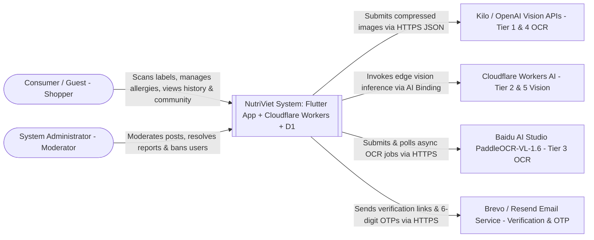
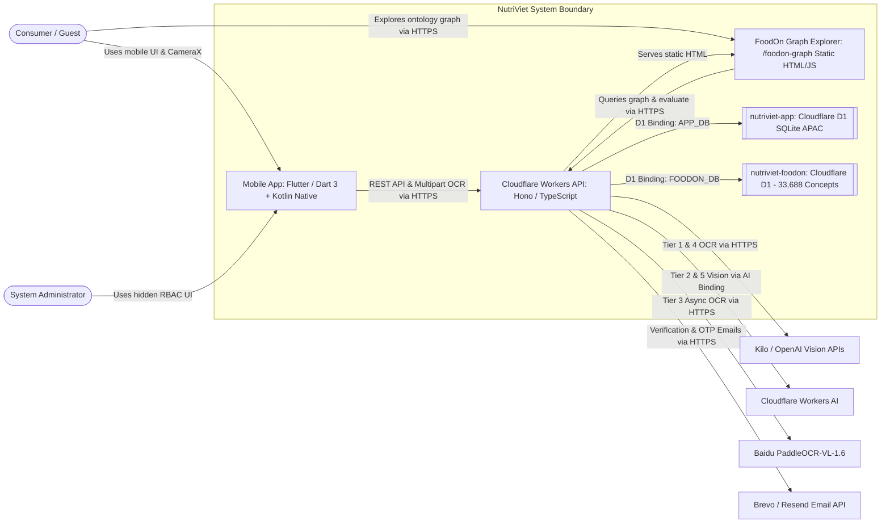
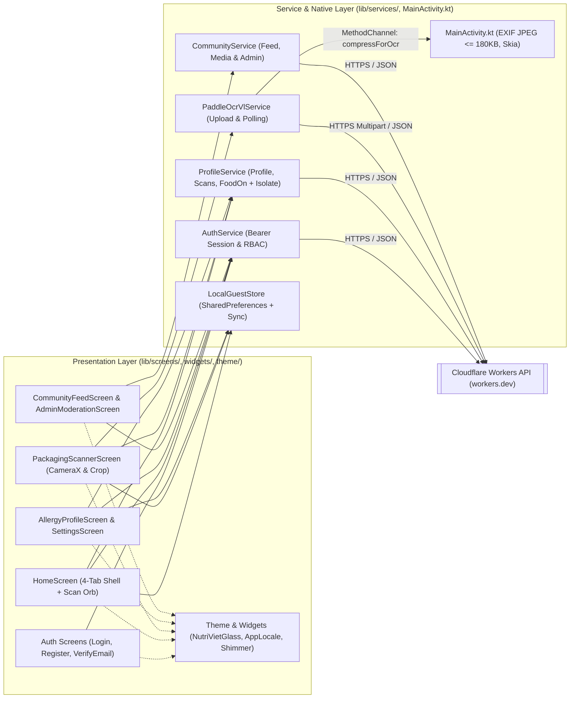
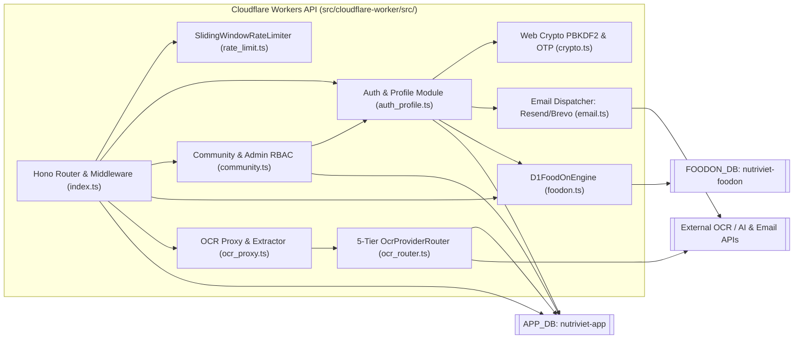
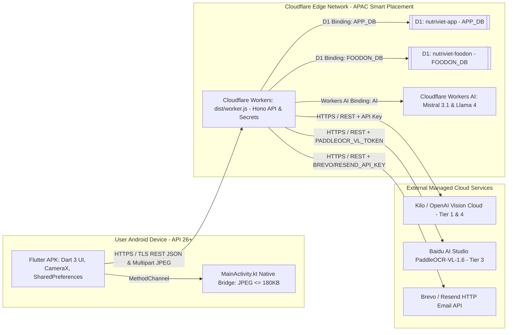

# NutriViet: Software Architecture Document
**System Architecture, Technology Stack & C4 Model**  
**Course:** CS300 - CSC13002 - Introduction to Software Engineering  
**Project Assignment:** PA4-2026 (Sections B, C & D Deliverables)  
**Group:** Group 07 - NutriViet Team  
**Date:** 25/11/2026  

---

## 1. Introduction & Architectural Overview
*Performed by: Le Tat Nam | Reviewed by: Ngo Tien Binh | Edited by: Nguyen Hoang Phuc Thinh*

**NutriViet** is an Android-first mobile application and serverless cloud platform designed to protect consumers with food allergies and chronic metabolic conditions by translating packaged food ingredient labels into instant, unambiguous **RED / YELLOW / GREEN** hazard alerts.

This document formally captures the software architecture of NutriViet as implemented across **PA1 through PA4**, ensuring 100% consistency with the active source code in [`src/mobile/`](../../src/mobile/) and [`src/cloudflare-worker/`](../../src/cloudflare-worker/).

---

## 2. Technology Stack
*Performed by: Le Tat Nam | Reviewed by: Luong Hoang Nam | Edited by: Nguyen Hoang Phuc Thinh*

### 2.1. Frontend & Native Mobile Layer (`src/mobile/`)

| Component | Technology / Package | Version / Spec | Purpose & Implementation Details |
| :--- | :--- | :--- | :--- |
| **Mobile Framework** | **Flutter (Dart)** | SDK `>= 3.0.0 < 4.0.0` (Material 3) | Cross-platform UI client targeting Android (`minSdk` 26+) with custom Liquid Glass theme (`nutriviet_glass.dart`), lazy-mounted `NutriVietTabView`, `NutriVietPageRoute`, and Stale-While-Revalidate home caching. |
| **Native Android Bridge** | **Kotlin (`MainActivity.kt`)** | Android `FlutterActivity` | Exposes `MethodChannel("com.nutriviet/image_opt")` (`compressForOcr`) running on a background executor for EXIF orientation rotation, normalized upright cropping, downscaling (`maxSide = 1280`), and adaptive JPEG compression (`<= 180 KB`). Also manages Skia fallback on low-RAM/non-Vulkan 1.1 devices and high-refresh-rate display mode selection. |
| **Camera & Media** | `camera`, `image_picker` | `^0.12.2`, `^1.2.4` | Full-screen live CameraX viewfinder with torch/focus controls (`PackagingScannerScreen`) and gallery photo import. |
| **Networking** | `http` | `^1.2.0` | Shared `http.Client` with 12s timeouts, multipart image upload to `/api/v1/ocr/jobs`, and `Isolate.run` JSON decoding offload for payloads `> 4096` bytes (`ProfileService`). |
| **Local Persistence** | `shared_preferences` | `^2.2.2` | Stores Bearer session tokens & RBAC role (`AuthService`), UI language (`AppLocale`: `'vi'` / `'en'`), SWR home snapshots, and complete local-first **Guest Mode** data (`LocalGuestStore`: allergens, chronics, family, up to 50 scans). |
| **Icons & Telemetry** | `phosphor_icons`, `NutriVietPerfMonitor` | `3.0.1` | Consistent iconography and opt-in frame-timing telemetry tracking 60Hz/120Hz budget misses. |

### 2.2. Backend Serverless Layer (`src/cloudflare-worker/`)

| Component | Technology / Package | Version / Spec | Purpose & Implementation Details |
| :--- | :--- | :--- | :--- |
| **Serverless Runtime** | **Cloudflare Workers** | `compatibility_date: 2026-11-22` | Edge compute runtime with Smart Placement in APAC (`nutriviet.nutriviet-api.workers.dev`), zero cold-start server management, and encrypted Worker Secrets. |
| **Web Framework** | **Hono** (TypeScript) | `^4.7.4` (`TS ^5.7.3`) | Lightweight REST router (`src/index.ts`) handling CORS, security headers (`nosniff`, `DENY`, `no-referrer`), and modular route registration (`auth_profile.ts`, `community.ts`, `ocr_proxy.ts`). |
| **Cryptography & Auth** | **Web Crypto API** (`crypto.ts`) | PBKDF2-HMAC-SHA256 | 100,000-iteration PBKDF2 password hashing (16-byte random hex salt), 32-byte URL-safe Bearer tokens (`user_sessions`), unbiased 6-digit OTP generation (15-min TTL), and constant-time hex comparison. |
| **Rate Limiting** | `SlidingWindowRateLimiter` | In-isolate (`maxTrackedKeys = 512`) | Per-IP sliding-window throttling on `login` (15/60s), `register` (8/60s), `forgot-password` (5/60s), `reset-password` (8/60s), `resend-verification` (5/60s), and `ocr/jobs` (20/60s). |
| **Ontology & NLP Engine** | `D1FoodOnEngine` + `extractIngredientsSection` | TypeScript (`foodon.ts`, `ingredient_extractor.ts`) | 4-stage ingredient recognition (E/INS codes, `lexical_bridge`, 1–4 word n-grams, Levenshtein fuzzy matching $\ge 82\%$), OCR homoglyph repair, derivative/trace evaluation (`RED`/`YELLOW`/`GREEN`), and fuzzy Ingredients-only extraction. |
| **OCR Failover Router** | `OcrProviderRouter` (`ocr_router.ts`) | 5-tier chain | Fastest-to-slowest failover across 5 Vision/OCR providers with persistent cooldown & failure backoff stored in D1 (`ocr_provider_state`). |
| **Build & Test Tooling** | `esbuild`, `vitest` | `^0.25.0`, `^3.0.7` | Bundles minified ESM Worker (`dist/worker.js`) and executes unit/integration tests (`test/worker.test.ts`). |

### 2.3. Database & Storage Layer (Cloudflare D1 — APAC)

| Binding | Database Name | Technology | Stored Data & Indexes |
| :--- | :--- | :--- | :--- |
| `APP_DB` | `nutriviet-app` | **Cloudflare D1 (SQLite)** | `users`, `user_sessions`, `user_allergens`, `user_chronics`, `user_settings`, `family_members`, `scan_history`, `community_posts`, `community_likes`, `community_comments`, `community_reports`, `community_media` (binary images up to 1.5 MB), `ocr_provider_state`, and `static_pages` (`foodon-graph` HTML). |
| `FOODON_DB` | `nutriviet-foodon` | **Cloudflare D1 (SQLite)** | **33,688** FoodOn concepts (`foodon_concepts`), **53,242** lexical bridge terms (`lexical_bridge`), **742** E-codes (`ecode_bridge`), `foodon_allergen_map`, `foodon_chronic_map`, and 8 B-tree indexes. |

### 2.4. External Services & Integrations

| Service | Integration Mechanism | Purpose |
| :--- | :--- | :--- |
| **Kilo / OpenAI-Compatible Vision APIs** | HTTPS REST (`ocr_router.ts`) | Tier 1 (`kilo-particle-1`: `particle-ai/particle-1:free`) and Tier 4 (`kilo-nemotron-vl`: `nvidia/nemotron-3.5-super-vl:free`) fast packaging OCR extraction. |
| **Cloudflare Workers AI** | `env.AI` binding (`ocr_router.ts`) | Tier 2 (`@cf/mistralai/mistral-small-3.1-24b-instruct`) and Tier 5 (`@cf/meta/llama-4-scout-17b-16e-instruct`) serverless vision fallback. |
| **Baidu AI Studio (`PaddleOCR-VL-1.6`)** | HTTPS REST + `PADDLEOCR_VL_TOKEN` Secret | Tier 3 async layout-parsing OCR (`POST` + `GET` polling with `resultUrl.jsonUrl` JSONL parsing). |
| **Brevo / Resend HTTP Email API** | HTTPS REST (`email.ts`) | Transactional email dispatch for account verification links (`GET /verify-email`) and 6-digit password reset OTPs. |
| **GitHub Spec Kit & Actions** | `.specify/`, `.github/workflows/ci.yml` | Spec-driven development governance (`specs/`) and CI checks. |

---

## 3. C4 Model — Level 1: System Context Diagram
*Performed by: Le Tat Nam | Reviewed by: Ngo Tien Binh | Edited by: Truong Gia Linh*

### 3.1. System Context Diagram (Mermaid)

### 3.2. System Context Explanation

1. **Primary Human Actors:**
   - **Consumer / Guest:** Interacts with the NutriViet Android mobile client either as an authenticated user (persisting profiles, scan history, and community posts in Cloudflare D1) or in local-first **Guest Mode** (`LocalGuestStore` in `SharedPreferences`), where label evaluations run statelessly against `POST /api/v1/foodon/evaluate` with zero cloud writes.
   - **System Administrator (`role === 'admin'`):** Authenticates through the standard login flow and unlocks the hidden `AdminModerationScreen` (and `/api/v1/admin/*` endpoints) to moderate community content, resolve user reports, and ban/unban accounts.
2. **Core System Boundary (`NutriViet System`):**
   - Encompasses the **Flutter + Kotlin Android client** (`src/mobile/`), the **Cloudflare Workers + Hono API** (`src/cloudflare-worker/`), and the two **Cloudflare D1** databases (`nutriviet-app` and `nutriviet-foodon`), plus the Edge-served interactive FoodOn Graph Explorer (`/foodon-graph`).
3. **External Dependencies:**
   - **5-Tier OCR Failover Providers (`Kilo Vision`, `Cloudflare Workers AI`, `Baidu PaddleOCR-VL-1.6`):** All OCR tokens and provider keys are isolated on Cloudflare Workers; the mobile client never holds third-party OCR API keys (unless a user explicitly supplies an optional `X-PaddleOCR-Token` override).
   - **Transactional Email (`Brevo` / `Resend`):** Used exclusively by `src/cloudflare-worker/src/email.ts` to deliver account activation links and 15-minute password reset OTP codes.

---

## 4. C4 Model — Level 2: Container Diagram (Section C)
*Performed by: Le Tat Nam | Reviewed by: Ngo Tien Binh | Edited by: Luong Hoang Nam*

### 4.1. Container Diagram (Mermaid)

### 4.2. Container Descriptions

| Container | Technology / Framework | Responsibilities & Services Provided | Inter-Container Communication |
| :--- | :--- | :--- | :--- |
| **Mobile Application** (`src/mobile/`) | **Flutter (Dart 3.x)** + **Kotlin Native (`MainActivity.kt`)** + `SharedPreferences` | Provides the Android user interface (Home, Live CameraX Scanner, Allergy Profile, Community Feed, Admin Moderation, Settings), native EXIF-aware JPEG compression (`<= 180 KB`), SWR home caching, and local-first Guest Mode (`LocalGuestStore`). | Communicates exclusively with `Cloudflare Workers API` over **HTTPS/JSON** (and multipart `POST /api/v1/ocr/jobs`) using `http.Client` and Bearer tokens (`Authorization: Bearer <token>`). |
| **Cloudflare Workers API** (`src/cloudflare-worker/`) | **Cloudflare Workers** + **Hono `^4.7.4`** + **TypeScript `^5.7.3`** | Exposes all `/api/v1/*` REST endpoints: PBKDF2 auth & OTP reset, Bearer-scoped health profiles & scan history, `D1FoodOnEngine` hazard evaluation, `OcrProviderRouter` 5-tier OCR proxy, Community feed & D1 media hosting, and Admin RBAC moderation. | Connects to `nutriviet-app` via **`APP_DB`** binding and `nutriviet-foodon` via **`FOODON_DB`** binding; invokes external OCR/AI and email providers over **HTTPS** or **`AI` binding**. |
| **nutriviet-app Database** (`APP_DB`) | **Cloudflare D1 (SQLite — APAC)** | Persists user accounts, `user_sessions`, `user_allergens`, `user_chronics`, `user_settings`, `family_members`, `scan_history`, `community_posts/likes/comments/reports/media`, `ocr_provider_state`, and `static_pages`. | Accessed internally by `Cloudflare Workers API` via Cloudflare D1 SQL prepared statements and atomic `batch()` transactions. |
| **nutriviet-foodon Database** (`FOODON_DB`) | **Cloudflare D1 (SQLite — APAC)** | Read-optimized semantic knowledge base storing **33,688** `foodon_concepts`, **53,242** `lexical_bridge` terms, **742** `ecode_bridge` entries, precomputed allergen/chronic maps, and 8 B-tree indexes. | Queried by `D1FoodOnEngine` inside `Cloudflare Workers API` via **`FOODON_DB`** D1 binding. |
| **FoodOn Graph Explorer** (`static/foodon_graph.html`) | **HTML5 / CSS3 / Vanilla JS** (stored in `APP_DB.static_pages`) | Interactive bilingual (VI/EN) ontology visualizer, Label Lab evaluator, and Lowest Common Ancestor (LCA) Path Finder served at `GET /foodon-graph`. | Served by `Cloudflare Workers API` (`Cache-Control: max-age=300`) and calls `/api/v1/foodon/*` endpoints over **HTTPS/JSON**. |

---

## 5. C4 Model — Level 3: Component Diagrams (Section C)

### 5.1. Frontend Container Component Diagram (`src/mobile/`)
*Performed by: Luong Hoang Nam | Reviewed by: Le Tat Nam | Edited by: Ngo Tien Binh*

#### Frontend Component Responsibilities & Relationships

| Component | Location | Responsibility & Relationships |
| :--- | :--- | :--- |
| **Auth Screens** (`LoginScreen`, `RegisterScreen`, `VerifyEmailScreen`) | `lib/screens/` | Handles zero-prefill email/password login, registration, email verification resend, 6-digit OTP password reset, and **Continue as Guest** entry. Delegates API & session state to `AuthService`. |
| **HomeScreen** | `lib/screens/home_screen.dart` | Main 4-tab shell (`NutriVietTabView` + `NutriVietFloatingBottomBar`) with Stale-While-Revalidate `SharedPreferences` snapshot hydration, scan history deletion, and launch orb to `PackagingScannerScreen`. |
| **PackagingScannerScreen** | `lib/screens/packaging_scanner_screen.dart` | Manages `CameraController` (CameraX) and `image_picker` gallery flow, computes normalized crop bounds (`PackagingScannerMath`), triggers OCR via `PaddleOcrVlService`, and evaluates ingredients via `ProfileService` or `LocalGuestStore`. |
| **AllergyProfileScreen & SettingsScreen** | `lib/screens/` | Configures allergens, severities, chronic conditions, `scan_derivatives`/`warn_traces`, family members, VI/EN language (`AppLocale`), Guest-to-Cloud sync, and exposes hidden `AdminModerationScreen` entry when `AuthService.isAdmin` is true. |
| **CommunityFeedScreen & AdminModerationScreen** | `lib/screens/` | Displays community product reviews (blocked for Guests with a sign-in gate), handles photo compose/likes/comments/reports, and provides 3-tab Admin Moderation (`Reports`, `Posts`, `Users`) via `CommunityService`. |
| **Theme & Shared Widgets** (`NutriVietGlass`, `AppLocale`, `NutriVietShimmerGroup`, `NutriVietPerfMonitor`) | `lib/theme/`, `lib/widgets/`, `lib/l10n/` | Shared Liquid Glass styling, strict VI/EN monolingual switching, shared-controller shimmer skeletons, floating notices, and frame-budget telemetry. |
| **AuthService** | `lib/services/auth_service.dart` | Manages `/api/v1/auth/*` calls and persists `auth_token`, `is_guest`, and `user_role` in `SharedPreferences`. |
| **ProfileService** | `lib/services/profile_service.dart` | Calls `/api/v1/profile/*`, `/api/v1/scans*`, and `/api/v1/foodon/*`; offloads JSON parsing `> 4096` bytes to `Isolate.run` and caches category lookups for 5 minutes. |
| **PaddleOcrVlService** | `lib/services/paddle_ocr_vl_service.dart` | Invokes `MainActivity.kt` (`compressForOcr`), uploads compressed JPEGs to `/api/v1/ocr/jobs`, supports sync fast-path and cancellable async polling. |
| **CommunityService** | `lib/services/community_service.dart` | Calls `/api/v1/community/*` and `/api/v1/admin/*` endpoints with Bearer authentication. |
| **LocalGuestStore** | `lib/services/local_guest_store.dart` | Persists Guest Mode allergens, chronics, family, settings, and up to 50 scans locally; merges them into a cloud account via `syncToCloudAccount()`. |
| **MainActivity.kt** | `android/.../MainActivity.kt` | Kotlin native bridge executing background EXIF-aware crop & JPEG compression (`com.nutriviet/image_opt`), low-RAM Skia renderer fallback, and max display refresh rate selection. |

---

### 5.2. Backend Container Component Diagram (`src/cloudflare-worker/`)
*Performed by: Le Tat Nam | Reviewed by: Ngo Tien Binh | Edited by: Nguyen Hoang Phuc Thinh*

#### Backend Component Responsibilities & Relationships

| Component | Source File | Responsibility & Relationships |
| :--- | :--- | :--- |
| **Hono Router & Security Middleware** | `src/index.ts` | Entrypoint configuring global CORS, security headers (`nosniff`, `DENY`, `no-referrer`), `/health`, `/foodon-graph` (from `APP_DB.static_pages`), and `/api/v1/foodon/*` routes; delegates domain routes to `auth_profile.ts`, `community.ts`, and `ocr_proxy.ts`. |
| **SlidingWindowRateLimiter** | `src/rate_limit.ts` | Protects 6 sensitive POST endpoints against brute-force/abuse using `CF-Connecting-IP` / `X-Forwarded-For` with bounded in-isolate map eviction (`429 Retry-After`). |
| **Auth & Profile Module** | `src/auth_profile.ts` | Manages registration, email verification, login/logout, 6-digit OTP password reset, allergen/chronic/settings/family CRUD, and owner-scoped `scan_history`. Calls `FoodOnEngine` to re-evaluate recent scans on allergen updates. |
| **Web Crypto Utility** | `src/crypto.ts` | Implements Web Crypto PBKDF2-HMAC-SHA256 password hashing, SHA-256 OTP digests, rejection-sampled 6-digit OTPs, and constant-time hex comparison. |
| **Email Dispatcher** | `src/email.ts` | Sends HTML + plain-text verification and OTP emails via `RESEND_API_KEY` or fallback `BREVO_API_KEY`. |
| **Community & Admin RBAC** | `src/community.ts` | Provides `authenticateViewer` and `requireAdmin` guards, D1 `community_media` magic-byte upload/serve (`<= 1.5 MB`), community posts/likes/comments/reports, and `/api/v1/admin/*` moderation endpoints. |
| **D1FoodOnEngine** | `src/foodon.ts` | Executes 4-stage ingredient recognition (`ecode_bridge`, `lexical_bridge`, 1–4 word n-grams, Levenshtein fuzzy `>= 0.82`), OCR homoglyph repair, `scan_derivatives`/`warn_traces` evaluation, and graph neighborhood/LCA path queries against `FOODON_DB`. |
| **OCR Proxy & Ingredient Extractor** | `src/ocr_proxy.ts`, `src/ingredient_extractor.ts` | Validates image uploads (`<= 5 MB`), invokes `OcrProviderRouter`, strips Markdown/HTML (`extractCleanOcrText`), and isolates the Ingredients-only section (`extractIngredientsSection`) via fuzzy header matching. |
| **OcrProviderRouter** | `src/ocr_router.ts` | Orchestrates the 5-tier fastest-to-slowest failover chain (`kilo-particle-1` → `cf-mistral-vision` → `baidu-paddleocr` → `kilo-nemotron-vl` → `cf-llama4-vision`), persisting cooldowns and failure counts in `APP_DB.ocr_provider_state`. |

---

## 6. Deployment Diagram (Section D)
*Performed by: Nguyen Hoang Phuc Thinh | Reviewed by: Le Tat Nam | Edited by: Truong Gia Linh*

### 6.1. Deployment Diagram (Mermaid)

### 6.2. Infrastructure Node Descriptions

| Infrastructure Node | Hardware / Cloud Service | Deployed Containers & Components | Communication Protocols |
| :--- | :--- | :--- | :--- |
| **User Android Device** | Physical Android smartphone or Android Emulator (API 26–35, CameraX hardware) | Flutter release/debug APK (`src/mobile/`), `MainActivity.kt` native image optimizer, and `SharedPreferences` local storage (`LocalGuestStore`, session cache). | **HTTPS (TLS)** to Cloudflare Workers (`nutriviet.nutriviet-api.workers.dev`); in-process Flutter `MethodChannel` between Dart and Kotlin. |
| **Cloudflare Workers Runtime** | Cloudflare Edge Serverless Compute (Smart Placement — APAC) | Minified ESM Worker (`dist/worker.js`) running Hono router, `AuthProfile`, `Community/Admin RBAC`, `D1FoodOnEngine`, `OcrProviderRouter`, and encrypted Worker Secrets (`PADDLEOCR_VL_TOKEN`, `BREVO_API_KEY`). | Receives **HTTPS** requests from mobile/browser clients; uses Cloudflare internal bindings (`APP_DB`, `FOODON_DB`, `AI`) and outbound **HTTPS/REST** to external APIs. |
| **Cloudflare D1 Managed SQLite** | Cloudflare D1 Serverless Relational Storage (APAC region) | Two isolated D1 databases: `nutriviet-app` (`APP_DB`) for transactional app/community data + static HTML, and `nutriviet-foodon` (`FOODON_DB`) for the 33,688-concept ontology. | Internal Cloudflare **D1 SQL binding** from `WorkerNode` (zero public database port exposure). |
| **Cloudflare Workers AI** | Cloudflare Edge GPU Inference | Hosts Tier 2 (`@cf/mistralai/mistral-small-3.1-24b-instruct`) and Tier 5 (`@cf/meta/llama-4-scout-17b-16e-instruct`) vision models. | Internal Cloudflare **Workers AI binding (`env.AI`)**. |
| **External Cloud Services** | Kilo Vision API, Baidu AI Studio (`PaddleOCR-VL-1.6`), and Brevo/Resend | Tier 1 & Tier 4 Vision OCR endpoints, Tier 3 async `PaddleOCR-VL-1.6` layout parser, and transactional email delivery service. | Outbound **HTTPS/REST (JSON)** authenticated with encrypted Cloudflare Worker Secrets. |

