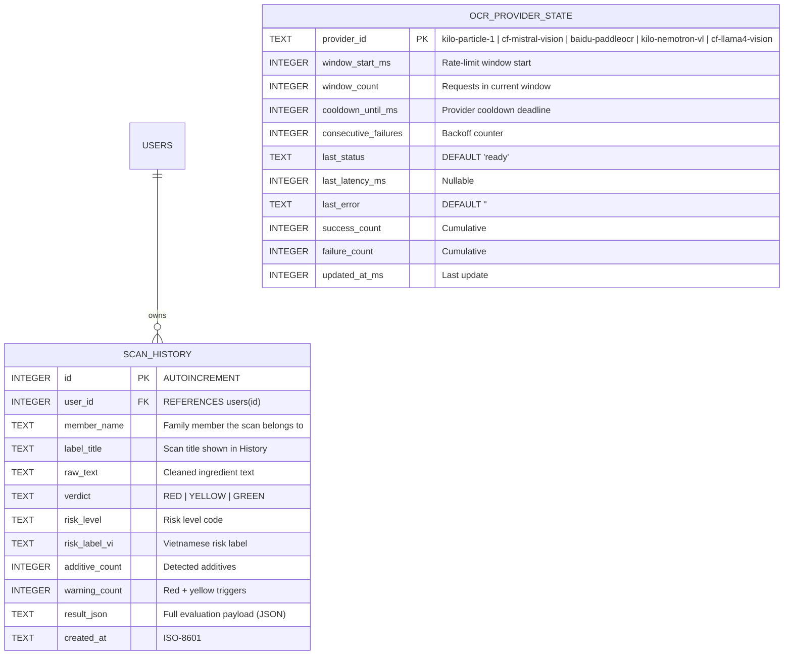

# Data Model: FG3 - Packaging OCR Scanner & Scan History

**Feature**: `003-fg3-ocr-scanner`  
**Specification**: [spec.md](spec.md) | **Plan**: [plan.md](plan.md)  
**Database Engine**: Cloudflare D1 (SQLite APAC — `nutriviet-app`, binding `APP_DB`)  
**Target Tables**: `scan_history`, `ocr_provider_state`

> **Source of truth:** column names below are taken from the SQL used in `src/cloudflare-worker/src/auth_profile.ts` (`scan_history`) and from the `CREATE TABLE IF NOT EXISTS` statement in `src/cloudflare-worker/src/ocr_router.ts` (`ocr_provider_state`). The `scan_history` table itself is provisioned directly on D1 (no DDL in the repository), so its columns are listed as read/written by the code.

---

## 1. Entity-Relationship Schema



---

## 2. DDL for `ocr_provider_state` (verbatim from `ocr_router.ts`)

```sql
CREATE TABLE IF NOT EXISTS ocr_provider_state (
  provider_id TEXT PRIMARY KEY,
  window_start_ms INTEGER NOT NULL DEFAULT 0,
  window_count INTEGER NOT NULL DEFAULT 0,
  cooldown_until_ms INTEGER NOT NULL DEFAULT 0,
  consecutive_failures INTEGER NOT NULL DEFAULT 0,
  last_status TEXT NOT NULL DEFAULT 'ready',
  last_latency_ms INTEGER,
  last_error TEXT NOT NULL DEFAULT '',
  success_count INTEGER NOT NULL DEFAULT 0,
  failure_count INTEGER NOT NULL DEFAULT 0,
  updated_at_ms INTEGER NOT NULL DEFAULT 0
);
```

The router creates this table lazily and silently falls back to isolate-memory state if D1 DDL is unavailable.

---

## 3. `scan_history` Access Patterns (from `auth_profile.ts`)
- **List:** `SELECT id, member_name, label_title, raw_text, verdict, risk_level, risk_label_vi, additive_count, warning_count, result_json, created_at FROM scan_history WHERE user_id = ? ORDER BY id DESC LIMIT 50`
- **Re-evaluate on allergen change:** reads the 25 most recent rows (`ORDER BY id DESC LIMIT 25`) and `UPDATE`s `verdict`, `risk_level`, `risk_label_vi`, `warning_count`, `result_json`.
- **Delete one / clear all:** `DELETE ... WHERE id = ? AND user_id = ?` and `DELETE ... WHERE user_id = ?` (always owner-scoped).

---

## 4. Local Guest Persistence (`SharedPreferences`)
- `nv_guest_scans`: JSON array of the most recent **50** Guest scans (`[newScan, ...existing].take(50)` in `LocalGuestStore.createLocalScan`), with `deleteScan` and `clearScans` support (`src/mobile/lib/services/local_guest_store.dart`).
