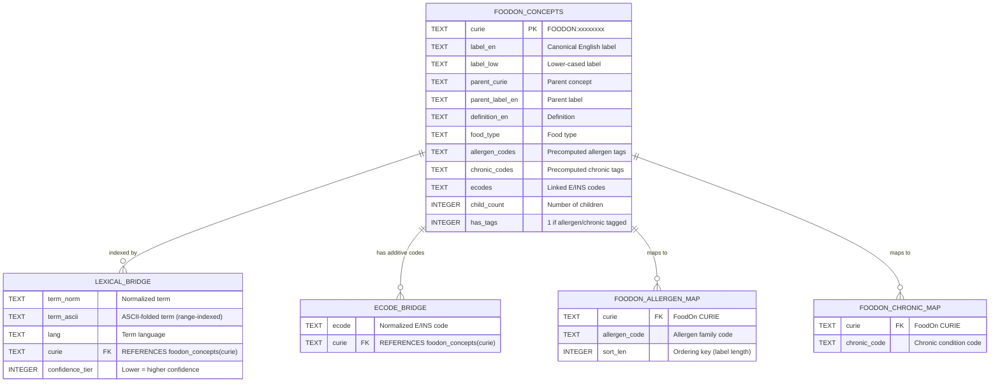

# Data Model: FG4 - FoodOn Allergen & Chronic Hazard Evaluation

**Feature**: `004-fg4-allergen-evaluation`  
**Specification**: [spec.md](spec.md) | **Plan**: [plan.md](plan.md)  
**Database Engine**: Cloudflare D1 (SQLite APAC — `nutriviet-foodon`, binding `FOODON_DB`; plus `nutriviet-app` for `static_pages` and `user_*` profile tables)

> **Source of truth:** columns below are taken from the `FoodOnConceptRow` interface (`src/cloudflare-worker/src/types.ts`) and from the SQL statements in `src/cloudflare-worker/src/foodon.ts`. The FoodOn tables are bulk-loaded directly into D1 (no DDL in the repository), so only the columns actually read by the code are listed.

---

## 1. Entity-Relationship Schema (`FOODON_DB`)

*(`foodon_allergen_map` and `foodon_chronic_map` may contain additional columns not read by the application; only the columns used in queries are shown.)*

---

## 2. Scale & Indexing (`nutriviet-foodon`)
- **`foodon_concepts`**: 33,688 pure-English FoodOn concepts.
- **`lexical_bridge`**: 53,242 lexical terms; queried by `term_norm` (exact) and by `term_ascii` range scans (`term_ascii >= ? AND term_ascii < ?`) for fuzzy candidates.
- **`ecode_bridge`**: 742 E/INS codes.
- **`db_metadata`**: key/value metadata table read via `SELECT key, value FROM db_metadata`.
- **Indexes**: 8 B-tree indexes (documented in `src/cloudflare-worker/README.md`).
- **`APP_DB.static_pages`**: stores the `foodon-graph` HTML served at `GET /foodon-graph`.

## 3. Profile Inputs Consumed by the Engine (`APP_DB`)
- `user_allergens(allergen_code, allergen_name, severity)`, `user_chronics(chronic_code, chronic_name)`, and `user_settings(scan_derivatives, warn_traces, ...)` feed `evaluatePackagingLabel`.
