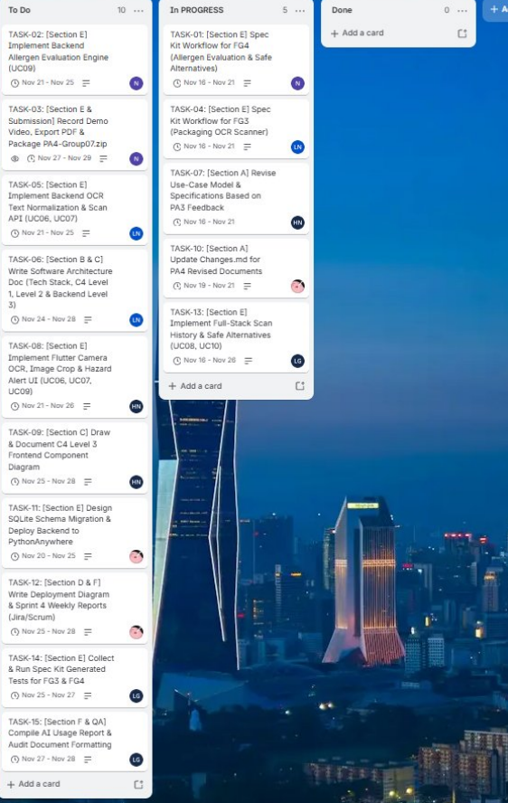
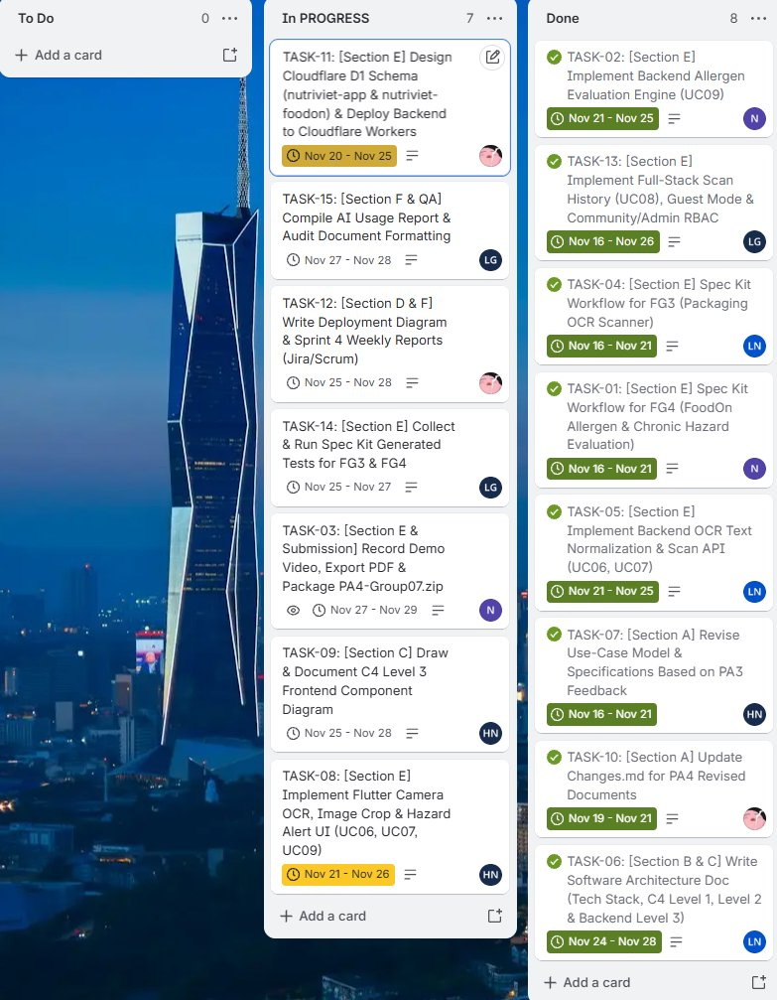
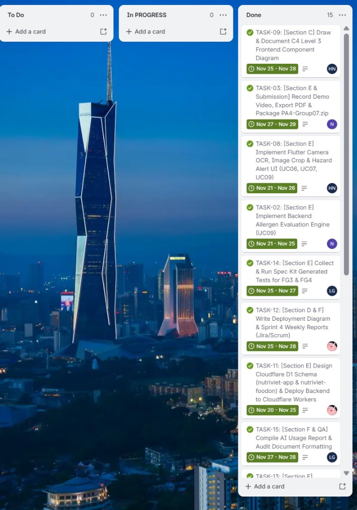

# NutriViet: Weekly Scrum & AI Usage Reports (Sprint 4)
**Agile Meeting Minutes, Trello Tracking & Generative AI Disclosure**  
**Course:** CS300 - CSC13002 - Introduction to Software Engineering  
**Project Assignment:** PA4-2026 (Section F Deliverable)  
**Group:** Group 07 - NutriViet Team  
**Sprint 4 Cadence:** 16/11/2026 – 29/11/2026  

---

## 1. Weekly Scrum Meeting Minutes
*Performed by: Nguyen Hoang Phuc Thinh | Reviewed by: Ngo Tien Binh | Edited by: Truong Gia Linh*

---

### =========== Meeting 1: Sprint 4 Planning (16/11/2026) ===========

**Date & Time:** Monday, 16/11/2026 | 20:00 – 21:30  
**Location:** Google Meet (Online)  
**Team members present:**
- Ngo Tien Binh (PM & AI Lead)
- Le Tat Nam (Backend & Architecture Lead)
- Luong Hoang Nam (UI/UX & Flutter Lead)
- Nguyen Hoang Phuc Thinh (Database & DevOps Lead)
- Truong Gia Linh (QA, Test & Full-Stack Engineer)

**Team members absent:** None (100% Attendance)

---

#### Status Reports & Sprint 4 Kickoff:

#### Ngo Tien Binh (PM & AI Lead)
* **Completed tasks:**
  - Synthesized PA3-2026 TA feedback and decomposed PA4-2026 requirements (Sections A–F) into 15 concrete sprint tasks (`TASK-01` through `TASK-15`) for the 2-week sprint (`16/11/2026 – 29/11/2026`).
  - Configured the Sprint 4 Trello Kanban board with strict **1 Performer (Assignee) + 1 Reviewer** ownership per task.
* **In-Progress Tasks:**
  - Task `TASK-01`: **IN PROGRESS (Nov 16 – Nov 21).** Execute the Spec Kit workflow (`spec.md`, `plan.md`, `tasks.md`, `contracts/`) for **FG4: FoodOn Allergen & Chronic Hazard Evaluation** (and Guest/Community RBAC spec `003`).
* **To-do Tasks:**
  - Task `TASK-02` *(Nov 21 – Nov 25)*: Implement Backend Allergen Evaluation Engine (`UC09`) using `D1FoodOnEngine` (`src/cloudflare-worker/src/foodon.ts` — Levenshtein fuzzy matching $\ge 82\%$ + Cloudflare D1 `nutriviet-foodon` 33,688 concepts + `foodon_graph.html`).
  - Task `TASK-03` *(Nov 27 – Nov 29)*: Record narrated YouTube demo video, export all Markdown documents to PDF, export Git log, and package `PA4-Group07.zip`.
* **Issues/Obstacles:**
  - Tight 2-week sprint window requires freezing FG3 & FG4 implementation by `26/11` so that C4 architecture diagrams accurately reflect the final source code.

#### Le Tat Nam (Backend & Architecture Lead)
* **Completed tasks:**
  - Reviewed existing `src/cloudflare-worker/` structure (`index.ts`, `auth_profile.ts`, `cloudflare.config.ts`) to plan FG3 & FG4 integration on Cloudflare Workers + D1 and C4 architectural mapping.
* **In-Progress Tasks:**
  - Task `TASK-04`: **IN PROGRESS (Nov 16 – Nov 21).** Execute the Spec Kit workflow (`spec.md`, `plan.md`, `tasks.md`, `contracts/`) for **FG3: Packaging OCR Scanner**.
* **To-do Tasks:**
  - Task `TASK-05` *(Nov 21 – Nov 25)*: Implement Backend OCR Text Normalization & Scan API (`UC06`, `UC07`).
  - Task `TASK-06` *(Nov 24 – Nov 28)*: Author Software Architecture Document (`docs/analysis-and-design/architecture.md`) covering Tech Stack, C4 Level 1 (System Context), C4 Level 2 (Container), and C4 Level 3 (Backend Component Diagram).
* **Issues/Obstacles:**
  - Need to align API JSON contracts between Flutter CameraX / native JPEG compression (`MainActivity.kt`) and Cloudflare Workers Edge OCR Router (`/api/v1/ocr/jobs`) early before coding begins.

#### Luong Hoang Nam (UI/UX & Flutter Lead)
* **Completed tasks:**
  - Reviewed PA3 TA feedback on `docs/requirements/use-cases.md` to identify required revisions for Section A.
* **In-Progress Tasks:**
  - Task `TASK-07`: **IN PROGRESS (Nov 16 – Nov 21).** Revise Use-Case Model and Specifications (`docs/requirements/use-cases.md`) to address PA3 feedback and synchronize with `vision.md` and implemented features.
* **To-do Tasks:**
  - Task `TASK-08` *(Nov 21 – Nov 26)*: Implement Flutter Camera OCR, Image Crop & Hazard Alert UI (`UC06`, `UC07`, `UC09`) with WCAG 2.1 dual-coding.
  - Task `TASK-09` *(Nov 25 – Nov 28)*: Draw and document C4 Level 3 Frontend Component Diagram (`src/mobile/lib/`) in `architecture.md`.
* **Issues/Obstacles:**
  - Ensuring smooth camera preview frame rate and accurate bounding-box cropping across different Android screen aspect ratios.

#### Nguyen Hoang Phuc Thinh (Database & DevOps Lead)
* **Completed tasks:**
  - Audited PA3 `Changes.md` format and prepared the Sprint 4 `Changes.md` tracking template.
* **In-Progress Tasks:**
  - Task `TASK-10`: **IN PROGRESS (Nov 19 – Nov 21).** Update `Changes.md` documenting all PA4 revisions compared to the PA3-2026 submission.
* **To-do Tasks:**
  - Task `TASK-11` *(Nov 20 – Nov 25)*: Design Cloudflare D1 (SQLite) Schema Migration (`scan_history`, `foodon_concepts`, `lexical_bridge`, `ecode_bridge`) across `nutriviet-app` & `nutriviet-foodon` and deploy updated backend to Cloudflare Workers (`src/cloudflare-worker/`).
  - Task `TASK-12` *(Nov 25 – Nov 28)*: Author Deployment Diagram in `architecture.md` and compile Sprint 4 Weekly Reports with Jira/Trello progress screenshots.
* **Issues/Obstacles:**
  - Need to ensure Cloudflare D1 schema migrations preserve existing FG1 & FG2 user/profile records without downtime.

#### Truong Gia Linh (QA, Test & Full-Stack Engineer)
* **Completed tasks:**
  - Reviewed FG3 (`UC08`) and Guest/Community RBAC requirements to plan end-to-end Scan History, Guest Mode, and Community/Admin implementation.
* **In-Progress Tasks:**
  - Task `TASK-13`: **IN PROGRESS (Nov 16 – Nov 26).** Implement Full-Stack Scan History (`UC08`), Local-First Guest Mode (`LocalGuestStore`), & Community/Admin RBAC — backend endpoints (`/api/v1/scans`, `/api/v1/community/*`, `/api/v1/admin/*`) and Flutter `HomeScreen` History tab + `ProfileService` + `CommunityFeedScreen` / `AdminModerationScreen`.
* **To-do Tasks:**
  - Task `TASK-14` *(Nov 25 – Nov 27)*: Collect and run automated test suites (`vitest` / `npm test` & `flutter test`) for FG3, FG4, & Community/Guest RBAC.
  - Task `TASK-15` *(Nov 27 – Nov 28)*: Compile detailed AI Usage Report and audit all Markdown documents for English clarity and `Performed by | Reviewed by | Edited by` attribution headers.
* **Issues/Obstacles:**
  - Coordinating `ProfileService` / `LocalGuestStore` scan models with `TASK-11` Cloudflare D1 schema migration.

---

#### Actions & Decisions:
1. **Sprint 4 Scope & Board Initialization:** Confirmed **15 tasks** (`TASK-01` to `TASK-15`) on Trello: **5 tasks immediately In Progress** (`TASK-01`, `TASK-04`, `TASK-07`, `TASK-10`, `TASK-13`), **10 tasks queued in To Do**, and **0 tasks in Done**.
2. **Spec-Driven First:** Spec Kit artifacts (`specs/003-ocr-scanner/`, `specs/004-allergen-evaluation/`, `specs/003-community-guest-rbac/`) and PA3 Use-Case revisions (`TASK-07`, `TASK-10`) must be completed by `21/11/2026`.
3. **Architecture-Code Consistency Rule:** C4 Level 1–3 and Deployment diagrams (`TASK-06`, `TASK-09`, `TASK-12`) will be finalized only after FG3 & FG4 code is frozen on `26/11/2026` to guarantee 100% consistency with the actual codebase.
4. **Next Ceremony:** Mid-Sprint Scrum Standup scheduled for **Sunday, 22/11/2026**.

#### Summary of Meeting 1:
The Sprint 4 Planning meeting successfully kicked off PA4-2026 (`16/11/2026 – 29/11/2026`). All 5 team members aligned on their individual full-stack coding, Spec Kit, architecture documentation, and QA responsibilities, with 5 foundational tasks immediately moved to *In Progress* on the Trello board.

---

### Trello Board Progress Evidence (Sprint 4 Planning - 16/11/2026)

  

*Figure 1.1: NutriViet Sprint 4 Scrum Board on Trello at Sprint Kickoff (16/11/2026), showing 5 tasks In Progress (`TASK-01`, `TASK-04`, `TASK-07`, `TASK-10`, `TASK-13`), 10 tasks queued in To Do, and 0 tasks in Done.*

---

### =========== Meeting 2: Sprint 4 Mid-Sprint Standup & Checkpoint (24/11/2026) ===========

**Date & Time:** Tuesday, 24/11/2026 | 21:00 – 21:45  
**Location:** Google Meet (Online)  
**Team members present:**
- Ngo Tien Binh (PM & AI Lead)
- Le Tat Nam (Backend & Architecture Lead)
- Luong Hoang Nam (UI/UX & Flutter Lead)
- Nguyen Hoang Phuc Thinh (Database & DevOps Lead)
- Truong Gia Linh (QA, Test & Full-Stack Engineer)

**Team members absent:** None (100% Attendance)

---

#### Status Reports & Mid-Sprint Progress (8 Done, 7 In Progress, 0 To Do):

#### Ngo Tien Binh (PM & AI Lead)
* **Completed tasks:**
  - `TASK-01`: **DONE.** Completed Spec Kit artifacts for FG4 (FoodOn Allergen & Chronic Hazard Evaluation).
  - `TASK-02`: **DONE.** Implemented Backend Allergen Evaluation Engine (`UC09`) using `D1FoodOnEngine` (`src/cloudflare-worker/src/foodon.ts` — 4-stage matching, Levenshtein $\ge 82\%$, Cloudflare D1 `nutriviet-foodon` 33,688 concepts, and `foodon_graph.html`).
* **In-Progress Tasks:**
  - `TASK-03`: **IN PROGRESS (Nov 27 – Nov 29).** Preparing narration script and environment to record the YouTube demo video, export Markdown documents to PDF, and package `PA4-Group07.zip`.
* **Issues/Obstacles:**
  - Ensuring final C4 Level 2 & Level 3 diagrams (`TASK-09`, `TASK-12`) stay synchronized with the Cloudflare Workers + D1 migration before recording the demo.

#### Le Tat Nam (Backend & Architecture Lead)
* **Completed tasks:**
  - `TASK-04`: **DONE.** Completed Spec Kit workflow for FG3 (Packaging OCR Scanner).
  - `TASK-05`: **DONE.** Implemented Backend OCR Text Normalization & Scan API (`UC06`, `UC07`) via `src/cloudflare-worker/src/ocr_proxy.ts`, `ocr_router.ts` (5-tier failover + `PaddleOCR-VL-1.6`), and `ingredient_extractor.ts`.
  - `TASK-06`: **DONE.** Authored Software Architecture Document (`docs/analysis-and-design/architecture.md`) covering Tech Stack, C4 Level 1, Level 2, and Backend Level 3 components.
* **In-Progress Tasks:**
  - Supporting final integration review for `TASK-09` and `TASK-11` D1 deployment checks.
* **Issues/Obstacles:**
  - None; all assigned backend OCR and architecture deliverables completed on schedule.

#### Luong Hoang Nam (UI/UX & Flutter Lead)
* **Completed tasks:**
  - `TASK-07`: **DONE.** Revised Use-Case Model and Specifications (`docs/requirements/use-cases.md`) addressing PA3 feedback and aligning with Cloudflare Workers + D1 and CameraX/Edge OCR.
* **In-Progress Tasks:**
  - `TASK-08`: **IN PROGRESS (Nov 21 – Nov 26).** Implementing Flutter CameraX live scanner, gallery crop review (`PackagingScannerMath`), native JPEG compression (`MainActivity.kt`), and hazard alert UI (`UC06`, `UC07`, `UC09`).
  - `TASK-09`: **IN PROGRESS (Nov 25 – Nov 28).** Drawing and documenting C4 Level 3 Frontend Component Diagram (`src/mobile/lib/`) in `architecture.md`.
* **Issues/Obstacles:**
  - Fine-tuning `BoxFit.cover` to image coordinate mapping across different Android aspect ratios in `PackagingScannerScreen`.

#### Nguyen Hoang Phuc Thinh (Database & DevOps Lead)
* **Completed tasks:**
  - `TASK-10`: **DONE.** Updated `Changes.md` documenting all PA4 revisions compared to the PA3-2026 submission.
* **In-Progress Tasks:**
  - `TASK-11`: **IN PROGRESS (Nov 20 – Nov 25).** Finalizing Cloudflare D1 Schema (`nutriviet-app` & `nutriviet-foodon`) and verifying live deployment on Cloudflare Workers (`https://nutriviet.nutriviet-api.workers.dev`).
  - `TASK-12`: **IN PROGRESS (Nov 25 – Nov 28).** Writing Deployment Diagram in `architecture.md` and compiling Sprint 4 Weekly Reports with Trello progress evidence.
* **Issues/Obstacles:**
  - Verifying cold-isolate D1 cooldown persistence (`ocr_provider_state`) and D1 index performance under `nutriviet-foodon`.

#### Truong Gia Linh (QA, Test & Full-Stack Engineer)
* **Completed tasks:**
  - `TASK-13`: **DONE.** Implemented Full-Stack Scan History (`UC08`), Local-First Guest Mode (`LocalGuestStore`), and Community/Admin RBAC (`CommunityFeedScreen`, `AdminModerationScreen`, `/api/v1/scans`, `/api/v1/community/*`, `/api/v1/admin/*`).
* **In-Progress Tasks:**
  - `TASK-14`: **IN PROGRESS (Nov 25 – Nov 27).** Collecting and running automated test suites (`vitest` / `npm test` & `flutter test`) for FG3, FG4, and Community/Guest RBAC.
  - `TASK-15`: **IN PROGRESS (Nov 27 – Nov 28).** Compiling detailed AI Usage Report and auditing all Markdown documents for English clarity and attribution headers.
* **Issues/Obstacles:**
  - None; transitioning cleanly from feature completion (`TASK-13`) into full test verification (`TASK-14`).

---

#### Actions & Decisions:
1. **Milestone Checkpoint (8/15 Done):** Confirmed **8 tasks completed** (`TASK-01`, `TASK-02`, `TASK-04`, `TASK-05`, `TASK-06`, `TASK-07`, `TASK-10`, `TASK-13`), **7 tasks In Progress** (`TASK-03`, `TASK-08`, `TASK-09`, `TASK-11`, `TASK-12`, `TASK-14`, `TASK-15`), and **0 tasks remaining in To Do**.
2. **Trello Stack Alignment:** Updated Trello card descriptions and titles (`TASK-01`, `TASK-11`, `TASK-13`) to reflect the production **Cloudflare Workers + D1** architecture and **Guest Mode + Community/Admin RBAC** scope.
3. **Final Sprint Freeze:** Mobile UI (`TASK-08`) and D1 deployment (`TASK-11`) must be frozen by `26/11/2026` to finalize C4 Frontend Level 3, Deployment Diagram (`TASK-09`, `TASK-12`), automated tests (`TASK-14`), and demo video (`TASK-03`).
4. **Next Ceremony:** Sprint 4 Review & Retrospective scheduled for **Saturday, 28/11/2026**.

#### Summary of Meeting 2:
The Mid-Sprint Standup on `24/11/2026` confirmed strong delivery momentum with over half of the Sprint 4 backlog (`8/15` tasks) completed, including the entire Cloudflare Workers FoodOn & OCR backend, Scan History, Guest Mode, Community/Admin RBAC, and revised Use-Case documentation. The remaining 7 tasks focus on finishing the Flutter scanner UI, C4 Frontend & Deployment diagrams, automated test runs, and final PA4 packaging.

---

### Trello Board Progress Evidence (Mid-Sprint Checkpoint - 24/11/2026)

  

*Figure 1.2: NutriViet Sprint 4 Scrum Board on Trello at Mid-Sprint Checkpoint (24/11/2026), showing **0 To Do**, **7 In Progress** (`TASK-03`, `TASK-08`, `TASK-09`, `TASK-11`, `TASK-12`, `TASK-14`, `TASK-15`), and **8 Done** (`TASK-01`, `TASK-02`, `TASK-04`, `TASK-05`, `TASK-06`, `TASK-07`, `TASK-10`, `TASK-13`).*

---

### =========== Meeting 3: Sprint 4 Review & Retrospective (27/11/2026) ===========

**Date & Time:** Friday, 27/11/2026 | 20:00 – 21:30  
**Location:** Google Meet (Online)  
**Team members present:**
- Ngo Tien Binh (PM & AI Lead)
- Le Tat Nam (Backend & Architecture Lead)
- Luong Hoang Nam (UI/UX & Flutter Lead)
- Nguyen Hoang Phuc Thinh (Database & DevOps Lead)
- Truong Gia Linh (QA, Test & Full-Stack Engineer)

**Team members absent:** None (100% Attendance)

---

#### Final Sprint 4 Status Reports (15/15 Done — 100% Completion):

#### Ngo Tien Binh (PM & AI Lead)
* **Completed tasks:**
  - `TASK-01`, `TASK-02`: **DONE.** Finalized Spec Kit `004-allergen-evaluation` and `D1FoodOnEngine` (`src/cloudflare-worker/src/foodon.ts`) with 33,688 concepts, 53,242 lexical terms, 742 E-codes, and `/foodon-graph`.
  - `TASK-03`: **DONE.** Recorded and published narrated PA4 demonstration video covering FG3 & FG4 end-to-end flows on [YouTube (https://www.youtube.com/watch?v=p96107Qfwzk)](https://www.youtube.com/watch?v=p96107Qfwzk), exported Markdown deliverables to PDF, exported Git commit log, and assembled `PA4-Group07.zip` (excluding `node_modules/`, `build/`, `.dart_tool/`).
* **Issues/Obstacles:** None.

#### Le Tat Nam (Backend & Architecture Lead)
* **Completed tasks:**
  - `TASK-04`, `TASK-05`, `TASK-06`: **DONE.** Finalized Spec Kit `003-ocr-scanner`, Cloudflare Workers Edge OCR Proxy + 5-tier `OcrProviderRouter` + `extractIngredientsSection`, and `docs/analysis-and-design/architecture.md` (Tech Stack, C4 Level 1, Level 2, and Backend Level 3).
* **Issues/Obstacles:** None.

#### Luong Hoang Nam (UI/UX & Flutter Lead)
* **Completed tasks:**
  - `TASK-07`: **DONE.** Revised `docs/requirements/use-cases.md` to align all actors, Mermaid diagrams, and use-case specs with Cloudflare Workers + D1 and CameraX/Edge OCR.
  - `TASK-08`, `TASK-09`: **DONE.** Completed Flutter CameraX + gallery crop (`PackagingScannerScreen`), native EXIF JPEG compression (`MainActivity.kt`), tri-tier hazard UI (`UC06`, `UC07`, `UC09`), and C4 Level 3 Frontend Component Diagram in `architecture.md`.
* **Issues/Obstacles:** None.

#### Nguyen Hoang Phuc Thinh (Database & DevOps Lead)
* **Completed tasks:**
  - `TASK-10`, `TASK-11`, `TASK-12`: **DONE.** Finalized `Changes.md` for PA4-2026, verified Cloudflare D1 (`nutriviet-app` & `nutriviet-foodon`) deployment on Cloudflare Workers (`https://nutriviet.nutriviet-api.workers.dev`), authored Deployment Diagram in `architecture.md`, and compiled Sprint 4 Weekly Reports with Trello evidence.
* **Issues/Obstacles:** None.

#### Truong Gia Linh (QA, Test & Full-Stack Engineer)
* **Completed tasks:**
  - `TASK-13`: **DONE.** Delivered Scan History (`UC08`), Local-First Guest Mode (`LocalGuestStore`), and Community/Admin RBAC (`CommunityFeedScreen`, `AdminModerationScreen`).
  - `TASK-14`: **DONE.** Executed automated test suites across both layers: `vitest run` in `src/cloudflare-worker/test/worker.test.ts` (**19 tests**) and `flutter test` in `src/mobile/test/` (**38 tests**: 11 OCR/scanner tests + 27 widget/store/RBAC tests).
  - `TASK-15`: **DONE.** Compiled the Sprint 4 Generative AI Usage Report and audited all Markdown & PDF files for English clarity, Mermaid rendering (`academic.css`), and `Performed by | Reviewed by | Edited by` headers.
* **Issues/Obstacles:** None.

---

#### Sprint 4 Retrospective & Actions:
1. **100% Sprint Completion:** All **15/15 tasks** (`TASK-01` through `TASK-15`) reached **Done** on Trello (`0 To Do`, `0 In Progress`, `15 Done`).
2. **What Went Well:** Migrating to **Cloudflare Workers + D1** and the 5-tier `OcrProviderRouter` eliminated local server bottlenecks; Spec Kit artifacts (`001`–`004`) and C4 diagrams in `architecture.md` were verified 100% consistent with the source code.
3. **What to Improve for Sprint 5 (PA5-2026):** Complete remaining `UC10` (Safe Product Alternatives), `FG5` (Dietary & Reaction Journal), and `FG6` (Shopping List & Favorites), and perform load/UAT verification.

---

### Trello Board Progress Evidence (Sprint 4 Review - 27/11/2026)

  

*Figure 1.3: NutriViet Sprint 4 Scrum Board on Trello at Sprint Review (27/11/2026), showing **0 To Do**, **0 In Progress**, and **15/15 Done (100%)** across `TASK-01` through `TASK-15`.*

---

## 2. Generative AI Usage Report (Sprint 4)
*Performed by: Truong Gia Linh | Reviewed by: Ngo Tien Binh | Edited by: Nguyen Hoang Phuc Thinh*

### 2.1. AI Usage Declaration & Ownership Boundaries
Group 07 declares that generative AI tools were used strictly as **auxiliary engineering assistants** during Sprint 4 (`16/11/2026 – 27/11/2026`). All architectural decisions, Cloudflare Workers + D1 schema designs, C4 system modeling, Flutter UI/UX implementation, Spec Kit specifications, and test verification were authored, reviewed, and validated by the 5 team members.

### 2.2. Detailed AI Tool Usage Log (Sprint 4)

| Date | Member | AI Tool Used | Task / Artifact | Specific Usage & Human Verification |
| :---: | :--- | :--- | :--- | :--- |
| 16/11 – 20/11 | **Ngo Tien Binh** | GitHub Copilot / Gemini | `004-allergen-evaluation` & `foodon.ts` | Assisted with TypeScript boilerplate for D1 prepared queries and Levenshtein fuzzy threshold tuning (`>= 0.82`); team manually verified all 33,688 FoodOn mappings and unit tests (`worker.test.ts`). |
| 18/11 – 22/11 | **Le Tat Nam** | GitHub Copilot / Gemini | `ocr_router.ts` & `architecture.md` | Assisted with Hono TypeScript type definitions, 5-tier failover state machine scaffolding, and Mermaid C4 diagram syntax formatting; verified against live Cloudflare Workers logs. |
| 20/11 – 24/11 | **Luong Hoang Nam** | GitHub Copilot / Gemini | `packaging_scanner_screen.dart` & `use-cases.md` | Assisted with `BoxFit.cover` crop math helpers and English grammar proofreading in `use-cases.md`; manually tested on physical Android devices. |
| 21/11 – 25/11 | **Nguyen Hoang Phuc Thinh** | Gemini / GitHub Copilot | `Changes.md`, `academic.css` & D1 deployment | Assisted with CSS print/Mermaid SVG page-break fixes (`academic.css`) and Markdown table formatting in `Changes.md`; verified exported PDFs in Chrome. |
| 24/11 – 27/11 | **Truong Gia Linh** | Gemini / GitHub Copilot | `worker.test.ts`, `widget_test.dart` & Section F | Assisted with Vitest/Flutter test case scaffolding and proofreading the Sprint 4 Weekly & AI Usage Reports; executed and verified all 57 automated tests locally. |

### 2.3. Academic Integrity Statement
Every team member takes full academic and engineering responsibility for all submitted source code, Spec Kit artifacts, diagrams, and documentation in **PA4-2026**. No fabricated results, unverified code, or unattributed third-party assets are included in this submission.
