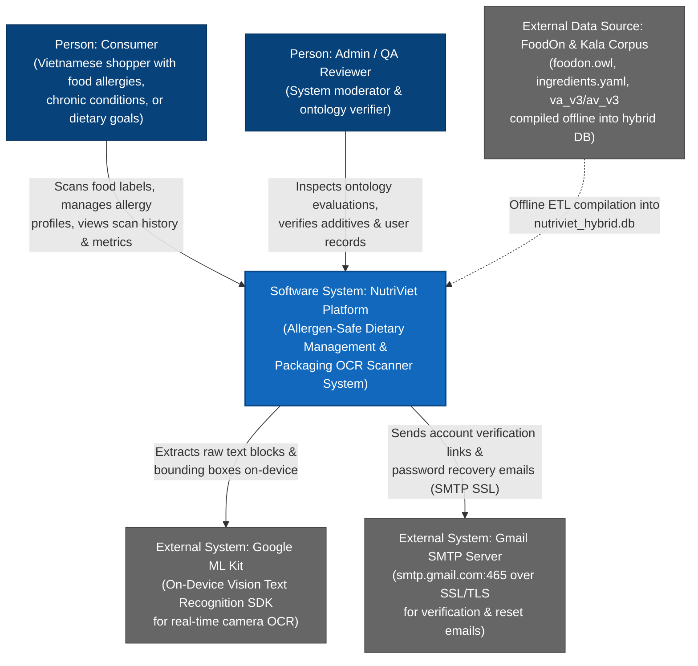
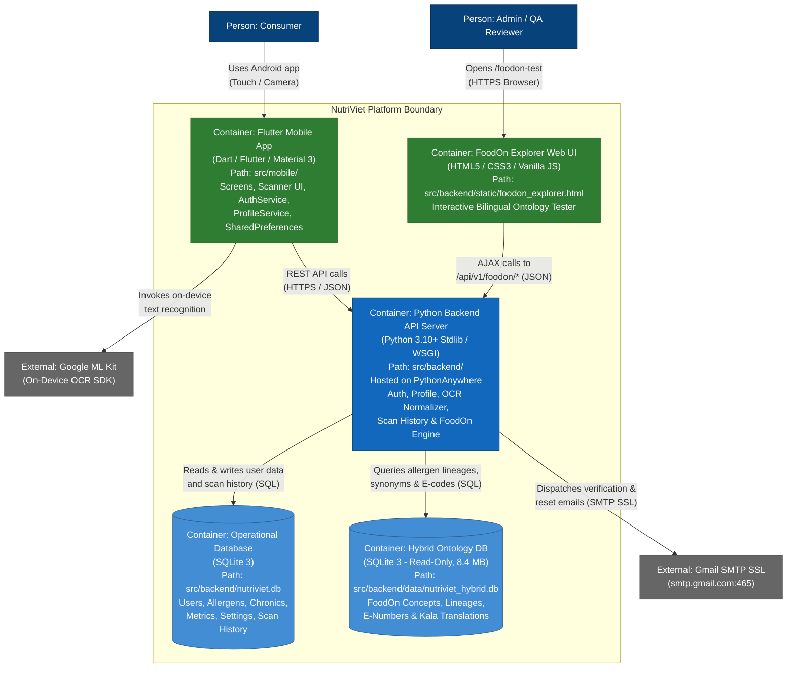
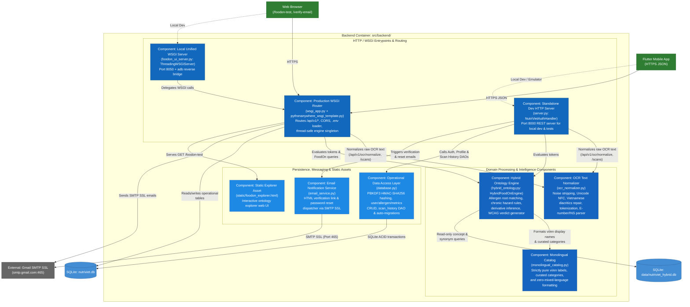
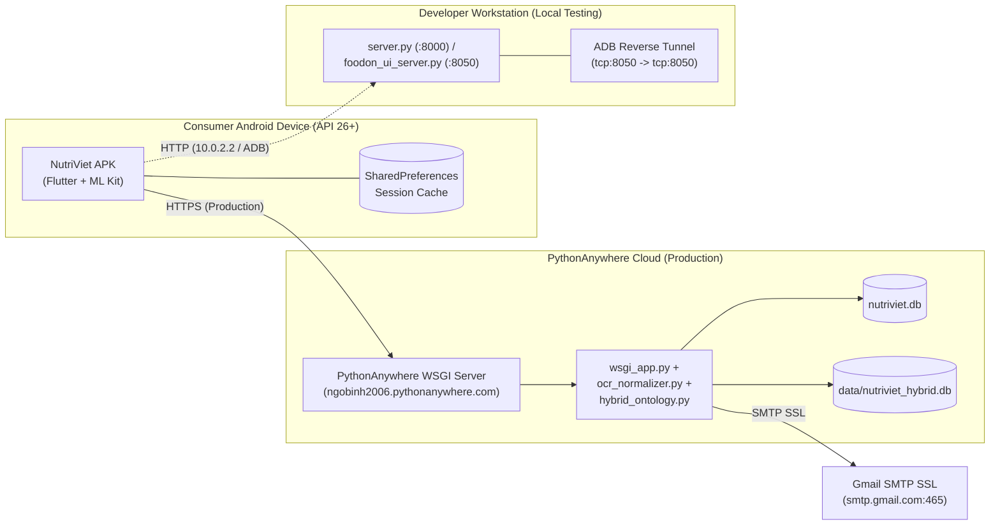

# NutriViet: Software Architecture Document

**Course:** CS300 - CSC13002 - Introduction to Software Engineering  
**Project Assignment:** PA3-2026 (Section B & C Deliverable)  
**Group:** Group 07 - NutriViet Team  
**Performer:** Le Tat Nam  
**Reviewer:** Nguyen Hoang Phuc Thinh  
**Date:** 26/11/2026 → 28/11/2026  
**Version:** 2.0.0  

---

## 1. Introduction & Architectural Goals

### 1.1. Purpose
This Software Architecture Document (SAD) provides a comprehensive technical blueprint of the **NutriViet** platform — an allergen-safe dietary management and food packaging OCR scanner application tailored for Vietnamese consumers. Following the **C4 Model** (Context, Containers, Components), every diagram and specification in this document aligns 100% with the actual source code implemented in `src/mobile/` and `src/backend/`.

### 1.2. Architectural Drivers & Quality Attributes
The architecture of NutriViet is shaped by five primary non-functional requirements derived from the [Vision Document](../requirements/vision.md) and [Use-Case Model](../requirements/use-cases.md):

| Quality Attribute | Target Metric / Constraint | Architectural Mechanism |
|:---|:---|:---|
| **Performance & Low Latency** | Shutter-to-verdict $\le 1.5\text{ s}$; ontology evaluation $< 50\text{ ms}$; viewfinder $\ge 30\text{ fps}$ | Hybrid Edge-Cloud OCR (Google ML Kit on-device extracts compact text $< 2\text{ KB}$) + indexed local SQLite hybrid ontology (`nutriviet_hybrid.db`). |
| **Deployment Simplicity & Portability** | Zero third-party Python runtime dependencies on PythonAnywhere Free Tier | Pure Python 3.8+ standard library backend (`http.server`, `wsgiref`, `sqlite3`, `hashlib`, `smtplib`, `unicodedata`). |
| **Security & Medical Data Privacy** | Salted password hashing, mandatory email verification gate, strict user-scoped queries | PBKDF2-HMAC-SHA256 (100,000 iterations, 16-byte cryptographic salt), 32-byte URL-safe tokens, `is_verified = 1` enforcement, and `ON DELETE CASCADE` foreign keys. |
| **Accessibility (WCAG 2.1 AA)** | Dual-coded safety alerts (color + glyph + localized text) | Tri-color verdict engine returning `RED` (`[!X]`), `YELLOW` (`[!?]`), and `GREEN` (`[OK]`) with strictly monolingual `vi`/`en` catalogs. |
| **Offline & Weak-Signal Resilience** | Usable in low-signal supermarket aisles | On-device ML Kit text extraction + local `shared_preferences` session caching + dual backend failover (`local` / `PythonAnywhere`). |

---

## 2. Technology Stack

All technologies listed below correspond directly to the dependencies declared in [pubspec.yaml](../../src/mobile/pubspec.yaml), [requirements.txt](../../src/backend/requirements.txt), and the runtime modules in `src/backend/` and `src/mobile/`.

### 2.1. Mobile Frontend (`src/mobile/`)
| Category | Technology / Package | Version / Spec | Role in NutriViet |
|:---|:---|:---|:---|
| **Framework & Language** | Flutter & Dart SDK | Dart `>=3.0.0 <4.0.0` | Cross-platform mobile UI (targeting Android API 26–35) using Material Design 3. |
| **Networking** | `http` | `^1.2.0` | Asynchronous REST JSON client powering `AuthService` and `ProfileService`. |
| **Local Persistence** | `shared_preferences` | `^2.2.2` | Persists active user session tokens, user IDs, cached profile state, and `AppLocale` (`vi`/`en`). |
| **UI & Visual Design** | `liquid_glass_easy`, `phosphor_icons` | `^5.2.0`, `3.0.1` | Translucent glassmorphism modals (`nutriviet_glass.dart`), scanner reticle overlays, and crisp vector iconography. |
| **On-Device OCR Engine** | Google ML Kit Text Recognition | Android Vision SDK | Extracts raw Vietnamese/Latin text blocks and bounding boxes locally on the device camera stream (UC06/UC07). |
| **Automated Testing** | `flutter_test`, `flutter_lints` | SDK / `^3.0.0` | Widget tests, localization tests, and static Dart code linting. |

### 2.2. Backend Services (`src/backend/`)
| Category | Technology / Module | Version / Spec | Role in NutriViet |
|:---|:---|:---|:---|
| **Runtime** | Python Standard Library | Python `3.8+` (3.10–3.13) | Zero-external-dependency backend runtime (`json`, `re`, `unicodedata`, `threading`, `urllib.parse`). |
| **Production Web Interface** | WSGI (`wsgi_app.py`) | PEP 3333 | Self-contained production WSGI application serving all `/api/v1/*` endpoints, `/verify-email`, and `/foodon-test`. |
| **Local Dev Servers** | `http.server` (`server.py`) & `wsgiref` (`foodon_ui_server.py`) | Python Stdlib | `server.py` (Port `8000`) for standalone REST API dev; `foodon_ui_server.py` (Port `8050`) with `ThreadingMixIn` and automatic `adb reverse` for physical Android testing. |
| **Cryptography** | `hashlib` & `secrets` | PBKDF2-HMAC-SHA256 | 100,000-iteration salted password hashing and 32-byte cryptographic tokens for email verification and password recovery. |
| **OCR Normalization** | `ocr_normalizer.py` | Custom Regex + NFC | Cleans ML Kit noise (banners, HSD/NSX/KLT), repairs hyphenated line wraps, normalizes Vietnamese diacritics, tokenizes ingredients, and extracts E-number / INS additives. |
| **Ontology Engine** | `hybrid_ontology.py` & `monolingual_catalog.py` | FoodOn + Kala Hybrid | Data-driven hierarchical allergen & chronic-condition hazard evaluator with strictly monolingual Vietnamese/English output. |
| **Email Transport** | `smtplib` + `email.mime` (`email_service.py`) | Gmail SMTP SSL (Port `465`) | Sends HTML account activation emails and temporary password reset codes via `smtp.gmail.com`. |
| **Testing & Offline Build** | `unittest`, `PyYAML` (optional) | Stdlib / `>=6.0` | `test_ocr_scan.py` & `test_wsgi_pythonanywhere.py` for automated verification; `PyYAML` only for offline ontology rebuilds. |

### 2.3. Data Storage & Knowledge Bases
| Store | Engine | File Path | Purpose |
|:---|:---|:---|:---|
| **Operational Database** | SQLite 3 (ACID, `PRAGMA foreign_keys = ON`) | `src/backend/nutriviet.db` | Stores `users`, `user_allergens`, `user_chronics`, `user_metrics`, `user_settings`, `family_members`, and `scan_history`. |
| **Hybrid Ontology Database** | SQLite 3 (Read-Only Compacted Store, ~8.4 MB) | `src/backend/data/nutriviet_hybrid.db` | Pre-compiled FoodOn ontology concepts, taxonomic lineages, E-codes, and Kala Vietnamese–English bilingual dictionary mappings. |

### 2.4. Cloud Hosting & DevOps
| Platform | Configuration | Role |
|:---|:---|:---|
| **PythonAnywhere** | `pythonanywhere_wsgi_template.py` | Production cloud WSGI host serving `https://ngobinh2006.pythonanywhere.com` with whitelisted Gmail SMTP SSL egress. |
| **GitHub & Spec Kit** | `specs/001-*`, `002-*`, `003-*` | Version control, pull-request code reviews, and Spec-Driven Development (SDD) artifact traceability. |

---

## 3. C4 Level 1: System Context Diagram

The System Context diagram establishes the highest-level architectural boundary of **NutriViet**, illustrating how end-users and administrators interact with the platform and how NutriViet integrates with external systems.

### 3.1. Context Participants & Boundaries
1. **Consumer (Primary Actor):** Shoppers, parents, and individuals managing IgE-mediated food allergies (peanuts, seafood, milk, gluten, eggs, soy, tree nuts, sesame) or chronic conditions (diabetes, hypertension, gout, high cholesterol). They interact exclusively through the Android mobile app.
2. **Admin / QA Reviewer (Secondary Actor):** Moderates community product contributions and uses the bilingual FoodOn Explorer web console (`/foodon-test`) to verify ingredient hazard classifications and E-number lookups.
3. **Google ML Kit (External On-Device SDK):** Runs locally inside the Android runtime to detect and recognize Latin/Vietnamese text on food packaging without uploading heavy camera images to the cloud.
4. **Gmail SMTP Server (External Email Gateway):** Handles transactional emails (registration verification links pointing to `/verify-email?token=...` and temporary password recovery notifications).
5. **FoodOn & Kala Corpus (Offline Knowledge Source):** Authoritative global food ontology (FoodOn) combined with Kala bilingual Vietnamese–English databases, compiled offline into a compact SQLite knowledge base shipped with the backend.

---

## 4. C4 Level 2: Container Diagram

Zooming inside the **NutriViet Platform**, the system is decomposed into five deployable/runtime containers across the mobile edge, web browser, cloud application server, and dual SQLite storage layer.

### 4.1. Container Specifications

#### 1. Flutter Mobile Application (`src/mobile/`)
* **Technology:** Flutter / Dart 3.x, Material Design 3, `http`, `shared_preferences`, `liquid_glass_easy`, `phosphor_icons`.
* **Responsibilities:**
  * **Authentication (`FG1`):** `LoginScreen`, `RegisterScreen`, `VerifyEmailScreen`, and `AuthService` (`src/mobile/lib/services/auth_service.dart`). Enforces clean empty forms and mandatory email verification.
  * **Health Profile & Metrics (`FG2`):** `AllergyProfileScreen`, `SettingsScreen`, and `ProfileService` (`src/mobile/lib/services/profile_service.dart`). Manages Top-8 allergens with severity levels (`high`, `moderate`, `mild`), chronic conditions, family members, and BMI/calorie metrics.
  * **OCR Packaging Scanner & History (`FG3` & `FG4`):** `_PackagingScannerScreen` inside `HomeScreen` (`src/mobile/lib/screens/home_screen.dart`). Provides live viewfinder reticle, flashlight toggle, editable OCR text preview, real-time RED/YELLOW/GREEN safety verdict display, and searchable scan history.
  * **Community Features (`FG7`):** `CommunityFeedScreen` and `ContributeProductScreen` for crowdsourced product submissions.
  * **Localization (`src/mobile/lib/l10n/app_locale.dart`):** Instant bilingual switching between Vietnamese (`vi`) and English (`en`).

#### 2. FoodOn Explorer Web UI (`src/backend/static/foodon_explorer.html`)
* **Technology:** Single-page HTML5 / CSS3 / Vanilla JavaScript served directly by the backend at `GET /foodon-test`.
* **Responsibilities:** Provides developers, reviewers, and administrators with an interactive browser console to test allergen lookups, inspect E-number additives, browse curated food categories, and run live packaging evaluations against `/api/v1/foodon/*`.

#### 3. Python Backend API Server (`src/backend/`)
* **Technology:** Python 3.10+ standard library WSGI (`wsgi_app.py` on PythonAnywhere; `server.py` and `foodon_ui_server.py` for local development).
* **Responsibilities:** Acts as the central application tier handling authentication, profile management, OCR text cleaning/normalization, FoodOn ontology hazard inference, email notifications, and scan history persistence.

#### 4. Operational Database (`src/backend/nutriviet.db`)
* **Technology:** Embedded SQLite 3 relational database with `PRAGMA foreign_keys = ON` and `busy_timeout = 5000`.
* **Tables:** `users`, `user_allergens`, `user_chronics`, `user_metrics`, `user_settings`, `family_members`, `scan_history`.
* **Design:** Normalized 3NF relational tables with cascade deletes on `users(id)` and indexed lookups (`idx_user_allergen`, `idx_scan_history_user`) for sub-50ms history queries.

#### 5. Hybrid Ontology Database (`src/backend/data/nutriviet_hybrid.db`)
* **Technology:** Compacted read-only SQLite 3 knowledge store (~8.4 MB).
* **Responsibilities:** Stores FoodOn ontological concepts (CURIEs), parent-child derivation lineages, allergen root anchors, E-number/INS additive metadata, and Kala Vietnamese–English synonym indexes. Separating this read-only knowledge store from `nutriviet.db` eliminates write-lock contention and simplifies knowledge base updates.

---

## 5. C4 Level 3: Component Diagram — Backend Container (`src/backend/`)

Zooming into the **Python Backend API Server (`src/backend/`)**, every component below maps 1:1 to a concrete Python module in the repository.

### 5.1. Backend Component Directory & Responsibilities

| Component | Source File | Key Classes / Functions | Responsibility |
|:---|:---|:---|:---|
| **Production WSGI Router** | `src/backend/wsgi_app.py` | `application()`, `_get_foodon_engine()`, `init_tables()`, `calculate_metrics_info()` | Unified production entrypoint for PythonAnywhere. Handles CORS, JSON parsing, thread-safe lazy initialization of `HybridFoodOnEngine`, and routes all FG1–FG4 REST endpoints plus `/foodon-test` and `/verify-email`. |
| **Cloud WSGI Bootstrap** | `src/backend/pythonanywhere_wsgi_template.py` | `application` export | Configures `sys.path` and environment variables (`NUTRIVIET_DB_PATH`, `NUTRIVIET_GMAIL_USER`, `NUTRIVIET_PUBLIC_BASE_URL`) on PythonAnywhere Web tab. |
| **Standalone Dev HTTP Server** | `src/backend/server.py` | `NutriVietAuthHandler`, `run()` | Lightweight `BaseHTTPRequestHandler` server on Port `8000` integrating `database.py`, `ocr_normalizer.py`, `email_service.py`, and `hybrid_ontology.py`. Used for fast local development and socket-free unit testing. |
| **Local Unified WSGI Server** | `src/backend/foodon_ui_server.py` | `ThreadingWSGIServer`, `_setup_adb_reverse_once()` | Multi-threaded local WSGI runner on Port `8050` wrapping `wsgi_app.application` and automatically executing `adb reverse tcp:8050 tcp:8050` for USB-connected Android devices. |
| **OCR Text Normalizer** | `src/backend/ocr_normalizer.py` | `clean_raw_ocr_text()`, `normalize_vietnamese_diacritics()`, `tokenize_ingredients()`, `extract_e_numbers()`, `normalize_ocr_payload()` | 4-stage pipeline for FG3 (`UC07`): strips packaging banners/metadata (`HSD`, `NSX`, `KLT`), repairs hyphenated line breaks, normalizes Unicode NFC and Vietnamese tones, tokenizes nested percentages, and maps E-numbers/INS codes using `STANDARD_ADDITIVES`. |
| **Hybrid Ontology Engine** | `src/backend/hybrid_ontology.py` | `HybridFoodOnEngine`, `evaluate_packaging_label()`, `classify_concept_risk()` | Queries `data/nutriviet_hybrid.db` to match ingredient tokens against FoodOn allergen root anchors (`FOODON_ALLERGEN_ROOTS`), detects hidden derivatives and chronic-condition triggers, and produces WCAG-compliant `RED`/`YELLOW`/`GREEN` verdicts. |
| **Monolingual Catalog** | `src/backend/monolingual_catalog.py` | `ALLERGEN_DISPLAY_NAMES_VI/EN`, `CHRONIC_DISPLAY_NAMES_VI/EN`, `CURATED_CATEGORY_CURIES` | Enforces strictly monolingual output so Vietnamese (`vi`) responses contain zero English words and English (`en`) responses contain zero Vietnamese words. |
| **Operational Data Access Layer** | `src/backend/database.py` | `init_db()`, `hash_password()`, `create_user()`, `authenticate_user()`, `save_user_allergens()`, `save_scan_session()`, `get_user_scan_history()`, `delete_scan_session()`, `get_scan_statistics()` | Manages SQLite connections, auto-migrations, PBKDF2-HMAC-SHA256 cryptographic password hashing, atomic profile updates, and scan history persistence (`nutriviet.db`). |
| **Email Notification Service** | `src/backend/email_service.py` | `send_verification_email()`, `send_password_reset_email()` | Constructs responsive HTML emails and delivers them over `smtplib.SMTP_SSL("smtp.gmail.com", 465)`. |
| **Automated Test Suites** | `src/backend/test_ocr_scan.py`, `src/backend/test_wsgi_pythonanywhere.py` | `TestOCRNormalizer`, `TestDatabaseScanHistory`, `TestServerAPIEndpoints` | Validates OCR normalization on real Vietnamese retail labels (Hảo Hảo, Oreo), SQLite CRUD/migrations, HTTP handler contracts, and WSGI production routes. |

---

## 6. REST API Surface Summary

All endpoints exposed by the Backend Container (`server.py` and `wsgi_app.py`) follow consistent JSON response envelopes aligned with the OpenAPI contracts in `specs/001-authentication/contracts/`, `specs/002-allergy-profile/contracts/`, and `specs/003-ocr-scanner/contracts/`:

| Functional Group | Method | Endpoint | Primary Components Invoked |
|:---|:---:|:---|:---|
| **System Health** | `GET` | `/health` | `wsgi_app.py` / `server.py` |
| **FG1: Auth** | `POST` | `/api/v1/auth/register` | `database.py` + `email_service.py` |
| **FG1: Auth** | `POST` | `/api/v1/auth/login` | `database.py` (enforces `is_verified == 1`) |
| **FG1: Auth** | `GET` | `/verify-email?token=...` | `database.py` (activates account, returns HTML) |
| **FG1: Auth** | `POST` | `/api/v1/auth/resend-verification` | `database.py` + `email_service.py` |
| **FG1: Auth** | `POST` | `/api/v1/auth/forgot-password` | `database.py` + `email_service.py` |
| **FG1: Auth** | `POST` | `/api/v1/auth/change-password` | `database.py` |
| **FG2: Profile** | `GET` / `POST` | `/api/v1/profile/allergens` | `database.py` + `hybrid_ontology.py` (re-evaluates history) |
| **FG2: Profile** | `GET` / `POST` | `/api/v1/profile/metrics` | `database.py` + BMI calculator |
| **FG2: Profile** | `GET` / `POST` | `/api/v1/profile/settings` | `wsgi_app.py` (`user_settings` table) |
| **FG3: OCR Scanner** | `POST` | `/api/v1/ocr/normalize` | `ocr_normalizer.py` |
| **FG3 & FG4: Scans** | `POST` | `/api/v1/scans` | `ocr_normalizer.py` $\rightarrow$ `hybrid_ontology.py` $\rightarrow$ `database.py` |
| **FG3: History** | `GET` / `DELETE` | `/api/v1/scans` | `database.py` (`scan_history` table) |
| **FG4: Ontology** | `GET` / `POST` | `/api/v1/foodon/*` (`allergy-lookup`, `additives`, `category`, `search`, `evaluate`) | `hybrid_ontology.py` + `monolingual_catalog.py` |
| **Admin / QA** | `GET` | `/foodon-test` | `static/foodon_explorer.html` |

---

## 7. Key Architectural Decisions (ADRs)

1. **Zero-Dependency Python Standard Library Backend:**  
   Instead of deploying heavy frameworks (Django/FastAPI + Uvicorn + SQLAlchemy), the backend uses Python's built-in `wsgiref`, `http.server`, and `sqlite3`. This guarantees instant cold starts, zero `pip` dependency drift on PythonAnywhere Free Tier, and complete self-containment.
2. **Hybrid Edge-Cloud OCR Pipeline:**  
   Running Google ML Kit on-device avoids transmitting multi-megabyte raw camera photos over unstable supermarket mobile networks. Only clean text strings ($< 2\text{ KB}$) cross the network boundary to `ocr_normalizer.py` and `hybrid_ontology.py`.
3. **Dual SQLite Database Separation (`nutriviet.db` vs. `nutriviet_hybrid.db`):**  
   Separating mutable user state (`nutriviet.db`) from the read-only FoodOn + Kala ontology store (`nutriviet_hybrid.db`) prevents SQLite write locks from blocking concurrent ingredient lookups and allows independent ontology upgrades without risking user data.
4. **Thread-Safe Singleton Ontology Engine:**  
   `wsgi_app.py` guards `HybridFoodOnEngine` instantiation with a `threading.Lock()` (`_ENGINE_LOCK`), ensuring that multi-threaded WSGI workers share a single pre-warmed engine instance with sub-20ms query latency.
5. **Automatic Schema Migration on Startup:**  
   Both `database.py` (`init_db()`) and `wsgi_app.py` (`init_tables()`) inspect `PRAGMA table_info(...)` on startup and safely execute `ALTER TABLE` statements for newly added columns (such as `normalized_text`, `tokens_json`, `additives_json` in `scan_history`), enabling zero-downtime upgrades.

---

## 8. Deployment & Runtime Topology

---

## 9. Sign-Off & Traceability

* **Author / Architect:** Le Tat Nam (`TASK-06`)
* **Reviewer:** Nguyen Hoang Phuc Thinh
* **Traceability:** Aligned with `proposal.md`, `docs/requirements/vision.md`, `docs/requirements/use-cases.md`, `specs/001-authentication/`, `specs/002-allergy-profile/`, `specs/003-ocr-scanner/`, `src/mobile/`, and `src/backend/`.
