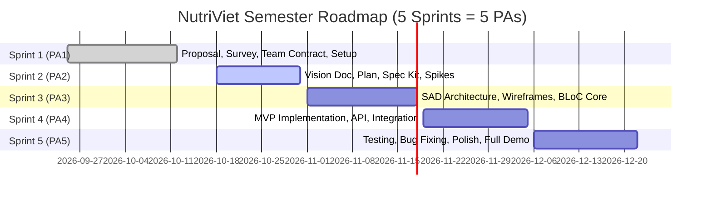
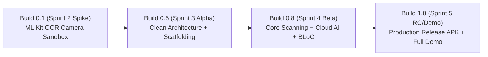

# NutriViet: Project Plan
**Software Engineering Project Plan & Scrum Cadence Specification**  
**Course:** CS300 - CSC13002 - Introduction to Software Engineering  
**Project Assignment:** PA2-2026  
**Group:** Group 07 - NutriViet Team  

---

## 1. Introduction
*Performed by: Ngo Tien Binh | Reviewed by: Truong Gia Linh | Edited by: Le Tat Nam*

### 1.1. Project Overview
**NutriViet** is an intelligent, camera-driven mobile application engineered for the Android platform that delivers personalized food allergen warnings and comprehensive nutrition management for Vietnamese consumers. By integrating on-device Optical Character Recognition (OCR), Levenshtein fuzzy matching, and the FoodOn semantic food ontology, NutriViet empowers individuals suffering from severe allergies (peanuts, seafood, gluten, cow's milk) and chronic metabolic conditions to instantly evaluate packaged food labels in retail environments. The application eliminates the dependency on pre-existing barcode databases through direct camera text extraction, while providing structured daily nutritional logging, safe product alternative recommendations, and a moderated crowdsourcing ecosystem for local food products.

### 1.2. Purpose of the Project Plan
This Project Plan defines the operational roadmap, organizational structure, agile Scrum schedule, risk mitigation protocols, and software build strategy for the NutriViet development lifecycle across the semester. It coordinates the efforts of the 5 engineering team members, aligns task dependencies with the course milestones (PA1 through PA5), establishes transparent quality gates, and guarantees delivery of a fully validated, production-ready mobile application and demonstration by Sprint 5.

---

## 2. Project Overview
*Performed by: Ngo Tien Binh | Reviewed by: Le Tat Nam | Edited by: Nguyen Hoang Phuc Thinh*

### 2.1. Project Goals
1. **Primary Safety Goal:** Deliver an instant (< 2.0s), unambiguous color-coded visual warning system (RED/YELLOW/GREEN) on mobile devices that achieves $\ge 98\%$ recall for primary declared food allergens on packaged labels.
2. **Architectural Goal:** Implement a robust Clean Architecture in Flutter (BLoC pattern) for the client application paired with a modular, containerized Python FastAPI backend and PostgreSQL database.
3. **Engineering Rigor Goal:** Maintain Spec-Driven Development (SDD) via GitHub Spec Kit, achieving $\ge 80\%$ automated unit test coverage across core domain algorithms and zero critical security vulnerabilities.
4. **Agile Process Goal:** Execute 5 disciplined Scrum Sprints, ensuring complete traceability between requirements, Trello task boards, Git commits, peer code reviews, and weekly status reports.

### 2.2. Project Scope
* **In-Scope Capabilities:**
  * Real-time mobile camera capture, image contrast preprocessing, and on-device text token extraction (Google ML Kit OCR).
  * Backend and offline fuzzy text matching against Vietnamese ingredient and additive dictionaries.
  * Hierarchical allergen relationship derivation via the FoodOn ontology graph (e.g., Casein $\rightarrow$ Milk).
  * Customizable personal health profiles (allergens, medical conditions, dietary goals).
  * Daily dietary diary tracking macro/micronutrients (sugar, sodium, purine, calories).
  * Contextual safe food alternative recommendation engine.
  * Community product crowdsourcing and OCR discrepancy reporting.
  * Web-based administrative moderation portal for crowdsourced catalog verification and audit trails.
* **Out-of-Scope Capabilities:**
  * Direct e-commerce purchasing or payment gateway integrations within the application.
  * Automated medical diagnosis or prescription writing (NutriViet provides decision support, not medical treatment).
  * Native iOS build distribution during the academic semester (development focuses exclusively on Android; Flutter ensures cross-platform readiness for future releases).

### 2.3. Project Deliverables
The project deliverables are organized across the 5 course assignment milestones:

| Deliverable ID | Milestone | Description | Target Delivery Date |
|:---:|:---:|:---|:---:|
| **DEL-01** | **PA1** | Project Proposal, Existing App Survey (Yuko & Soosee), Team Contract, Scrum & Git Setup | 12/10/2026 (Completed) |
| **DEL-02** | **PA2** | Initial Vision Document, Initial Project Plan, Spec Kit Setup & Constitution, Sprint 2 Reports | 31/10/2026 (In Progress) |
| **DEL-03** | **PA3** | Refined Vision Document, Revised Project Plan, Software Architecture Document (SAD), UI Prototypes | Mid-November 2026 |
| **DEL-04** | **PA4** | Functional MVP Source Code, Unit & Integration Test Suites, API Contracts, Sprint 4 Reports | Late November 2026 |
| **DEL-05** | **PA5** | Final Integrated Product, Test Reports, Complete Feature Demonstration, Deployment Package | Mid-December 2026 |

### 2.4. Project Assumptions
1. **Developer Tooling & Access:** All 5 team members have functional Android development environments (Flutter SDK, Android Studio, VS Code, Git) and active GitHub student accounts.
2. **Camera Hardware Availability:** Testing physical devices have operational autofocus cameras running Android 8.0 (API 26) or higher.
3. **Scrum Discipline:** Every team member participates in required sprint ceremonies and logs task effort transparently on the shared Trello board.

---

## 3. Project Organization
*Performed by: Le Tat Nam | Reviewed by: Nguyen Hoang Phuc Thinh | Edited by: Truong Gia Linh*

### 3.1. Team Structure and Roles
NutriViet adopts a collaborative Agile team structure where all 5 members act as Full-Stack Software Engineers while assuming designated functional leadership roles:

| Member Name | Student ID | Academic Email | Functional Leadership Role | Primary Responsibilities |
|:---|:---:|:---|:---|:---|
| **Ngo Tien Binh** | **24127004** | `ntbinh2419@clc.fitus.edu.vn` | **Project Manager (PM) & AI Lead** | Overall sprint coordination, liaison with Course TAs, Spec Kit management, Fuzzy Matching & FoodOn ontology AI pipeline, final submission quality. |
| **Le Tat Nam** | **23127432** | `ltnam23@clc.fitus.edu.vn` | **Backend & System Architecture Lead** | System architecture specifications, FastAPI backend services, RESTful API design, database data flow, and role-based access control. |
| **Luong Hoang Nam** | **24127456** | `lhnam2434@clc.fitus.edu.vn` | **UI/UX & Flutter Lead** | Mobile UI/UX Figma design, Flutter Clean Architecture implementation, BLoC state management, camera OCR integration, responsive layout. |
| **Nguyen Hoang Phuc Thinh** | **24127242** | `nhpthinh2416@clc.fitus.edu.vn` | **Database & Git Repository Lead** | PostgreSQL schema design, offline cache data models (SQLite/Hive), Git workflow management, CI/CD pipeline, and package archiving. |
| **Truong Gia Linh** | **24127438** | `tglinh2437@clc.fitus.edu.vn` | **Quality Assurance (QA) & Documentation Lead** | Test planning and test case authoring, weekly Scrum report documentation, meeting moderation, academic formatting compliance, and audit logs. |

### 3.2. Risk Management
*Performed by: Le Tat Nam | Reviewed by: Nguyen Hoang Phuc Thinh | Edited by: Truong Gia Linh*  
*Estimated Effort: 4.0 hours | Status: Complete & Verified*

Risk management is central to ensuring that NutriViet meets its rigorous safety benchmarks (>= 98% recall on declared allergens), sub-2-second latency constraints, and academic semester delivery milestones. The team utilizes a proactive, quantitative risk assessment model rooted in SEI/CMMI risk management principles.

#### 3.2.1. Risk Assessment Framework & Quantification
Each identified risk is evaluated across two orthogonal dimensions on a 3-point ordinal scale:
1. **Likelihood of Occurrence (L):**
   - **Low (1 - Unlikely):** Probability < 20%. Rare occurrence given existing safeguards.
   - **Medium (2 - Possible):** Probability 20% to 50%. Moderate chance under typical operating conditions.
   - **High (3 - Probable):** Probability > 50%. High likelihood of occurrence unless actively mitigated.
2. **Impact Severity (I):**
   - **Low (1 - Minor):** Negligible impact on safety or timeline; minor cosmetic or secondary UX inconvenience.
   - **Medium (2 - Significant):** Component-level degradation, localized sprint delays (<= 48h), or fallback execution required.
   - **High (3 - Critical):** Threat to user health safety (e.g., false-negative allergen misclassification), core architectural failure, or major milestone deadline breach.

The **Risk Exposure Score ($R_E$)** is computed as the product of Likelihood and Impact ($R_E = L \times I$), yielding three risk priority tiers:
- **Critical Risk ($R_E \ge 6$):** Requires mandatory engineering mitigation, automated fallbacks, and weekly executive oversight.
- **Moderate Risk ($3 \le R_E < 6$):** Requires proactive preventive procedures and pre-allocated contingency action plans.
- **Low Risk ($R_E < 3$):** Monitored routinely during bi-weekly Scrum standups.

#### 3.2.2. Risk Assessment Quadrant Chart

```mermaid
quadrantChart
    title Project Risk Assessment Matrix: Likelihood vs Impact
    x-axis Low Likelihood --> High Likelihood
    y-axis Low Impact --> High Impact
    quadrant-1 High Risk (Critical Focus)
    quadrant-2 Moderate Risk (Contingency Required)
    quadrant-3 Low Risk (Monitor Routinely)
    quadrant-4 Moderate Risk (Actionable Prevention)
    R-01 OCR Accuracy on Glossy Labels: [0.78, 0.90]
    R-02 Member Unavailability / Exam Conflicts: [0.65, 0.72]
    R-03 Scope Creep & Feature Bloat: [0.55, 0.80]
    R-04 FoodOn Ontology Query Latency: [0.38, 0.65]
```

#### 3.2.3. Comprehensive Risk Assessment Matrix

The table below synthesizes the 4 primary project risks, their quantified exposure levels, preventive engineering controls, fallback contingencies, and designated leads:

| Risk ID | Category | Risk Description & Failure Mode | Likelihood ($L$) | Impact ($I$) | Risk Exposure ($R_E$) | Mitigation & Preventive Strategy | Contingency & Fallback Action Plan | Owner / Lead |
|:---:|:---:|:---|:---:|:---:|:---:|:---|:---|:---:|
| **R-01** | Technical / AI | **Degraded OCR Accuracy on Real-World Packaging:** High-glare BOPP cellophane, metallic foils, cylindrical beverage cans, and crinkled bags cause character dropouts, misrecognized diacritics, and optical noise. | **High (3)** | **High (3)** | **9 (Critical)** | 1. Implement client-side image contrast preprocessing (CLAHE, adaptive thresholding, perspective unwarping).<br/>2. Apply Levenshtein fuzzy string matching with a **75% similarity threshold** against curated Vietnamese ingredient dictionaries.<br/>3. Auto-prompt flashlight activation when ambient lux drops below threshold. | Provide an intuitive on-screen **1-tap manual text correction interface** with suggested replacement chips so users can amend ambiguous tokens in 1 tap without typing full words. | Luong Hoang Nam (UI/UX) & Ngo Tien Binh (AI) |
| **R-02** | Operational / Resource | **Team Member Unavailability during Midterm Exams:** Academic midterm examination crunches, university project deadlines, or unforeseen illness could stall critical task paths and sprint deliverables. | **Medium (2)** | **High (3)** | **6 (Critical)** | 1. Strict adherence to the **"1 Doer + 1 Reviewer"** pairing rule ensures at least 2 team members possess end-to-end domain knowledge of every code module and document.<br/>2. Enforce **mandatory daily Git branch commits and pushes** to prevent work-in-progress lockup on local machines.<br/>3. Maintain an active availability calendar on the team Discord workspace. | Re-allocate non-critical research tasks if a member experiences an emergency; designated reviewer immediately assumes doer status with zero onboarding lag. | Truong Gia Linh (QA) & Ngo Tien Binh (PM) |
| **R-03** | Scope / Process | **Scope Creep & Feature Bloat:** Expanding system scope into e-commerce checkouts, meal ordering APIs, clinical blood-test parsing, or social gamification threatens on-time completion of core safety deliverables. | **Medium (2)** | **High (3)** | **6 (Critical)** | 1. Strictly enforce the functional boundaries defined in the Project Scope (Section 2.2).<br/>2. Enforce a **formal feature freeze** at the conclusion of Sprint 2 (PA2).<br/>3. Apply strict **MoSCoW backlog prioritization**; classify all non-essential enhancements (social feeds, community badges) as *Priority-3 Backlog*. | Priority-3 Backlog items are completely deferred until core features (FG1–FG4) pass QA testing with >= 80% automated unit test coverage. | Ngo Tien Binh (PM) & Le Tat Nam (Arch) |
| **R-04** | Technical / Architecture | **FoodOn Ontology Query Latency:** Recursive semantic graph traversals for deep allergen lineage (e.g., *Casein -> Cow's Milk -> Dairy*) could exceed the strict < 2.0s scan response threshold over degraded cellular networks. | **Low (1)** | **Medium (2)** | **2 (Low)** | 1. Flatten and precompute primary allergen lineage paths into indexed, materialized relational lookup tables in PostgreSQL.<br/>2. Cache the top 500 most frequent Vietnamese packaged food additives and synonyms directly in Redis and local device storage.<br/>3. Bound recursive ontology graph traversals to a **maximum depth of 4 relationship hops**. | In low-connectivity or high-latency scenarios, fall back immediately to on-device encrypted SQLite/Hive cache evaluation, delivering guaranteed baseline warnings in < 300 ms. | Le Tat Nam (Backend) & Nguyen Hoang Phuc Thinh (DB) |

#### 3.2.4. Detailed Risk Analysis & Actionable Engineering Plans

##### Risk R-01: Degraded OCR Accuracy on Real-World Packaging
* **Engineering Challenge:** In real-world retail shopping, consumers scan items under uneven fluorescent lighting, through transparent reflective shrink-wraps, and over curved surfaces (e.g., cylindrical aluminum beverage cans). Optical noise frequently causes diacritic stripping (e.g., recognizing *"đậu phộng"* as *"dau phong"* or *"trứng"* as *"trung"*), which could lead to disastrous false-negative allergen detection.
* **Concrete Technical Mitigation:**
  1. *Contrast & Preprocessing Pipeline:* Before passing images to Google ML Kit, the Flutter camera layer executes client-side OpenCV-based adaptive contrast equalization (CLAHE) and Otsu binarization to eliminate surface glare.
  2. *75% Fuzzy Match Threshold:* Extracted text tokens are normalized (lowercased, diacritics preserved, punctuation stripped) and evaluated against normalized lexicons using Levenshtein distance:
     $$\text{Similarity}(s_1, s_2) = 1 - \frac{\text{Levenshtein}(s_1, s_2)}{\max(|s_1|, |s_2|)} \ge 0.75$$
     This guarantees that minor OCR substitutions (e.g., *"0"* for *"O"*, *"1"* for *"l"*) match verified allergens.
  3. *1-Tap Manual Correction Interface:* If an extracted token scores between 0.60 and 0.74 against an allergen candidate, the UI renders an inline cautionary prompt with a 1-tap chip (e.g., *"Did you mean Đậu phộng?"*), eliminating manual keyboard retyping.
* **Success Metric:** Achieve >= 98% recall on declared primary food allergens (NFR-REL-01) and < 1.5s preprocessing latency (NFR-PERF-01).

##### Risk R-02: Team Member Unavailability during Midterm Exams
* **Operational Challenge:** The academic semester schedule concentrates major midterm exams, laboratory deliverables, and university commitments in late October and November (coinciding with Sprint 2 and Sprint 3). A single member's absence could stall dependent architecture modules or document reviews.
* **Concrete Operational Mitigation:**
  1. *Enforced "1 Doer + 1 Reviewer" Governance:* Every project work item is explicitly assigned to one primary performer and one designated reviewer. The reviewer actively participates in design discussions, reads commit diffs, and understands code logic in real time.
  2. *Mandatory Daily Git Branch Pushes:* Team members must commit and push all work-in-progress code to remote feature branches at the end of each working day. No unfinished work may remain stranded on private local drives.
  3. *Asynchronous Emergency Handover:* If a team member notifies the PM of unavailability due to exams or illness, the designated reviewer immediately assumes the doer role without requiring lengthy knowledge-transfer sessions. Non-critical tasks (e.g., styling tweaks, secondary documentation) are frozen or rescheduled to later sprints.
* **Success Metric:** Zero critical path task blocked for more than 48 hours throughout Sprint 2 through Sprint 5.

##### Risk R-03: Scope Creep and Feature Bloat
* **Process Challenge:** As the product vision develops, enthusiasm for extra features (e.g., integrating third-party grocery store price comparisons, social meal journals, automated blood-test profile imports, or multi-language speech output) creates severe scope creep, jeopardizing foundational requirements.
* **Concrete Process Mitigation:**
  1. *Formal Scope Freeze at Sprint 2 (PA2):* The system boundary established in Project Scope (Section 2.2) is formally locked at the conclusion of PA2. No new feature requests may be introduced into the Sprint 3–5 backlog without unanimous consent from all 5 leads and formal TA approval.
  2. *Strict MoSCoW Prioritization:* Backlog items are strictly segregated:
     - **Must-Have (P1):** Camera OCR scanning, Fuzzy matching, FoodOn allergen classification, RED/YELLOW/GREEN hazard alert UI, offline profile storage.
     - **Should-Have (P2):** Nutrition/reaction diary, safe alternative recommender, community product crowdsourcing, admin moderation portal.
     - **Could-Have / Won't-Have (P3):** Social sharing, gamification badges, barcode scanner integration, barcode database sync.
  3. *Quality Gate Dependency:* P3 backlog items are strictly barred from active development until all P1 and P2 deliverables pass integration tests with >= 80% test coverage.
* **Success Metric:** 100% adherence to defined functional groups FG1–FG8; zero scope deviation on core deliverables.

##### Risk R-04: FoodOn Semantic Ontology Query Latency
* **Architectural Challenge:** The FoodOn ontology graph contains tens of thousands of classes and extensive multi-hop taxonomic relationships. Querying remote ontology endpoints over public mobile internet (often 3G or degraded 4G in supermarket basements) could introduce network round-trip latencies > 3.0s, directly violating NFR-PERF-02 (< 2.5s total scan response).
* **Concrete Architectural Mitigation:**
  1. *Materialized Relational Paths in PostgreSQL:* Rather than executing live recursive SPARQL/OWL graph queries during scan evaluation, the database precomputes and materializes all ancestor-descendant allergen lineage paths into an indexed relational table (`foodon_allergen_closure`). Query execution drops from recursive multi-second graph traversals to a single indexed SQL lookup:
     $$\text{Execution Time} \le 50\text{ ms}$$
  2. *Top-500 In-Memory Additive Cache:* The top 500 most frequently consumed Vietnamese packaged additives and primary allergen keywords are cached in Redis on the server and embedded in an encrypted SQLite/Hive local database on the mobile client.
  3. *Bounded Recursion (Max Depth 4 Hops):* Any runtime graph query is strictly bounded to a maximum depth of 4 hops, pruning esoteric taxonomic ancestors that do not contribute to clinical consumer warnings.
  4. *Offline Local Triage Fallback:* If network latency exceeds 800 ms or connection is severed, the client executes local offline triage against cached profiles in < 300 ms (NFR-PERF-03).
* **Success Metric:** Database lookup latency <= 50 ms (NFR-SCAL-03); end-to-end hazard alert rendered in < 2.0s over 4G connections.

#### 3.2.5. Continuous Risk Monitoring & Review Cadence
Risk management is an active operational discipline embedded into regular Scrum ceremonies:
1. **Weekly Scrum Standups:** Every Tuesday and Friday standup includes a dedicated 5-minute risk check where members report newly emerging technical blockers or academic conflicts.
2. **Sprint Retrospective Risk Audit:** At the end of each sprint, the QA Lead (Truong Gia Linh) and PM (Ngo Tien Binh) review the risk quadrant chart, reassess likelihood and impact scores, and log mitigated risks in `docs/management/weekly-reports.md`.
3. **Escalation Protocol:** Any risk whose exposure score escalates to >= 6 triggers an immediate architectural sync meeting within 24 hours to execute contingency procedures.

---

## 4. Project Plan & Scrum Cadence
*Performed by: Ngo Tien Binh | Reviewed by: Le Tat Nam | Edited by: Luong Hoang Nam*

The project is structured into **5 consecutive Scrum Sprints**, each spanning 2 to 3 weeks and corresponding directly to course project assignments.

### 4.1. 5-Sprint High-Level Roadmap



1. **Sprint 1 (PA1 - Project Proposal & Setup):** *Completed (25/09/2026 – 12/10/2026)*
   * Established team roster, leadership roles, and working agreement contract.
   * Defined initial 8 Functional Groups, 2 system actors, and AI fuzzy matching concepts.
   * Conducted comprehensive competitive survey of Yuko and Soosee.
   * Configured Git repository, Trello Kanban board, and AI tooling disclosures.
2. **Sprint 2 (PA2 - Vision Document, Project Plan & Spec Kit):** *In Progress (18/10/2026 – 31/10/2026)*
   * Author initial Vision Document (`vision.md`) with standardized tables and Mermaid workflows.
   * Author initial Project Plan (`project-plan.md`) with 5-Sprint schedule and risk management.
   * Integrate GitHub Spec Kit, ratify `constitution.md`, and complete member training.
   * Execute technical spikes on Flutter ML Kit camera capture and FoodOn schema design.
3. **Sprint 3 (PA3 - Software Architecture & UI Prototype):** *Planned (01/11/2026 – 18/11/2026)*
   * Author Software Architecture Document (SAD) with C4 component and deployment models.
   * Design high-fidelity UI/UX interactive wireframes in Figma.
   * Implement foundational Flutter Clean Architecture scaffolding (BLoC, Network, Dependency Injection).
   * Refine Vision Document and Project Plan based on TA evaluation feedback.
4. **Sprint 4 (PA4 - Core Implementation & Integration):** *Planned (19/11/2026 – 05/12/2026)*
   * Implement functional camera OCR pipeline and visual hazard alert rendering (RED/YELLOW/GREEN).
   * Implement FastAPI backend microservices for fuzzy matching and FoodOn ontology queries.
   * Implement user health profile configuration and local SQLite/Hive offline storage.
   * Author unit tests and integration tests achieving $\ge 80\%$ domain code coverage.
5. **Sprint 5 (PA5 - Verification, Polish & Comprehensive Demo):** *Planned (06/12/2026 – 22/12/2026)*
   * Implement Community Crowdsourcing and Admin Moderation portal.
   * Execute end-to-end user acceptance testing (UAT) and load testing (150 concurrent requests).
   * Fix bugs, optimize battery and memory usage, compile production release APK.
   * Deliver live end-to-end product demonstration covering all 8 Functional Groups.

---

### 4.2. Detailed Upcoming Sprint Tasks (Sprint 2 / PA2)
*Duration: 18/10/2026 – 31/10/2026 (Synchronized with Trello Board)*

In accordance with course guidelines, every task represents a concrete project activity, has **exactly one assigned performer**, and is **reviewed by another designated member**.

| Task ID | Task Title & Specific Activity | Performer (Assignee) | Reviewer | Start Date | Due Date | Est. (h) | Status |
|:---:|:---|:---:|:---:|:---:|:---:|:---:|:---:|
| **TASK-01** | **Spec Kit Repository Integration:** Install `specify-cli`, configure `.specify/` infrastructure, author NutriViet `constitution.md`, verify clean Git synchronization. | **Ngo Tien Binh** | Nguyen Hoang Phuc Thinh | 18/10 | 21/10 | 4h | **Done** |
| **TASK-02** | **Spec Kit Training & Learning Notes:** Complete YouTube tutorial series on Spec-Driven Development; document individual learning takeaways. | **All 5 Members** *(Subtasks 02.1 - 02.5)* | Peer Cross-Review | 19/10 | 23/10 | 10h | **In Progress** |
| **TASK-03** | **Vision Doc - Positioning Tables:** Formulate Problem Statement and Product Position Statement tables adhering to course formats. | **Le Tat Nam** | Ngo Tien Binh | 21/10 | 24/10 | 5h | **Done** |
| **TASK-04** | **Vision Doc - Stakeholders & Survey:** Detail user personas, supermarket environmental constraints, update competitive analysis of Yuko & Soosee. | **Truong Gia Linh** | Luong Hoang Nam | 21/10 | 25/10 | 5h | **To Do** |
| **TASK-05** | **Vision Doc - Features & Mermaid:** Author detailed 3–5 sentence paragraphs for FG1–FG8 (What, Why, Who); draw 2 Mermaid workflow diagrams. | **Luong Hoang Nam** | Ngo Tien Binh | 22/10 | 26/10 | 8h | **To Do** |
| **TASK-06** | **Vision Doc - Quantifiable NFRs:** Define measurable thresholds for latency (< 2.0s), security (AES-256, TLS 1.3), scalability, and reliability. | **Nguyen Hoang Phuc Thinh** | Le Tat Nam | 22/10 | 26/10 | 4h | **To Do** |
| **TASK-07** | **Project Plan - Goals & Scope:** Draft project goals, boundaries, assumptions, deliverables, and team organization matrix. | **Ngo Tien Binh** | Truong Gia Linh | 24/10 | 27/10 | 5h | **To Do** |
| **TASK-08** | **Project Plan - Risk Management:** Analyze 4 technical and operational risks (OCR degradation, midterm absences, scope creep, ontology latency) + mitigations. | **Le Tat Nam** | Nguyen Hoang Phuc Thinh | 24/10 | 29/10 | 4h | **Done** |
| **TASK-09** | **Project Plan - Schedule & Build Plan:** Formalize 5-Sprint schedule, milestone build outputs, and task rules; align with Trello board. | **Ngo Tien Binh** | Le Tat Nam | 25/10 | 28/10 | 6h | **To Do** |
| **TASK-10** | **Tech Spike - Flutter Camera OCR:** Benchmark Google ML Kit Text Recognition on sample Vietnamese packaged foods; measure token extraction speed. | **Luong Hoang Nam** | Ngo Tien Binh | 21/10 | 28/10 | 8h | **In Progress** |
| **TASK-11** | **Tech Spike - FoodOn Schema Design:** Analyze FoodOn OWL graph structures and draft normalized relational schema for ingredients and allergen hierarchies. | **Nguyen Hoang Phuc Thinh** | Le Tat Nam | 23/10 | 28/10 | 6h | **To Do** |
| **TASK-12** | **Weekly Report - Scrum Documentation:** Document Sprint Planning (18/10), standup meetings, and Sprint Review agendas in `weekly-reports.md`. | **Truong Gia Linh** | Ngo Tien Binh | 20/10 | 29/10 | 4h | **To Do** |
| **TASK-13** | **AI Usage Logging & Disclosure:** Compile transparent log of AI tool queries (Copilot, Spec Kit, Gemini) for Sprint 2 with academic integrity statements. | **Ngo Tien Binh** | Truong Gia Linh | 28/10 | 30/10 | 3h | **To Do** |
| **TASK-14** | **Packaging, Jira Export & PDF Assembly:** Capture final Trello screenshots, export Git commit history, convert documents to PDF, build `PA2-Group07.zip`. | **Nguyen Hoang Phuc Thinh** | Ngo Tien Binh | 30/10 | 31/10 | 4h | **To Do** |

---

### 4.3. Planned Tasks for Later Sprints (Sprints 3 to 5)

#### Sprint 3 Planned Tasks (Architecture & UI Prototype)
* Author Software Architecture Document (SAD): Architectural patterns, C4 component diagrams, physical deployment architecture.
* Build high-fidelity Figma interactive prototype for all 8 Functional Groups; conduct heuristic evaluation.
* Set up Flutter Clean Architecture folder structure: `core/`, `features/scanner/`, `features/profile/`, `features/history/`.
* Set up FastAPI backend boilerplate with Docker Compose, PostgreSQL container, and health check endpoints.
* Establish automated CI/CD pipeline on GitHub Actions for automated linting and testing.
* Review and update Vision Document and Project Plan based on TA feedback from PA2.

#### Sprint 4 Planned Tasks (Core Implementation & Unit Testing)
* Implement on-device camera scanner UI with live bounding box overlays and flashlight toggle.
* Integrate ML Kit OCR text parser with hyphenated word reconstruction and whitespace normalization.
* Implement Levenshtein fuzzy matching algorithm with benchmarked similarity thresholds.
* Implement FoodOn hierarchical allergen query engine in FastAPI.
* Implement local offline storage using SQLite/Hive for encrypted health profile caching.
* Author comprehensive Unit Test suites targeting $\ge 80\%$ code coverage across all business logic.
* Implement Daily Dietary Diary food logging and nutritional accumulation widgets.

#### Sprint 5 Planned Tasks (Verification, Polish & Live Demonstration)
* Implement Community Food Product Crowdsourcing submission flow and Admin Moderation web portal.
* Implement Safe Food Alternative recommendation algorithm.
* Conduct end-to-end integration testing and user acceptance testing across varying retail packaging types.
* Perform load and stress testing on FastAPI backend simulating 150 concurrent scanning requests.
* Profile and optimize mobile memory footprint, frame rate (stable $\ge 30\text{ fps}$), and battery consumption.
* Finalize comprehensive user guide, API documentation, and presentation slide deck.
* Conduct live product demonstration covering all 8 Functional Groups for course evaluation.

---

## 5. Software Build Plan
*Performed by: Nguyen Hoang Phuc Thinh | Reviewed by: Ngo Tien Binh | Edited by: Le Tat Nam*

To ensure incremental verification and prevent big-bang integration failures, the engineering team schedules **4 planned software build releases** leading to the final demonstration in Sprint 5:



| Build Version | Release Milestone | Target Date | Included Capabilities & Verification Objective | Target Audience |
|:---:|:---:|:---|:---|:---|
| **Build 0.1 (Proof of Concept)** | End of Sprint 2 | 28/10/2026 | Standalone Flutter camera capture spike validating ML Kit text extraction speed and Vietnamese accent recognition. | Internal Engineering Team |
| **Build 0.5 (Alpha Release)** | End of Sprint 3 | 18/11/2026 | Full Clean Architecture mobile shell, interactive mock screens for all 8 Functional Groups, local SQLite database initialized. | Internal Team & QA Lead |
| **Build 0.8 (Beta Release)** | End of Sprint 4 | 05/12/2026 | Fully integrated client-server build: Camera OCR $\rightarrow$ FastAPI Fuzzy Matching $\rightarrow$ FoodOn Graph $\rightarrow$ Visual Hazard Alerts (RED/YELLOW/GREEN). Unit test suites integrated. | Development Team & Course TAs |
| **Build 1.0 (Release Candidate / Final Demo)** | End of Sprint 5 | 20/12/2026 | Complete, hardened Android release APK: Full offline caching fallback, community crowdsourcing, admin moderation portal, polished UI animations, and finalized user documentation. Ready for live classroom demo. | Instructors, TAs & External Evaluators |
