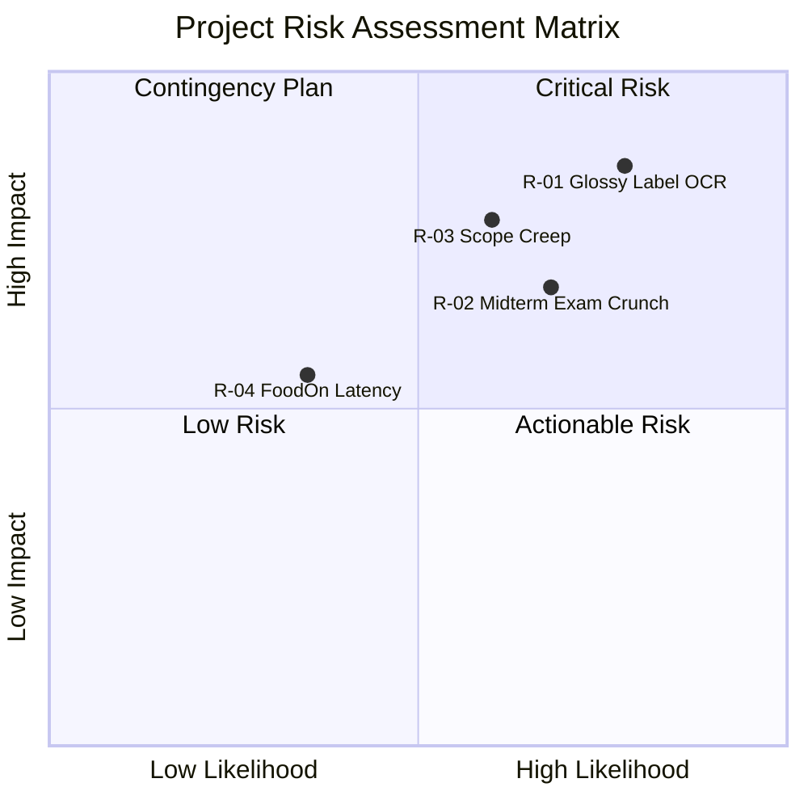

# NutriViet: Project Plan
**Software Engineering Project Plan & Scrum Cadence Specification**  
**Course:** CS300 - CSC13002 - Introduction to Software Engineering  
**Project Assignment:** PA3-2026 (2nd Submission)  
**Group:** Group 07 - NutriViet Team  

---

## 1. Introduction
*Performed by: Ngo Tien Binh | Reviewed by: Truong Gia Linh | Edited by: Le Tat Nam*

### 1.1. Project Overview
**NutriViet** is an intelligent, camera-driven mobile application engineered for the Android platform that delivers personalized food allergen warnings and comprehensive nutrition management for Vietnamese consumers. By integrating on-device Optical Character Recognition (OCR), Levenshtein fuzzy matching, and the FoodOn semantic food ontology, NutriViet empowers individuals suffering from severe allergies (peanuts, seafood, gluten, cow's milk) and chronic metabolic conditions to instantly evaluate packaged food labels in retail environments. The application eliminates the dependency on pre-existing barcode databases through direct camera text extraction, while providing structured daily nutritional logging, safe product alternative recommendations, and a moderated crowdsourcing ecosystem for local food products.

### 1.2. Purpose of the Project Plan
This Project Plan defines the operational roadmap, organizational structure, agile Scrum schedule, and risk mitigation protocols for the NutriViet development lifecycle across the semester. It coordinates the efforts of the 5 engineering team members, aligns task dependencies with the course milestones (PA1 through PA5), establishes transparent quality gates, and guarantees delivery of a fully validated, production-ready mobile application and demonstration by Sprint 5.

---

## 2. Project Overview
*Performed by: Ngo Tien Binh | Reviewed by: Le Tat Nam | Edited by: Nguyen Hoang Phuc Thinh*

### 2.1. Project Goals
1. **Primary Safety Goal:** Deliver an instant (< 2.0s), unambiguous color-coded visual warning system (RED/YELLOW/GREEN) on mobile devices that achieves $\ge 98\%$ recall for primary declared food allergens on packaged labels.
2. **Architectural Goal:** Implement a robust Clean Architecture in Flutter (BLoC pattern) for the client application paired with a modular, containerized Python FastAPI backend and PostgreSQL database.
3. **Engineering Rigor Goal:** Maintain Spec-Driven Development (SDD) via GitHub Spec Kit, achieving $\ge 80\%$ automated unit test coverage across core domain algorithms and zero critical security vulnerabilities.
4. **Agile Process Goal:** Execute 5 disciplined Scrum Sprints, ensuring complete traceability between requirements, Trello task boards, Git commits, peer code reviews, and weekly status reports.

### 2.2. Project Scope
* **In-Scope Capabilities:**
  * Real-time mobile camera capture, image contrast preprocessing, and on-device text token extraction (Google ML Kit OCR).
  * Backend and offline fuzzy text matching against Vietnamese ingredient and additive dictionaries.
  * Hierarchical allergen relationship derivation via the FoodOn ontology graph (e.g., Casein $\rightarrow$ Milk).
  * Customizable personal health profiles (allergens, medical conditions, dietary goals).
  * Daily dietary diary tracking macro/micronutrients (sugar, sodium, purine, calories).
  * Contextual safe food alternative recommendation engine.
  * Community product crowdsourcing and OCR discrepancy reporting.
  * Web-based administrative moderation portal for crowdsourced catalog verification and audit trails.
* **Out-of-Scope Capabilities:**
  * Direct e-commerce purchasing or payment gateway integrations within the application.
  * Automated medical diagnosis or prescription writing (NutriViet provides decision support, not medical treatment).
  * Native iOS build distribution during the academic semester (development focuses exclusively on Android; Flutter ensures cross-platform readiness for future releases).

### 2.3. Project Assumptions
1. **Developer Tooling & Access:** All 5 team members have functional Android development environments (Flutter SDK, Android Studio, VS Code, Git) and active GitHub student accounts.
2. **Camera Hardware Availability:** Testing physical devices have operational autofocus cameras running Android 8.0 (API 26) or higher.
3. **Scrum Discipline:** Every team member participates in required sprint ceremonies and logs task effort transparently on the shared Trello board.

---

## 3. Project Organization
*Performed by: Le Tat Nam | Reviewed by: Nguyen Hoang Phuc Thinh | Edited by: Truong Gia Linh*

### 3.1. Team Structure and Roles
NutriViet adopts a collaborative Agile team structure where all 5 members act as Full-Stack Software Engineers while assuming designated functional leadership roles:

| Member Name | Student ID | Functional Leadership Role | Primary Responsibilities |
|:---|:---:|:---|:---|
| **Ngo Tien Binh** | **24127004** | **Project Manager (PM) & AI Lead** / Full-Stack Engineer | Overall sprint coordination, liaison with Course TAs, Spec Kit management; AI algorithm development (Levenshtein fuzzy matching in Python/Dart, FoodOn ontology graph queries), and algorithm test verification. |
| **Le Tat Nam** | **23127432** | **Backend & System Architecture Lead** / Full-Stack Engineer | System architecture specifications; FastAPI backend services implementation, RESTful API endpoints, user authentication/RBAC (User/Admin), and Docker service containerization. |
| **Luong Hoang Nam** | **24127456** | **UI/UX & Flutter Lead** / Full-Stack Engineer | Mobile UI/UX Figma & interactive prototypes; Flutter client development (Clean Architecture + BLoC), camera OCR text recognition pipeline (Google ML Kit integration), and visual hazard alert rendering (RED/YELLOW/GREEN). |
| **Nguyen Hoang Phuc Thinh** | **24127242** | **Database & DevOps Lead** / Full-Stack Engineer | PostgreSQL schema design and migrations; client-side encrypted offline caching layer (SQLite/Hive in Flutter), Git workflow management, and automated GitHub Actions CI/CD pipelines. |
| **Truong Gia Linh** | **24127438** | **QA & Test Automation Lead** / Full-Stack Engineer | Automated test suite development (Flutter unit & widget test scripts, backend pytest integration tests targeting $\ge 80\%$ coverage), Daily Dietary Diary feature development (FG5 logging & nutritional accumulation logic), and Scrum QA documentation. |

### 3.2. Risk Management
The team has identified 4 critical project risks spanning technical, operational, and scope dimensions, and formulated concrete mitigation strategies for each:

| Risk ID | Risk Category | Risk Description | Severity | Likelihood | Mitigation & Contingency Strategy |
|:---:|:---:|:---|:---:|:---:|:---|
| **R-01** | Technical | **Degraded OCR Accuracy on Real-World Packaging:** Glossy cellophane, curved cans, and crinkled bags cause character dropouts and noise in text recognition. | **High** | **High** | 1. Implement client-side image contrast preprocessing and adaptive binarization before OCR. 2. Apply Levenshtein fuzzy matching with a 75% similarity threshold against verified ingredient dictionaries. 3. Provide an intuitive on-screen manual text correction interface so users can amend ambiguous tokens in 1 tap. |
| **R-02** | Operational | **Team Member Unavailability during Midterms:** Illness or academic midterm examination crunches could stall critical task paths. | **High** | **Medium** | 1. Strict adherence to the **"1 Doer + 1 Reviewer"** rule ensures at least 2 members are fully familiar with every piece of code and documentation. 2. All work-in-progress code must be committed to Git feature branches daily to prevent progress lockup. 3. Re-allocate non-critical research tasks if a member experiences an emergency. |
| **R-03** | Scope | **Scope Creep / Feature Bloat:** Expanding into e-commerce, meal ordering, or complex medical lab data could prevent on-time project completion. | **High** | **Medium** | 1. Strictly enforce the boundaries defined in the Project Scope (Section 2.2). 2. Freeze feature specifications at the conclusion of Sprint 2 (PA2). 3. Classify all "nice-to-have" enhancements (e.g., social feed, gamification badges) as *Priority-3 Backlog* items that will only be touched if core deliverables pass QA ahead of schedule. |
| **R-04** | Technical / Architecture | **FoodOn Ontology Query Latency:** Complex recursive graph lookups for hidden allergen lineage could exceed the 2.0s latency threshold over the network. | **Medium** | **Low** | 1. Flatten and precompute primary allergen lineage paths into indexed relational lookup tables in PostgreSQL. 2. Cache the top 500 most frequent Vietnamese packaged food additives directly in Redis and local device storage. 3. Bound recursive ontology lookups to a maximum depth of 4 relationship hops. |

---

## 4. Project Plan & Scrum Cadence
*Performed by: Ngo Tien Binh | Reviewed by: Le Tat Nam | Edited by: Luong Hoang Nam*

The project is structured into **5 consecutive Scrum Sprints**, each spanning 2 to 3 weeks and corresponding directly to course project assignments.

### 4.1. 5-Sprint High-Level Roadmap

1. **Sprint 1 (PA1 - Project Proposal & Setup):** *Completed (25/09/2026 – 12/10/2026)*
   * Established team roster, leadership roles, and working agreement contract.
   * Defined initial 8 Functional Groups, 2 system actors, and AI fuzzy matching concepts.
   * Conducted comprehensive competitive survey of Yuko and Soosee.
   * Configured Git repository, Trello Kanban board, and AI tooling disclosures.
2. **Sprint 2 (PA2 - Vision Document, Project Plan & Spec Kit):** *Completed (18/10/2026 – 31/10/2026)*
   * Authored initial Vision Document (`vision.md`) with standardized tables and Mermaid workflows.
   * Authored initial Project Plan (`project-plan.md`) with 5-Sprint schedule and risk management.
   * Integrated GitHub Spec Kit, ratified `constitution.md`, and completed member training.
   * Executed technical spikes on Flutter ML Kit camera capture and FoodOn schema design.
3. **Sprint 3 (PA3 - Requirements Elaboration, Use-Case Specifications, UI Prototype & Spec Kit E2E Implementation):** *Active Sprint (01/11/2026 – 18/11/2026)*
   * Revise Project Plan and Vision Document based on evaluation rubrics; maintain unified `Changes.md`.
   * Model complete system use cases via Mermaid diagrams covering FG1 through FG8 (Section C).
   * Elaborate comprehensive Use-Case Specifications for every use case (Section D) including basic flow, alternative flows, and postconditions.
   * Develop interactive UI prototypes for each use case and embed screenshots in specifications.
   * Select and implement 1 Functional Group end-to-end (UI + API/Logic + Data Persistence) following the Spec Kit spec-driven workflow (Section E).
   * Record video demo with narration demonstrating the working feature; compile AI and weekly Scrum reports (Section F).
4. **Sprint 4 (PA4 - Core Implementation, Multi-Feature Integration & Domain Testing):** *Planned (19/11/2026 – 05/12/2026)*
   * Integrate camera OCR pipeline with live bounding boxes and flashlight control across device form factors.
   * Implement FastAPI backend microservices for fuzzy matching and FoodOn ontology queries.
   * Implement user health profile configuration and local SQLite/Hive offline storage.
   * Author unit tests and integration tests achieving $\ge 80\%$ domain code coverage.
5. **Sprint 5 (PA5 - Verification, Polish & Comprehensive Demo):** *Planned (06/12/2026 – 22/12/2026)*
   * Implement Community Crowdsourcing and Admin Moderation portal.
   * Execute end-to-end user acceptance testing (UAT) and load testing (150 concurrent requests).
   * Fix bugs, optimize battery and memory usage, compile production release APK.
   * Deliver live end-to-end product demonstration covering all 8 Functional Groups.

---

### 4.2. Sprint 2 Completed Tasks (PA2 Archive)
*Duration: 18/10/2026 – 31/10/2026 (Synchronized with Trello Board)*

| Task ID | Task Title & Specific Activity | Performer (Assignee) | Reviewer | Start Date | Due Date | Status |
|:---:|:---|:---:|:---:|:---:|:---:|:---:|
| **TASK-01** | **Spec Kit Repository Integration:** Install `specify-cli`, configure `.specify/` infrastructure, author NutriViet `constitution.md`, verify clean Git synchronization. | **Ngo Tien Binh** | Nguyen Hoang Phuc Thinh | 18/10 | 21/10 | **Done** |
| **TASK-02** | **Spec Kit Training & Learning Notes:** Complete YouTube tutorial series on Spec-Driven Development; document individual learning takeaways. | **All 5 Members** *(Subtasks 02.1 - 02.5)* | Peer Cross-Review | 19/10 | 23/10 | **Done** |
| **TASK-03** | **Vision Doc - Positioning Tables:** Formulate Problem Statement and Product Position Statement tables adhering to course formats. | **Le Tat Nam** | Ngo Tien Binh | 21/10 | 24/10 | **Done** |
| **TASK-04** | **Vision Doc - Stakeholders & Survey:** Detail user personas, supermarket environmental constraints, update competitive analysis of Yuko & Soosee. | **Truong Gia Linh** | Luong Hoang Nam | 21/10 | 25/10 | **Done** |
| **TASK-05** | **Vision Doc - Features & Mermaid:** Author detailed 3–5 sentence paragraphs for FG1–FG8 (What, Why, Who); draw 2 Mermaid workflow diagrams. | **Luong Hoang Nam** | Ngo Tien Binh | 22/10 | 26/10 | **Done** |
| **TASK-06** | **Vision Doc - Quantifiable NFRs:** Define measurable thresholds for latency (< 2.0s), security (AES-256, TLS 1.3), scalability, and reliability. | **Nguyen Hoang Phuc Thinh** | Le Tat Nam | 22/10 | 26/10 | **Done** |
| **TASK-07** | **Project Plan - Goals & Scope:** Draft project goals, boundaries, assumptions, deliverables, and team organization matrix. | **Ngo Tien Binh** | Truong Gia Linh | 24/10 | 27/10 | **Done** |
| **TASK-08** | **Project Plan - Risk Management:** Analyze 4 technical and operational risks (OCR degradation, midterm absences, scope creep, ontology latency) + mitigations. | **Le Tat Nam** | Nguyen Hoang Phuc Thinh | 24/10 | 29/10 | **Done** |
| **TASK-09** | **Project Plan - Schedule & Sprint Roadmap:** Formalize 5-Sprint schedule, milestone deliverables, and task rules; align with Trello board. | **Ngo Tien Binh** | Le Tat Nam | 25/10 | 28/10 | **Done** |
| **TASK-10** | **Tech Spike - Flutter Camera OCR:** Benchmark Google ML Kit Text Recognition on sample Vietnamese packaged foods; measure token extraction speed. | **Luong Hoang Nam** | Ngo Tien Binh | 21/10 | 28/10 | **Done** |
| **TASK-11** | **Tech Spike - FoodOn Schema Design:** Analyze FoodOn OWL graph structures and draft normalized relational schema for ingredients and allergen hierarchies. | **Nguyen Hoang Phuc Thinh** | Le Tat Nam | 23/10 | 28/10 | **Done** |
| **TASK-12** | **Weekly Report - Scrum Documentation:** Document Sprint Planning (18/10), standup meetings, and Sprint Review agendas in `weekly-reports.md`. | **Truong Gia Linh** | Ngo Tien Binh | 20/10 | 29/10 | **Done** |
| **TASK-13** | **AI Usage Logging & Disclosure:** Compile transparent log of AI tool queries (Copilot, Spec Kit, Gemini) for Sprint 2 with academic integrity statements. | **Ngo Tien Binh** | Truong Gia Linh | 28/10 | 30/10 | **Done** |
| **TASK-14** | **Packaging, Jira Export & PDF Assembly:** Capture final Trello screenshots, export Git commit history, convert documents to PDF, build `PA2-Group07.zip`. | **Nguyen Hoang Phuc Thinh** | Ngo Tien Binh | 30/10 | 31/10 | **Done** |

---

### 4.3. Sprint 3 Active Tasks (PA3-2026)
*Duration: 01/11/2026 – 18/11/2026 (Synchronized with Jira/Trello Board)*

In accordance with course guidelines, every task represents a concrete project activity, has **exactly one assigned performer**, and is **reviewed by another designated member**.

| Task ID | Task Title & Specific Activity | Performer (Assignee) | Reviewer | Start Date | Due Date | Status |
|:---:|:---|:---:|:---:|:---:|:---:|:---:|
| **TASK-15** | **Revised Project Plan & Changes Tracking:** Update project schedule, task matrix, and author `Changes.md` (Section A). | **Ngo Tien Binh** | Le Tat Nam | 01/11 | 04/11 | **In Progress** |
| **TASK-16** | **Detailed Vision Document Refinements:** Expand user environments (supermarket basements, camera hardware), competitor matrix, and quantifiable NFR verification (Section B). | **Le Tat Nam** | Truong Gia Linh | 01/11 | 05/11 | **In Progress** |
| **TASK-17** | **Use-Case Model (Mermaid Diagrams):** Construct hierarchical use-case diagrams with Mermaid covering FG1–FG8, actors, and include/extend relationships (Section C). | **Luong Hoang Nam** | Ngo Tien Binh | 02/11 | 06/11 | **In Progress** |
| **TASK-18** | **Use-Case Specifications (Part 1: Core User Scenarios):** Author detailed use-case specifications for FG1 (Auth), FG2 (Profiles), FG3 (Scanner), FG4 (Alerts & Alternatives) with preconditions, basic flows, alternative flows, and postconditions (Section D). | **Truong Gia Linh** | Luong Hoang Nam | 03/11 | 08/11 | **To Do** |
| **TASK-19** | **Use-Case Specifications (Part 2: Diary, Crowdsourcing & Admin):** Author specifications for FG5 (Diary), FG6 (Favorites), FG7 (Contribution), FG8 (Admin Verification) with exhaustive alternative flows (Section D). | **Nguyen Hoang Phuc Thinh** | Le Tat Nam | 03/11 | 08/11 | **To Do** |
| **TASK-20** | **High-Fidelity UI Prototype Development:** Build interactive prototype application demonstrating core screens for basic and alternative flows across use cases (Section D). | **Luong Hoang Nam** | Ngo Tien Binh | 04/11 | 09/11 | **In Progress** |
| **TASK-21** | **Prototype Screenshot Extraction & Spec Embedding:** Capture high-resolution prototype screens and systematically integrate alongside each use case specification (Section D). | **Truong Gia Linh** | Nguyen Hoang Phuc Thinh | 07/11 | 10/11 | **To Do** |
| **TASK-22** | **Spec Kit Workflow - Functional Group Specification (`specs`):** Author detailed specification for chosen functional group following Spec Kit methodology (Section E). | **Ngo Tien Binh** | Le Tat Nam | 06/11 | 09/11 | **To Do** |
| **TASK-23** | **Spec Kit Workflow - Architecture & Implementation Plan (`plans`):** Formulate technical plan, data contracts, and task breakdown (`tasks`) for selected functional group (Section E). | **Le Tat Nam** | Ngo Tien Binh | 08/11 | 11/11 | **To Do** |
| **TASK-24** | **End-to-End Implementation - Frontend UI & Logic:** Implement client-side interface and state management for selected functional group (Section E). | **Luong Hoang Nam** | Truong Gia Linh | 10/11 | 14/11 | **To Do** |
| **TASK-25** | **End-to-End Implementation - Backend API & Data Persistence:** Implement RESTful API endpoints, business logic, and PostgreSQL database storage for selected functional group (Section E). | **Le Tat Nam** | Nguyen Hoang Phuc Thinh | 10/11 | 14/11 | **To Do** |
| **TASK-26** | **Video Demonstration Recording & Narration:** Record end-to-end working software demonstration with voiceover narration and publish to YouTube (Section E). | **Ngo Tien Binh** | Luong Hoang Nam | 14/11 | 16/11 | **To Do** |
| **TASK-27** | **Weekly Scrum Meetings & Jira Reporting:** Document Sprint 3 planning, standup meetings, sprint review, and Jira progress screenshots (Section F). | **Truong Gia Linh** | Ngo Tien Binh | 01/11 | 16/11 | **In Progress** |
| **TASK-28** | **AI Usage Disclosure & Final Submission Assembly:** Compile comprehensive AI usage logs, clean dependencies (`node_modules`), export Git logs, generate PDFs, and package `PA3-Group07.zip`. | **Nguyen Hoang Phuc Thinh** | Ngo Tien Binh | 16/11 | 18/11 | **To Do** |

---

### 4.4. Planned Tasks for Later Sprints (Sprints 4 & 5)

#### Sprint 4 Planned Tasks (Core Implementation, Integration & Domain Testing)
* Integrate live camera OCR pipeline with bounding box overlays and flashlight toggle across diverse retail food packaging types.
* Implement FoodOn hierarchical allergen inference engine and Levenshtein fuzzy matching services in FastAPI backend.
* Implement encrypted local offline cache (SQLite/Hive) ensuring offline allergen checks complete in under 300 ms.
* Author comprehensive automated unit test suites targeting $\ge 80\%$ domain logic coverage.
* Implement Daily Dietary Diary food logging and nutritional accumulation calculation widgets.

#### Sprint 5 Planned Tasks (Verification, Polish & Live Demonstration)
* Implement Community Food Product Crowdsourcing submission flow and Admin Moderation web portal.
* Implement Safe Food Alternative recommendation algorithm.
* Conduct end-to-end integration testing and user acceptance testing across varying retail packaging types.
* Perform load and stress testing on FastAPI backend simulating 150 concurrent scanning requests.
* Profile and optimize mobile memory footprint, frame rate (stable $\ge 30\text{ fps}$), and battery consumption.
* Finalize comprehensive user guide, API documentation, and presentation slide deck.
* Conduct live product demonstration covering all 8 Functional Groups for course evaluation.

