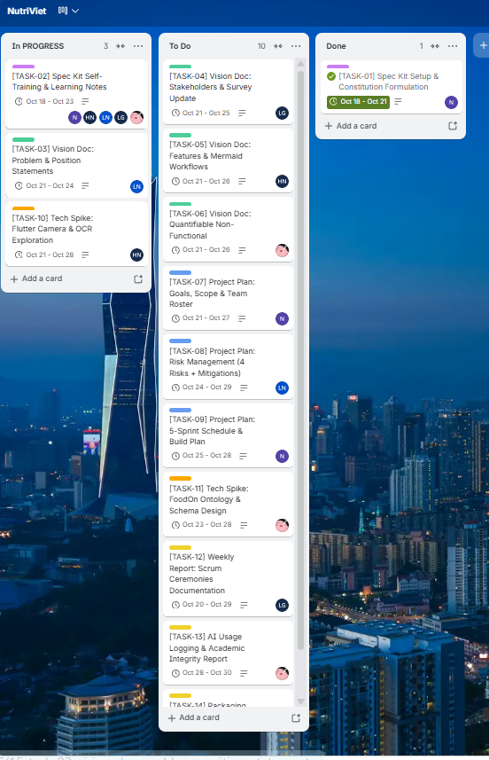
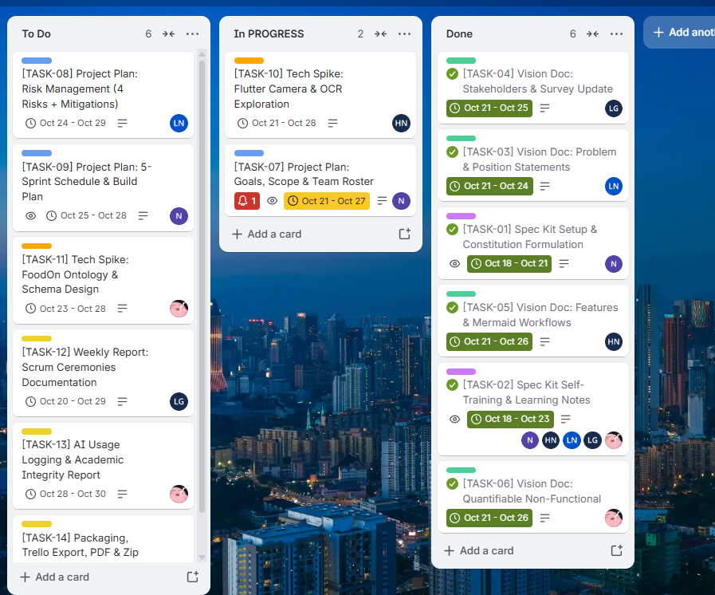

# NutriViet: Weekly Scrum & AI Usage Reports (Sprint 2)
**Agile Meeting Minutes, Trello Tracking & Generative AI Disclosure**  
**Course:** CS300 - CSC13002 - Introduction to Software Engineering  
**Project Assignment:** PA2-2026 (Part D Deliverable)  
**Group:** Group 07 - NutriViet Team  
**Sprint 2 Cadence:** 18/10/2026 – 31/10/2026  

---

## 1. Weekly Scrum Meeting Minutes
*Performed by: Truong Gia Linh | Reviewed by: Ngo Tien Binh | Edited by: Le Tat Nam*

### =========== 18/10, Sprint 2 ===========

**Team members present:**
- Ngo Tien Binh
- Le Tat Nam
- Luong Hoang Nam
- Nguyen Hoang Phuc Thinh
- Truong Gia Linh

**Team members absent:**
- None

---

### Status reports:

#### Ngo Tien Binh (PM & AI Lead)
* **Completed tasks:**
  - Reviewed PA2 requirements and decomposed assignment scope into 14 distinct sprint tasks.
  - Initialized team Trello Kanban board with Scrum columns: *In Progress*, *To Do*, and *Done*.
* **To-do Tasks:**
  - Task TASK-01: Set up GitHub Spec Kit repository scaffolding (`specify init`), configure `.specify/`, and author `constitution.md`.
  - Task TASK-07: Draft Project Plan goals, boundaries, scope, and deliverables (`project-plan.md`).
  - Task TASK-09: Define the 5-Sprint schedule and 4-tier software build plan.
  - Task TASK-13: Consolidate AI usage disclosures for Sprint 2.
* **Issues/Obstacles:**
  - Need to ensure Spec Kit installation works cleanly on Windows PowerShell environments without path permission issues.

#### Le Tat Nam (Backend & Architecture Lead)
* **Completed tasks:**
  - Analyzed PA1 feedback and reviewed required Vision Document positioning table structures.
* **To-do Tasks:**
  - Task TASK-03: Draft Problem Statement and Product Position Statement tables for `vision.md` (Section 2).
  - Task TASK-08: Author the Project Plan risk management section with 4 categorized risks and concrete mitigation plans.
  - Cross-review TASK-06 (Quantifiable NFRs) and TASK-11 (FoodOn schema design).
* **Issues/Obstacles:**
  - Need to strictly adhere to the exact required table formats (`the problem of / affects / ...` and `For / Who / ...`).

#### Luong Hoang Nam (UI/UX & Flutter Lead)
* **Completed tasks:**
  - Outlined Flutter Android project structure and reviewed Google ML Kit Flutter integration docs.
* **To-do Tasks:**
  - Task TASK-05: Write detailed 3–5 sentence explanatory paragraphs for FG1–FG8 and construct 2 Mermaid workflow diagrams in `vision.md`.
  - Task TASK-10: Conduct technical spike testing Google ML Kit camera text recognition on physical food packages.
* **Issues/Obstacles:**
  - Need physical packaging samples with curved and glossy surfaces to test optical character recognition boundaries.

#### Nguyen Hoang Phuc Thinh (Database & Git Lead)
* **Completed tasks:**
  - Verified Git repository synchronization and clean `main` branch state.
* **To-do Tasks:**
  - Task TASK-06: Formulate quantifiable, measurable Non-Functional Requirements in `vision.md`.
  - Task TASK-11: Investigate FoodOn OWL ontology graph structures and draft preliminary PostgreSQL schemas.
  - Task TASK-14: Manage Trello evidence captures, Git log exports, and final `PA2-Group07.zip` packaging.
* **Issues/Obstacles:**
  - Avoiding subjective NFR metrics (e.g., "fast") by ensuring all performance and scalability items are numeric.

#### Truong Gia Linh (QA & Documentation Lead)
* **Completed tasks:**
  - Established document templates for `vision.md` and `project-plan.md` in `/docs`.
* **To-do Tasks:**
  - Task TASK-04: Author stakeholder personas, supermarket environmental constraints, and competitor quadrant chart in `vision.md`.
  - Task TASK-12: Document meeting minutes and maintain Scrum records.
  - Coordinate the Spec Kit training completion log (`training-log.md`) across all 5 members.
* **Issues/Obstacles:**
  - Verifying that all section headers include the mandatory Author/Reviewer/Editor metadata.

---

### Actions (if any)
1. Ngo Tien Binh to execute `specify init` and commit the ratified `constitution.md` to GitHub.
2. All members to watch the official Spec Kit YouTube tutorials and submit 3–4 sentence takeaways for `training-log.md`.
3. Le Tat Nam and Luong Hoang Nam to begin initial drafting of `vision.md` sections.
4. Next sync: Mid-Sprint Progress Check (Weekly Scrum 1) on Wednesday, 21/10/2026.

### Summary of the meeting
The team held the Sprint 2 Planning meeting on Google Meet from 20:00 to 21:00 on Sunday, 18/10/2026. All 5 members attended. The group reviewed the PA2 assignment guidelines, enforced the mandatory **1 Doer + 1 Reviewer** rule, and populated 14 task cards on Trello (`TASK-01` to `TASK-14`). An internal milestone of Friday, 30/10/2026 was established to guarantee a 24-hour buffer before the official 31/10/2026 deadline.

---

### Trello Board Progress Evidence (Sprint 2)

*Figure 1.1: NutriViet Sprint 2 Scrum Board on Trello showing active task assignments and workflow progression across In Progress, To Do, and Done columns.*

---

### =========== 26/10, Sprint 2 ===========

**Team members present:**
- Ngo Tien Binh
- Le Tat Nam
- Luong Hoang Nam
- Nguyen Hoang Phuc Thinh
- Truong Gia Linh

**Team members absent:**
- None

---

### Status reports:

#### Ngo Tien Binh (PM & AI Lead)
* **Completed tasks:**
  - Task TASK-01: Completed GitHub Spec Kit setup, initialized `.specify/` infrastructure, and ratified `constitution.md`.
  - Task TASK-02: Completed Spec Kit YouTube training tutorial and authored personal learning log.
  - Reviewed and approved TASK-03 (Vision Doc Positioning) and TASK-05 (Vision Doc Features & Mermaid).
* **To-do Tasks:**
  - Task TASK-07: Finalize Project Plan goals, boundaries, scope, and deliverables (currently In Progress).
  - Task TASK-09: Draft 5-Sprint Scrum schedule and 4-tier software build plan.
  - Review TASK-10 (Flutter Camera OCR spike).
* **Issues/Obstacles:**
  - Balancing mid-sprint documentation review with Project Plan drafting; on track to meet internal deadline on 30/10.

#### Le Tat Nam (Backend & Architecture Lead)
* **Completed tasks:**
  - Task TASK-02: Completed Spec Kit self-training module on `/speckit-plan`.
  - Task TASK-03: Completed Section 2 of Vision Document (Problem Statement & Product Position Statement tables).
  - Reviewed TASK-06 (Quantifiable NFRs) authored by Thinh.
* **To-do Tasks:**
  - Task TASK-08: Author Project Plan Risk Management section with 4 categorized risks and concrete mitigation strategies.
  - Review TASK-09 (5-Sprint schedule) and TASK-11 (FoodOn schema design).
* **Issues/Obstacles:**
  - Ensuring ontology lookup query latency risk is properly quantified and paired with indexed relational caching.

#### Luong Hoang Nam (UI/UX & Flutter Lead)
* **Completed tasks:**
  - Task TASK-02: Completed Spec Kit training on `/speckit-specify` and acceptance criteria.
  - Task TASK-05: Completed Section 5 of Vision Document (8 refined feature descriptions with 3–5 sentence paragraphs and 2 Mermaid workflow diagrams).
  - Reviewed TASK-04 (Stakeholders & Survey) authored by Linh.
* **To-do Tasks:**
  - Task TASK-10: Continue Flutter ML Kit camera OCR text recognition spike (currently In Progress).
  - Measure extraction latency on physical packaging under varying lighting conditions.
* **Issues/Obstacles:**
  - High-reflection cellophane packaging occasionally causes character drops; tuning contrast preprocessing parameters in ML Kit sandbox.

#### Nguyen Hoang Phuc Thinh (Database & Git Lead)
* **Completed tasks:**
  - Task TASK-02: Completed Spec Kit training on `/speckit-tasks` decomposition.
  - Task TASK-06: Completed Section 6 of Vision Document (Quantifiable Non-Functional Requirements covering latency, security, and scalability).
  - Reviewed TASK-01 (Spec Kit setup and Git sync) by Binh.
* **To-do Tasks:**
  - Task TASK-11: Draft preliminary PostgreSQL relational schema for FoodOn allergen lineages and ingredient lexicons.
  - Task TASK-13: Compile Sprint 2 AI usage disclosure logs.
  - Task TASK-14: Prepare PDF conversion scripts and packaging checklist.
* **Issues/Obstacles:**
  - None; Git repository is clean and synchronized.

#### Truong Gia Linh (QA & Documentation Lead)
* **Completed tasks:**
  - Task TASK-02: Completed Spec Kit training on `/speckit-clarify` and QA checklist quality gates.
  - Task TASK-04: Completed Section 3 of Vision Document (Stakeholder personas, supermarket constraints, and competitor quadrant chart).
  - Consolidated member training summaries into `src/speckit/training-log.md`.
* **To-do Tasks:**
  - Task TASK-12: Document meeting minutes for Meeting 2 (26/10) and prepare final sprint review templates.
  - Review TASK-07 (Project Plan Scope) authored by Binh.
* **Issues/Obstacles:**
  - Need to ensure all Markdown tables and Mermaid diagrams render without overflow in PDF export.

---

### Actions (if any)
1. Ngo Tien Binh to finalize TASK-07 (Project Plan Scope) and advance to TASK-09 (5-Sprint Schedule).
2. Le Tat Nam to begin TASK-08 (Risk Management) and Nguyen Hoang Phuc Thinh to begin TASK-11 (FoodOn Schema Design).
3. Luong Hoang Nam to complete ML Kit benchmark measurements for TASK-10.
4. Next sync: Pre-submission Integration Check on Friday, 30/10/2026.

### Summary of the meeting
The team held Weekly Scrum Meeting 2 via Google Meet on Monday, 26/10/2026 from 20:00 to 20:35 with all 5 members present. The team reviewed mid-sprint progress: 6 out of 14 tasks are fully completed (all Vision Document and Spec Kit setup tasks), 2 tasks are actively In Progress (Project Plan Scope and Flutter OCR Spike), and the remaining 6 tasks are queued in To Do. The project is well ahead of schedule and fully on track to achieve the internal freeze milestone on 30/10/2026.

---

### Trello Board Progress Evidence (Mid-Sprint - 26/10)

*Figure 1.2: NutriViet Sprint 2 Scrum Board on Trello as of 26/10/2026 showing 6 completed tasks in Done, 2 tasks In Progress, and 6 remaining tasks in To Do.*
