# NutriViet: Use-Case Model & Functional Specifications
**Detailed Requirements Modeling & User Interface Prototyping**  
**Course:** CS300 - CSC13002 - Introduction to Software Engineering  
**Project Assignment:** PA3-2026 (Section C & Section D Deliverables)  
**Group:** Group 07 - NutriViet Team  
**Submission Date:** 02/11/2026  

---

## 1. Traceability Matrix: Functional Groups to Use Cases
*Performed by: Ngo Tien Binh | Reviewed by: Le Tat Nam | Edited by: Truong Gia Linh*

The table below establishes bidirectional traceability between the 8 Functional Groups (FG1–FG8) defined in the [Vision Document](vision.md) and the 18 elaborated system Use Cases (UC01–UC18).

| Functional Group (Vision Document) | Use Case ID | Use Case Name | Primary Actor | Priority | Prototype Reference |
|:---|:---:|:---|:---|:---:|:---|
| **FG1: Authentication & Authorization** | **UC01** | Register New Account | Consumer | High | [Figure D.1](#figure-d1) |
| | **UC02** | Log In & Authenticate | Consumer, Admin | Critical | [Figure D.2](#figure-d2) |
| | **UC03** | Manage Account Profile & Preferences | Consumer | Medium | [Figure D.3](#figure-d3) |
| **FG2: Personal Allergy Profile Management** | **UC04** | Configure Allergy & Health Profile | Consumer | Critical | [Figure D.4](#figure-d4) |
| | **UC05** | Set Allergen Sensitivity Thresholds | Consumer | High | [Figure D.4](#figure-d4) |
| **FG3: Packaging OCR Scanner** | **UC06** | Scan Food Packaging Label via Camera | Consumer | Critical | [Figure D.5](#figure-d5) |
| | **UC07** | Preprocess & Crop Label Image | Consumer | High | [Figure D.6](#figure-d6) |
| | **UC08** | View & Filter Scan History | Consumer | Medium | [Figure D.7](#figure-d7) |
| **FG4: Hazard Evaluation & Safe Alternatives** | **UC09** | Evaluate Ingredient Hazards | Consumer | Critical | [Figures D.8a, D.8b, D.8c](#figure-d8a) |
| | **UC10** | View Safe Product Alternatives | Consumer | High | [Figure D.9](#figure-d9) |
| **FG5: Dietary & Reaction Journal** | **UC11** | Log Daily Meal Intake | Consumer | High | [Figure D.10](#figure-d10) |
| | **UC12** | Record Allergic Symptom Incident | Consumer | High | [Figure D.11](#figure-d11) |
| **FG6: Shopping List & Favorites** | **UC13** | Manage Safe Product Favorites | Consumer | Medium | [Figure D.12](#figure-d12) |
| | **UC14** | Create & Check Grocery Shopping List | Consumer | Medium | [Figure D.12](#figure-d12) |
| **FG7: Community Product Contribution** | **UC15** | Submit Unindexed Food Product | Consumer | High | [Figure D.13](#figure-d13) |
| | **UC16** | Report OCR / Ingredient Inaccuracy | Consumer | Medium | [Figure D.14](#figure-d14) |
| **FG8: Admin Allergy Dictionary & Verification**| **UC17** | Moderate Crowdsourced Submissions | Administrator | Critical | [Figure D.15](#figure-d15) |
| | **UC18** | Manage Master Additive Dictionary | Administrator | High | [Figure D.16](#figure-d16) |

---

## 2. Section C: Use-Case Model
*Performed by: Luong Hoang Nam | Reviewed by: Ngo Tien Binh | Edited by: Nguyen Hoang Phuc Thinh*

### 2.1. System Actors

1. **Consumer (Primary End-User):** Shoppers managing individual or family dietary restrictions, fatal food allergies (peanuts, seafood, cow's milk, gluten), or chronic metabolic disorders (gout, diabetes, hypertension). Interacts via the Android mobile client.
2. **System Administrator (Staff / Moderator):** Platform managers and medical nutrition moderators responsible for vetting crowdsourced product submissions, rectifying reported OCR discrepancies, and maintaining the FoodOn ontology mapping tables. Interacts via the desktop web moderation portal.
3. **Google ML Kit OCR Engine (Secondary / Technical Actor):** On-device machine vision system providing bounding box detection and raw optical character recognition from mobile camera frames.
4. **FoodOn Semantic Ontology Engine (Secondary / Technical Actor):** Relational and graph query service responsible for deriving hidden allergen relationships (e.g., verifying that *Casein* implies *Cow's Milk*).

---

### 2.2. Global System Use-Case Diagram
The diagram below provides a complete structural view of all system use cases, primary and secondary actors, system boundaries, and inter-use-case relationships (`<<include>>`, `<<extend>>`, and generalizations).

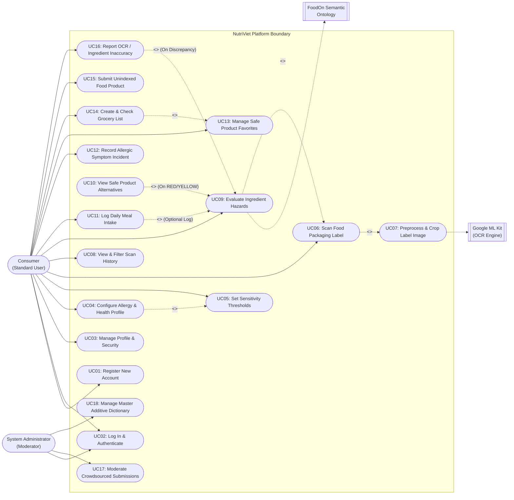

---

### 2.3. Subsystem Use-Case Diagrams

#### Subsystem 1: Identity & Health Profile Subsystem (FG1, FG2)
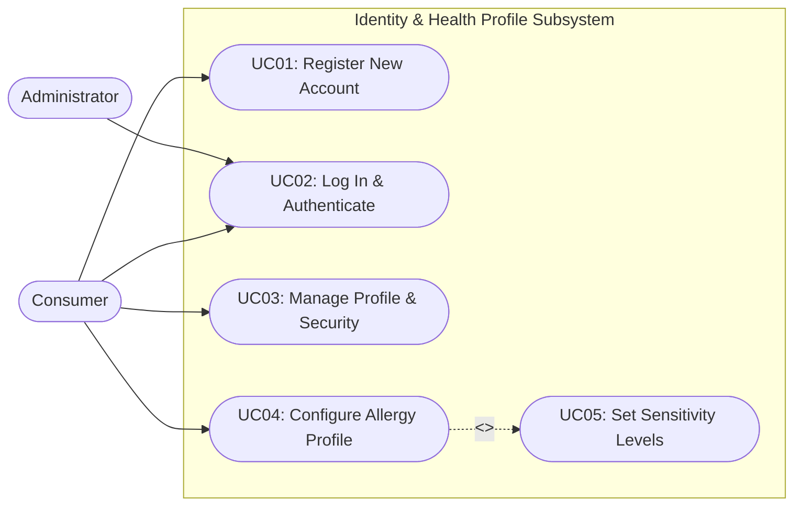

#### Subsystem 2: Camera OCR & Real-Time Hazard Alert Subsystem (FG3, FG4)
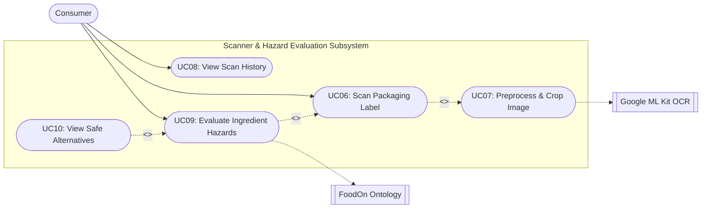

#### Subsystem 3: Nutritional Journal & Smart Grocery Subsystem (FG5, FG6)
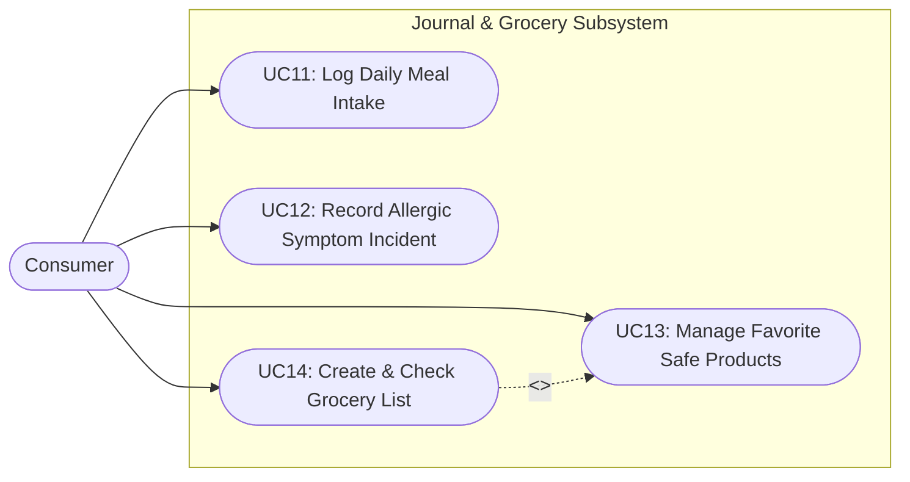

#### Subsystem 4: Community Crowdsourcing & Admin Governance Subsystem (FG7, FG8)
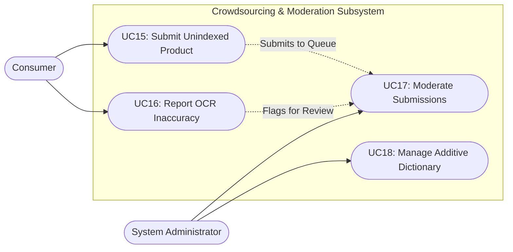

---

## 3. Section D: Use-Case Specifications & UI Prototypes
*Performed by: Truong Gia Linh & Nguyen Hoang Phuc Thinh | Reviewed by: Le Tat Nam | Edited by: Ngo Tien Binh*

---

### UC01: Register New Account
*Performed by: Truong Gia Linh | Reviewed by: Ngo Tien Binh | Edited by: Le Tat Nam*

| Element | Specification |
|:---|:---|
| **Use Case ID** | **UC01** |
| **Use Case Name** | Register New Account |
| **Functional Group** | FG1: Authentication and Authorization |
| **Primary Actor** | Consumer (Unauthenticated Guest) |
| **Priority** | High |
| **Description** | Allows a new user to create a personal NutriViet account by supplying full name, email address, and a secure password, or through single-tap Google OAuth 2.0 registration. |
| **Preconditions** | 1. Mobile device has internet connectivity (Wi-Fi or cellular). 2. Application is installed and user is not currently logged in. |
| **Postconditions** | **Success:** A new user account record is created in PostgreSQL; encrypted local session tokens (JWT) are stored in the device Keystore; the user is redirected to the initial Health Profile setup wizard (`UC04`). **Failure:** No account record created; device remains on registration screen with explanatory error message. |

#### Basic Flow (Main Success Scenario)
1. User opens the application and selects **"Đăng ký ngay" (Register Now)** on the welcome screen.
2. System displays the registration form requesting: Full Name, Email, Password, Password Confirmation, and Terms of Medical Service acceptance checkbox.
3. User enters valid information (e.g., name `"Nguyễn Văn An"`, email `"an.nguyen@nutriviet.vn"`, password with $\ge 8$ chars, numbers, and symbols) and checks the terms checkbox.
4. User taps **"Hoàn tất & Cài đặt Hồ sơ" (Complete & Configure Profile)**.
5. System validates field formats client-side, computes Argon2id password hash, and transmits an encrypted registration request over TLS 1.3 to the backend API.
6. Backend verifies email uniqueness, creates the user record with role `USER`, and issues a cryptographically signed JWT access/refresh token pair.
7. Mobile client stores the tokens securely in Android Keystore / SQLCipher.
8. System transitions automatically to **UC04: Configure Allergy & Health Profile**.

#### Alternative & Exception Flows
* **A1 (Duplicate Email Address):** At Step 5, if the backend detects that the email already exists in the system:
  1. Backend returns HTTP 409 Conflict.
  2. Mobile client displays error banner: *"Email này đã được đăng ký. Vui lòng đăng nhập hoặc sử dụng tính năng quên mật khẩu."*
  3. Form fields are preserved except the password; user can switch to Login screen.
* **A2 (Weak Password):** At Step 3, if the entered password has $< 8$ characters or lacks required character classes:
  1. Client-side regex validator updates password strength meter to *"Yếu" (Weak)*.
  2. Step 4 button remains disabled until criteria are satisfied.
* **A3 (Network Interruption during Registration):** At Step 5, if network connection drops before receiving server response:
  1. Client retries request 2 times with exponential backoff (2s, 4s).
  2. If still unreachable, displays: *"Không thể kết nối đến máy chủ. Vui lòng kiểm tra kết nối mạng và thử lại."*
* **A4 (Google OAuth Registration):** At Step 2, user taps **"Tiếp tục với Google" (Continue with Google)**:
  1. System triggers Google Sign-In SDK consent prompt.
  2. User selects Google account; Google returns OAuth ID token.
  3. System sends ID token to backend `/auth/google` endpoint.
  4. Backend creates verified user profile and continues to Step 7.

#### Special Requirements
- Password hashing must use Argon2id with 64MB memory cost.
- Complete registration roundtrip latency must be $\le 1.5$ seconds under standard 4G networks.

#### Prototype Screen

  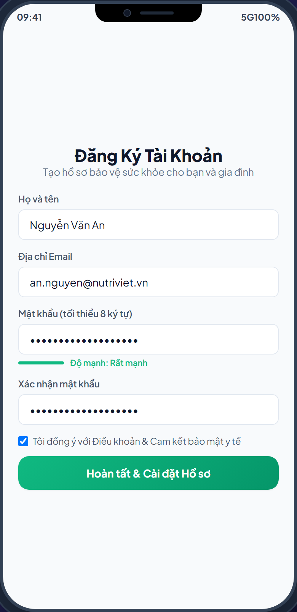

<em>Figure D.1: UC01 Registration screen showing form inputs, dynamic password strength indicator, and medical consent toggle.</em>

---

### UC02: Log In & Authenticate
*Performed by: Le Tat Nam | Reviewed by: Ngo Tien Binh | Edited by: Truong Gia Linh*

| Element | Specification |
|:---|:---|
| **Use Case ID** | **UC02** |
| **Use Case Name** | Log In & Authenticate |
| **Functional Group** | FG1: Authentication and Authorization |
| **Primary Actor** | Consumer, System Administrator |
| **Priority** | Critical |
| **Description** | Authenticates registered users or administrators using credentials (email + password) or Google OAuth, granting access to personalized profiles or moderation portals based on RBAC roles. |
| **Preconditions** | User has an active registered account in NutriViet. |
| **Postconditions** | **Success:** User identity authenticated; JWT access token (60-minute expiry) and refresh token issued; user redirected to home scanner or admin portal according to role. **Failure:** User session remains unauthenticated; error feedback displayed; failed attempt count incremented. |

#### Basic Flow (Main Success Scenario)
1. User launches NutriViet mobile app or navigates to the admin web portal.
2. System displays the login interface requesting email and password.
3. User enters registered email and password, checks **"Ghi nhớ đăng nhập" (Remember me)**, and taps **"Đăng Nhập An Toàn" (Secure Login)**.
4. Client validates non-empty inputs and transmits credentials over HTTPS/TLS 1.3 to `/api/v1/auth/login`.
5. Backend verifies password hash and checks user status (Active / Banned).
6. Backend constructs JWT containing `user_id`, `email`, and `role` (`USER` or `ADMIN`).
7. Client stores encrypted session tokens and decrypts local offline SQLite health cache.
8. System directs regular consumers to **UC06: Camera OCR Scanner**, or administrators to **UC17: Admin Moderation Portal**.

#### Alternative & Exception Flows
* **A1 (Invalid Credentials):** At Step 5, if email does not exist or password hash fails verification:
  1. Backend returns HTTP 401 Unauthorized with generic message *"Email hoặc mật khẩu không chính xác."*
  2. Client highlights password field in red and increments local failed attempt counter.
* **A2 (Account Brute-Force Lockout):** At Step 5, if 5 consecutive failed login attempts occur within 10 minutes:
  1. Backend locks the account for 15 minutes to prevent credential stuffing attacks.
  2. Client informs user: *"Tài khoản tạm thời bị khóa do nhập sai nhiều lần. Vui lòng thử lại sau 15 phút hoặc đặt lại mật khẩu."*
* **A3 (Expired Session Token Refresh):** During regular app operation, when 60-minute access token expires:
  1. Mobile client interceptor catches HTTP 401 and automatically calls `/auth/refresh` using refresh token.
  2. Backend validates refresh token rotation and returns fresh access token without user disruption.
* **A4 (Deactivated / Banned Account):** If user account was flagged for abusive crowdsourced spam:
  1. Backend returns HTTP 403 Forbidden with reason: *"Tài khoản đã bị tạm khóa do vi phạm tiêu chuẩn cộng đồng."*

#### Special Requirements
- Sensitive tokens must be stored in Android Keystore hardware-backed storage.
- Admin role must enforce Multi-Factor Authentication (MFA) on desktop web portal.

#### Prototype Screen

  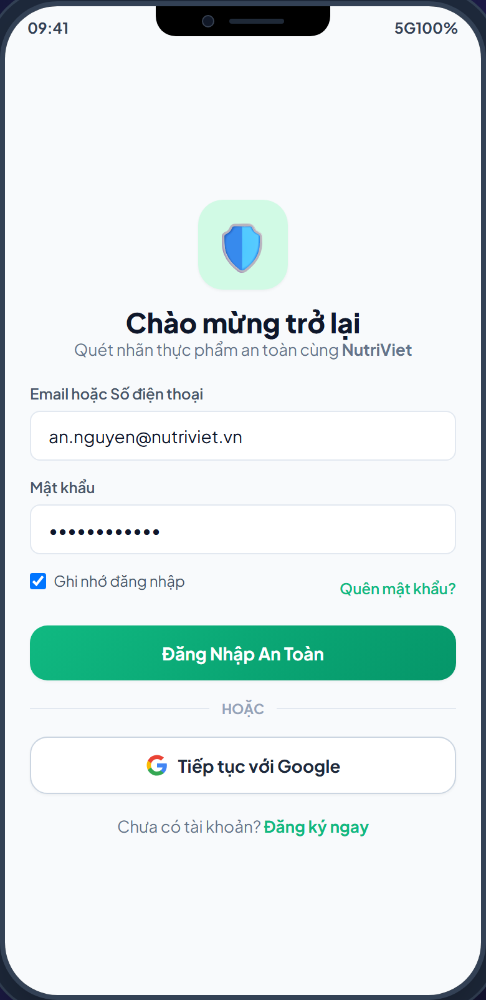

<em>Figure D.2: UC02 Log In screen displaying credentials entry, remember me checkbox, and Google OAuth shortcut.</em>

---

### UC03: Manage Account Profile & Preferences
*Performed by: Ngo Tien Binh | Reviewed by: Truong Gia Linh | Edited by: Le Tat Nam*

| Element | Specification |
|:---|:---|
| **Use Case ID** | **UC03** |
| **Use Case Name** | Manage Account Profile & Preferences |
| **Functional Group** | FG1: Authentication and Authorization |
| **Primary Actor** | Consumer |
| **Priority** | Medium |
| **Description** | Enables users to update account personal details, change security passwords, manage linked Google accounts, switch dependent family profiles, and securely terminate active sessions. |
| **Preconditions** | User is authenticated (`UC02`). |
| **Postconditions** | Account profile or credentials updated; local and server-side preferences synchronized. |

#### Basic Flow (Main Success Scenario)
1. User navigates to the **Settings Hub** from the bottom navigation bar.
2. System displays current user profile info, active dependent sub-profiles, app display preferences (High Contrast, Large Fonts), and security options.
3. User selects **"Đổi mật khẩu" (Change Password)**.
4. System prompts for current password, new password, and confirmation.
5. User enters valid information and taps **"Cập nhật" (Update)**.
6. Backend validates old password, stores new Argon2id hash, and invalidates all other active refresh sessions.
7. System displays success notification: *"Mật khẩu đã được thay đổi thành công."*

#### Alternative & Exception Flows
* **A1 (Incorrect Current Password):** User enters wrong current password; system shows inline validation error.
* **A2 (Profile Switch for Family Caregivers):** User taps avatar to switch from personal profile to a child's allergy profile (e.g., *"Bé Bo - 3 tuổi"*); system loads the child's allergen rules into the active scanning engine.
* **A3 (Log Out All Devices):** User taps "Đăng xuất khỏi tất cả thiết bị"; backend revokes all refresh tokens; client deletes local encrypted cache and redirects to Login.

---

### UC04: Configure Allergy & Health Profile
*Performed by: Truong Gia Linh | Reviewed by: Luong Hoang Nam | Edited by: Nguyen Hoang Phuc Thinh*

| Element | Specification |
|:---|:---|
| **Use Case ID** | **UC04** |
| **Use Case Name** | Configure Allergy & Health Profile |
| **Functional Group** | FG2: Personal Allergy Profile Management |
| **Primary Actor** | Consumer |
| **Priority** | Critical |
| **Description** | Allows consumers to select and update known food allergens (peanuts, shellfish, cow's milk, gluten, soy, eggs, tree nuts, sesame) and chronic health conditions (diabetes, gout, hypertension, hyperlipidemia) that drive all scanning evaluations. |
| **Preconditions** | User is authenticated (`UC02`). |
| **Postconditions** | **Success:** Personal health profile updated in PostgreSQL and mirrored to local AES-256 encrypted SQLite cache for offline scanning. **Failure:** Previous profile remains intact; error notification shown. |

#### Basic Flow (Main Success Scenario)
1. User navigates to **"Hồ Sơ Sức Khỏe & Dị Ứng" (Health & Allergy Profile)**.
2. System presents an interactive chip grid categorized into: Major Food Allergens, Sensitivity Derivation Rules, and Chronic Conditions.
3. User toggles allergen chips (e.g., selects **🥜 Đậu phộng**, **🦐 Hải sản**, **🥛 Sữa bò**). Selected chips glow with red/warning borders and count tag updates to *"3 đã chọn"*.
4. User selects chronic dietary condition chips (e.g., toggles **🩸 Gút / Axit Uric cao**).
5. User taps **"Xác Nhận & Bắt Đầu Quét Nhãn" (Confirm & Start Scanning)**.
6. System packages profile payload, persists it to local SQLite cache, and synchronizes asynchronously with backend `/api/v1/profile`.
7. System confirms: *"Hồ sơ sức khỏe đã được cập nhật thành công"* and transitions to camera scanner.

#### Alternative & Exception Flows
* **A1 (No Allergens Selected):** User unchecks all items and saves:
  1. System displays informational modal: *"Bạn chưa chọn chất gây dị ứng nào. Ứng dụng sẽ chỉ đánh giá thành phần theo tiêu chuẩn dinh dưỡng chung. Bạn có muốn tiếp tục?"*
  2. If user confirms, profile is saved in neutral mode.
* **A2 (Offline Profile Update):** If user modifies allergies in a supermarket basement without cellular signal:
  1. Mobile client writes changes immediately to local encrypted SQLite storage (`offline_pending_sync = true`).
  2. All local OCR scans instantly apply the newly configured allergens.
  3. A background sync worker uploads changes to backend once network connectivity resumes.
* **A3 (Family Dependent Sub-Profiles):** User taps "+ Thêm hồ sơ người thân"; inputs child's name and independent allergy tags.

#### Special Requirements
- Local cache storage must be encrypted with AES-256-GCM using keys stored in Android Keystore.
- Switching profiles must recalculate scan history risk ratings on demand.

#### Prototype Screen

  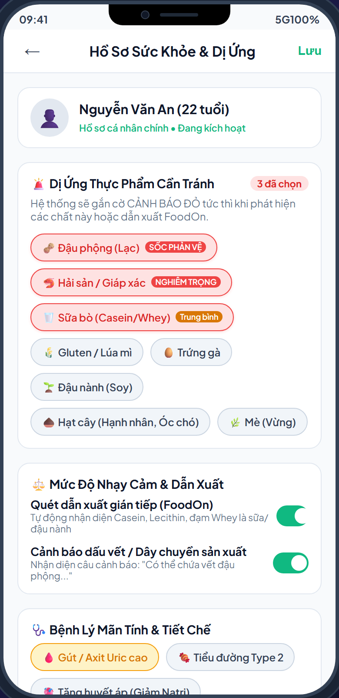

<em>Figure D.4: UC04 & UC05 Health Profile screen showing multi-select allergen chips, severity flags, FoodOn derivation toggles, and chronic conditions.</em>

---

### UC05: Set Allergen Sensitivity Thresholds
*Performed by: Truong Gia Linh | Reviewed by: Le Tat Nam | Edited by: Ngo Tien Binh*

| Element | Specification |
|:---|:---|
| **Use Case ID** | **UC05** |
| **Use Case Name** | Set Allergen Sensitivity Thresholds |
| **Functional Group** | FG2: Personal Allergy Profile Management |
| **Primary Actor** | Consumer |
| **Priority** | High |
| **Description** | Configures granular sensitivity rules for each declared allergen, including severity classification (Severe / Anaphylaxis vs Mild Intolerance), recursive FoodOn derivation depth, and "May contain traces" advisory warnings. |
| **Preconditions** | User is on the Health Profile Configuration screen (`UC04`). |
| **Postconditions** | Sensitivity parameters stored and linked to corresponding allergen entities. |

#### Basic Flow (Main Success Scenario)
1. On the Health Profile screen, user taps an active allergen chip (e.g., **"Đậu phộng"**).
2. System presents a sensitivity drawer containing:
   - Severity Level: **Sốc phản vệ (Anaphylaxis - Fatal)** vs **Dị ứng nhẹ / Không dung nạp (Mild/Sensitivity)**.
   - Toggle: **"Quét dẫn xuất gián tiếp qua FoodOn"** (e.g., automatically infer that *Lecithin* or *Casein* are dairy/soy derivatives).
   - Toggle: **"Cảnh báo dấu vết / Dây chuyền sản xuất"** (flag statements like *"Có thể chứa vết đậu phộng..."*).
3. User selects **"Sốc phản vệ"** and activates both FoodOn and advisory toggles.
4. User taps **"Áp dụng" (Apply)**; sensitivity badge updates to red *"SỐC PHẢN VỆ"*.
5. Profile rules are cached for immediate scanner evaluation.

#### Alternative & Exception Flows
* **A1 (Conservative Mode Enabled):** User toggles "Strict Mode" for infants; system automatically sets all selected allergens to maximum sensitivity and forces YELLOW caution on any unrecognized technical E-numbers.
* **A2 (Reset to Clinical Defaults):** User taps "Khôi phục chuẩn y tế"; system restores default thresholds benchmarked against Vietnamese pediatric allergy clinical guidelines.

---

### UC06: Scan Food Packaging Label via Camera
*Performed by: Luong Hoang Nam | Reviewed by: Ngo Tien Binh | Edited by: Nguyen Hoang Phuc Thinh*

| Element | Specification |
|:---|:---|
| **Use Case ID** | **UC06** |
| **Use Case Name** | Scan Food Packaging Label via Camera |
| **Functional Group** | FG3: Packaging OCR Scanner |
| **Primary Actor** | Consumer |
| **Priority** | Critical |
| **Description** | Provides real-time camera viewfinder with live text bounding boxes, flashlight control, and capture shutter button to extract packaging label text in supermarket aisles. |
| **Preconditions** | 1. User has granted Android Camera permissions (`android.permission.CAMERA`). 2. Mobile device camera is operational. |
| **Postconditions** | High-resolution label image captured, passed to on-device OCR preprocessing (`UC07`), and analyzed for hazards (`UC09`). |

#### Basic Flow (Main Success Scenario)
1. User taps the floating **Scan Button (Camera)** on the main navigation bar.
2. System initializes camera hardware, displays active viewfinder at $\ge 30\text{ fps}$, and renders target framing corners with animated laser guide.
3. User positions phone camera 15–20 cm away from food package ingredient panel.
4. Google ML Kit text detector analyzes incoming camera frames in real time, drawing green/yellow bounding boxes around recognized text tokens (*"Đậu phộng"*, *"Sodium Caseinate"*, *"Bột mì"*).
5. User taps the circular white **Shutter Button**.
6. System captures uncompressed photo frame, freezes camera view with haptic feedback, and invokes **UC07: Preprocess & Crop Label Image**.

#### Alternative & Exception Flows
* **A1 (Camera Permission Denied):** At Step 2, if camera permission was denied by user:
  1. System displays permission rationale modal: *"NutriViet cần quyền truy cập camera để quét nhãn thành phần thực phẩm."*
  2. Provides button linking directly to Android App System Settings.
* **A2 (Low-Light Environment in Traditional Market):** At Step 3, if ambient illumination is $< 100\text{ lux}$:
  1. System displays on-screen toast: *"Ánh sáng yếu. Chạm vào biểu tượng tia sét để bật đèn flash."*
  2. User taps **"Bật Đèn" (Torch)** button; camera LED illuminates package.
* **A3 (Blurry / Unstable Camera Frame):** If user moves phone too quickly during capture:
  1. On-device image sharpness detector computes Laplacian variance $< 100$.
  2. System prompts: *"Ảnh bị mờ. Vui lòng giữ chắc tay và chụp lại."* Viewfinder resets immediately.
* **A4 (Import Photo from Gallery):** User taps "🖼️ Chọn từ thư viện"; opens Android Photo Picker to select an existing packaging photo.

#### Special Requirements
- Camera viewfinder frame rate must not drop below 30 fps on Snapdragon 680 devices (NFR-PERF-04).
- Shutter capture to initial token extraction must execute in under 1.5 seconds (NFR-PERF-01).

#### Prototype Screen

  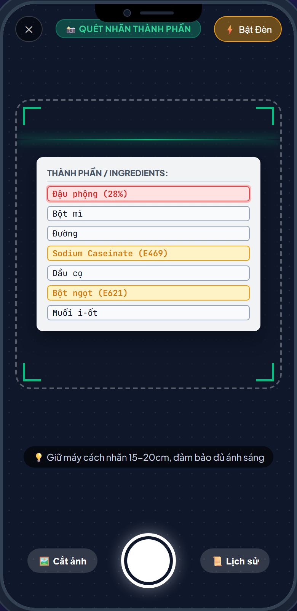

<em>Figure D.5: UC06 Camera Scanner screen with live OCR token bounding boxes, targeting corners, flashlight toggle, and tips.</em>

---

### UC07: Preprocess & Crop Label Image
*Performed by: Luong Hoang Nam | Reviewed by: Nguyen Hoang Phuc Thinh | Edited by: Le Tat Nam*

| Element | Specification |
|:---|:---|
| **Use Case ID** | **UC07** |
| **Use Case Name** | Preprocess & Crop Label Image |
| **Functional Group** | FG3: Packaging OCR Scanner |
| **Primary Actor** | Consumer, Google ML Kit (Secondary) |
| **Priority** | High |
| **Description** | Automatically straightens, enhances contrast, and enables manual crop boundary adjustment over captured label images to eliminate extraneous background noise prior to OCR text tokenization. |
| **Preconditions** | Label photo successfully captured via `UC06`. |
| **Postconditions** | Normalized, binarized text region extracted and tokenized for hazard evaluation (`UC09`). |

#### Basic Flow (Main Success Scenario)
1. System receives raw captured image from `UC06` and automatically detects rectangular text boundaries.
2. System displays the cropped region inside adjustable corner drag handles alongside image enhancement filters (**"Tăng tương phản"**, **"Xoay 90°"**, **"Khử bóng lóa"**).
3. User verifies bounding box covers all ingredients and taps **"Trích Xuất Văn Bản OCR" (Extract Text)**.
4. On-device pipeline applies adaptive Otsu thresholding to remove cellophane glare.
5. Google ML Kit extracts raw text lines; regex normalizer stitches hyphenated line-breaks and standardizes Vietnamese diacritics.
6. Cleaned ingredient tokens are passed forward to **UC09: Evaluate Ingredient Hazards**.

#### Alternative & Exception Flows
* **A1 (Manual Crop Adjustment):** User drags corner handles to exclude promotional text or barcode graphics, focusing exclusively on the *"Thành phần"* paragraph.
* **A2 (Sideways / Upside-down Packaging):** User taps "🔄 Xoay 90°" to orient curved beverage bottle label text horizontally.
* **A3 (No Text Detected in Selected Box):** If ML Kit finds zero text lines in cropped area:
  1. System alerts: *"Không tìm thấy văn bản trong vùng đã chọn. Vui lòng căn chỉnh lại vùng nhãn."*
  2. Provides shortcut to retake photo or enter ingredients manually.

#### Prototype Screen

  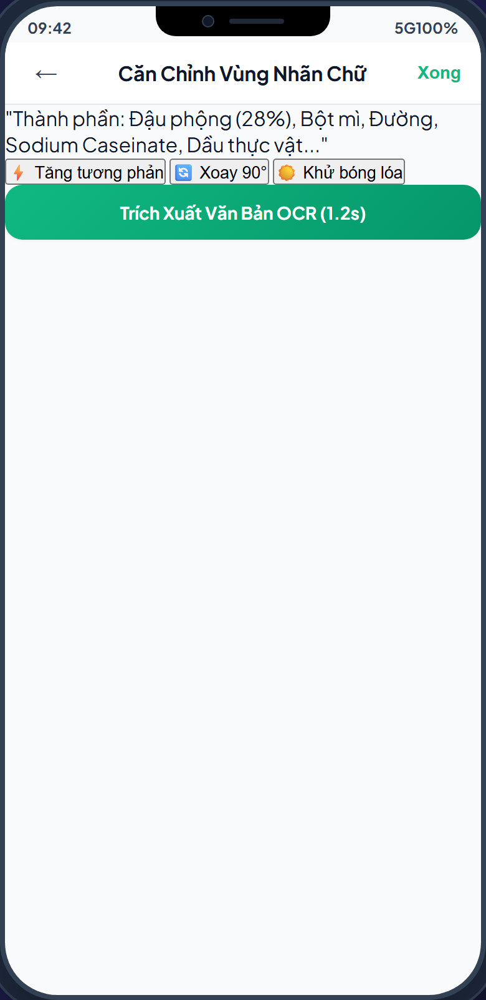

<em>Figure D.6: UC07 Crop and Preprocess screen showing interactive boundary handles, image enhancement pills, and preview text.</em>

---

### UC08: View & Filter Scan History
*Performed by: Nguyen Hoang Phuc Thinh | Reviewed by: Truong Gia Linh | Edited by: Ngo Tien Binh*

| Element | Specification |
|:---|:---|
| **Use Case ID** | **UC08** |
| **Use Case Name** | View & Filter Scan History |
| **Functional Group** | FG3: Packaging OCR Scanner |
| **Primary Actor** | Consumer |
| **Priority** | Medium |
| **Description** | Enables users to review previously scanned food products, search by product name, and filter by safety alert outcome (Red, Yellow, Green) without requiring network connectivity. |
| **Preconditions** | User has executed at least one scan (`UC06`/`UC09`). |
| **Postconditions** | Historical scan records retrieved from local encrypted storage and displayed chronologically. |

#### Basic Flow (Main Success Scenario)
1. User taps **"Lịch sử" (History)** from the scanner screen or navigation menu.
2. System queries local SQLite database and renders chronological list of scan cards.
3. Each card displays: Product Name, Timestamp, Hazard Status Tag (Cảnh báo Đỏ / Cảnh báo Vàng / An toàn), and primary flagged ingredients.
4. User types `"Bánh"` in the search bar; list dynamically filters in $< 50\text{ ms}$.
5. User taps a card (e.g., *"Bánh Quy Bơ Đậu Phộng Oishi"*); system opens full detailed hazard report (`UC09`).

#### Alternative & Exception Flows
* **A1 (Empty History):** If user has never scanned a product, system displays empty-state illustration with CTA button *"Bắt đầu quét sản phẩm đầu tiên"*.
* **A2 (Delete History Record):** User swipes card left and confirms deletion; record is erased from local and cloud storage.
* **A3 (Re-Evaluate on Profile Change):** If user recently added a new allergy in `UC04`, system places a refresh badge on historical scans indicating hazard levels have been updated against the new profile.

#### Prototype Screen

  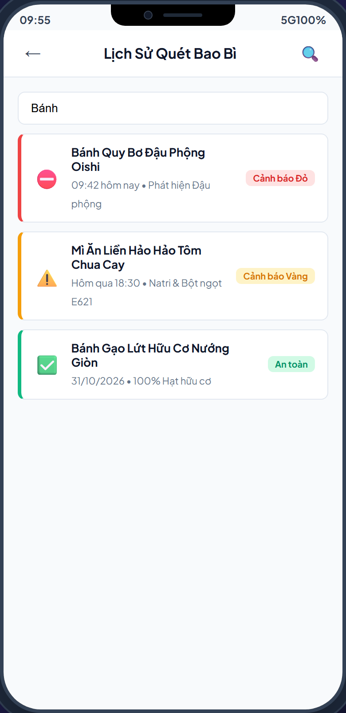

<em>Figure D.7: UC08 Scan History screen displaying search bar, chronological product cards, and color-coded safety indicators.</em>

---

### UC09: Evaluate Ingredient Hazards
*Performed by: Ngo Tien Binh & Le Tat Nam | Reviewed by: Luong Hoang Nam | Edited by: Truong Gia Linh*

| Element | Specification |
|:---|:---|
| **Use Case ID** | **UC09** |
| **Use Case Name** | Evaluate Ingredient Hazards |
| **Functional Group** | FG4: Instant Evaluation, Allergy Alert, and Safe Alternative Suggestion |
| **Primary Actor** | Consumer, FoodOn Ontology Engine (Secondary) |
| **Priority** | Critical |
| **Description** | Compares extracted ingredient tokens against active user health profile using Levenshtein typo-tolerant fuzzy matching and FoodOn ontology derivation, instantly rendering a tri-tier color-coded hazard alert (RED / YELLOW / GREEN) with WCAG-compliant dual-coded icons. |
| **Preconditions** | 1. OCR tokens extracted via `UC06`/`UC07`. 2. Active user health profile configured (`UC04`). |
| **Postconditions** | Visual safety assessment displayed; scan logged to history (`UC08`); options provided to view safe alternatives (`UC10`) or log meal (`UC11`). |

#### Basic Flow (Main Success Scenario - RED Hazard Triggered)
1. System receives normalized ingredient tokens: `["Đậu phộng (28%)", "Bột mì", "Đường", "Sodium Caseinate (E469)", "Bột ngọt (E621)", "Dầu cọ"]`.
2. Evaluation engine applies Levenshtein fuzzy matching ($\ge 75\%$ similarity threshold) against Vietnamese allergen dictionaries and queries FoodOn graph.
3. System identifies:
   - Match 1: *"Đậu phộng"* matches user's primary severe allergen with 100% confidence.
   - Match 2: *"Sodium Caseinate"* is identified via FoodOn ontology node `FOODON:03411304` as a primary protein derivative of *Cow's Milk*.
4. System calculates overall risk rating as **RED (FATAL / SEVERE HAZARD)**.
5. System displays the **RED Hazard Screen**:
   - Header: WCAG-compliant octagonal symbol `[!X]` and bold warning *"NGUY HIỂM: PHÁT HIỆN DỊ ỨNG - KHÔNG NÊN SỬ DỤNG"*.
   - Explanatory details: Highlights exact offending tokens with biological origin explanations.
   - Primary Action Button: **"🥗 Xem 3 Sản Phẩm Thay Thế An Toàn" (View Safe Alternatives)** (`UC10`).
   - Secondary Action Button: **"🚩 Báo cáo sai lệch OCR"** (`UC16`).
6. Result is automatically saved to local scan history (`UC08`).

#### Alternative & Exception Flows
* **A1 (YELLOW Caution Hazard Triggered):** Extracted ingredients do not contain declared severe allergens, but include unverified additives (e.g., *Monosodium Glutamate E621*) or ambiguous matches relevant to chronic conditions (e.g., Gout/Sodium):
  1. System renders **YELLOW Caution Screen** with triangular symbol `[!?]` and label *"CẢNH BÁO: CẦN THẬN TRỌNG - CHỨA CHẤT CẦN TIẾT CHẾ"*.
  2. Displays advisory note detailing additive E-numbers and health cautions.
  3. Action buttons provide options to log meal into journal (`UC11`) or view lower-sodium alternatives (`UC10`).
* **A2 (GREEN Safe Evaluation):** All extracted ingredients pass verification and match zero allergens or chronic health restrictions:
  1. System renders **GREEN Safe Screen** with shield check symbol `[OK]` and label *"AN TOÀN SỬ DỤNG - KHÔNG PHÁT HIỆN DỊ ỨNG"*.
  2. Displays verified nutritional badges and medical disclaimer (*"Đánh giá dựa trên thông tin nhãn có sẵn"*).
  3. Action button prompts user to add product to Favorites / Shopping List (`UC13`/`UC14`) or log meal (`UC11`).
* **A3 (Offline Evaluation Fallback):** If mobile device lacks cellular connection:
  1. System bypasses cloud API and queries local encrypted SQLite dictionary and precomputed FoodOn tables.
  2. Evaluation completes in $< 300\text{ ms}$ with an offline badge *"Đánh giá ngoại tuyến"*.
* **A4 (Ambiguous / Partially Damaged Label):** If OCR confidence is $< 60\%$ on critical tokens:
  1. System raises a Yellow cautionary flag warning: *"Một số từ trên nhãn bị mờ. Vui lòng kiểm tra kỹ bao bì thực tế."*

#### Special Requirements
- Total evaluation latency from shutter capture to alert rendering must not exceed 3.0 seconds (NFR-PERF-02).
- Visual alerts must adhere to WCAG 2.1 AA color contrast ($\ge 4.5:1$) and include distinct geometric icons for color-blind accessibility (NFR-USAB-01).

#### Prototype Screens

  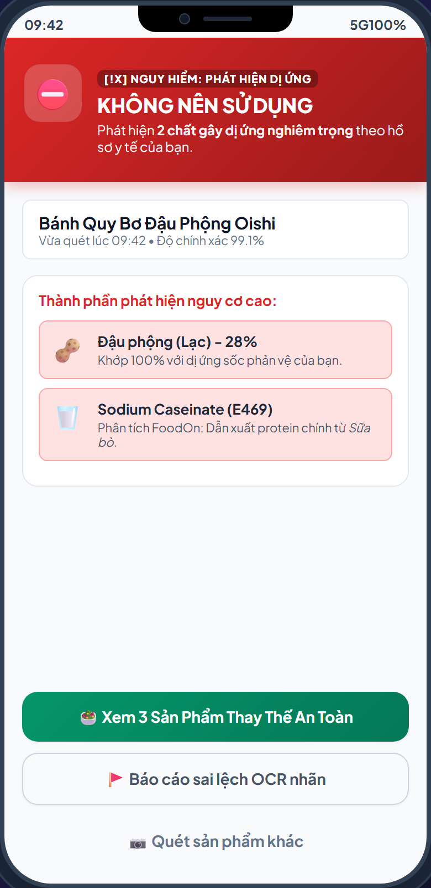

<em>Figure D.8a: UC09 RED Hazard Alert screen featuring WCAG [!X] icon, peanut and casein detection cards, and CTA for safe alternatives.</em>

  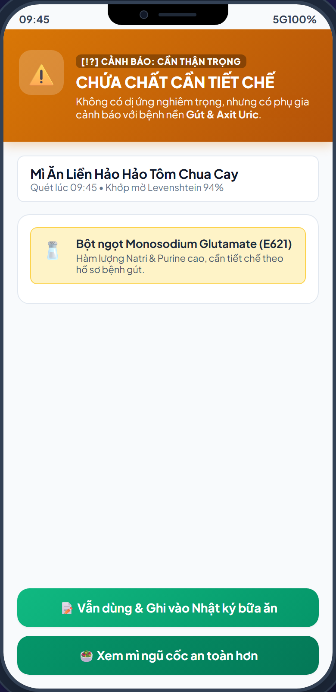

<em>Figure D.8b: UC09 YELLOW Caution Alert screen displaying [!?] glyph, additive E621 warning for gout, and nutritional logging CTA.</em>

  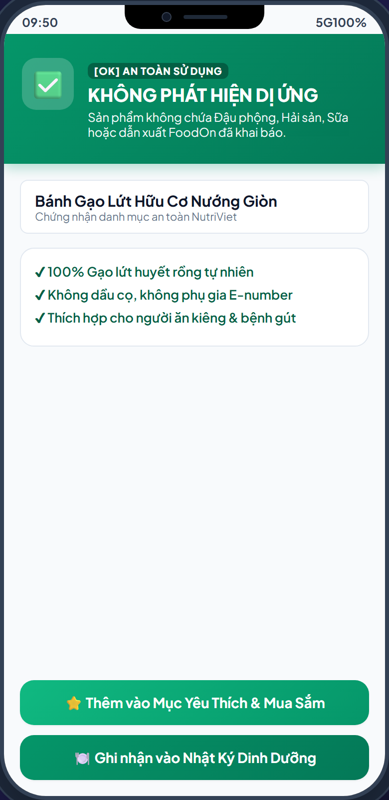

<em>Figure D.8c: UC09 GREEN Safe Evaluation screen displaying [OK] shield, organic brown rice validation, and shopping list bookmark button.</em>

---

### UC10: View Safe Product Alternatives
*Performed by: Luong Hoang Nam | Reviewed by: Ngo Tien Binh | Edited by: Truong Gia Linh*

| Element | Specification |
|:---|:---|
| **Use Case ID** | **UC10** |
| **Use Case Name** | View Safe Product Alternatives |
| **Functional Group** | FG4: Instant Evaluation, Allergy Alert, and Safe Alternative Suggestion |
| **Primary Actor** | Consumer |
| **Priority** | High |
| **Description** | Proactively suggests curated, verified safe food substitutes in the same food category when a scanned product triggers a RED or YELLOW hazard alert, preventing shoppers from leaving retail stores empty-handed. |
| **Preconditions** | Scanned product evaluated as RED or YELLOW (`UC09`). |
| **Postconditions** | List of safe substitute products displayed with nutritional comparison and one-tap shopping list additions. |

#### Basic Flow (Main Success Scenario)
1. On the RED/YELLOW hazard screen (`UC09`), user taps **"🥗 Xem 3 Sản Phẩm Thay Thế An Toàn"**.
2. System queries the verified catalog for products sharing the same category (e.g., *Bánh quy / Confectionery*) that have 100% negative matches against the user's active allergens.
3. System presents substitute cards:
   - Item 1: **Bánh Quy Hạt Yến Mạch Mè Đen** (Oaty Healthy Foods) - 100% Safe, Calo: 120 kcal, Sugar: 2.1g, Sodium: 45mg.
   - Item 2: **Bánh Gạo Lứt Nướng Rong Biển** (V-Rice Organic) - 100% Safe, Purine: Rất thấp.
4. User taps **"+ Thêm Giỏ Mua Sắm"** on Item 1.
5. System adds product to **UC14: Grocery Shopping List** and displays confirmation badge.

#### Alternative & Exception Flows
* **A1 (No Direct Category Alternatives Available):** If catalog contains zero substitutes in the exact subcategory:
  1. System broadens search to parent category (e.g., *Đồ ăn nhẹ lành mạnh / Healthy Snacks*).
  2. Displays: *"Không tìm thấy bánh quy thay thế trực tiếp. Dưới đây là các món ăn nhẹ lành mạnh an toàn cho bạn."*
* **A2 (Offline Storage of Verified Substitutes):** In offline supermarket mode, substitutes are loaded from pre-cached top-100 safe staple foods.

#### Prototype Screen

  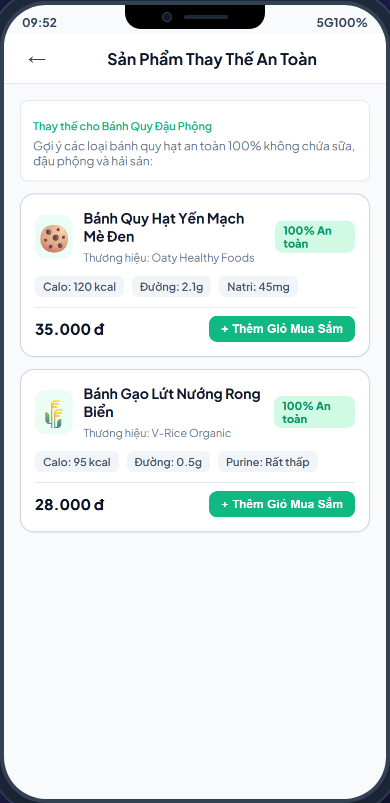

<em>Figure D.9: UC10 Safe Product Alternatives screen showing allergen-free substitute recommendations with nutritional badges and shopping list action.</em>

---

### UC11: Log Daily Meal Intake
*Performed by: Truong Gia Linh | Reviewed by: Nguyen Hoang Phuc Thinh | Edited by: Le Tat Nam*

| Element | Specification |
|:---|:---|
| **Use Case ID** | **UC11** |
| **Use Case Name** | Log Daily Meal Intake |
| **Functional Group** | FG5: Dietary and Reaction Journal |
| **Primary Actor** | Consumer |
| **Priority** | High |
| **Description** | Allows consumers to log consumed meals and snacks (directly from camera scans or catalog search), calculating cumulative daily calories, sugar, sodium, and purine against personalized health limits. |
| **Preconditions** | User is authenticated (`UC02`). |
| **Postconditions** | Meal entry recorded; daily cumulative nutrition gauges updated. |

#### Basic Flow (Main Success Scenario)
1. User navigates to **"Nhật Ký Dinh Dưỡng" (Dietary Journal)** or taps "Ghi vào nhật ký" from a scan result (`UC09`).
2. System displays current date and circular nutritional meters: Calories (1,450 / 2,000 kcal), Sodium (1,820 / 2,000 mg - Caution), Purine (110 mg - Safe for gout).
3. System shows logged meals: Bữa Sáng (Breakfast), Bữa Trưa (Lunch).
4. User selects portion size (e.g., `"1 serving (50g)"`) and confirms entry.
5. System recalculates daily totals and updates visual progress rings.

#### Alternative & Exception Flows
* **A1 (Exceeding Chronic Health Threshold):** If adding a meal pushes sodium $> 2,000\text{ mg}$ or purine $> 150\text{ mg}$:
  1. System turns the circular gauge amber/red and displays toast: *"Cảnh báo: Bữa ăn này khiến lượng Natri trong ngày vượt quá khuyến nghị cho bệnh huyết áp."*
* **A2 (Delete or Edit Meal Entry):** User taps on a logged item to adjust serving size or delete entry; nutritional dials update immediately.

#### Prototype Screen

  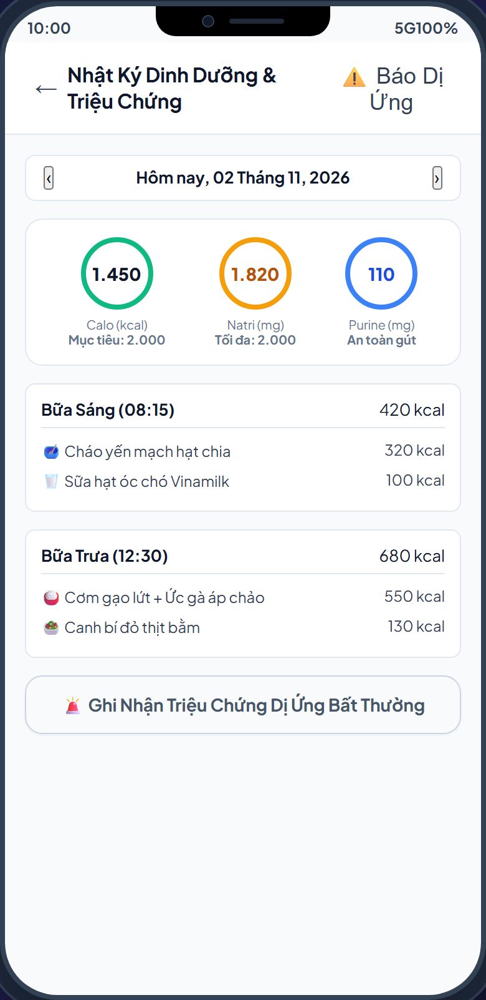

<em>Figure D.10: UC11 Daily Dietary Journal screen displaying circular nutrition meters (Calories, Sodium, Purine) and meal logs.</em>

---

### UC12: Record Allergic Symptom Incident
*Performed by: Truong Gia Linh | Reviewed by: Ngo Tien Binh | Edited by: Le Tat Nam*

| Element | Specification |
|:---|:---|
| **Use Case ID** | **UC12** |
| **Use Case Name** | Record Allergic Symptom Incident |
| **Functional Group** | FG5: Dietary and Reaction Journal |
| **Primary Actor** | Consumer |
| **Priority** | High |
| **Description** | Enables users to document unexpected allergic or gastrointestinal symptoms after eating, recording symptom onset, suspected food, clinical manifestations, severity rating, and medications taken for physician consultation. |
| **Preconditions** | User is authenticated (`UC02`). |
| **Postconditions** | Allergic incident report stored securely with timestamp and exportable clinical summary. |

#### Basic Flow (Main Success Scenario)
1. User taps **"⚠️ Báo Dị Ứng"** in the Dietary Journal (`UC11`).
2. System displays urgent medical banner: *"Nếu có dấu hiệu khó thở, phù mặt, hãy liên hệ cấp cứu 115 ngay lập tức!"*
3. User verifies symptom onset time (`10:00 - 15 phút sau ăn`) and suspected food item (`"Bánh quy tại tiệc trà"`).
4. User selects manifested symptoms from chip grid: **"Ngứa rát môi/họng"**, **"Nổi mề đay / Ban đỏ"**.
5. User adjusts Severity Slider to Level 3 (Trung bình).
6. User enters medication notes: *"Đã uống 1 viên Cetirizine 10mg lúc 10:05..."*.
7. User taps **"Lưu Báo Cáo & Xuất File Y Tế" (Save & Export Clinical Report)**.
8. System stores incident report encrypted and generates a shareable PDF summary for the user's allergist.

#### Alternative & Exception Flows
* **A1 (Emergency Severity Level 5 Selected):** If user selects Severity Level 5 (Khẩn cấp / Khó thở / Choáng váng):
  1. System immediately displays emergency dialing shortcut to **115 (Emergency Ambulance Vietnam)**.
  2. Prompts user to inject Epinephrine (EpiPen) if prescribed by their doctor.

#### Prototype Screen

  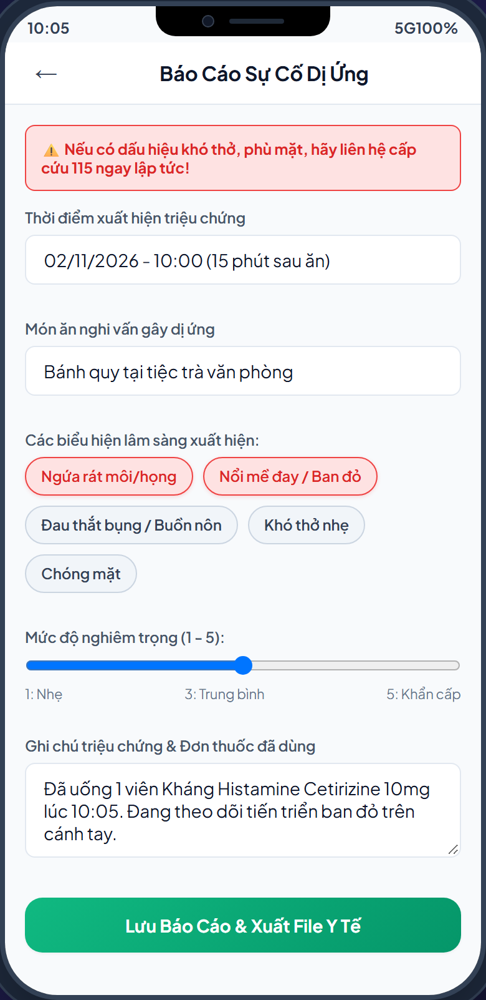

<em>Figure D.11: UC12 Allergic Incident Report screen showing emergency hotline alert, symptom selector, severity slider, and medication notes.</em>

---

### UC13: Manage Safe Product Favorites
*Performed by: Nguyen Hoang Phuc Thinh | Reviewed by: Luong Hoang Nam | Edited by: Truong Gia Linh*

| Element | Specification |
|:---|:---|
| **Use Case ID** | **UC13** |
| **Use Case Name** | Manage Safe Product Favorites |
| **Functional Group** | FG6: Shopping List and Favorites |
| **Primary Actor** | Consumer |
| **Priority** | Medium |
| **Description** | Allows consumers to bookmark verified safe food items into a personal favorites collection, organizing them by grocery category for rapid re-evaluation and shopping checklist creation. |
| **Preconditions** | User is authenticated (`UC02`). |
| **Postconditions** | Product added or removed from favorites; stored locally for offline access. |

#### Basic Flow (Main Success Scenario)
1. On any safe evaluation screen (`UC09` GREEN) or catalog search, user taps the Star / Bookmark icon.
2. System tags product as Favorite and caches its barcode and ingredient breakdown.
3. User accesses **"Mục Yêu Thích" (Favorites)** tab to browse saved items.
4. User selects multiple items and taps **"Thêm vào Danh sách Mua sắm"** (`UC14`).

#### Alternative & Exception Flows
* **A1 (Formula Revision Warning):** If manufacturer updates product ingredients in the master catalog and an allergen is introduced:
  1. System displays warning badge on the favorite item: *"Công thức sản phẩm vừa thay đổi! Đã phát hiện thành phần mới."*

---

### UC14: Create & Check Grocery Shopping List
*Performed by: Nguyen Hoang Phuc Thinh | Reviewed by: Le Tat Nam | Edited by: Ngo Tien Binh*

| Element | Specification |
|:---|:---|
| **Use Case ID** | **UC14** |
| **Use Case Name** | Create & Check Grocery Shopping List |
| **Functional Group** | FG6: Shopping List and Favorites |
| **Primary Actor** | Consumer |
| **Priority** | Medium |
| **Description** | Provides an in-store grocery checklist that automatically checks off verified safe items as the user scans them in supermarket aisles, displaying shopping completion progress. |
| **Preconditions** | User has created a grocery shopping list. |
| **Postconditions** | Checklist progress updated; verified items checked off in real time. |

#### Basic Flow (Main Success Scenario)
1. User opens **"Danh Sách Mua Sắm Siêu Thị"** upon arriving at a retail grocery store.
2. System displays checklist items categorized into verified safe staples and pending items with progress indicator (e.g., *"3 / 5 sản phẩm an toàn đã xác thực - 60%"*).
3. User picks up a pending item (*"Dầu olive nguyên chất"*) from the supermarket shelf and taps **"📷 Bật Camera Quét Xác Nhận Khi Mua"** (`UC06`).
4. Camera scans the packaging label; hazard engine confirms GREEN safe status.
5. System automatically checks off the item, applies strike-through text styling, and increments progress ring to 80%.

#### Alternative & Exception Flows
* **A1 (Scanned Item Triggers Red Alert in Store):**
  1. Item is NOT checked off.
  2. System alerts user immediately and prompts with safe substitute (`UC10`).

#### Prototype Screen

  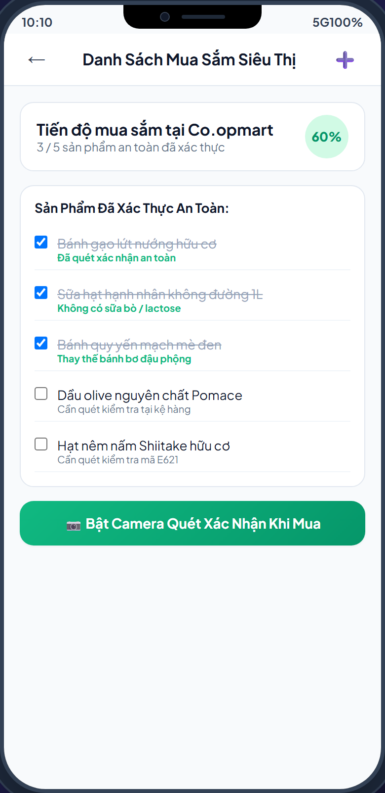

<em>Figure D.12: UC13 & UC14 Shopping List screen displaying real-time supermarket checklist, progress ring, and scan verification button.</em>

---

### UC15: Submit Unindexed Food Product
*Performed by: Nguyen Hoang Phuc Thinh | Reviewed by: Ngo Tien Binh | Edited by: Le Tat Nam*

| Element | Specification |
|:---|:---|
| **Use Case ID** | **UC15** |
| **Use Case Name** | Submit Unindexed Food Product |
| **Functional Group** | FG7: Community Product Contribution |
| **Primary Actor** | Consumer |
| **Priority** | High |
| **Description** | Empowers users to crowdsource new packaged food products by capturing packaging photos, scanning barcodes, and entering ingredient text when an item is not found in the catalog. |
| **Preconditions** | User is authenticated (`UC02`). |
| **Postconditions** | New product entry created with status `PENDING` and routed to the Admin Moderation Queue (`UC17`). |

#### Basic Flow (Main Success Scenario)
1. User navigates to **"Đóng Góp Sản Phẩm Mới" (Contribute Product)**.
2. System displays submission form requesting: Packaging photos (Front & Ingredients), Barcode / EAN, Product Name, Brand / Manufacturer, and Ingredient Text.
3. User captures front photo and ingredient panel photo.
4. User taps **"Quét mã"**; camera captures barcode `8934567891234`.
5. User enters product name (`"Bánh Que Giòn Cay Ngũ Vị"`), manufacturer (`"VinaFood"`), and ingredients.
6. User taps **"Gửi Lên Kiểm Duyệt (Pending)"**.
7. System uploads data over TLS 1.3 to `/api/v1/community/products`.
8. Backend validates fields, creates record with status `PENDING`, and displays confirmation: *"Cảm ơn bạn! Sản phẩm đã được gửi lên hàng đợi kiểm duyệt của Admin NutriViet."*

#### Alternative & Exception Flows
* **A1 (Duplicate Barcode Detected):** If barcode already exists in the verified database:
  1. System informs user: *"Sản phẩm này đã tồn tại trong danh mục. Bạn có muốn báo cáo sai lệch thành phần không?"* with link to `UC16`.
* **A2 (Missing Ingredient Image):** If ingredient panel photo is missing, submission button is disabled.

#### Prototype Screen

  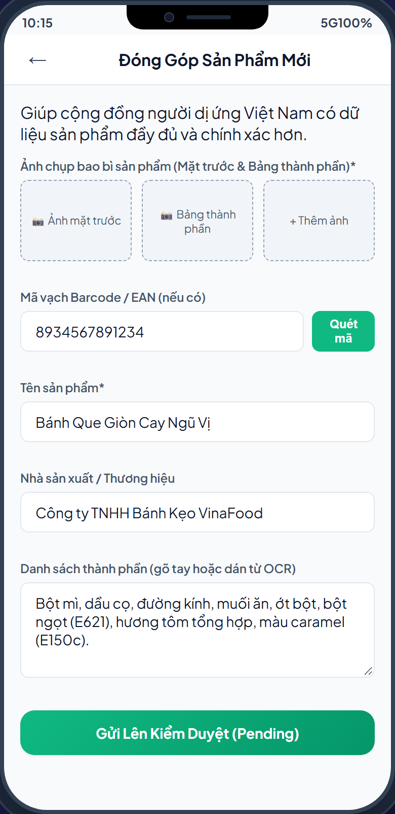

<em>Figure D.13: UC15 Community Submission screen showing packaging photo uploader, barcode scanner, and ingredient input.</em>

---

### UC16: Report OCR / Ingredient Inaccuracy
*Performed by: Nguyen Hoang Phuc Thinh | Reviewed by: Truong Gia Linh | Edited by: Luong Hoang Nam*

| Element | Specification |
|:---|:---|
| **Use Case ID** | **UC16** |
| **Use Case Name** | Report OCR / Ingredient Inaccuracy |
| **Functional Group** | FG7: Community Product Contribution |
| **Primary Actor** | Consumer |
| **Priority** | Medium |
| **Description** | Allows consumers to flag transcription inaccuracies, missing ingredients, or improper allergy hazard ratings on scanned items, initiating an administrative review ticket. |
| **Preconditions** | User has completed a scan (`UC09`). |
| **Postconditions** | Discrepancy report recorded and flagged in Admin Audit Queue (`UC17`). |

#### Basic Flow (Main Success Scenario)
1. On the Hazard Alert screen (`UC09`), user taps **"🚩 Báo cáo sai lệch OCR nhãn"**.
2. System opens the Discrepancy Report modal displaying product name and scan transaction ID (`OCR-SCAN-#9281`).
3. User selects error category: **"Nhận diện sai từ vựng thành phần"**.
4. User specifies the misread token (`"Sodium Caseinate (E469)"`) and the actual text on packaging (`"Sodium Caseinate (Protein sữa)"`).
5. User adds explanatory remarks and taps **"Gửi Báo Cáo Sai Lệch"**.
6. System logs report to backend audit queue; displays toast: *"Báo cáo đã gửi thành công tới đội ngũ kiểm duyệt dữ liệu!"*

#### Alternative & Exception Flows
* **A1 (Anonymous Submission):** User can submit report without linking their public name for privacy.

#### Prototype Screen

  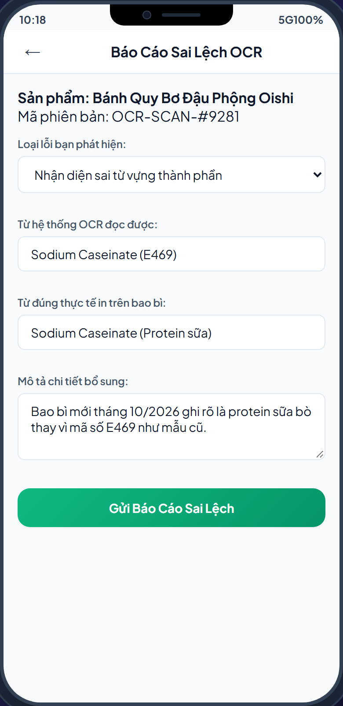

<em>Figure D.14: UC16 OCR Discrepancy Report screen showing error category dropdown, original vs corrected text inputs, and submission button.</em>

---

### UC17: Moderate Crowdsourced Product Submissions
*Performed by: Le Tat Nam | Reviewed by: Ngo Tien Binh | Edited by: Nguyen Hoang Phuc Thinh*

| Element | Specification |
|:---|:---|
| **Use Case ID** | **UC17** |
| **Use Case Name** | Moderate Crowdsourced Submissions |
| **Functional Group** | FG8: Admin Allergy Dictionary and Product Verification |
| **Primary Actor** | System Administrator |
| **Priority** | Critical |
| **Description** | Equips administrators with a desktop web moderation portal to inspect user-submitted photos side-by-side with OCR text, standardize ingredient taxonomies, and approve items into the public catalog or reject invalid entries. |
| **Preconditions** | Administrator is authenticated with `ADMIN` role (`UC02`). |
| **Postconditions** | **Approved:** Product status updated to `VERIFIED`; indexed into master catalog for all users. **Rejected:** Product status updated to `REJECTED` with audit feedback. |

#### Basic Flow (Main Success Scenario)
1. Administrator opens the web portal and logs in; system navigates to `/admin/moderation`.
2. System presents pending queue count (e.g., *"12 chờ duyệt"*). Admin selects `"Bánh Que Giòn Cay Ngũ Vị"`.
3. System renders a side-by-side split screen:
   - Left Panel: Original high-res packaging photos uploaded by user.
   - Right Panel: Editable fields for Product Name, Barcode, Normalized Ingredients, and Auto-detected Allergen tags.
4. Administrator inspects packaging photo, corrects typography, and verifies the automated hazard tags (**⚠️ Gắn nhãn Dị ứng: Tôm / Giáp xác**).
5. Administrator clicks **"✔ Duyệt Vào Danh Mục" (Approve into Catalog)**.
6. Backend updates product status to `VERIFIED`, writes audit record with admin ID and timestamp, and sends a push notification thanking the contributor.

#### Alternative & Exception Flows
* **A1 (Unclear Photo - Request Revision):** Packaging photo is too blurry to verify ingredients:
  1. Admin clicks **"✏ Yêu cầu sửa" (Request Correction)**.
  2. System notifies contributing user to upload a sharper packaging photo.
* **A2 (Spam / Fake Product - Reject):** Submission is non-food spam or duplicate:
  1. Admin clicks **"✖ Từ chối" (Reject)**, selects reason from dropdown, and archives record.

#### Prototype Screen

  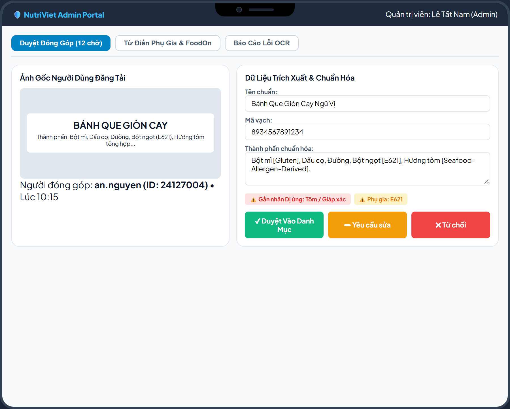

<em>Figure D.15: UC17 Admin Moderation desktop portal showing side-by-side photo inspection, ingredient standardization, and approval buttons.</em>

---

### UC18: Manage Master Additive & Allergen Dictionary
*Performed by: Le Tat Nam | Reviewed by: Ngo Tien Binh | Edited by: Luong Hoang Nam*

| Element | Specification |
|:---|:---|
| **Use Case ID** | **UC18** |
| **Use Case Name** | Manage Master Additive & Allergen Dictionary |
| **Functional Group** | FG8: Admin Allergy Dictionary and Product Verification |
| **Primary Actor** | System Administrator |
| **Priority** | High |
| **Description** | Provides centralized administrative controls to create, read, update, and classify chemical food additive codes (E-numbers), scientific synonyms, and link them to FoodOn ontology concept IDs. |
| **Preconditions** | Administrator is authenticated with `ADMIN` role (`UC02`). |
| **Postconditions** | Additive dictionary updated in PostgreSQL; cache invalidation broadcasted to client devices. |

#### Basic Flow (Main Success Scenario)
1. Administrator navigates to **"Từ Điển Phụ Gia & FoodOn"** tab on the admin web dashboard.
2. System renders master lookup table containing: E-Code, Scientific & Vietnamese Name, FoodOn Concept ID, and Warning Severity.
   - E469: Sodium Caseinate $\rightarrow$ `FOODON:03411304 (Cow Milk Protein)` [Cực kỳ nghiêm trọng]
   - E621: Monosodium Glutamate $\rightarrow$ `FOODON:03420109 (Glutamic Salt)` [Thận trọng (Gút/Natri)]
   - E322: Lecithin $\rightarrow$ `FOODON:03411422 (Soybean Derivative)` [Cảnh báo Đậu nành]
3. Administrator clicks **"+ Thêm Phụ Gia Mới"**.
4. Enters new additive definition (e.g., *E102 - Tartrazine*), selects FoodOn node, and assigns warning level.
5. Clicks **"Lưu" (Save)**; backend validates ontology format, updates database, and pushes delta sync to client offline storage.

#### Alternative & Exception Flows
* **A1 (Invalid FoodOn Concept ID):** If admin enters malformed ontology URI, system validates format against FoodOn OWL regex before saving.

#### Prototype Screen

  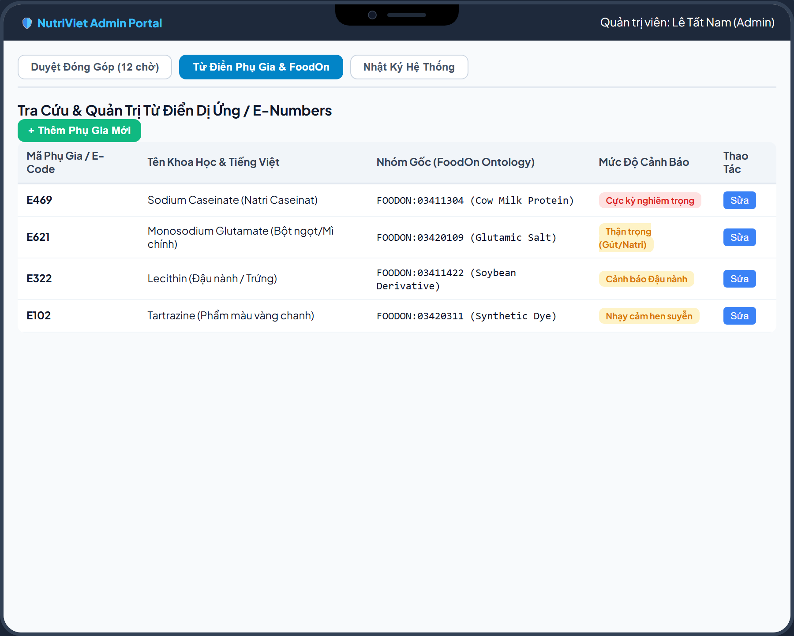

<em>Figure D.16: UC18 Admin Additive Dictionary screen displaying E-number records, FoodOn ontology mappings, and severity classification table.</em>

