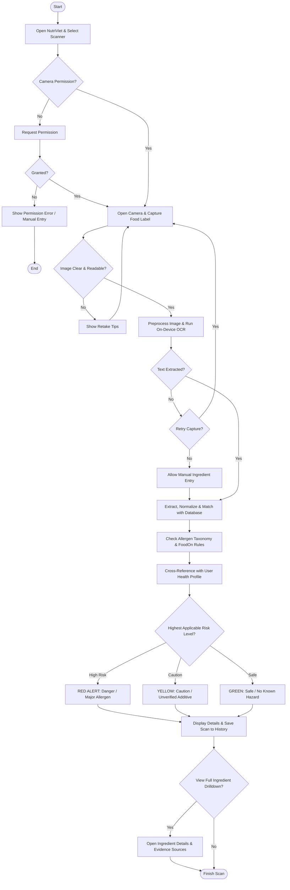
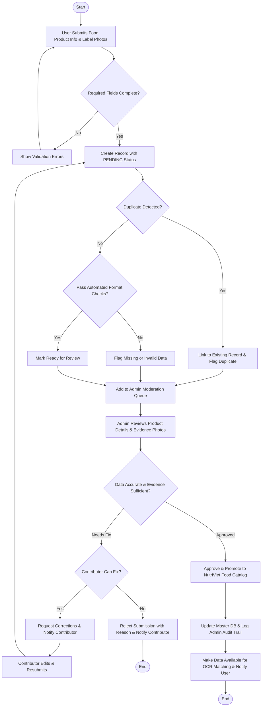

# NutriViet: Vision Document
**Product Vision and High-Level Requirements Specification**  
**Course:** CS300 - CSC13002 - Introduction to Software Engineering  
**Project Assignment:** PA2-2026  
**Group:** Group 07 - NutriViet Team  

---

## 1. Introduction
*Performed by: Ngo Tien Binh | Reviewed by: Truong Gia Linh | Edited by: Le Tat Nam*

### 1.1. Purpose of the Document
The purpose of this Vision Document is to collect, analyze, and define the high-level needs and features of **NutriViet**, an intelligent mobile food allergy detection and personalized nutrition management application for Android. It focuses on the capabilities required by primary stakeholders, target end-users, and system administrators, establishing the target problems, system boundaries, unique market positioning, key architectural capabilities, and non-functional quality standards. This document serves as the authoritative baseline for all downstream architectural design, use case elaboration, sprint task breakdown, and acceptance validation throughout the CS300 Software Engineering curriculum.

### 1.2. References
1. **NutriViet Project Proposal (PA1-2026):** Baseline requirements, existing app survey, and team contract ([proposal.md](../../proposal.md)).
2. **FoodOn Consortium:** FoodOn: A global farm-to-fork food ontology (`https://foodon.org/`).
3. **National Food Safety Technical Regulations:** QCVN 01-189:2019/BNNPTNT on labeling standards for packaged foodstuffs in Vietnam.
4. **IEEE Std 830-1998:** IEEE Recommended Practice for Software Requirements Specifications.
5. **Open Food Facts API Documentation:** Open database of food products worldwide (`https://world.openfoodfacts.org/`).

---

## 2. Positioning
*Performed by: Le Tat Nam | Reviewed by: Ngo Tien Binh | Edited by: Luong Hoang Nam*

### 2.1. Problem Statement
The table below specifies the core societal and health challenge addressed by the NutriViet platform.

| Element | Specification |
|:---|:---|
| **The problem of** | Obscure, complex, and unstandardized ingredient labeling on packaged food products in Vietnam, characterized by microscopic typography, foreign technical nomenclature, cryptic chemical additive codes (E-numbers), and undeclared cross-contamination allergens. |
| **affects** | Vietnamese consumers suffering from severe food allergies (e.g., peanuts, seafood, gluten, cow's milk), chronic metabolic disorders (e.g., diabetes, hypertension, gout), parents purchasing baby food, and health-conscious shoppers following strict dietary regimens. |
| **the impact of which is** | High risks of life-threatening anaphylactic reactions, chronic dietary complications, severe anxiety during grocery shopping, and excessive time wasted manually deciphering chemical labels at retail supermarket shelves. |
| **a successful solution would be** | A mobile application offering instant smartphone camera Optical Character Recognition (OCR) combined with typo-tolerant fuzzy matching and FoodOn ontology classification, delivering unambiguous color-coded safety hazard alerts (RED dangerous / YELLOW caution / GREEN safe), personalized dietary logging, and curated safe food alternatives. |

### 2.2. Product Position Statement
The table below outlines the strategic positioning of NutriViet in contrast to existing commercial market alternatives.

| Element | Specification |
|:---|:---|
| **For** | Vietnamese shoppers and households managing dietary restrictions, food allergies, and chronic medical nutrition plans. |
| **Who** | Require immediate, foolproof, and scientifically grounded verification of food ingredients while shopping in retail stores. |
| **The product name** | **NutriViet** |
| **That** | Scans product packaging labels via camera OCR in real time, cross-references ingredients against personalized user health profiles using hierarchical FoodOn allergen ontologies, and delivers immediate visual hazard alerts without requiring pre-registered barcode databases. |
| **Unlike** | Existing international applications like **Yuko** (which lacks personalized health-profile hazard filtering and Vietnamese label support) and **Soosee** (which lacks recursive additive ontology mapping, dietary logging, and community verification). |
| **Our product** | Delivers specialized Vietnamese OCR text normalization, semantic ontology inference for hidden food derivatives, local offline caching for low-connectivity supermarket environments, and verified community-driven product crowdsourcing. |

---

## 3. Stakeholder and User Descriptions
*Performed by: Truong Gia Linh | Reviewed by: Luong Hoang Nam | Edited by: Nguyen Hoang Phuc Thinh*

### 3.1. Stakeholder Summary
The key stakeholders invested in the development, operation, and outcome of the NutriViet ecosystem include:

| Stakeholder Group | Role in Project | Key Concerns & Interests |
|:---|:---|:---|
| **Course Instructors & TAs** | Academic supervisors & quality evaluators | Adherence to Scrum process, Spec-Driven Development, quantifiable NFRs, traceability, and code quality. |
| **Development Team (Group 07)** | System designers, full-stack engineers, QA | Scalable Clean Architecture, robust OCR accuracy, test coverage $\ge 80\%$, on-time sprint deliverables. |
| **Health-Restricted Consumers** | Primary end-users | Zero false negatives on severe allergens, instant scanning response (< 2s), clear visual indicators. |
| **Medical Dietitians / Nutritionists** | Domain advisors | Accuracy of dietary calculations, safe macro/micronutrient thresholds, proper medical disclaimer visibility. |
| **System Administrators** | Operational managers | Intuitive moderation portal, data integrity in ontology tables, fast resolution of OCR correction flags. |

### 3.2. User Summary

| User Persona | System Role | Motivation & Usage Pattern | Technical Proficiency |
|:---|:---|:---|:---|
| **Allergy-Prone Consumer (e.g., An, 22)** | Standard User | Scans labels in supermarkets to avoid fatal peanut and shellfish exposure; checks hazard alerts in under 3 seconds. | Basic mobile smartphone literacy. |
| **Chronic Care Shopper (e.g., Uncle Hai, 58)** | Standard User | Monitors daily sodium, sugar, and purine intake; logs meals to prevent gout flare-ups and diabetic spikes. | Moderate mobile literacy; needs high-contrast UI and large font options. |
| **Platform Moderator (e.g., Linh, 24)** | System Administrator | Verifies user-contributed food products, approves additive dictionary extensions, monitors error rates. | Advanced web and database proficiency. |

### 3.3. User Environment
1. **Physical Retail Environments:** Users predominantly scan products within brick-and-mortar grocery stores, traditional markets, and supermarket basements. These settings frequently present poor artificial fluorescent lighting, reflective cellophane packaging, crinkled labels, and degraded cellular network connectivity (3G/HSPA or total signal dropouts).
2. **Device Hardware Constraints:** The application operates on Android mobile devices (Android 8.0 Oreo, API Level 26 and above). Target devices range from budget smartphones (2GB RAM, modest camera lenses) to high-end devices. Handheld camera stability varies significantly across users.
3. **Administrative Environment:** Administrators operate via desktop/laptop web browsers (Google Chrome, Firefox, Safari) over stable broadband internet connections.

### 3.4. Summary of Key Stakeholder and User Needs

| Need ID | Priority | Stakeholder / User Need | Current Pain Point | Addressed Feature |
|:---:|:---:|:---|:---|:---|
| **N-01** | High | Instant allergen hazard detection without manual typing. | Decoding microscopic label text is exhausting and error-prone. | Camera OCR + Instant Visual Alert (FG1, FG2) |
| **N-02** | High | Identification of obscure chemical additives & hidden allergens. | Additives like "E621" or "Sodium Caseinate" hide dairy/MSG origins. | FoodOn Ontology & Additive Dictionary (FG3) |
| **N-03** | High | Full functionality in offline supermarket basements. | Cloud-only apps fail completely when cellular signal is lost. | On-Device OCR & Offline Health Cache (FG1, FG7) |
| **N-04** | Medium | Tracking daily nutritional consumption against medical targets. | Generic calorie counters do not track allergy hazard histories. | Daily Nutritional Diary & Health Metrics (FG4) |
| **N-05** | Medium | Finding safe alternative foods when a scanned item is dangerous. | Shoppers leave empty-handed after discovering an allergen. | Safe Dietary Alternative Recommender (FG5) |
| **N-06** | Medium | Community contributions for unindexed local Vietnamese snacks. | Barcode databases omit artisanal and local market products. | Crowdsourced Food Product Submission (FG6) |
| **N-07** | High | Rigorous moderation to ensure crowdsourced data accuracy. | Unverified community data could lead to severe health accidents. | Admin Portal & Ingredient Audit System (FG8) |

### 3.5. Alternatives and Competition
Refining the empirical competitive survey conducted in PA1, NutriViet benchmarks against two leading international commercial solutions:

```mermaid
quadrantChart
    title Market Positioning Matrix: Allergen Intelligence vs Vietnamese Localization
    x-axis Low Vietnamese Food Support --> High Vietnamese Food Support
    y-axis Basic Additive Lookup --> Advanced Hierarchical Allergen AI
    quadrant-1 Specialized Local Leaders (NutriViet Target)
    quadrant-2 International Scientific Scanners
    quadrant-3 Rudimentary Barcode Apps
    quadrant-4 Generic Localized Trackers
    Yuko App: [0.25, 0.45]
    Soosee App: [0.38, 0.72]
    Open Food Facts: [0.35, 0.50]
    NutriViet: [0.88, 0.85]
```

1. **Yuko App (Germany/EU):** Excels in evaluating cosmetics and standardized European food additive health scores. However, it relies heavily on pre-registered European EAN barcodes and completely lacks individual allergy customization and Vietnamese packaging text extraction.
2. **Soosee App (Netherlands):** Provides word-highlighting camera scanning across predefined allergy categories. However, Soosee lacks deep semantic relationship mapping (fails to infer that *Whey Powder* implies *Cow's Milk* unless explicitly hardcoded), does not provide nutritional diary logging, and lacks crowdsourced moderation for regional Vietnamese foods.
3. **NutriViet Competitive Advantage:** Fills this critical market void by delivering localized Vietnamese text recognition, hierarchical ontology derivation (FoodOn), personal profile tailoring, offline warning caching, and admin-verified community crowdsourcing.

---

## 4. Product Overview
*Performed by: Nguyen Hoang Phuc Thinh | Reviewed by: Le Tat Nam | Edited by: Ngo Tien Binh*

### 4.1. Product Perspective
NutriViet is a modern, cloud-connected mobile health platform operating on a client-server architecture:
- **Client Tier:** A cross-platform Flutter application running natively on Android, utilizing on-device machine learning for real-time text recognition (Google ML Kit).
- **Edge / Local Data Tier:** An encrypted SQLite/Hive local storage cache holding the user's active health profile, severe allergen keys, and emergency offline dictionary.
- **Server Tier:** A containerized FastAPI (Python 3.12) backend exposing RESTful APIs, orchestrating fuzzy matching services, FoodOn semantic ontology graph queries, community submission pipelines, and administrative moderation portals.
- **Data Persistence Tier:** A PostgreSQL relational database managing normalized ingredient lexicons, user accounts, audit trails, and product catalogs.

### 4.2. Assumptions and Dependencies
1. **Camera Quality Assumption:** The host mobile device possesses an autofocus camera with a minimum resolution of 8 megapixels capable of legibly capturing packaging labels at 10–25 cm distance.
2. **Lighting Assumption:** While the app supports flashlight toggling, packaging text must have sufficient optical contrast against label backgrounds.
3. **Ontology Dependency:** Accurate allergen lineage derivation depends on the FoodOn open-source ontology dataset and curated Vietnamese ingredient mappings maintained by administrators.
4. **Legal & Medical Boundary:** NutriViet provides assistive decision-support warnings and does not claim to replace certified clinical allergy diagnosis or emergency medical care.

---

## 5. Product Features
*Performed by: Luong Hoang Nam | Reviewed by: Ngo Tien Binh | Edited by: Truong Gia Linh*

This section refines the 8 Functional Groups (FG1–FG8) established in PA1 into detailed feature specifications. In compliance with PA2 standards, each feature is described through a dedicated explanatory paragraph outlining what the feature does, why it is needed, and who benefits from it.

### 5.1. Feature Descriptions

#### FG1: Authentication and Authorization
* **Description:** NutriViet allows users to register and log in securely using an email and password or Google authentication. This feature is needed to protect personal information and ensure that each user can access the appropriate functions. Standard users can access features such as food scanning and allergy profile management, while administrators can access the administrative dashboard. Both users and administrators benefit from role-based access control, which helps protect private records and prevent unauthorized changes to system data.

#### FG2: Personal Allergy Profile Management
* **Description:** NutriViet enables users to create and manage personal profiles containing known food allergens, such as seafood, peanuts, milk, eggs, gluten, and soy, as well as dietary conditions such as diabetes, high blood pressure, hyperlipidemia, and gout. This feature is necessary because different people have different allergies and dietary restrictions, so food safety assessments must be personalized. The profile serves as the reference for evaluating ingredients detected during food scanning. Individuals with food allergies, people with dietary restrictions, and caregivers managing family members' profiles benefit from more personalized food safety information.

#### FG3: Packaging OCR Scanner
* **Description:** NutriViet allows users to capture food packaging with a smartphone camera and extract ingredient lists and nutritional information using Optical Character Recognition (OCR). This feature is needed because ingredient labels often contain small text that is difficult to read manually, especially while shopping. By converting images into machine-readable text and coupling with fuzzy matching to correct optical misreadings, the application makes ingredient analysis faster and more convenient. Consumers, particularly those who need to check many ingredients before purchasing food, benefit from a simpler and more efficient scanning process.

#### FG4: Instant Evaluation and Allergy Alert
* **Description:** NutriViet compares the ingredients extracted by the OCR scanner against the user's personal allergy profile and FoodOn ontology rules, displaying a clear color-coded safety result. A red alert indicates that a relevant hazard or allergen has been detected, a yellow alert signals caution or unverified additives, while a green result indicates that no known hazard was detected in the available data. This feature is needed to help users identify potential food risks quickly before consuming or purchasing a product. People with food allergies and their caregivers benefit from timely warnings that reduce the risk of accidental allergen exposure; however, a green result does not guarantee that a product is completely safe.

#### FG5: Dietary and Reaction Journal
* **Description:** NutriViet allows users to record the foods they consume, monitor daily calorie and macronutrient intake, and log symptoms such as itching, hives, or stomach cramps after meals. This feature is needed because users may have difficulty remembering which foods they consumed before experiencing a reaction or tracking their dietary habits over time. Keeping these records can help users recognize patterns and provide useful information when discussing symptoms with healthcare professionals. People managing allergies, dietary restrictions, or nutrition goals benefit from having their food intake and reported reactions organized in one place.

#### FG6: Shopping List and Favorites
* **Description:** NutriViet allows users to save safe, verified food products to a favorites list and create shopping checklists before visiting supermarkets. This feature is needed because users may repeatedly purchase the same products and do not want to scan each item every time they shop. Saved products make it easier to retrieve previously checked information and organize grocery shopping. Regular shoppers, people managing food allergies, and caregivers purchasing groceries for their families benefit from faster product lookup and more convenient shopping preparation.

#### FG7: Community Product Contribution
* **Description:** NutriViet allows users to submit new food products by uploading packaging photos, ingredient labels, and relevant product information when an item is missing from the database. This feature is needed because the range of packaged foods available in Vietnam is extensive and the database may not initially contain every local product. Community contributions help expand product coverage and make more ingredient information available to other users. Consumers benefit from a growing database, while contributors help improve the usefulness of NutriViet for the wider community.

#### FG8: Admin Allergy Dictionary and Product Verification
* **Description:** NutriViet provides administrators with a dashboard to create, edit, and classify allergen and food-additive records, as well as review, correct, approve, or reject user-submitted product information. This feature is needed because crowdsourced data may contain mistakes, incomplete information, duplicate products, or misleading submissions. Administrative verification helps maintain the accuracy, consistency, and reliability of the food database used by the scanning and alert features. Administrators benefit from centralized data-management tools, while all users benefit from more trustworthy ingredient information and allergy assessments.

---

### 5.2. System Workflow Diagrams

<style>
  .mermaid svg {
    max-width: 60% !important;
    height: auto !important;
    margin: 0 auto !important;
    display: block !important;
  }
</style>

#### Workflow Diagram 1: Mobile Camera OCR Scanning & Hazard Alert Workflow
The workflow diagram below illustrates the end-to-end user journey during food label capture, text extraction, risk calculation, and visual hazard alerting.



#### Workflow Diagram 2: Community Food Crowdsourcing & Admin Verification Pipeline
The workflow diagram below illustrates the data lifecycle and administrative moderation pipeline for user-submitted food products.



---

## 6. Non-Functional Requirements (NFR)
*Performed by: Nguyen Hoang Phuc Thinh | Reviewed by: Le Tat Nam | Edited by: Ngo Tien Binh*

All non-functional requirements are explicitly quantifiable to ensure unambiguous verification, benchmarking, and automated testing throughout development.

### 6.1. Performance & Responsiveness
* **NFR-PERF-01 (OCR Latency):** The complete on-device OCR extraction and preprocessing pipeline must execute in **less than 1.5 seconds** on mid-range Android devices (tested on Snapdragon 680 or equivalent with 4GB RAM) for labels containing up to 150 words.
* **NFR-PERF-02 (End-to-End Hazard Evaluation):** From camera shutter capture to rendering the visual hazard alert (RED/YELLOW/GREEN), total elapsed time must be **under 2.5 seconds** over a standard 4G cellular connection (ping $\le 50\text{ ms}$).
* **NFR-PERF-03 (Offline Evaluation Latency):** In offline fallback mode, evaluating extracted tokens against the local encrypted allergy cache must complete in **less than 300 milliseconds**.
* **NFR-PERF-04 (Camera Frame Rate):** The active camera preview interface must maintain a smooth refresh rate of **at least 30 frames per second (fps)** without UI jank or freezing.

### 6.2. Scalability & Availability
* **NFR-SCAL-01 (Concurrent Workload):** The backend API service must sustain **at least 150 concurrent active scanning requests** with an average response latency $\le 500\text{ ms}$ and a 99th percentile latency $\le 1200\text{ ms}$.
* **NFR-SCAL-02 (Service Availability):** The cloud backend and database infrastructure must guarantee **99.5% operational uptime** per calendar month, excluding scheduled maintenance windows announced 24 hours in advance.
* **NFR-SCAL-03 (Catalog Capacity):** The PostgreSQL database schema and indexing must support querying over a catalog of **at least 100,000 product records and 5,000 additive definitions** with indexed query execution times $\le 50\text{ ms}$.

### 6.3. Security & Data Protection
* **NFR-SEC-01 (In-Transit Encryption):** All communications between the mobile client and backend APIs must be encrypted using **TLS 1.3** (with fallback to TLS 1.2), enforcing HTTPS and strict certificate validation.
* **NFR-SEC-02 (At-Rest Encryption):** User health profiles, medical allergy tags, and personal scan history stored on the device must be encrypted using **AES-256-GCM** via the Android Keystore-backed SQLCipher/Hive encryption.
* **NFR-SEC-03 (Credential & Token Management):** User authentication sessions must utilize cryptographically signed **JSON Web Tokens (JWT)** with an access token lifespan of **60 minutes** and refresh token rotation. Zero API keys, database credentials, or secret salts may be stored in Git source control.
* **NFR-SEC-04 (Role-Based Access Control - RBAC):** Administrative API endpoints (moderation, catalog mutation, user audits) must strictly verify administrative scopes; unauthorized access attempts must return HTTP 403 and trigger security log events.

### 6.4. Platform & Compatibility
* **NFR-PLAT-01 (Operating System Support):** The client application must install and run flawlessly on **Android 8.0 (Oreo, API Level 26)** through **Android 15 (API Level 35)**.
* **NFR-PLAT-02 (Display Adaptability):** The mobile UI layout must adapt seamlessly across screen resolutions from **720x1280 (HD)** up to **1440x3200 (QHD+)** and support dynamic system font scaling up to **150%** without text clipping or layout overflow errors.
* **NFR-PLAT-03 (Installation Package Size):** The compiled Android Application Package (APK) release size must **not exceed 45 megabytes (MB)** to enable rapid downloading on mobile cellular networks.

### 6.5. Reliability & Accuracy
* **NFR-REL-01 (Allergen Detection Recall):** On clear, standardized packaging text, the fuzzy matching algorithm must achieve **at least 98% recall (zero allowable false negatives)** for primary declared allergens (peanuts, tree nuts, shellfish, milk, eggs, wheat, soybeans).
* **NFR-REL-02 (Offline Storage Footprint):** The local offline database and emergency cache must consume **less than 40 megabytes (MB)** of device storage space.
* **NFR-REL-03 (Graceful Degradation):** In the event of OCR failure due to severe packaging distortion or poor lighting, the application must never crash; it must notify the user within 1.0 second with guidance to activate the flashlight or input manual text.
