

  NUTRIVIET: SMART PERSONALIZED NUTRITION & FOOD ALLERGY WARNING MOBILE APPLICATION

  <strong>Student Group: Group 07 - NutriViet Team</strong> 
  Course: CS300 - CSC13002 - Introduction to Software Engineering 
  Faculty of Information Technology, VNU-HCM University of Science (HCMUS) 
  Team Leader: Ngo Tien Binh (24127004) &nbsp;|&nbsp; ntbinh2419@clc.fitus.edu.vn 
  Team Members: Le Tat Nam (23127432), Luong Hoang Nam (24127456), Nguyen Hoang Phuc Thinh (24127242), Truong Gia Linh (24127438)

  
ABSTRACT

  
Food allergies and diet-related chronic health conditions pose severe, life-threatening risks to Vietnamese consumers, yet packaged food labels frequently present obscure terminology, complex chemical additives (E-numbers), and microscopic font sizes. In this project assignment report, our team presents <strong>NutriViet</strong>, an intelligent mobile food safety platform developed with Flutter for Android. NutriViet bypasses traditional barcode lookup constraints by utilizing direct smartphone camera Optical Character Recognition (OCR), integrated with <strong>Levenshtein Fuzzy Matching</strong> for typo-tolerant label extraction and a <strong>FoodOn Semantic Ontology Knowledge Graph</strong> for recursive hidden allergen lineage inference (e.g., Sodium Caseinate &rarr; Casein &rarr; Cow's Milk &rarr; Milk Allergy). We present the comprehensive empirical benchmark against international market leaders (Yuko and Soosee), establish the team governance contract, and formalize our Scrum agile development methodology for the CS300 Software Engineering curriculum.

  
CONTENTS

  
<strong>1 &nbsp; Group Registration & Team Leadership Roster</strong>2

  
1.1 &nbsp; Team Identification and Leadership Responsibilities2

  
<strong>2 &nbsp; Project Proposal & Core Architecture</strong>2

  
2.1 &nbsp; Introduction & Practical Value2

  
2.2 &nbsp; Target Users (2 System Actors) & Operational Environments2

  
2.3 &nbsp; Key Features & Functional Groups (FG1 – FG8)3

  
2.4 &nbsp; Proposed AI Feature Specification (Fuzzy Matching + FoodOn)4

  
<strong>3 &nbsp; Existing App Survey & Competitive Benchmark</strong>4

  
3.1 &nbsp; Surveyed Application 1: Yuko App (Screens & Architecture)4

  
3.2 &nbsp; Surveyed Application 2: Soosee App (Screens & Architecture)6

  
3.3 &nbsp; Synthesis & Comprehensive Comparative Analysis8

  
<strong>4 &nbsp; Team Contract & Working Agreements</strong>9

  
<strong>5 &nbsp; Development Environment & Scrum Setup Evidence</strong>11

## A - Group Registration

- **Group Name:** Group 07 - NutriViet Team
- **Project Name:** NutriViet (Smart Android Mobile Application for Nutrition Management and Personalized Food Allergy Alerts)
- **Group Leader:** Ngo Tien Binh

### Team Members Roster

| No. | Student ID | Full Name | Academic Email | Project Role & Primary Responsibilities |
|:---:|:---:|:---|:---|:---|
| 1 | **24127004** | **Ngo Tien Binh** | `ntbinh2419@clc.fitus.edu.vn` | **Project Manager (PM) & AI/OCR Lead** / Full-Stack Engineer |
| 2 | **23127432** | **Le Tat Nam** | `ltnam23@clc.fitus.edu.vn` | **Backend & System Architecture Lead** / Full-Stack Engineer |
| 3 | **24127456** | **Luong Hoang Nam** | `lhnam2434@clc.fitus.edu.vn` | **UI/UX & Flutter Lead** / Full-Stack Engineer |
| 4 | **24127242** | **Nguyen Hoang Phuc Thinh** | `nhpthinh2416@clc.fitus.edu.vn` | **Database & Git Lead** / Full-Stack Engineer |
| 5 | **24127438** | **Truong Gia Linh** | `tglinh2437@clc.fitus.edu.vn` | **Quality Assurance (QA) & Documentation Lead** / Full-Stack Engineer |

---

## B - Project Proposal

### 1. Introduction & Project Value

*Performed by: Nguyen Hoang Phuc Thinh| Reviewed by: Le Tat Nam | Edited by: Ngo Tien Binh*

- **Idea Description:**  
  **NutriViet** is an intelligent Android mobile application designed to empower users with personalized nutrition management and instant food allergy warnings. By integrating Optical Character Recognition (OCR) and Artificial Intelligence (AI), regular consumers can effortlessly scan product packaging to automatically extract ingredient lists, receive immediate allergy hazard alerts tailored to their individual health profiles, record daily dietary logs, and obtain safe alternative food suggestions. Concurrently, system administrators manage platform operations, maintain and expand the ingredient and additive dictionaries, verify community-submitted products, and correct OCR parsing discrepancies to guarantee long-term data accuracy.

- **Practical Value:**  
  Vietnamese consumers suffering from food allergies or chronic medical conditions frequently face significant health risks while grocery shopping. Packaging labels often present tiny fonts, complex chemical terminology, and obscure additive codes (E-numbers) that are difficult for the average consumer to decipher. NutriViet resolves this critical challenge instantly by automatically detecting harmful substances through a single smartphone camera scan. The seamless combination of rapid on-device lookups for users and rigorous backend data moderation by administrators ensures that individuals on strict medical diets can shop and consume packaged foods with complete confidence and safety.

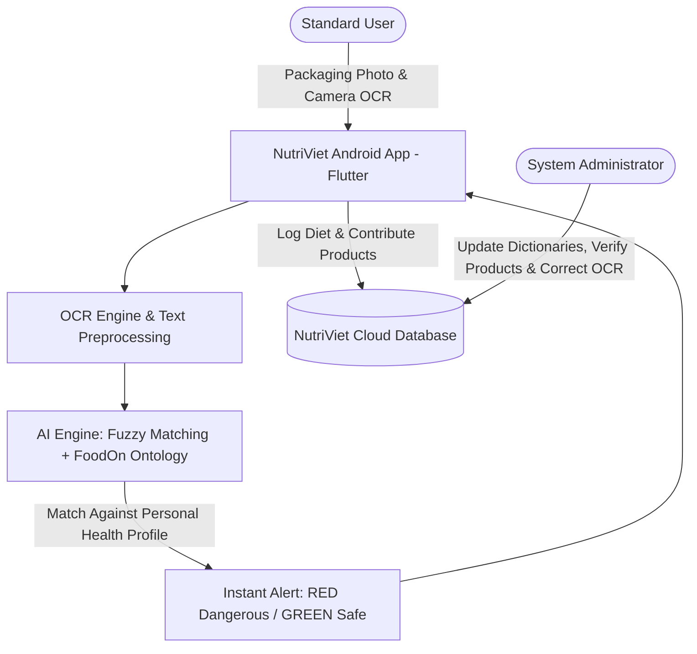

---

### 2. Target Users and Operational Environments

#### 2.1. Target Users (2 System Actors)
The NutriViet platform is architected around **two primary system actors** (satisfying the course requirement of at least 2 actors):

1. **Standard Users (Regular Users):**
   - **Target Audience:** Individuals diagnosed with food allergies or intolerances (seafood, peanuts, cow's milk lactose, gluten, eggs, etc.); patients adhering to medical dietary regimens (diabetes, hypertension, hyperlipidemia, gout); parents purchasing packaged food for young children with sensitive constitutions; and health-conscious consumers pursuing balanced nutrition.
   - **Primary Activities:** Configure personal and family health/allergy profiles; scan product packaging via camera OCR to extract ingredient lists and obtain instantaneous safety verdicts; view recommended safe alternative foods; log daily meals, caloric intake, and allergic symptoms; and contribute new packaged product details to the community database.

2. **System Administrators:**
   - **Target Audience:** Platform operators responsible for quality control, regulatory compliance, food knowledge integrity, and operational health of the application.
   - **Primary Activities:**
     - Create, update, and manage the master database of food ingredients, chemical additives, and map them to standard allergen categories (e.g., tagging *Sodium Caseinate* under the *Milk Allergy* group).
     - Review, verify, and approve (or reject) new product submissions and ingredient photos uploaded by community users.
     - Inspect flagged packaging images with OCR character misrecognitions to rectify parsed text, continuously enhancing search accuracy.
     - Administer user accounts (role assignment, spam/malicious account suspensions) and monitor application usage analytics.

#### 2.2. Operational Environments
The entire NutriViet system (encompassing both the Standard User module and the Administrator module) is deployed as a unified Android mobile application:
- **Operating System:** Android OS (supporting Android 10.0 - API Level 29 and higher).
- **Hardware Requirements:** Android smartphones equipped with an auto-focus rear camera (for sharp packaging photography and high-precision OCR text capture) and active internet connectivity (Wi-Fi / 4G / 5G) for cloud synchronization and AI processing.
- **Application Architecture:** Developed using the **Flutter** cross-platform framework for Android. The application incorporates a **Role-Based UI** that automatically routes users upon authentication—directing Standard Users to the scanner, diary, and profile interfaces, while directing System Administrators to the Administrative Management Dashboard.

---

### 3. Key Features & Functional Groups

#### 3.1. Core Functional Groups (FG1 – FG5)
*Performed by: Nguyen Hoang Phuc Thinh| Reviewed by: Le Tat Nam | Edited by: Ngo Tien Binh*

- **FG1: Authentication & Authorization**  
  Allows users to register and securely log in via Email/Password or Google OAuth. The system automatically routes the user to the appropriate role-based interface (Standard User dashboard or Administrator console). Role-based access control safeguards private medical records and restricts master data modifications strictly to authorized administrators.

- **FG2: Personal Allergy Profile Management**  
  Enables users to quickly select known allergens (seafood, peanuts, milk, eggs, gluten, soy, etc.) and medical dietary conditions (diabetes, high blood pressure, hyperlipidemia, gout). This profile serves as the automated baseline against which scanned food items are evaluated.

- **FG3: Packaging OCR Scanner**  
  Allows users to utilize their smartphone camera to capture ingredient lists and nutritional text directly from packaging. The optical character recognition pipeline converts packaging imagery into structured text, sparing consumers from straining their eyes on fine print.

- **FG4: Instant Evaluation & Allergy Alert**  
  Instantly cross-references recognized ingredients against the user's personal allergy profile, rendering a prominent color-coded safety verdict (**RED: Dangerous / Allergen Detected**, **GREEN: Safe to Consume**). This immediate warning prevents accidental ingestion and severe allergic reactions.

- **FG5: Dietary & Reaction Journal**  
  Enables users to record consumed foods into a daily diary to monitor caloric and macronutrient intake. In the event of post-meal discomfort (itching, hives, stomach cramps), users can record specific symptoms and severity to identify problematic foods over time.

#### 3.2. Additional & Administrative Functional Groups (FG6 – FG8)
*Performed by: Le Tat Nam | Reviewed by: Nguyen Hoang Phuc Thinh | Edited by: Truong Gia Linh*

- **FG6: Shopping List & Favorites**  
  Allows users to bookmark safe, verified products into their favorites and curate shopping checklists prior to visiting supermarkets. This facilitates rapid lookup without having to rescan familiar household groceries repeatedly.

- **FG7: Community Product Contribution**  
  When scanning a new product not yet present in the system, users can capture packaging photos and ingredient labels to submit to the platform. This crowdsourced model rapidly expands the repository of packaged food products available in Vietnam.

- **FG8: Admin Allergy Dictionary & Product Verification**  
  Provides an administrative dashboard for administrators to create, edit, and classify allergens and food additives, as well as review, edit, approve, or reject user-submitted items. This guarantees that published food data remains authoritative, accurate, and free of spam.

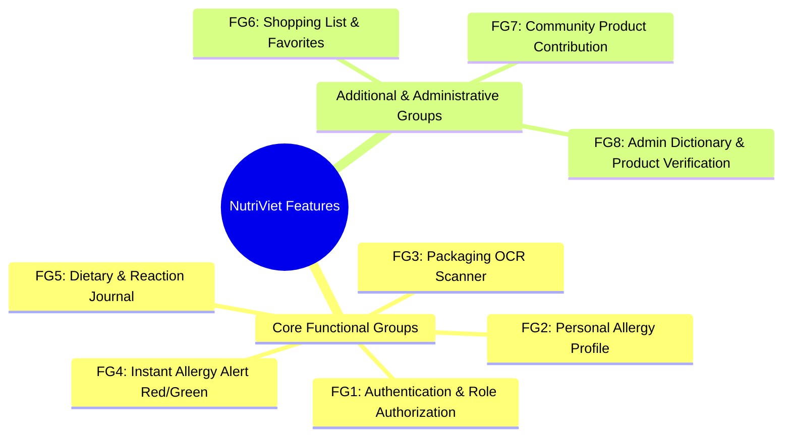

---

### 4. Proposed AI Feature Specification

*Performed by: Le Tat Nam | Reviewed by: Nguyen Hoang Phuc Thinh | Edited by: Ngo Tien Binh*

#### 4.1. Practical Problem in Everyday Grocery Shopping
- When capturing ingredient labels on food packages using a smartphone, printed text is frequently blurred, skewed, curved around cylindrical cans, or missing Vietnamese diacritical marks due to wrinkled or reflective packaging (e.g., scanning the word `"đậu phộng"` might be misread by OCR as `"đâu phông"`).
- Food manufacturers rarely list familiar allergen terms directly. Instead, they print technical chemical names or additive codes (e.g., an individual allergic to cow's milk will not find the word *"Sữa"* on a biscuit label, but will see *"Sodium Caseinate"*, *"Whey powder"*, or *"E469"*). If an application relies solely on basic keyword matching, it will fail to detect the hazard, endangering the consumer's health.

#### 4.2. Explanation of the Two Core AI Technologies
1. **Fuzzy Matching – "Automated Approximate Spell Correction":**
   - Standard search engines require a 100% exact character match to recognize a word.
   - Fuzzy Matching computes similarity percentages based on string edit distance (Levenshtein distance). If an OCR-scanned word has minor character errors or corrupted diacritics (such as `"đâu_phông"` matching `"đậu phộng"` with 85%+ similarity), the system automatically infers and rectifies the text to the standardized ingredient name `"Đậu phộng"`.
2. **FoodOn Ontology – "The Hierarchical Family Tree of Food":**
   - FoodOn is a globally standardized ontology modeling the origins, derivates, and relationships of food ingredients in a connected semantic knowledge graph.
   - Leveraging this hierarchical tree, NutriViet traces complex chemical derivatives back to raw parent foods:
     > **Sodium Caseinate** *(derived from)* → **Casein** *(found in)* → **Cow's Milk** *(belongs to)* → **Milk Allergen Group**

#### 4.3. Feature Workflow and Practical Value
When a user takes a photo of an ingredient label, the system processes it through a rapid 3-step pipeline:
- **Step 1 (Text Rectification):** Fuzzy Matching corrects typos, distorted characters, and missing diacritics, mapping raw OCR tokens to standardized database entries.
- **Step 2 (Ontological Trace):** FoodOn traverses the semantic knowledge graph to identify the biological and culinary origins of each detected ingredient or additive.
- **Step 3 (Contextual Alert):** If an ingredient's origin matches any allergen in the user's declared profile, the app immediately triggers a **RED ALERT** with a clear, layman-friendly explanation:
  > **"Warning: This product contains Sodium Caseinate — a substance derived from Cow's Milk that will trigger your diagnosed Dairy Allergy!"**

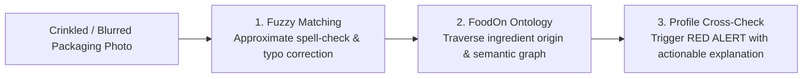

---

## C - Existing App Survey

*Performed by: Luong Hoang Nam  | Reviewed by: Le Tat Nam | Edited by: Truong Gia Linh*

To establish a clear baseline and benchmark for **NutriViet**, our team conducted an in-depth survey of existing food additive and nutrition analysis applications currently available on the market. Below is the comprehensive survey of the first reference application: **Yuko**.

---

### 1. Surveyed Application 1: Yuko App

#### 1.1. Overview and Core Purpose
**Yuko** is a mobile food-scanning application designed to help consumers understand the ingredients present in packaged food products and identify additives that may pose health concerns. 
- **Target Audience:** Health-conscious individuals, consumers with dietary sensitivities, and families seeking to avoid harmful additives.
- **Primary Mechanism:** Scans product barcodes or physical ingredient lists, evaluates additive toxicity/risk levels, personalizes alerts according to users' specific health conditions and allergies, and records historical scans.

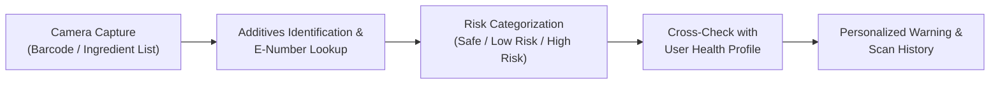

#### 1.2. Key User Flows
The application structures its primary interactions into 3 fundamental user flows:

1. **Flow 1: First-Time Onboarding & Health Profile Setup**
   > **Open Yuko** → **Select Additives to Avoid** → **Create Health Profile** → **Choose Active Profile** → **Start Scanning**
   * *Description:* When launching the app for the first time, users define their additive sensitivities, enter their profile name/avatar, optionally pick chronic conditions (e.g., Diabetes, Hypertension), activate their profile, and immediately transition to the scanner.

2. **Flow 2: Product Scanning and Risk Analysis**
   > **Open Scanner** → **Scan Barcode or Ingredient List** → **Recognize Product Info** → **View Warnings** → **Informed Decision**
   * *Description:* Users point the phone camera at a package. Yuko retrieves product data or scans text, flags risky additives with colored tags, and provides plain-language explanations so users can decide whether to purchase or consume.

3. **Flow 3: Health Profile and Allergy Management**
   > **Open Settings** → **Manage Health Profile** → **Update Conditions / Allergies** → **Receive Personalized Warnings**
   * *Description:* From the centralized Settings screen, users can update existing chronic conditions, add new family members, or reconfigure additive filters to adjust real-time scanning alerts.

#### 1.3. Core Functional Features
Based on direct empirical analysis of the application, Yuko provides 7 main features:

| Feature No. | Feature Name | Detailed Functional Specification |
|:---:|:---|:---|
| **F-01** | **Additive Preferences** | Enables users to search and toggle specific additives to avoid by common chemical name or E-number. Customizes warnings according to individual dietary sensitivities. |
| **F-02** | **Health Profile Setup** | Allows users to create a personal profile by entering a nickname, selecting an avatar, and tagging chronic health conditions (e.g., Diabetes, Hypertension, Cardiovascular/Cholesterol, Kidney disease). |
| **F-03** | **Multi-Profile Management** | Supports managing multiple independent profiles on a single device (e.g., self, children, elderly family members) with distinct allergy rules and health restrictions. |
| **F-04** | **Product Scanner** | Utilizes the mobile camera viewfinder to capture and read both standard product barcodes and printed ingredient text lists. |
| **F-05** | **Additive Database & Dictionary** | Provides an offline/online searchable directory of food additives with European E-numbers, official names, descriptions, and color-coded risk ratings (*Safe*, *Low Risk*, *High Risk*). |
| **F-06** | **Scan History** | Stores a chronological log of all previously scanned items for quick reference, complete with empty-state guidance for first-time users. |
| **F-07** | **Settings & Notifications** | Centralizes configuration for profile switching, allergy preferences, interface language selection, and reminder push notifications. |

#### 1.4. Key UI Screens & Interface Design
Yuko adopts a sleek, modern **Dark Mode interface** with high-contrast accessibility tags across its core user journey:
- **Screen 1 - Additive Dictionary:** Search bar and categorized additive cards with colored risk badges (*E100 Curcumin* - Low Risk, *E101 Riboflavin* - Safe, *E102 Tartrazine* - High Risk).
- **Screen 2 - Allergy Onboarding:** Quick additive selection and avoidance toggles with `[+]` buttons.
- **Screen 3 - Household Profile Switcher:** Displays active profile and quick action to *"Add a family member"*.
- **Screen 4 - Settings & Health Controls:** Central hub for health profiles, allergy preferences, language, and notifications.
- **Screen 5 - Scan History:** Chronological log of scanned products with empty-state guidance.
- **Screen 6 - Health Profile Setup:** Profile nickname, avatar selection, and chronic condition chips (*Diabetes*, *Hypertension*, *Cardiovascular*, *Kidney Disease*).
- **Screen 7 - Active Profile Management:** Switch between active profiles or create new ones.
- **Screen 8 - Camera Scanner Viewfinder:** Live camera viewfinder with guide overlay.

##### Visual Screen Gallery (Compact 8-Screen Walkthrough)

| Screen 1: Additive Search | Screen 2: Allergy Selection | Screen 3: Profile Switcher | Screen 4: Settings Hub |
|:---:|:---:|:---:|:---:|
| 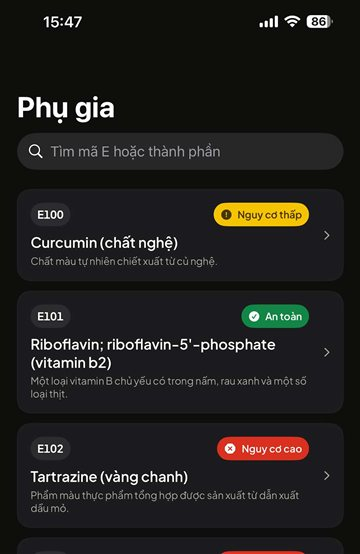 *Additive Dictionary* | 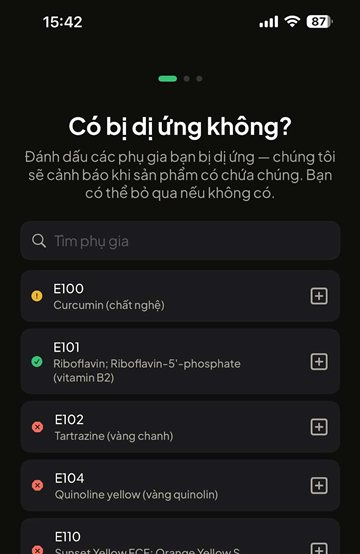 *Allergy Onboarding* | 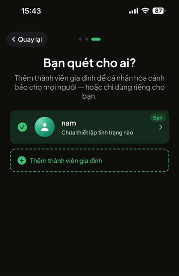 *Household Switcher* | 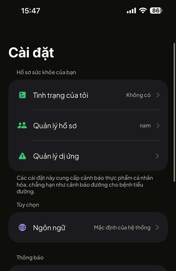 *Settings & Health* |

| Screen 5: Scan History | Screen 6: Profile Setup | Screen 7: Active Profiles | Screen 8: Camera Scanner |
|:---:|:---:|:---:|:---:|
| 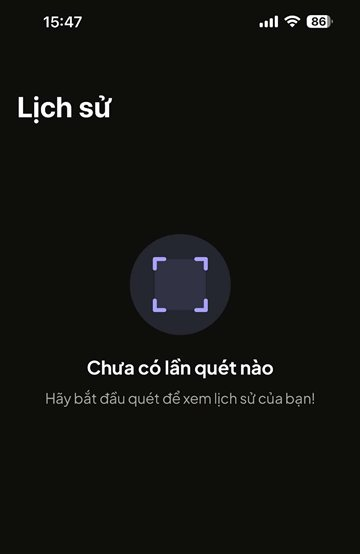 *Scan History* | 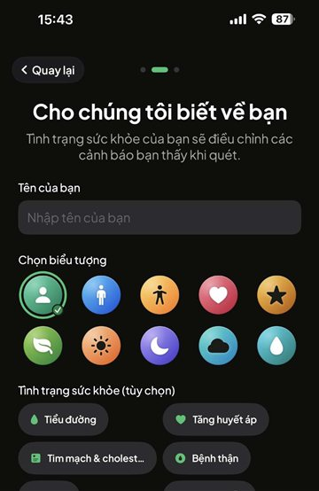 *Health Profile Setup* | 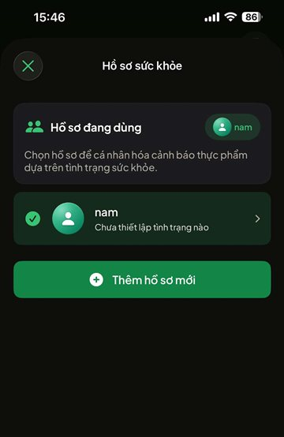 *Profile Management* | 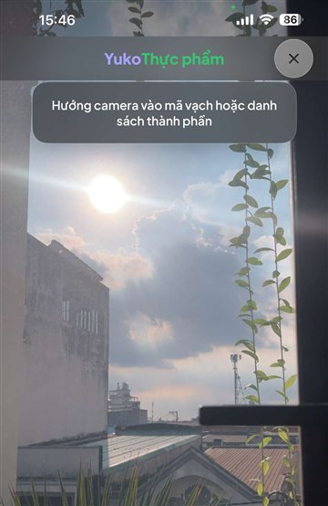 *Scanner Viewfinder* |

*Figure C.1: Complete UI screen walkthrough of the surveyed reference application (Yuko App, Screens 1 to 8).*

#### 1.5. Strengths and Advantages
1. **Clean, Focused User Experience:** Intuitive dark UI with minimal visual clutter, making it easy for non-technical users to quickly check food safety.
2. **Standardized E-Number Classification:** Excellent international additive taxonomy categorized systematically into 3 intuitive risk tiers (*Safe*, *Low Risk*, *High Risk*).
3. **Household Multi-Profile Support:** Allows one caregiver to monitor different dietary profiles for multiple family members (e.g., a child with a peanut allergy and a grandparent with diabetes).
4. **Chronic Health Condition Integration:** Bridges the gap between pure allergy prevention and medical dietary management (cardiovascular, kidney, diabetes).

#### 1.6. Limitations and Critical Gaps
While Yuko performs well for standardized European/international packaged goods, our evaluation identified critical shortcomings, especially when applied to the **Vietnamese market**:

1. **Inability to Handle Blurred / Wrinkled Packaging (No Typo-Tolerant OCR):** 
   - Yuko's ingredient scanner relies on rigid string matching. When a camera captures packaging with glare, folds, or slight OCR character misreads (e.g., `"đâu phong"` instead of `"đậu phộng"`, or `"tartrazin"` instead of `"tartrazine"`), Yuko completely fails to detect the additive.
2. **Lack of Semantic Ingredient Lineage (No Ontology Graph):**
   - Yuko cannot infer hidden allergens through taxonomic relationships. For example, if a user has a cow's milk allergy, but a label only lists `"Sodium Caseinate"` or `"Whey Protein"`, Yuko fails to trigger a warning unless those specific sub-derivatives are manually selected one by one.
3. **Absence of Local Vietnamese Food & Product Data:**
   - The database is heavily oriented toward global E-codes and standard barcodes, lacking coverage of regional Vietnamese packaged goods, traditional street foods, and domestic manufacturer formulations.
4. **No Community Contribution & Admin Moderation Mechanism:**
   - When a user scans an unindexed product, there is no mechanism to contribute the product to the system or flag incorrect OCR results for administrative review.
5. **No Dietary Journaling or Nutritional Balancing:**
   - Yuko only acts as a one-time "scanner" without supporting daily calorie tracking, macro distribution, or safe alternative food suggestions.

---

### 2. Surveyed Application 2: Soosee App

#### 2.1. Overview and Core Purpose
**Soosee** is an intelligent mobile dietary scanner designed to assist individuals with food allergies, intolerances, vegan/vegetarian lifestyles, and specific health conditions by scanning ingredient labels in real time.
- **Target Audience:** Consumers managing severe allergies (peanuts, gluten, dairy, etc.), vegans, pregnant women, and travelers shopping in foreign grocery stores.
- **Primary Mechanism:** Instead of querying a barcode database, Soosee utilizes on-device live camera text recognition (Optical Character Recognition) to actively scan ingredient text and instantly highlight matching trigger words directly on the screen without requiring a photo capture or internet connection.

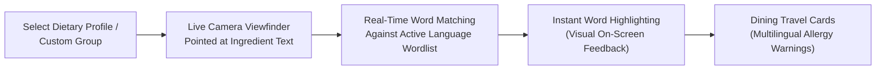

#### 2.2. Key User Flows
Soosee organizes its user experience into 3 primary flows:

1. **Flow 1: Category Configuration & Custom Group Setup**
   > **Open Categories** → **Select Predefined Group (Allergies/Vegan/E-Numbers)** → **Toggle Ingredients or Create Custom Group** → **Save Active Filter**
   * *Description:* Users browse predefined dietary categories or create custom groups (e.g., *"Binh's allergies"*). Inside each category, users toggle specific allergens or additives on/off.

2. **Flow 2: Real-Time Label Scanning and Word Highlighting**
   > **Open Scanner** → **Select Search Language** → **Point Camera at Ingredient List** → **Instantaneous On-Screen Highlighting**
   * *Description:* Users point the camera directly at product packaging. The scanner reads text in real time and highlights matched words directly on the camera feed with intuitive color codes.

3. **Flow 3: Multilingual Dining & Travel Cards**
   > **Open Travel Cards** → **Select Dietary Restriction** → **Choose Target Foreign Language** → **Present Card to Restaurant Staff**
   * *Description:* When dining out or traveling abroad, users access translated dining cards (e.g., English to German/French) explaining severe allergic restrictions to restaurant chefs and servers to prevent cross-contamination.

#### 2.3. Core Functional Features
Based on empirical analysis of the application interface, Soosee provides 6 main features:

| Feature No. | Feature Name | Detailed Functional Specification |
|:---:|:---|:---|
| **S-01** | **Hierarchical Dietary Categories** | Pre-built categories divided into 6 main domains: *Allergies* (13 subcategories), *Vegan* (7 subcategories), *Environment* (3 subcategories, e.g., palm oil), *Health* (4 subcategories), *E-Numbers* (11 subcategories), and *Pregnancy* (2 subcategories). |
| **S-02** | **Custom Group Creation** | Enables users to curate personalized allergy combinations into named custom groups (such as *"Binh's allergies"*) with one-tap toggle activation. |
| **S-03** | **Live Real-Time Word Scanner** | Utilizes live video frames to recognize ingredient words on-device. Highlights matching allergen keywords on screen without needing to snap a static photo or query a remote server. |
| **S-04** | **Multilingual Search Language Support** | Allows toggling between international search dictionaries (English, German, French, Dutch, etc.) when buying imported groceries or traveling abroad. |
| **S-05** | **Dining Travel Cards** | Curated emergency communication cards translated into multiple languages explaining cross-contamination risks and severe anaphylactic consequences to restaurant personnel. |
| **S-06** | **Supporter Tier & App Customization** | Developer support subscription model offering premium perks such as unlimited active custom groups, continuous auto-scanning, custom accent colors, and custom app icons. |

#### 2.4. Key UI Screens & Interface Design
Soosee features a clean, minimalist **iOS Light Mode design system** emphasizing clarity, rounded card layouts, and pastel color tags across its 7 core screens:
- **Screen 1 - Categories Overview & Custom Groups:** Displays the active custom group (*"Binh's allergies"*) with one-tap toggle and 6 color-coded category cards (*Allergies*, *Vegan*, *Environment*, *Health*, *E-Numbers*, *Pregnancy*).
- **Screen 2 - Specific Allergies Toggle List:** Comprehensive toggle list for common allergens (*Chicken Egg*, *Dairy products*, *Fish and Shellfish*, *Fruit & Vegetables*, *Gluten*, *Lupine*, *Peanut*, *Sesame Seed*).
- **Screen 3 - Live Scanner Viewfinder (Idle):** Clean camera viewfinder with top language flag selector (English UK), flashlight toggle, and helpful prompt: *"Point the section above at the ingredient label of a product to scan for words."*
- **Screen 4 - Real-Time Detection Result:** Live detection overlay showing matched trigger words and allergen classification (*"POSSIBLE MATCHES FOUND: Dairy products -> Milk"*) directly when scanning physical Vietnamese milk packaging.
- **Screen 5 - Dining Travel Cards:** Multilingual phrase cards explaining dietary restrictions (e.g., *"I can not have the food if it is cooked or prepared with oils which contain my allergies"*) with dual-language flag picker (UK / Germany).
- **Screen 6 - Soosee Supporter Tier:** Independent developer support screen offering perks such as unlimited active groups, auto-scanner, custom color themes, and custom app icons with subscription tiers.
- **Screen 7 - Settings Hub & Search Language:** Centralized preferences for search language, scanner settings, app customization, tip jar, feedback, and missing word submissions.

##### Visual Screen Gallery (Compact 7-Screen Walkthrough)

| Screen 1: Categories | Screen 2: Allergies List | Screen 3: Scanner Viewfinder | Screen 4: Detection Result |
|:---:|:---:|:---:|:---:|
| 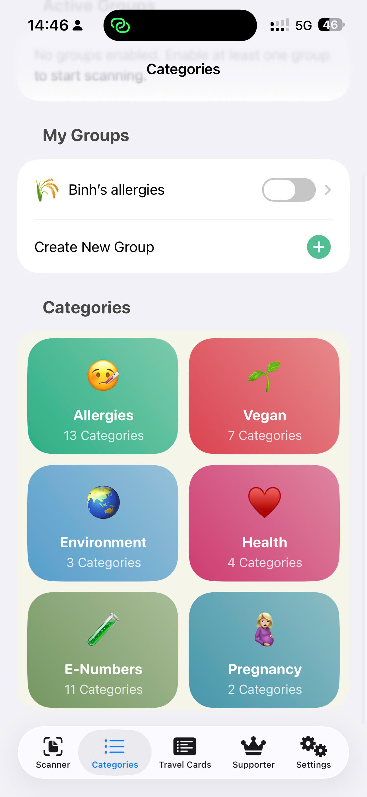 *Categories Overview* | 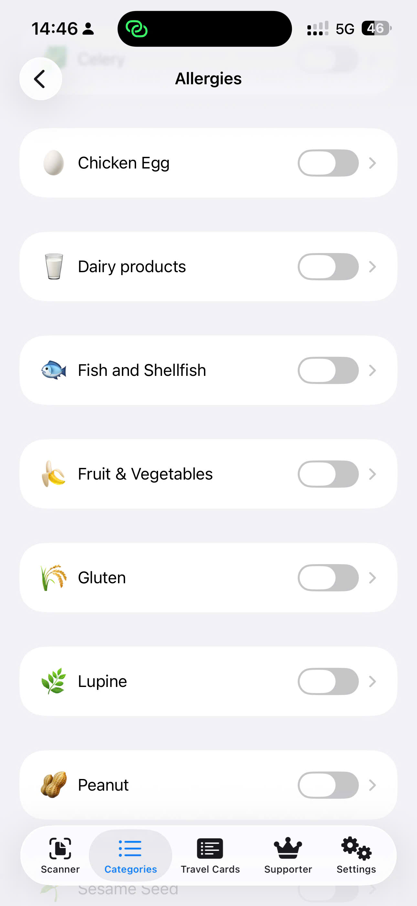 *Allergies List* | 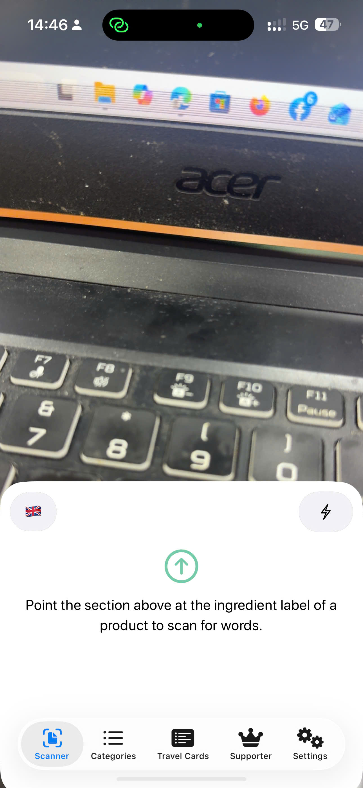 *Scanner Viewfinder* | 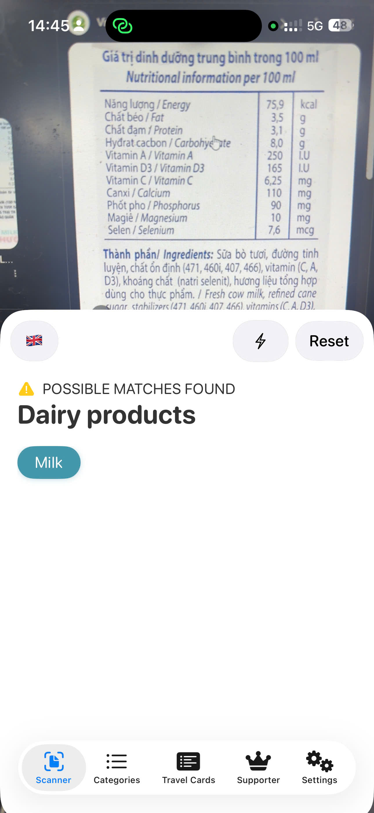 *Detection Result* |

| Screen 5: Travel Cards | Screen 6: Supporter Tier | Screen 7: Settings Hub |
|:---:|:---:|:---:|
| 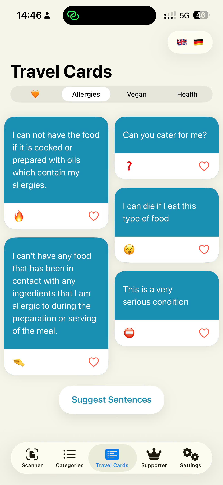 *Dining Travel Cards* | 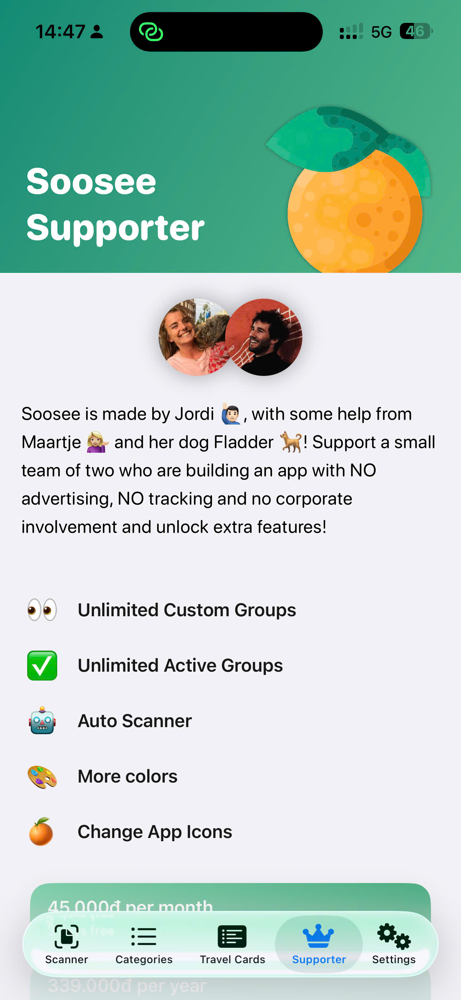 *Supporter & Perks* | 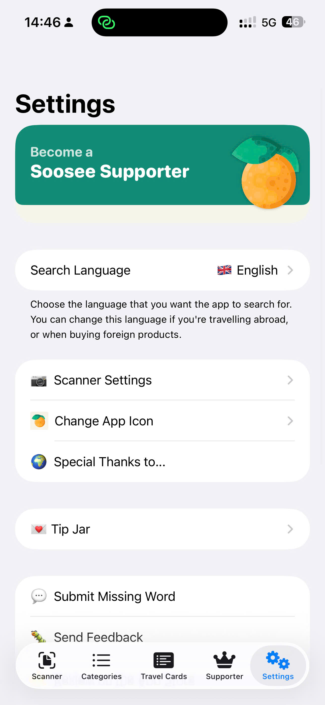 *Settings & Language* |

*Figure C.2: Complete UI screen walkthrough of the surveyed reference application (Soosee App, Screens 1 to 7).*

#### 2.5. Strengths and Advantages
1. **Ultra-Fast Real-Time Scanning:** Operates completely on-device without network latency, highlighting keywords instantly as the camera moves across packaging.
2. **Broad Lifestyle Coverage:** Beyond medical allergies, it accommodates lifestyle and ethical choices including veganism, environmental concerns (palm oil), and pregnancy safety.
3. **Highly Practical Travel Cards:** Solves the critical real-world problem of eating out in restaurants or traveling in foreign countries where the user does not speak the local language.
4. **Flexible Custom Grouping:** Empowers users to consolidate multiple diverse allergies and lifestyle preferences into single named toggles.

#### 2.6. Limitations and Critical Gaps
While Soosee performs well for real-time multilingual keyword scanning, our evaluation identified critical shortcomings, especially when applied to the **Vietnamese market**:

1. **Inability to Handle Blurred / Wrinkled Packaging (No Typo-Tolerant OCR):**
   - Soosee relies on exact dictionary keyword matching. When scanning real-world Vietnamese food packages with wrinkles, reflections, curved surfaces, or OCR diacritic misrecognitions (e.g., `"đâu phong"` instead of `"đậu phộng"`), Soosee completely fails to highlight the allergen.
2. **Lack of Semantic Ingredient Lineage (No Ontology Graph):**
   - Soosee cannot infer hidden allergens through taxonomic relationships. For example, if a user has a cow's milk allergy, Soosee only triggers if the exact keyword appears; it cannot infer that `"Sodium Caseinate"` or `"Whey Protein"` are milk derivatives unless manually added to custom lists.
3. **Absence of Local Vietnamese Food & Product Data:**
   - Soosee's predefined dictionaries are built primarily for Western ingredients and common international wordlists, lacking comprehensive coverage of Vietnamese culinary terms, domestic food additive designations, and regional packaged foods.
4. **No Community Contribution & Admin Moderation Mechanism:**
   - Soosee operates strictly as a local on-device utility (with only a basic "Submit Missing Word" form). It lacks a crowdsourced packaging contribution pipeline and administrative moderation console to verify ingredient lists and correct OCR errors.
5. **No Dietary Journaling or Nutritional Balancing:**
   - Soosee functions purely as an on-the-spot word highlighter without supporting daily meal logging, reaction tracking, nutritional balancing, or safe food alternative recommendations.

---

### 3. Synthesis & Comprehensive Comparative Analysis (NutriViet vs. Existing Applications)

To establish **NutriViet's competitive differentiation, architectural necessity, and design foundation**, this section synthesizes the empirical survey of Yuko and Soosee against our proposed solution across three core dimensions: commonalities, distinct innovations, and adopted UI/UX patterns.

---

#### 3.1. Common Features Across Surveyed Applications (What Existing Apps Have in Common)
Despite different interaction models (Yuko's database lookups vs. Soosee's live keyword highlighting), both benchmark applications share several foundational features essential to digital food safety:
1. **Camera-Based Packaging OCR:** Both applications leverage smartphone optical camera feeds to capture and extract textual information from physical ingredient labels, eliminating the need for tedious manual typing.
2. **Predefined Allergen & Additive Taxonomies:** Both systems categorize food risks into standardized groups (common allergens like peanuts, dairy, gluten, and European E-number additives like E100, E102).
3. **Personalized Avoidance Toggles:** Both tools allow users to personalize their experience by selecting specific substances they wish to avoid, establishing an active filtering baseline.
4. **On-Device Instantaneous Safety Feedback:** Both prioritize rapid feedback at the point of sale (supermarket aisle), providing visual warnings without requiring cumbersome multi-step navigation.

---

#### 3.2. What NutriViet Does Differently and Better (Our Distinct Innovations & Improvements)
While Yuko and Soosee offer valuable references, they were engineered for Western retail markets and exhibit severe vulnerabilities when deployed in Vietnam. **NutriViet** introduces five pivotal innovations to perform fundamentally better:

1. **Typo-Tolerant OCR with Fuzzy Matching (Addressing Crinkled/Blurred Vietnamese Packaging):**
   - *Existing Apps:* Both Yuko and Soosee rely on strict string matching. If an ingredient label is curved, wrinkled, reflective, or misrecognized by OCR (e.g., `"đâu phong"` instead of `"đậu phộng"`), both apps completely miss the allergen.
   - *NutriViet:* Integrates Levenshtein distance-based **Fuzzy Matching** (AI Feature 1) configured with an 85%+ similarity threshold. It automatically infers and corrects OCR spelling errors and missing Vietnamese tone marks, ensuring zero missed hazard alerts.
2. **Hierarchical Hidden Allergen Derivation via FoodOn Semantic Ontology:**
   - *Existing Apps:* Neither Yuko nor Soosee can perform semantic lineage reasoning. If a user is allergic to cow's milk, but the package only states *"Sodium Caseinate"* or *"Whey Protein"*, existing apps fail to alert unless the user manually selected those exact obscure chemical terms.
   - *NutriViet:* Implements the **FoodOn Knowledge Graph** (AI Feature 2) to recursively trace derivatives back to raw biological parents (**Sodium Caseinate** → **Casein** → **Cow's Milk** → **Milk Allergy**), preventing accidental anaphylaxis.
3. **Dedicated Packaging OCR Engine Tailored for Vietnamese Retail (Direct Ingredient Text Analysis):**
   - *Existing Apps:* Yuko relies on barcode lookups against pre-registered databases (failing completely on unindexed domestic Vietnamese goods), while Soosee acts only as a raw live keyword highlighter without nutritional parsing.
   - *NutriViet:* Operates exclusively through direct Optical Character Recognition (OCR) on printed ingredient text labels. By bypassing barcode systems entirely, NutriViet provides instantaneous allergen and health safety analysis for all domestic retail products, artisanal foods, and regional Vietnamese packaged specialties without requiring any barcode database.
4. **Two-Actor Moderation Pipeline with Admin OCR Correction:**
   - *Existing Apps:* Neither app offers administrative moderation to rectify OCR errors or verify crowdsourced community contributions.
   - *NutriViet:* Employs a dual-actor architecture (Standard User & System Administrator). Administrators utilize a dedicated tool (FG8) to verify community product uploads (FG7) and correct OCR parsing discrepancies, ensuring master data integrity.
5. **Holistic Dietary Management & Safe Meal Recommendations:**
   - *Existing Apps:* Purely standalone "scanners" with zero meal journaling, nutrient tracking, or alternative suggestions.
   - *NutriViet:* Provides an integrated dietary journal (FG5) to log daily meals and allergic reactions, coupled with safe substitute food recommendations tailored to Vietnamese culinary habits.

---

#### 3.3. UI/UX Design Patterns Adopted from Surveyed Apps
To ensure an intuitive, friction-free user experience, NutriViet purposefully adopts and refines the strongest UI/UX design patterns identified during our survey:

1. **High-Contrast Safety Verdict Badges (Adopted from Yuko):**
   - *Pattern:* Yuko's prominent color-coded risk tiering (**Green for Safe**, **Red for High Risk/Danger**, **Yellow for Warning**).
   - *Application in NutriViet:* Applied immediately upon scanning (FG4). The screen produces an unambiguous full-width verdict banner (RED ALERT or SAFE GREEN) accompanied by distinct iconography (checkmarks/warning symbols) to guarantee accessibility for colorblind individuals.
2. **One-Tap Household Profile Switcher (Adopted from Yuko):**
   - *Pattern:* Quick profile switcher on the main dashboard allowing a single caregiver to alternate between different family members' health profiles.
   - *Application in NutriViet:* Adopted directly in FG2, enabling parents to seamlessly switch between scanning for their child (peanut allergy) and an elderly relative (diabetic/low-sodium diet) without reconfiguring settings.
3. **Visual Grid-Based Category Navigation with Iconography (Adopted from Soosee):**
   - *Pattern:* Soosee's clean, pastel-shaded category cards with intuitive emoji/icons and subcategory counters (e.g., *Allergies - 13 categories*, *Health - 4 categories*).
   - *Application in NutriViet:* Adopted in our mobile onboarding and profile setup flows, organizing complex medical conditions and allergen families into visually engaging, recognizable chips rather than overwhelming plain-text lists.
4. **Clear Viewfinder Overlay with Contextual Instructions (Adopted from Soosee):**
   - *Pattern:* Transparent camera viewfinder with high-contrast framing borders, instant flashlight toggle, and a single guiding instruction banner (*"Point camera at ingredient list"*).
   - *Application in NutriViet:* Adopted in FG3 to guide users to align ingredient text within the optimal OCR detection bounding box under variable grocery store lighting conditions.
5. **Restaurant Dining & Allergy Travel Cards (Adapted from Soosee):**
   - *Pattern:* Pre-translated cards clearly communicating severe food allergies to waitstaff and chefs to prevent cross-contamination when eating out.
   - *Application in NutriViet:* Adapted as an enhancement within FG2/FG5, providing clear Vietnamese dining cards tailored for local street food vendors and restaurants (e.g., *"Tôi bị dị ứng đậu phộng nghiêm trọng, vui lòng không dùng dầu chiên chung hoặc rắc đậu phộng"*).

---

#### 3.4. Comprehensive Feature Comparison Matrix
The following matrix systematically benchmarks Yuko and Soosee against NutriViet across all functional and architectural criteria:

| Evaluation Criterion | Yuko App | Soosee App | NutriViet (Proposed Solution) | NutriViet Competitive Advantage & Novelty |
|:---|:---:|:---:|:---:|:---|
| **Target Market & Localization** | European / International E-numbers | Multilingual global packaging (Western focus) | **Vietnamese domestic retail & packaging** | Specifically optimized for Vietnamese food terminology, regional dishes, and domestic brands. |
| **Packaging OCR Method** | Static photo capture | Live video frame text highlighting | **On-Device Mobile OCR + Camera Viewfinder** | High-performance text extraction optimized for complex mobile packaging photos. |
| **Tolerance for OCR Typos / Wrinkles** | ❌ Rigid matching (fails on OCR errors) | ❌ Exact wordlist match (fails on typos/folds) | **Fuzzy Matching (Levenshtein Distance)** | **AI Innovation 1:** Tolerates blurred fonts, distorted letters, and missing Vietnamese diacritics up to 85%+ similarity. |
| **Hidden Allergen Derivation (Lineage)** | ❌ None (only explicit additive names) | ❌ None (only direct keyword match) | **FoodOn Semantic Knowledge Graph** | **AI Innovation 2:** Automatically traces chemical derivatives back to raw biological parent allergens (e.g., Casein → Cow's Milk). |
| **Chronic Disease Dietary Filters** | Supported (Diabetes, Kidney, Blood pressure) | Limited (Health category with 4 items) | **Supported (FG2 Allergy & Health Profile)** | Combines allergy hazard prevention with medical diet rules (diabetes, gout, hyperlipidemia). |
| **Multi-Profile & Custom Groups** | Supported (Family member profiles) | Supported (Named custom groups) | **Supported (FG2 Multi-Profile Management)** | Enables parents and caregivers to manage personalized restrictions for each family member independently. |
| **Community Product Contribution** | ❌ None | Limited ("Submit Missing Word" only) | **Supported (FG7 Crowdsourced Contribution)** | Allows users to submit new product packaging and photos to continuously expand the Vietnamese database. |
| **Admin Verification & OCR Error Correction** | ❌ None | ❌ None | **Supported (FG8 Admin Dashboard & Tool)** | Features a dedicated admin workbench to verify user submissions, correct OCR errors, and curate data integrity. |
| **Dietary Journaling & Safe Meal Advice** | ❌ None (scanner only) | ❌ None (scanner only) | **Supported (FG5 Journal & Safe Suggestions)** | Full daily dietary diary tracking calories/reactions and recommending safe alternative foods. |

#### 3.5. Strategic Synthesis & Conclusion
The survey reveals a stark divide in existing market solutions: **Yuko** provides structured additive databases and household profiles but relies heavily on barcode queries and cannot handle unstructured packaging text; conversely, **Soosee** excels in rapid on-device text scanning and dining cards but possesses zero product-level nutritional intelligence or semantic depth.

**NutriViet bridges this critical divide.** By operating exclusively on direct camera OCR text extraction from packaging rather than barcode queries, and synthesizing the best UX practices of both platforms—specifically Yuko's high-contrast safety verdict cards and Soosee's visual category grid and dining cards—while introducing **Fuzzy Matching typo tolerance** and **FoodOn Semantic Ontological Reasoning**, NutriViet establishes a comprehensive, localized, and technically superior food safety solution tailored to the everyday realities of Vietnamese consumers.

---

## D - Team Contract

*Performed by: Ngo Tien Binh| Reviewed by: Le Tat Nam, Truong Gia Linh | Edited by: Luong Hoang Nam, Nguyen Hoang Phuc Thinh*

### 1. Team Roles and Responsibilities 
All 5 team members act as Full-Stack Software Engineers, participating actively across all project stages while assuming primary leadership over specific domains:

| No. | Member Name | Student ID | Primary Lead Role | Leadership Responsibilities |
|:---:|:---|:---:|:---|:---|
| 1 | **Ngo Tien Binh** | 24127004 | **Project Manager (PM) & AI/OCR Lead** | Overall sprint coordination on Trello, liaison with Instructor/TA, AI feature integration (Fuzzy Matching + FoodOn), and final submission packaging. |
| 2 | **Le Tat Nam** | 23127432 | **Backend & Architecture Lead** | Data flow design, core business logic, and role-based access control mechanisms (User/Admin). |
| 3 | **Luong Hoang Nam** | 24127456 | **UI/UX & Flutter Lead** | Wireframes and visual UI design in Figma, and mobile frontend client development in Flutter for Android. |
| 4 | **Nguyen Hoang Phuc Thinh** | 24127242 | **Database & Git Lead** | Relational database schema design, GitHub repository branch management, and PR merge assistance. |
| 5 | **Truong Gia Linh** | 24127438 | **QA & Documentation Lead** | Quality assurance test planning, test case authoring, app precision testing, and Markdown/PDF document standardization. |

### 2. Communication Plan
- **Primary Communication Channels:**
  - **Zalo:** Real-time messaging for daily quick updates, urgent notifications, and voice/video group meetings.
  - **Trello:** Visual Kanban board for sprint backlog and task tracking following the Scrum framework (replacing Jira).
  - **GitHub:** Code reviews, PR feedback, discussions, and issue tracking directly on pull requests.
- **Regular Meeting Cadence:**
  - *Sprint Planning Meeting:* First Monday evening of each Sprint at 20:00 (task backlog creation and estimation on Trello).
  - *Scrum Standups (2x/week):* Wednesday and Saturday evenings at 21:00 (15-minute quick progress check via Zalo Call).
  - *Sprint Review:* Final Sunday evening of each Sprint to review and verify deliverables prior to submission.
- **Response Time Commitments:**
  - Normal working days: Acknowledge messages within **6 hours**.
  - Final 48 hours prior to submission: Acknowledge messages within **2 hours**.

### 3. Work Schedule and Deadlines
- **Time Commitment:** Each member commits at least **8–10 hours per week** to the project. Unexpected personal conflicts must be announced in the Zalo group at least 48 hours in advance.
- **Internal Deadline Buffer:** All individual tasks, reports, and code must be completed and merged at least **36 hours before the official Moodle deadline** to allow sufficient time for team review and clean PDF generation.
- **Blocker Escalation:** Any technical blocker persisting beyond 12 hours must be posted to the Zalo group for collaborative assistance rather than delayed until the deadline.

### 4. Code and Documentation Standards
- **Documentation:** Authored in **English** using GitHub-Flavored Markdown (`.md`), stored under `/docs`, diagrams created using **Mermaid syntax**, and author metadata (`Author | Reviewer | Editor`) declared beneath each section heading.
- **Git Workflow:** Feature branching (`feature/<task-name>`, `fix/<issue-name>`), with direct pushes to `main` strictly prohibited. Every Pull Request requires at least one peer review approval before merging.
- **Security:** Strict ban on committing API keys, secrets, credentials, or `.env` files to the repository.

### 5. Accountability and Performance Evaluation
- **Evaluation Criteria:** On-time Trello task completion, quality of code and deliverables, and consistent meeting attendance.
- **Three-Strike Non-Performance Protocol:**
  - *Strike 1:* Private 1-on-1 reminder from the Project Manager to identify and resolve blockers.
  - *Strike 2:* Formal warning during the weekly standup, task reassignment, and deduction in peer evaluation marks.
  - *Strike 3:* PM submits Trello/GitHub contribution audit history to Instructor/TA to request individual score deduction.

### 6. Decision-Making Process
- Routine technical and organizational decisions are determined by a simple majority vote (minimum 3/5 members).
- Technical domain leads hold prioritized decision authority within their respective focus areas.
- In the event of a tie or emergency decisions near deadlines, the **Project Manager (Ngo Tien Binh)** casts the deciding vote.

### 7. Conflict Resolution Framework
- **Direct Discussion:** Involved members engage in an objective, professional 1-on-1 dialogue on Zalo.
- **Team Mediation:** The Project Manager convenes a group meeting to hear both sides and hold a majority vote.
- **Academic Consultation:** If the conflict cannot be resolved internally, the PM contacts the Teaching Assistant (TA) for guidance.

### 8. Review and Update Process
- This contract is reviewed at the conclusion of each Sprint during the Sprint Review.
- Any amendment requires the unanimous consent of 100% of team members (5/5) and must be updated in the repository at `/docs/management/team-contract.md`.

---

## E - Development Tools and Process Setup

*Performed by: Ngo Tien Binh, Reviewed by: Le Tat Nam, Edited by: Ngo Tien Binh*

### 1. Scrum Methodology Implementation
Our team follows the Scrum agile methodology throughout the project lifecycle:
- **Sprint Duration:** Each Project Assignment (PA) corresponds to one official 2-to-3-week Sprint.
- **Meeting Cadence:**
  - *Sprint Planning Meeting:* Held at the beginning of each PA to break requirements into user stories and tasks, assign story points, and commit to the sprint backlog.
  - *Scrum Standup Meetings:* Held twice per sprint to inspect task progress, share blockers, and adjust sprint plans.
  - *Sprint Review & Retrospective:* Held prior to submission to demonstrate completed features and identify areas for team process improvement.
- **Meeting Documentation:** All agendas, minutes, attendance, and action items are documented in a centralized file under [docs/management/weekly-reports.md](./docs/management/weekly-reports.md) following the course *WeeklyReports* template.

### 2. Task Management Setup (Trello)
Task management follows the mandatory course rules:
- **Comprehensive Logging:** Every project activity—including report writing, system diagramming, UI design, self-training, backend coding, and testing—is logged as a dedicated task card.
- **Single Assignee Rule:** Each task card is assigned to **exactly one team member** (no shared or ambiguous task ownership).
- **Date Tracking:**
  - Every card records three explicit timestamps: **Creation Date**, **Assignment Date**, and **Completion Date**.
  - Tasks are created and assigned **prior** to the start of work during Sprint Planning. Retroactive bulk creation after work is done is strictly prohibited.
  - Completion dates are recorded when tasks are verified and merged.
- **Evidence Archiving:** Screenshots of the Kanban board across Sprints are captured and stored in sprint reports.

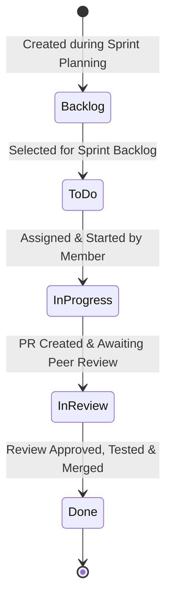

#### Trello Board Evidence
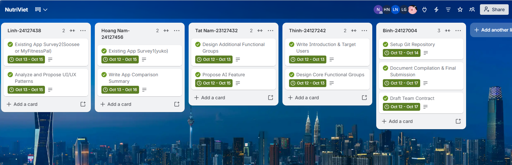

*Figure E.1: NutriViet Scrum Board setup on Trello with defined workflow columns and assigned sprint tasks.*

---

### 3. Version Control & Repository Architecture (Git)
The team utilizes a **Private GitHub Repository** to store both source code and documentation:
- **Security Rule:** No API keys, credentials, or sensitive secrets are ever committed to Git. Environment variables are managed using `.env.example` templates, with actual secrets kept in local, gitignored `.env` files.

#### GitHub Repository Evidence
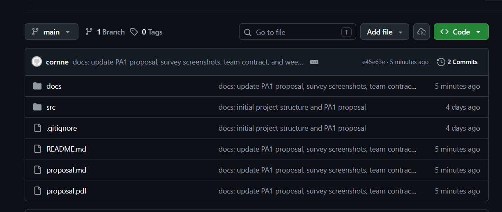

*Figure E.2: NutriViet GitHub Repository setup and collaboration roster.*

---

### 4. AI-Assisted Engineering Tooling
All team members have registered and set up free student educational accounts on modern AI coding platforms:
- **GitHub Copilot for Students:** Utilized for real-time pair programming, code auto-completion, and unit test generation.
- **Cursor / Gemini / Claude:** Utilized for architectural discussions, boilerplate scaffolding, and code review assistance.
- All AI tool usage will be logged transparently across weekly sprint reports as evidence of modern software engineering practices.