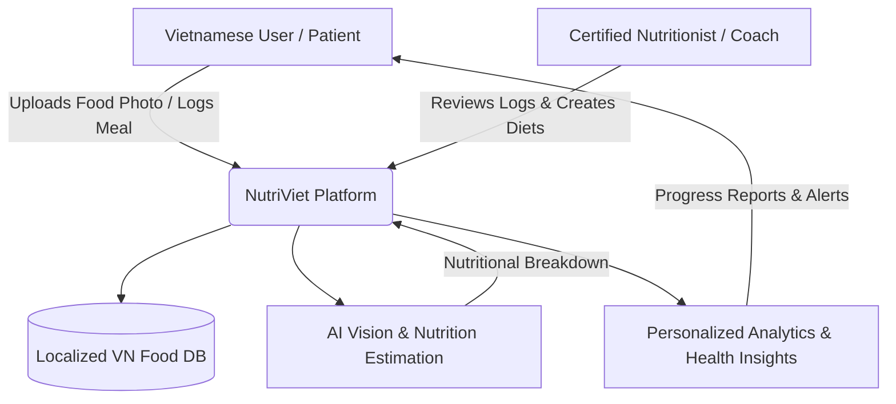
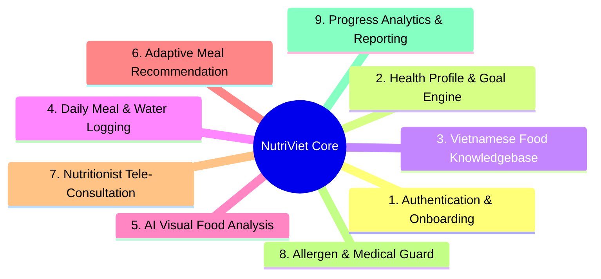
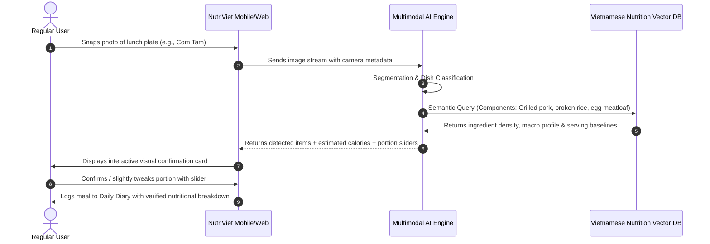
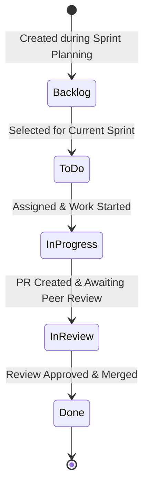

# NutriViet: Intelligent Nutrition & Dietary Tracking Platform
**Course:** CS300 - CSC13002 - Introduction to Software Engineering  
**Project Assignment:** PA1 - Project Proposal, Existing App Survey, Team Contract, and Setup  
**Date:** October 2026  

---

## A - Group Registration

*Performed by: Ngo Tien Binh, Reviewed by: Le Tat Nam, Edited by: Ngo Tien Binh*

- **Group Name:** Group 01 - NutriViet Team
- **Project Name:** NutriViet (Smart Vietnamese Nutrition & Health Monitoring Platform)
- **Group Leader:** Ngo Tien Binh

### Team Members Roster

| No. | Student ID | Full Name | Academic Email | Project Role & Focus |
|:---:|:---:|:---|:---|:---|
| 1 | **24127004** | **Ngo Tien Binh** | `ntbinh2419@clc.fitus.edu.vn` | **Group Leader** / Full-Stack Engineer / DevOps & Team Process Lead |
| 2 | **23127432** | **Le Tat Nam** | `ltnam23@clc.fitus.edu.vn` | Full-Stack Engineer / Technical Architecture & AI Lead |
| 3 | **24127456** | **Luong Hoang Nam** | `lhnam2434@clc.fitus.edu.vn` | Full-Stack Engineer / Market Survey & Data Analyst |
| 4 | **24127242** | **Nguyen Hoang Phuc Thinh** | `nhpthinh2416@clc.fitus.edu.vn` | Full-Stack Engineer / Requirements & Core Functional Lead |
| 5 | **24127438** | **Truong Gia Linh** | `tglinh2437@clc.fitus.edu.vn` | Full-Stack Engineer / UI/UX Design & Quality Assurance |

---

## B - Project Proposal

*Performed by: Nguyen Hoang Phuc Thinh & Le Tat Nam, Reviewed by: Truong Gia Linh, Edited by: Ngo Tien Binh*

### 1. Introduction & Value Proposition

In Vietnam, rapid urbanization and changing lifestyles have led to a sharp increase in non-communicable lifestyle diseases such as type 2 diabetes, cardiovascular issues, gout, and obesity. While maintaining balanced nutrition is essential for prevention and longevity, Vietnamese people face significant challenges when trying to log their daily intake. Existing international nutrition applications (such as MyFitnessPal or Lose It!) are heavily biased toward Western diets and packaged foods with standard nutritional barcode labels. They fail dramatically when applied to Vietnamese street food and traditional culinary habits, which typically involve multi-ingredient composite dishes (e.g., Phở, Bún chả, Cơm tấm, Bánh mì), varied regional cooking techniques, and communal dining with shared dishes.

**NutriViet** is conceived as a comprehensive, culturally attuned nutrition tracking and dietary management platform engineered specifically for the Vietnamese demographic. The platform combines a localized Vietnamese food and ingredient composition database with cutting-edge artificial intelligence. By allowing users to seamlessly log street foods, track micronutrients and macronutrients, detect allergy risks, and connect with certified dietitians, NutriViet empowers individuals to take control of their metabolic health with minimal manual effort and maximum cultural relevance.



---

### 2. Target Users and Operational Environments

#### User Actors (Stakeholders)
NutriViet serves three distinct user classes (exceeding the minimum requirement of 2 actors):

1. **Regular User (Health-Conscious Individuals & Patients):** Everyday Vietnamese citizens looking to lose weight, build muscle, or manage chronic health conditions (diabetes, hypertension, gout, gastrointestinal disorders). They require rapid meal logging, local cuisine calorie breakdowns, personalized daily targets, and allergen warnings.
2. **Certified Nutritionist / Dietitian (Healthcare Professional):** Licensed dietitians, clinical nutritionists, or fitness coaches who manage multiple clients. They need professional dashboards to monitor client meal adherence, assess nutrient intake trends, issue personalized diet templates, and provide direct telehealth consultation.
3. **System Administrator (Admin):** Platform managers responsible for auditing the food database, verifying professional nutritionist credentials, moderating user-generated food items, and managing platform compliance.

#### Deployment & Execution Environments
- **Client Web Application:** Responsive Progressive Web Application (PWA) compatible with modern desktop and mobile browsers (Google Chrome 115+, Apple Safari 16+, Mozilla Firefox, Microsoft Edge).
- **Client Mobile Application:** Native/cross-platform mobile apps for iOS (iOS 16.0+) and Android (Android 11.0+ / API level 30+), optimized for camera integration and on-device offline caching.
- **Backend & Cloud Services:** Cloud-native microservices architecture hosted on containerized cloud infrastructure, supporting high-throughput image recognition APIs and relational/vector databases.

---

### 3. Key Features & Functional Groups

NutriViet is architected into **9 distinctive functional groups**, each addressing a specific operational domain:



#### Functional Group 1: Authentication & User Onboarding
- **Feature 1.1: Multi-Channel Secure Authentication:**  
  Provides secure registration and sign-in via email/password, Google OAuth, and Apple ID, backed by JSON Web Tokens (JWT) and multi-factor authentication. This guarantees data privacy for sensitive personal medical and dietary information while keeping login fast and frictionless.
- **Feature 1.2: Dynamic Health Profile Intake Flow:**  
  Guides newly registered users through a step-by-step diagnostic questionnaire collecting biometric parameters (age, gender, height, weight, activity multiplier, dietary preferences, and medical history). This allows the system to accurately calculate Basal Metabolic Rate (BMR) and Total Daily Energy Expenditure (TDEE) immediately upon account creation.

#### Functional Group 2: Health Profile & Nutritional Goal Setting
- **Feature 2.1: Custom Macro & Micronutrient Target Configurator:**  
  Enables users and their nutritionists to configure granular daily nutritional goals, including customized ratios for carbohydrates, proteins, fats, fiber, sodium, and purine (vital for gout management). This flexibility ensures the app supports diverse dietary methodologies such as clean eating, ketogenic diets, diabetic-friendly carb limits, and high-protein sports training.
- **Feature 2.2: Biometric Progress Tracker:**  
  Maintains historical logs of changing body weight, body fat percentage, waist circumference, and blood glucose metrics. This visual tracking enables users to correlate shifts in their physical health indicators directly with their dietary choices over time.

#### Functional Group 3: Vietnamese Food & Ingredient Knowledgebase
- **Feature 3.1: Curated Vietnamese Food Database:**  
  Provides a comprehensive, verified digital catalog of thousands of traditional Vietnamese dishes, street foods, regional specialties (North, Central, South), and grocery ingredients referenced from the National Institute of Nutrition (Viện Dinh dưỡng Quốc gia). This resolves the chronic omission of local dishes in foreign apps, giving users accurate calorie and macro counts for dishes like Bún bò Huế, Canh chua, or Cơm tấm.
- **Feature 3.2: Community Dish Submission & Moderation Pipeline:**  
  Allows experienced home cooks and local vendors to submit new localized recipes, ingredients, and portion definitions, which enter a peer-review and admin verification queue before going public. This crowd-sourced model allows the database to stay current with regional culinary innovations while maintaining nutritional accuracy.

#### Functional Group 4: Daily Meal & Hydration Logging
- **Feature 4.1: Multi-Slot Meal Journaling:**  
  Allows users to quickly record food and beverage intake organized into breakfast, lunch, dinner, and custom snack slots with adjustable portion sizes (e.g., "bát", "đĩa", "tô", "cuốn"). This clear chronological categorization helps users build consistent dietary habits and spot unhealthy timing patterns like late-night binge snacking.
- **Feature 4.2: Smart Hydration Tracking with Ambient Reminders:**  
  Tracks daily water intake against climate-adjusted hydration goals, offering rapid one-tap logging for typical Vietnamese drink sizes (glasses, bottles, trà đá). This ensures users maintain adequate hydration, which is vital for metabolic balance and appetite regulation in tropical climates.

#### Functional Group 5: AI-Powered Visual Meal Recognition & Nutrition Estimation *(Core AI Feature)*
- **Feature 5.1: Multi-Object Vietnamese Dish Photo Scanner:**  
  Enables users to take a photo of their meal table or food plate, which is analyzed by a fine-tuned multimodal computer vision model to identify individual dishes and side items simultaneously. This eliminates the tedious chore of typing individual ingredients and speeds up meal recording by over 70%.
- **Feature 5.2: Portion Volume & Nutritional Approximation Engine:**  
  Estimates portion volume and constituent ratios (e.g., ratio of lean meat to fat, broth volume, and rice quantity) using contextual image depth cues and localized culinary heuristics. This automatically populates the user's daily diary with estimated calories, macros, and sodium levels, which the user can confirm or fine-tune with one slider adjustment.

#### Functional Group 6: Adaptive Meal Recommendation & Recipe Engine
- **Feature 6.1: Remaining Macro Meal Generator:**  
  Analyzes the user's remaining calories and macronutrient budget towards the end of the day and proposes healthy Vietnamese recipes or nearby restaurant options that fit the exact nutritional gap. This eliminates guesswork for busy individuals asking "what should I eat for dinner without ruining my diet?".
- **Feature 6.2: Healthy Ingredient Substitution Recommender:**  
  Suggests culturally authentic, healthier substitutions in traditional recipes (e.g., using brown vermicelli instead of refined rice noodles, or replacing pork belly with lean pork loin in Thịt kho). This assists users in preserving beloved Vietnamese culinary flavors while reducing glycemic index and saturated fat.

#### Functional Group 7: Nutritionist Tele-Consultation & Client Management
- **Feature 7.1: Professional Client Dashboard:**  
  Provides accredited nutritionists with a multi-patient management console displaying real-time compliance scores, macro trends, and flag alerts for extreme caloric deficits or surpluses. This allows dietitians to monitor dozens of outpatients efficiently without manual spreadsheets.
- **Feature 7.2: In-App Diet Prescription & Secure Messaging:**  
  Allows dietitians to author structured weekly meal plans directly into the client's app calendar and conduct asynchronous feedback conversations. This bridges the communication gap between periodic clinic visits, significantly increasing dietary adherence.

#### Functional Group 8: Allergen & Medical Condition Dietary Guard
- **Feature 8.1: Ingredient Cross-Contamination & Allergen Alert:**  
  Cross-checks all logged or scanned foods against the user's declared allergies (e.g., shellfish, peanuts, gluten, dairy, MSG). This immediate visual warning protects vulnerable users from severe allergic reactions when eating unfamiliar restaurant dishes or packaged foods.
- **Feature 8.2: Chronic Disease Nutrition Sentinel (Diabetes & Gout):**  
  Flags ingredients high in purines (for gout sufferers) or high in simple carbohydrates with elevated glycemic index (for diabetics), offering safer alternatives in real time. This acts as a digital health guardian preventing acute medical flare-ups caused by dietary unawareness.

#### Functional Group 9: Progress Analytics & Health Insights
- **Feature 9.1: Comprehensive Macro & Micro Nutrient Dashboard:**  
  Visualizes weekly and monthly intake distributions across calories, macronutrient splits, sodium, sugar, and dietary fiber using intuitive interactive charts. This gives users actionable visibility into hidden dietary pitfalls such as excess hidden sodium in sauces.
- **Feature 9.2: Automated Health Report Exporter (PDF/CSV):**  
  Generates standardized nutritional summary reports that users can download or share directly with their primary care physicians or cardiologists during regular check-ups. This provides medical practitioners with objective lifestyle data rather than relying on patients' vague memories.

---

### 4. AI-Powered Feature Specification

*Performed by: Le Tat Nam, Reviewed by: Luong Hoang Nam, Edited by: Ngo Tien Binh*

#### Feature Title: **Multimodal AI Visual Recognition & Contextual Nutrition Estimator for Vietnamese Cuisine**

#### Technical Formulation & Value Delivery:
Traditional calorie-tracking applications require users to manually search for each item, weigh ingredients, and calculate portion sizes. In Vietnam, where the culinary landscape is dominated by complex composite dishes (e.g., a bowl of Phở contains beef cuts, rice noodles, bone broth, onions, herbs, and condiments), manual logging creates extreme cognitive friction, causing more than 80% of users to abandon tracking within two weeks.

NutriViet’s AI capability implements a **multimodal computer vision and Retrieval-Augmented Generation (RAG) architecture**:
1. **Multimodal Detection:** When a user captures a food photo, an object detection and semantic segmentation pipeline identifies composite dishes and segmented components (e.g., distinguishing grilled pork slices from vermicelli in Bún chả).
2. **Contextual Knowledge Retrieval:** The model queries the NutriViet Vietnamese Food Vector Database to map visual detections to localized cooking standards and ingredient ratios.
3. **Adaptive User Feedback:** The AI presents an itemized estimate with visual confidence scores and interactive portion sliders (e.g., "Standard bowl with 150g rice noodles, 80g rare beef, 250ml broth; ~480 kcal").



**Practical Value to End User:** This feature turns a tedious 3-minute manual entry process into a 5-second capture-and-confirm experience, radically increasing daily tracking consistency and delivering actionable nutritional transparency to everyday Vietnamese diners.

---

## C - Existing App Survey

*Performed by: Luong Hoang Nam & Truong Gia Linh, Reviewed by: Le Tat Nam, Edited by: Ngo Tien Binh*

<!-- [PLACEHOLDER: Existing App Survey to be completed in subsequent step as requested by user] -->

### 1. Survey of Application 1: Yuka (Barcode & Nutrition Scanner)
*(Section reserved for screenshots, screen flow breakdown, and feature analysis - to be provided in upcoming step)*

### 2. Survey of Application 2: MyFitnessPal / Soosee (Food Tracking & Allergen Detector)
*(Section reserved for screenshots, screen flow breakdown, and feature analysis - to be provided in upcoming step)*

### 3. Synthesis & Comparative Analysis
*(Section reserved for Comparative Matrix, Differentiation Strategy for NutriViet, and UI/UX patterns to adopt - to be provided in upcoming step)*

---

## D - Team Contract

*Performed by: Ngo Tien Binh, Reviewed by: All Team Members, Edited by: Ngo Tien Binh*

This Team Contract establishes the operational rules, working agreements, and collaboration standards for **Group 01** throughout the CS300 Software Engineering project.

### 1. Team Roles and Responsibilities
To fulfill the course learning objectives, all 5 members operate as **Full-Stack Software Engineers** across all phases of the project, while taking individual leadership ownership over specific domains:

| Member Name | Student ID | Primary Lead Role | Key Leadership Responsibilities |
|:---|:---:|:---|:---|
| **Ngo Tien Binh** | 24127004 | **Project Manager & Scrum Master** | Overall project delivery, sprint coordination, GitHub repository administration, CI/CD, documentation releases. |
| **Le Tat Nam** | 23127432 | **Technical Architecture & AI Lead** | System architecture, AI computer vision integration, backend microservices, core algorithms. |
| **Luong Hoang Nam** | 24127456 | **Data & Business Logic Lead** | Vietnamese nutrition database schema, food API integration, competitive analysis, data verification. |
| **Nguyen Hoang Phuc Thinh** | 24127242 | **Requirements & Backend Lead** | Use case modeling, API specification, database optimization, core business logic implementation. |
| **Truong Gia Linh** | 24127438 | **UI/UX Design & QA Lead** | Figma design system, responsive design prototyping, test case development, quality assurance testing. |

### 2. Communication Plan
- **Primary Channels:**
  - **Discord:** Daily asynchronous messaging, task discussions, technical questions, and code review notifications.
  - **Google Meet:** Synchronous virtual meetings (Sprint Planning, Weekly Scrum, and Sprint Review).
  - **Zalo Group:** Urgent broadcast alerts and emergency notifications only.
- **Meeting Cadence:**
  - *Sprint Planning Meeting:* Held once at the start of each Sprint (PA cycle) - 60 minutes.
  - *Mid-Sprint Standup Meetings:* Held twice per sprint (Wednesdays & Sundays) - 30 minutes each.
  - *Sprint Review & Retrospective:* Held 2 days prior to each submission deadline - 45 minutes.
- **Response Time Commitments:**
  - Working hours (08:00 - 22:00): Acknowledge messages within **2 hours**.
  - Off-hours / Night: Acknowledge messages within **8 hours** (by the following morning).

### 3. Work Schedule and Deadlines
- **Internal Deadline Buffer:** All code, reports, and deliverables must be completed and internally merged **48 hours prior to the official course deadline**. This buffer is reserved for integration testing, PDF rendering verification, and final sanity checks.
- **Sprint Schedule Alignment:** Each project milestone matches a 2-to-3-week Sprint in accordance with course assignments.
- **Contingency Protocols:** Any member anticipating delays or academic/personal conflicts must notify the team at least **24 hours in advance** on Discord so tasks can be re-allocated without impacting project velocity.

### 4. Code and Documentation Standards
- **Source Code Conventions:**
  - Codebase written in modern JavaScript/TypeScript following ESLint and Prettier guidelines.
  - Clear modular architecture, descriptive variable/function naming in English, and inline comments for complex algorithmic logic.
- **Git Branching & Commit Conventions:**
  - Branch naming format: `<type>/<task-id>-<short-description>` (e.g., `feat/NV-12-meal-logging`, `fix/NV-08-auth-token`).
  - Conventional Commits standard: `feat:`, `fix:`, `docs:`, `refactor:`, `test:`, `chore:`.
  - Direct pushes to `main` branch are strictly prohibited. Every merge requires a Pull Request (PR) with at least **one peer review approval** and passing automated checks.
- **Documentation Standards:**
  - All documentation authored in English using GitHub-Flavored Markdown.
  - Diagrams must be rendered using **Mermaid.js** code blocks inside `.md` files to ensure version control and maintainability.
  - All markdown files must be successfully exportable to PDF with intact diagrams and formatting.

### 5. Accountability and Performance Metrics
- **Performance Criteria:**
  - On-time completion of assigned tasks with high quality and adherence to specifications.
  - Active participation and punctuality in all scheduled Scrum meetings.
  - Adherence to Git and code review hygiene.
- **Policy for Underperformance:**
  1. *First occurrence (minor delay / missed meeting without prior notice):* Informal reminder from Scrum Master / Tech Lead during standup.
  2. *Second occurrence (repeated delays, incomplete deliverables):* Formal written warning during Sprint Retrospective; task reassignment with recorded deduction on internal contribution log.
  3. *Third occurrence (unresponsive > 48 hours or complete failure to deliver):* Immediate escalation to the course Teaching Assistant (TA) and Instructor with documented Jira/Git logs, requesting individualized peer-evaluation grading.

### 6. Decision-Making Process
- **Consensus First:** Technical and architectural decisions are discussed openly with a goal of reaching unanimous consensus.
- **Majority Vote:** If consensus cannot be reached within 30 minutes of debate, decisions are resolved by majority vote (at least 3 out of 5 members in favor).
- **Tie-Breaker:** In the event of an insoluble deadlock, the **Project Leader (Ngo Tien Binh)** holds the casting vote to maintain project momentum.

### 7. Conflict Resolution Framework
1. **Direct Peer Resolution (Level 1):** The affected parties conduct a private, constructive 1-on-1 dialogue focusing strictly on facts, code quality, and project requirements.
2. **Team Internal Mediation (Level 2):** If unresolved within 24 hours, the issue is raised in a dedicated team session moderated by the Scrum Master and Group Leader.
3. **Academic Escalation (Level 3):** If conflicts involve persistent non-performance, ethical breaches, or fundamental project stalling, the team will formally request a consultation meeting with the course TA or Lecturer.

### 8. Review and Update Process
- This contract is a living document. It will be formally reviewed during each **Sprint Retrospective** at the end of each PA cycle.
- Amendments require agreement from at least 4 out of 5 team members and will be documented in the repository changelog.

---

## E - Development Tools and Process Setup

*Performed by: Ngo Tien Binh, Reviewed by: Le Tat Nam, Edited by: Ngo Tien Binh*

### 1. Scrum Methodology Implementation
NutriViet adopts the professional Scrum agile framework throughout its development lifecycle:
- **Sprint Cadence:** Each Project Assignment (PA) cycle represents one official 2-3 week Sprint.
- **Meeting Structure:**
  - *Sprint Planning:* Define sprint goals, break user stories into actionable Jira/Trello tasks, estimate story points, and assign tasks to individual members.
  - *Scrum Standup Meetings (2 per sprint):* Inspect progress, sync cross-dependent tasks, and resolve blockers.
  - *Sprint Review & Retrospective:* Demonstrate completed features against the Definition of Done (DoD) and document continuous process improvements.
- All meeting agendas, attendance, minutes, and action items are maintained in `docs/management/` following the course *WeeklyReports* standard.

### 2. Task Management Setup (Trello / Jira)
Task tracking strictly follows the core course rules:
- **Comprehensive Logging:** Every single project effort—including report drafting, diagramming, self-training, UI wireframing, backend coding, and unit testing—is documented as a dedicated task card.
- **Strict Single Assignee:** Each task is assigned to **exactly one team member** (no shared or ambiguous task ownership).
- **Lifecycle & Date Integrity:**
  - Every card records three explicit timestamps: **Creation Date**, **Assignment Date**, and **Completion Date**.
  - Tasks are created and assigned **prior** to the commencement of work. Retroactive bulk task creation is prohibited.
  - Periodic screenshots of the Kanban board across Sprints are archived for submission evidence.



### 3. Version Control & Repository Architecture (Git)
The team uses a **Private Git Repository** (hosted on GitHub) storing all code, documentation, assets, and meeting minutes in text-based Markdown format:
- **Security Rule:** Absolutely zero API keys, secrets, database credentials, or tokens are committed. All secrets are managed via `.env.example` templates and local untracked `.env` files protected by `.gitignore`.
- **Repository Directory Tree:**

```text
NutriViet/
├── .gitignore
├── README.md
├── package.json
├── src/                               # Application Source Code
│   ├── client/                        # Frontend Web & Mobile Application
│   │   ├── src/
│   │   │   ├── components/
│   │   │   ├── pages/
│   │   │   ├── services/
│   │   │   └── styles/
│   │   └── index.html
│   ├── server/                        # Backend API & Microservices
│   │   ├── controllers/
│   │   ├── models/
│   │   ├── routes/
│   │   └── services/
│   └── ai-engine/                     # Multimodal AI Model & RAG Pipeline
│       ├── models/
│       ├── embeddings/
│       └── inference.py
└── docs/                              # Project Documentation (Version-Controlled)
    ├── proposal.md                    # Project Proposal & PA1 Document
    ├── management/                    # Scrum & Process Documents
    │   ├── team-contract.md
    │   ├── sprint-planning-pa1.md
    │   └── weekly-reports/
    ├── requirements/                  # Requirements Specifications
    │   ├── vision.md
    │   └── use-cases.md
    ├── analysis-and-design/           # Architectural Designs & UI Mockups
    │   ├── architecture-document.md
    │   └── diagrams/
    └── test/                          # Quality Assurance & Testing
        ├── test-plan.md
        └── test-cases.md
```

### 4. Spec-Driven Development & Spec Kit Integration
In alignment with modern software engineering paradigms encouraged by the course instructors, the team will employ **specification-driven development**. Prior to coding from PA2 onward, detailed functional and technical specifications will be validated via Spec Kit to eliminate requirement drift before code generation begins.

### 5. AI-Assisted Engineering Tooling
All team members have verified and activated active educational licenses for cutting-edge AI-assisted engineering tools:
- **GitHub Copilot for Students:** Real-time pair programming, intelligent code completions, and automated unit test case generation.
- **Cursor / Claude / Gemini Integration:** Architectural refactoring, documentation synthesis, and specification-to-code translation.
- Development logs will record the integration of AI tools across Sprints to demonstrate modern engineering workflow mastery.