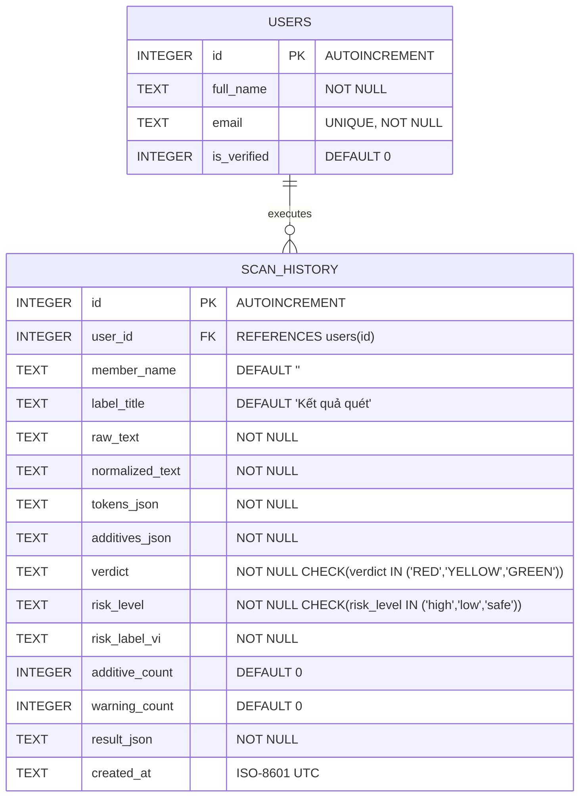
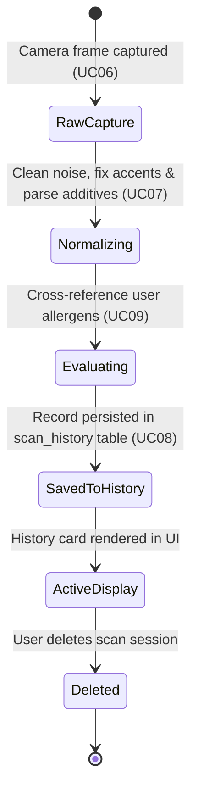

# Data Model: FG3 - Packaging OCR Scanner

**Feature**: `003-fg3-ocr-scanner`  
**Specification**: [spec.md](spec.md) | **Plan**: [plan.md](plan.md)  
**Database**: SQLite 3 (`nutriviet.db`)  
**Target Table**: `scan_history`  

---

## 1. Entity-Relationship Diagram



---

## 2. DDL Schema Definition (SQL)

```sql
CREATE TABLE IF NOT EXISTS scan_history (
    id INTEGER PRIMARY KEY AUTOINCREMENT,
    user_id INTEGER NOT NULL REFERENCES users(id) ON DELETE CASCADE,
    member_name TEXT NOT NULL DEFAULT '',
    label_title TEXT NOT NULL DEFAULT 'Kết quả quét',
    raw_text TEXT NOT NULL,
    normalized_text TEXT NOT NULL DEFAULT '',
    tokens_json TEXT NOT NULL DEFAULT '[]',
    additives_json TEXT NOT NULL DEFAULT '[]',
    verdict TEXT NOT NULL DEFAULT 'GREEN',
    risk_level TEXT NOT NULL DEFAULT 'safe',
    risk_label_vi TEXT NOT NULL DEFAULT 'An toàn',
    additive_count INTEGER NOT NULL DEFAULT 0,
    warning_count INTEGER NOT NULL DEFAULT 0,
    result_json TEXT NOT NULL DEFAULT '{}',
    created_at TEXT NOT NULL
);

-- Fast chronological retrieval index for user history queries
CREATE INDEX IF NOT EXISTS idx_scan_history_user ON scan_history(user_id, id DESC);
CREATE INDEX IF NOT EXISTS idx_scan_history_created ON scan_history(user_id, created_at DESC);
```

---

## 3. Data Dictionary

| Column Name | Data Type | Nullable | Constraints | Description |
|:---|:---:|:---:|:---|:---|
| `id` | `INTEGER` | No | `PRIMARY KEY AUTOINCREMENT` | Unique identifier for the scan session. |
| `user_id` | `INTEGER` | No | `FOREIGN KEY REFERENCES users(id)` | Identifies the authenticated consumer who performed the scan. |
| `member_name` | `TEXT` | No | Default `''` | Profile or family member name associated with this scan session. |
| `label_title` | `TEXT` | No | Default `'Kết quả quét'` | User-defined or recognized food product name (e.g., *"Bánh Oreo"*). |
| `raw_text` | `TEXT` | No | String | Unfiltered optical character recognition text extracted via ML Kit. |
| `normalized_text` | `TEXT` | No | Default `''` | Cleaned text with noise, prefixes, and trailing dates removed. |
| `tokens_json` | `TEXT` | No | JSON Array string | Array of parsed ingredient tokens: `["Bột mì", "Đậu phộng", ...]`. |
| `additives_json` | `TEXT` | No | JSON Array string | Structured metadata for detected E-numbers and INS additives. |
| `verdict` | `TEXT` | No | `'RED'`, `'YELLOW'`, `'GREEN'` | Tri-color safety determination evaluated against user allergens. |
| `risk_level` | `TEXT` | No | `'high'`, `'low'`, `'safe'` | Standard risk category. |
| `risk_label_vi` | `TEXT` | No | String | Display status in Vietnamese (*"Nguy cơ cao"*, *"An toàn"*). |
| `additive_count` | `INTEGER` | No | $\ge 0$ | Count of detected food additives in this scan. |
| `warning_count` | `INTEGER` | No | $\ge 0$ | Number of hazard warnings triggered by personal allergy profile. |
| `result_json` | `TEXT` | No | JSON Object string | Comprehensive evaluation response payload (FoodOn triggers, latency, etc.). |
| `created_at` | `TEXT` | No | ISO-8601 UTC String | Scan timestamp for chronological timeline ordering. |

---

## 4. Lifecycle State Machine


