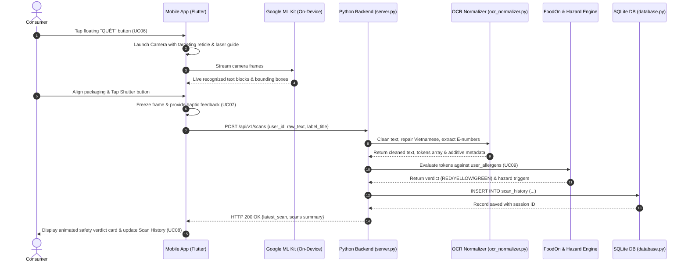
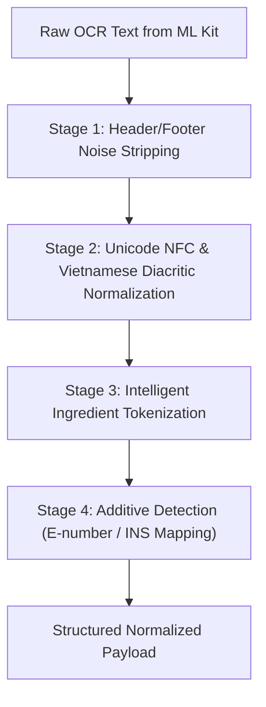

# Implementation Plan: FG3 - Packaging OCR Scanner

**Branch**: `003-fg3-ocr-scanner` | **Date**: 16/11/2026 → 21/11/2026 | **Spec**: [spec.md](spec.md)  
**Deliverable**: PA3-2026 Section E Full-Stack Implementation  
**Lead Architect & Performer**: Le Tat Nam | **Reviewer**: Ngo Tien Binh  

---

## 1. Technical Architecture & Approach

This plan details the full-stack engineering workflow for **FG3 (Packaging OCR Scanner)** encompassing `UC06` (Camera Scanning), `UC07` (Preprocessing & Text Normalization), and `UC08` (Scan History Persistence & Filtering).

```
+-------------------------------------------------------------------------------+
|                            FLUTTER MOBILE CLIENT                             |
|                                                                               |
|   +-----------------------------------------------------------------------+   |
|   |                   _PackagingScannerScreen (UI)                        |   |
|   |  - CameraPreview with NutriVietScannerReticle (Laser scan animation)  |   |
|   |  - Real-time Google ML Kit text detector binding                      |   |
|   |  - Torch toggle (Torch/Flashlight state management)                   |   |
|   |  - Live bottom sheet with editable OCR text & instant scan trigger   |   |
|   +-----------------------------------+-----------------------------------+   |
|                                       |                                       |
|                                       v                                       |
|   +-----------------------------------------------------------------------+   |
|   |               ProfileService (HTTP REST Client)                       |   |
|   |  - ProfileService.createScan() ➔ POST /api/v1/scans                   |   |
|   |  - ProfileService.getScans()   ➔ GET  /api/v1/scans                   |   |
|   +-----------------------------------+-----------------------------------+   |
+---------------------------------------|---------------------------------------+
                                        | HTTP JSON (Bearer Token / User ID)
                                        v
+-------------------------------------------------------------------------------+
|                             BACKEND API SERVER                                |
|                                                                               |
|   +-----------------------------------+-----------------------------------+   |
|   | POST /api/v1/ocr/normalize        | Clean raw OCR, parse E-numbers    |   |
|   | POST /api/v1/scans                | Normalize + Evaluate + Save Scan  |   |
|   | GET  /api/v1/scans                | Retrieve chronological history    |   |
|   | DELETE /api/v1/scans              | Remove scan session from DB       |   |
|   +-----------------------------------+-----------------------------------+   |
|                                       |                                       |
|                                       v                                       |
|   +-----------------------------------------------------------------------+   |
|   |                OCR Normalization Module (ocr_normalizer.py)           |   |
|   |  - Regex noise stripping (prefixes, dates, weights, barcodes)         |   |
|   |  - Unicode NFC normalization & Vietnamese tone mark repair            |   |
|   |  - E-number / INS detection & dictionary mapping (E322, E621, etc.)   |   |
|   +-----------------------------------+-----------------------------------+   |
|                                       |                                       |
|                                       v                                       |
|   +-----------------------------------------------------------------------+   |
|   |           HybridFoodOnEngine / Allergy Hazard Cross-Reference         |   |
|   +-----------------------------------+-----------------------------------+   |
+---------------------------------------|---------------------------------------+
                                        | SQL Queries (SELECT / INSERT / DELETE)
                                        v
+-------------------------------------------------------------------------------+
|                       DATABASE LAYER (SQLite: nutriviet.db)                   |
|                                                                               |
|   TABLE scan_history (                                                        |
|       id INTEGER PRIMARY KEY AUTOINCREMENT,                                   |
|       user_id INTEGER NOT NULL REFERENCES users(id) ON DELETE CASCADE,        |
|       member_name TEXT NOT NULL,                                              |
|       label_title TEXT NOT NULL,                                              |
|       raw_text TEXT NOT NULL,                                                 |
|       normalized_text TEXT NOT NULL,                                          |
|       tokens_json TEXT NOT NULL,                                              |
|       additives_json TEXT NOT NULL,                                           |
|       verdict TEXT NOT NULL,                                                  |
|       risk_level TEXT NOT NULL,                                               |
|       risk_label_vi TEXT NOT NULL,                                            |
|       additive_count INTEGER NOT NULL,                                        |
|       warning_count INTEGER NOT NULL,                                         |
|       result_json TEXT NOT NULL,                                              |
|       created_at TEXT NOT NULL                                                |
|   );                                                                          |
+-------------------------------------------------------------------------------+
```

---

## 2. Sequence Diagram (End-to-End Scanning Flow)



---

## 3. OCR Text Normalization Algorithm Details

The backend OCR normalizer (`src/backend/ocr_normalizer.py`) executes a 4-stage pipeline:



1. **Stage 1: Noise Stripping**:
   - Strips packaging introductory banners using case-insensitive regex:
     `^(?:thành phần|thành phần cấu tạo|nguyên liệu|ingredients|composition)\s*[:\-\.]*\s*`
   - Strips trailing packaging noise patterns:
     `(?:\b(?:nsx|hsd|klt|khối lượng tịnh|net wt|exp|mfg|sản xuất tại|xuất xứ|hướng dẫn bảo quản|bảo quản nơi|chỉ tiêu chất lượng)\b[\s\S]*$)`
   - Eliminates broken hyphens from packaging line-breaks (e.g. `đậu-\nphộng` ➔ `đậu phộng`).

2. **Stage 2: Vietnamese Diacritics Normalization**:
   - Normalizes to Unicode Canonical Decomposition followed by Canonical Composition (NFC form) via `unicodedata.normalize('NFC', text)`.
   - Normalizes diacritic marks often displaced or misread on curved food packages (such as `òa`/`oà`, `úy`/`uý`).
   - Fixes OCR character artifacts (e.g., pipes `|`, stray tildes, quotation noise, excessive punctuation).

3. **Stage 3: Semantic Ingredient Tokenization**:
   - Parses ingredients while respecting percentage declarations within parentheses:
     `Bột mì (65%), Dầu cọ, Đậu phộng (5%)` ➔ `["Bột mì (65%)", "Dầu cọ", "Đậu phộng (5%)"]`.
   - Splits on commas, semicolons, bullets, and newlines.
   - Cleans leading and trailing whitespace and periods.

4. **Stage 4: Food Additive (E-number & INS) Detection**:
   - Matches regex patterns:
     - `\b[Ee][-\s]?(\d{3,4}[a-zA-Z]?)\b`
     - `\b(?:INS|ins)[-\s]?(\d{3,4}[a-zA-Z]?)\b`
     - `\bmã\s*số\s*quốc\s*tế\s*[:\s]*(\d{3,4}[a-zA-Z]?)\b`
   - Maps standard INS numbers to universal E-number keys (e.g., `INS 471` ➔ `E471`).
   - Resolves functional classification from built-in standard additive catalog:
     - `E322` / `E322i`: Lecithin (Chất nhũ hóa / Emulsifier)
     - `E621`: Monosodium glutamate / Bột ngọt (Chất điều vị / Flavor enhancer)
     - `E102`: Tartrazine (Phẩm màu tổng hợp / Artificial color)
     - `E211`: Sodium benzoate (Chất bảo quản / Preservative)
     - `E450` / `E451` / `E452`: Diphosphates / Triphosphates (Chất tạo xốp & giữ ẩm)
     - `E471`: Mono- and diglycerides of fatty acids (Chất nhũ hóa)
     - `E950` / `E951`: Acesulfame K / Aspartame (Chất tạo ngọt tổng hợp)

---

## 4. RESTful API Contracts

### 4.1 Endpoint: `POST /api/v1/ocr/normalize`
* **Purpose**: Isolate OCR text cleaning and tokenization for testing and client-side preprocessing verification.
* **Request Body**:
  ```json
  {
    "raw_text": "Thành phần: Bột mì, Đậu phộng (10%), Chất nhũ hóa (E322i). HSD: 2027",
    "lang": "vi"
  }
  ```
* **Success Response (`200 OK`)**:
  ```json
  {
    "success": true,
    "raw_text": "Thành phần: Bột mì, Đậu phộng (10%), Chất nhũ hóa (E322i). HSD: 2027",
    "cleaned_text": "Bột mì, Đậu phộng (10%), Chất nhũ hóa (E322i)",
    "normalized_text": "Bột mì, Đậu phộng (10%), Chất nhũ hóa (E322i)",
    "tokens": ["Bột mì", "Đậu phộng (10%)", "Chất nhũ hóa", "E322i"],
    "extracted_e_numbers": [
      {
        "code": "E322i",
        "standard_code": "E322",
        "name": "Lecithin",
        "category": "Chất nhũ hóa",
        "risk": "safe"
      }
    ],
    "token_count": 4,
    "additive_count": 1
  }
  ```

---

### 4.2 Endpoint: `POST /api/v1/scans`
* **Purpose**: Full scan pipeline. Ingests raw OCR text, cleans & tokenizes it, evaluates hazards against user allergy profile, records the session into SQLite, and returns real-time safety metrics.
* **Request Body**:
  ```json
  {
    "user_id": 1,
    "raw_text": "Thành phần: Bột mì, Đường, Đậu phộng, Dầu cọ, Chất điều vị E621",
    "label_title": "Bánh quy đậu phộng",
    "member_name": "Lê Tất Nam",
    "lang": "vi"
  }
  ```
* **Success Response (`200 OK`)**:
  ```json
  {
    "success": true,
    "latest_scan": {
      "id": 1,
      "user_id": 1,
      "member_name": "Lê Tất Nam",
      "label_title": "Bánh quy đậu phộng",
      "raw_text": "Thành phần: Bột mì, Đường, Đậu phộng, Dầu cọ, Chất điều vị E621",
      "normalized_text": "Bột mì, Đường, Đậu phộng, Dầu cọ, Chất điều vị E621",
      "verdict": "RED",
      "risk_level": "high",
      "risk_label_vi": "Nguy cơ cao",
      "additive_count": 1,
      "warning_count": 1,
      "evaluation": { ... },
      "created_at": "2026-11-21T14:20:00"
    },
    "scans": [ ... ],
    "total_scans": 1,
    "warning_scans": 1,
    "monthly_scans": 1,
    "monthly_warnings": 1
  }
  ```

---

### 4.3 Endpoint: `GET /api/v1/scans`
* **Query Parameters**: `?user_id=1&limit=50`
* **Success Response (`200 OK`)**:
  ```json
  {
    "success": true,
    "scans": [ ... ],
    "total_scans": 1,
    "warning_scans": 1,
    "monthly_scans": 1,
    "monthly_warnings": 1
  }
  ```

---

### 4.4 Endpoint: `DELETE /api/v1/scans`
* **Query Parameters**: `?scan_id=1&user_id=1`
* **Success Response (`200 OK`)**:
  ```json
  {
    "success": true,
    "message": "Đã xóa bản ghi quét khỏi lịch sử.",
    "deleted_id": 1
  }
  ```

---

## 5. Verification & Testing Strategy

1. **Unit Testing (`src/backend/test_ocr_scan.py`)**:
   - Diacritics and Unicode normalization fidelity.
   - Packaging header/footer noise removal regex.
   - Comprehensive E-number and INS detection and taxonomy lookup.
   - Real-world Vietnamese product label benchmarks (Mì Hảo Hảo, Bánh Cosy, Chocopie, Sữa chua Vinamilk).
2. **Database Integration Testing**:
   - Verify `scan_history` table creation and migration.
   - Test atomic session insertion, chronological ordering, and cascade delete.
3. **API Endpoint Verification**:
   - Confirm HTTP status codes, headers, and payload structures for `POST /api/v1/ocr/normalize`, `POST /api/v1/scans`, `GET /api/v1/scans`, and `DELETE /api/v1/scans`.
